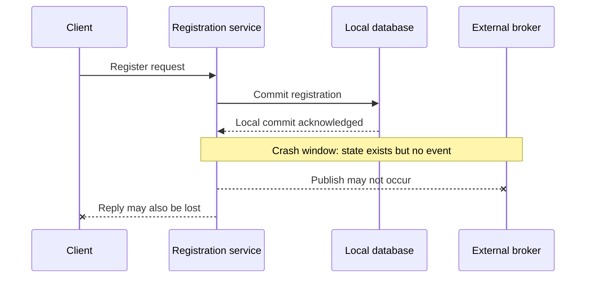
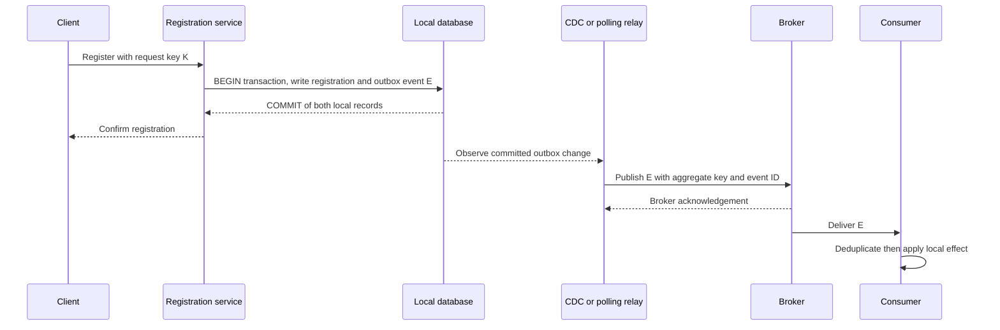
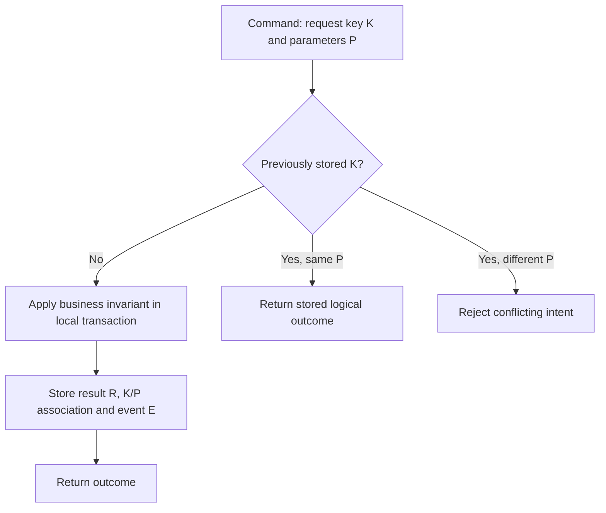
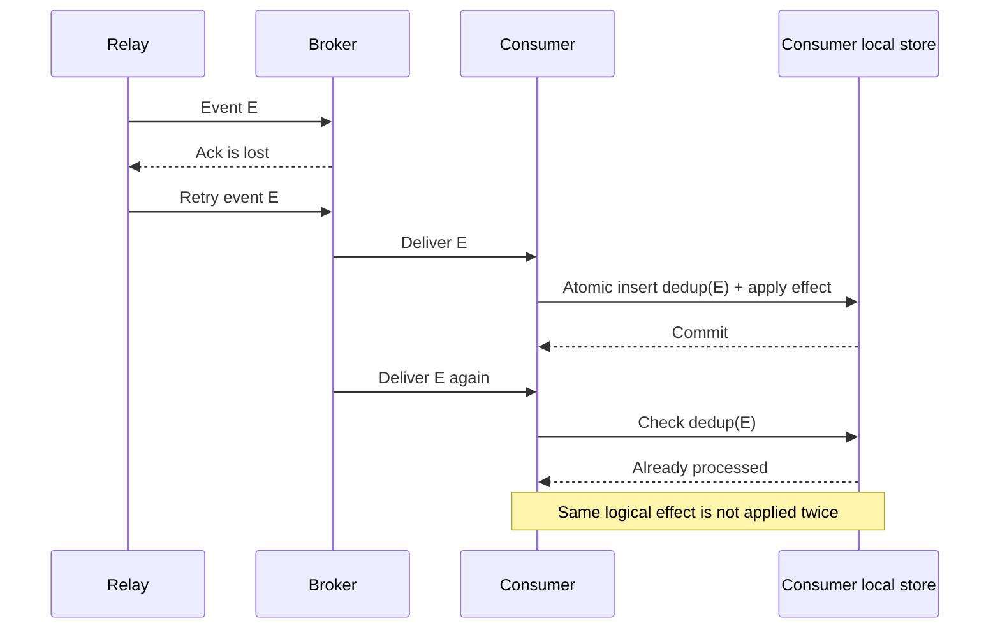

# Local transaction, outbox publication and duplicate side effects

> Tycho evidence-backed technical pilot, [#39](https://github.com/rouslanbaranov/tycho/issues/39); proposed owners V04/C04–C05. Source inspection: **2026-10-18**. Status: original technical explanation with specifically inspected public-source passages, **not** a running integration, verified production guarantee or independent human review.

## Purpose and mission

A user command can commit durable state locally while external notification, event delivery and reply transmission fail independently. This page explains where atomicity ends, how the **transactional outbox** moves the boundary, and why duplicate effects must be controlled by the consumer even when publication is reliable.

**Primary question:** What guarantees can a local state transaction, an outbox record and a downstream event consumer actually enforce—and which end-to-end guarantees still require application-level identity, ordering and reconciliation?

**Read route:** state ownership → local atomic transaction → event relay → ambiguous retries → consumer idempotency → failure/recovery evidence → alternatives and unknowns. Load/queue math belongs to [the queueing chapter](../volumes/v07/c01/queueing-littles-law.md).

## 1. Boundaries: why the naive dual write is unsafe

Imagine a **completely synthetic** workshop registration service. A user asks to register for a workshop; the registration service stores a confirmed registration in its database and sends a notification to another component.

The naive design is two independent effects:

1. Commit a database record.
2. Publish an event to an external broker.

Without an independently established cross-system atomic transaction, a failure between the two steps may leave a committed registration without its notification. Reversing the order creates the converse risk: a consumer can see an event for a registration that never committed. Neither REST success nor broker acknowledgement alone proves the pair committed atomically.

Text alternative: a local commit can succeed, after which both external publication and the client response can independently be lost. This is a **synthetic failure timeline**, not an observed defect.

## 2. Local transaction plus outbox: the changed atomic boundary

Write both the *business state* and a new *outbox event record* in a **single local database transaction**. The intended invariant is:

> If this transaction commits, the stored business update and its outbox intent exist together; if it aborts, neither change from that transaction is visible as committed state.

This rests on the specific database transaction and schema/enforcement conditions, not on a broker or an SMT. PostgreSQL 17 transaction isolation and transaction-control documentation describe the local transaction boundary; the Debezium 3.6 Outbox Event Router documentation specifies how committed outbox changes may be transformed and routed downstream. [E01, E02]

Text alternative: the registration and outbox rows commit together in the application's database. Publication and consumption happen later through a distinct relay and broker; there is **no global transaction** spanning these systems. The depicted replies are nominal events; lost responses and duplicate delivery are analyzed below.

### Record identity must be scoped correctly

A minimal **conceptual, original** outbox design tracks:

| Field | Responsibility | Consequence of omission or misuse |
|---|---|---|
| `event_id` | Unique immutable identity for a specific event, useful as a deduplication key | Duplicate replays may trigger the same effect twice |
| `aggregate_id` | Identity of the underlying business object; broker partition key where ordering of that object's events matters | Wrong partition key can weaken per-aggregate ordering assumptions |
| `event_type` / `schema_version` | Explicit change meaning and consumer compatibility | Mixed-version consumer may misinterpret payload |
| `payload` | Event data, not a replacement for authoritative source-of-truth reads | Sensitive data or stale state can leak or be mistaken for authority |
| `created_at` / position | Helps freshness, lag and replay diagnostics | Operators cannot easily distinguish pending work from vanished notification |

Debezium **3.6** documents default fields named `id`, `aggregatetype`, `aggregateid`, `type`, and `payload`. Its example routes by aggregate type, uses aggregate ID as a message key, and places unique event ID in a header; the actual field names and options are version-specific. This chapter's conceptual fields are not a verbatim source schema. [E02]

**Important:** an outbox is not an automatically enforced business invariant. If two registration transactions can independently over-allocate a final seat, recording each event atomically **does not repair that correctness problem**. Capacity correctness requires a suitable local concurrency/constraint protocol and separately tested invariant.

## 3. Identity across retries, messages and consumers

At least three identities are needed and should not be conflated:

- **Client request key K:** expresses a user's logical intent to repeat *the same command* after an ambiguous response. Scope it by principal/tenant and operation, bind it to immutable request parameters, persist outcome where necessary, and document expiry. Reject same-key/different-intent reuse.
- **Business entity ID R:** identifies the durable registration. Multiple event types can relate to one registration.
- **Event ID E:** identifies an immutable committed publication intent. Re-delivery of the same event keeps its identity E; a new legitimate change gets a new event identity.

HTTP RFC 9110 §9.2.2 distinguishes method-level idempotence from arbitrary retries. The public AWS Builders' Library article **Making retries safe with idempotent APIs**, specifically *Retrying and side effects*, *Retries and semantic equivalence*, *Late arriving requests*, and *Same client request ID, different intent*, describes request-token semantics and parameter mismatch handling. These are useful design evidence but do not define a universal API contract for every service. [E03, E04]

Text alternative: on first execution, the service commits business state and its request identity/outcome. Repeating the same key/intent recovers that result; reusing the key for a different command is rejected. **All nodes are a proposed synthetic design contract**, not an implemented API.

A request key is not sufficient merely because it is supplied in HTTP. The lookup and creation must be mutually safe under concurrent identical requests; choose a database uniqueness/locking strategy and test it. Do not claim key expiry is safe without aligning it with client retry horizon, business retention and late-arrival policy.

## 4. Failure and recovery matrix

| Failure timing | Committed state / outbox | External event / user-visible effect | Recovery contract / evidence required |
|---|---|---|---|
| Before commit | Neither should commit in the proposed local transaction | No authoritative successful registration | Verify transaction rollback and uniqueness/seat invariant |
| After local commit, before reply | Both may exist; client sees timeout | Client cannot infer whether registration succeeded | Retry with same K and recover committed R; prove no duplicate R |
| After commit, before relay publication | Both exist, broker may know nothing | Notification delayed; local registration remains authoritative | Recover relay and observe persisted pending event/CDC position; bound lag |
| After broker accepts but relay loses acknowledgement/progress | Commit and outbox exist; broker may already contain E | Replay can result in another delivery | Retain same E; prove consumer application deduplication |
| Consumer commits side effect then loses acknowledgement | Source event is available for redelivery | Reapplication risk | In one consumer-side transaction couple dedup marker with local effect, or document a tested alternative |
| Two distinct events for same aggregate reorder | Both events are legitimate and different | Consumer may apply stale update after newer update | Choose partition key/order contract, version check or reconciliation; do not assume global order |
| Schema/producer upgrade overlaps older consumers | Committed event format may be unreadable | Poisoned/retried messages and lag | Version compatibility tests, stop/go checks and safe replay plan |

The fourth and fifth rows show why **at-least-once delivery plus consumer idempotency** is a practical contract to investigate. A broker's producer idempotence or transactions—where provided in an exact version and configuration—cannot silently make an unrelated consumer's external database side effect globally exactly once.

### Duplicate delivery as a sequence

Text alternative: the same event might reach a consumer twice after an ambiguous acknowledgement. A **proposed** atomic consumer deduplication marker and side effect makes the second delivery a no-op. This property requires actual database constraints, transactionality, test conditions and key retention—it is not bestowed by the diagram.

## 5. Options and when the extra components are unwarranted

| Option | Fits when | Risks / evidence before choosing |
|---|---|---|
| **Local transaction + CDC outbox** | Database owns state; downstream events needed; change capture and connector operations are supported | Logical decoding/connector lag, retention slots, schema evolution, compatibility, infrastructure/operational burden |
| **Local transaction + polling outbox** | A controlled relay can atomically claim/scan queued rows under declared DB semantics | Poll interval/throughput, concurrency claims, duplicate publish, cleanup and DB load |
| **Direct synchronous downstream call** | Simpler bounded feature; transient coupled failure may be acceptable; no durable publish requirement | Response coupling, ambiguous remote side effects, retry safety and availability |
| **Single local modular boundary** | Both consumers can act inside one reliable local transaction; independent deployment isn't necessary | Organizational coupling and bounded capacity must be measured, not assumed |
| **Distributed transaction protocol** | Exact resources and failure/coordination semantics demonstrably support it | Added coordinator availability/operational cost and incompatibility with arbitrary external systems |

Avoid using an outbox only because events are fashionable. If no reliable external change notification is needed, local synchronous operations or a modular design can be simpler. If the source database has no usable atomic transaction guarantee, this exact outbox model's central invariant does not hold without another mechanism.

Debezium's SMT routes transformed events; it does not by itself determine consumer semantics, guarantee no duplicate external effects or provide a business-level reconciliation policy. On the data side, an outbox record can become stale or unavailable due to retention, slot failures or operational errors. Use real connector documentation and tests before asserting any particular recovery behavior.

## 6. Observability and validation design

Meaningful, architecture-relevant instrumentation distinguishes the boundaries:

- **Local invariant:** registration uniqueness/capacity constraint violations, transaction aborts, duplicate request-key conflicts, number of stored accepted outcomes.
- **Publisher health:** age of oldest eligible outbox entry, relay/CDC lag, connector health, publish attempts vs acknowledged outputs, retries and dead-letter/reconciliation backlog.
- **Consumer behavior:** unique event IDs processed, duplicate IDs ignored, consumer-side transaction failures, replay recovery and event-age distribution.
- **User outcomes:** confirmed registrations independent of notification latency, ambiguous timeouts, idempotent retry success, genuinely rejected business requests.
- **Consistency:** compare accepted registrations, event records and processed side effects under a declared reconciliation procedure and time window.

These are **recommended measurements**, not metrics that already exist in Tycho. A synthetic test plan should inject each failure point, preserve event IDs across relay restart, use concurrent same-key requests, verify stored outcome after a lost HTTP reply, replay duplicate broker messages and validate mixed-schema reading.

The experimental outcome must include actual recorded configuration/version, timeline, counts, lag and invariants. A green unit test without broker/database integration does not prove cross-system correctness.

## 7. Source-to-claim ledger and provenance

Sources below were read in their **named sections on 2026-10-18**. They were admitted earlier in the Tycho public inventory. Their published statements are evidence of documented behavior **within the cited version/scope**, not independent performance reproduction. No private or paid source and no copied example schema is used.

| Evidence | Primary public source and version | Actual inspected scope | Supports / limitations |
|---|---|---|---|
| E01 | [PostgreSQL 17 transaction isolation](https://www.postgresql.org/docs/17/transaction-iso.html) and [BEGIN](https://www.postgresql.org/docs/17/sql-begin.html) | Transaction isolation levels, BEGIN transaction boundary | Local DB transaction isolation semantics, not a global broker+DB atomicity guarantee |
| E02 | [Debezium 3.6 Outbox Event Router](https://debezium.io/documentation/reference/3.6/transformations/outbox-event-router.html) | Outbox pattern; Basic outbox table; Basic configuration; event ID/key/payload and selective SMT predicates | Product-specific outbox routing assumptions; no automatically deduplicated business side effects |
| E03 | [RFC 9110, §9.2.2, Idempotent Methods](https://www.rfc-editor.org/rfc/rfc9110.html#section-9.2.2) | Definition, automatic retry meaning and method semantics | Method-level protocol behavior, not a universal idempotency-key implementation |
| E04 | [AWS Builders' Library, Making retries safe with idempotent APIs](https://aws.amazon.com/builders-library/making-retries-safe-with-idempotent-APIs/) | Retrying and side effects; semantic equivalence; late arrival; same token/different intent | Author's API design considerations, not proof of a local registration system |
| E05 | [PostgreSQL 17 Write-Ahead Logging](https://www.postgresql.org/docs/17/wal-intro.html) | WAL introduction | Local durability mechanism context, not evidence of actual configured fsync, backup or recovery performance |

**Not claimed:** Kafka version-specific exactly-once behavior or actual CDC end-to-end guarantees, which would require separately version-pinned testing. We do not infer them from a generic Kafka homepage.

## 8. Decision boundary

**Insufficient-evidence example:** "Can an event published by our app never cause a double external payment, given that we have an outbox?" Answer: **not proven**. Need the payment provider's idempotency and reconciliation contract, event-ID retention, consumer transaction semantics, retry/timeout horizon, version/configuration and replay experiments. Merely adding an outbox proves nothing about this external effect.

**Next scope:** [#40 rollout, schema compatibility and recovery](https://github.com/rouslanbaranov/tycho/issues/40). That pilot owns upgrade/coexistence risk and irreversible transition paths; this chapter owns source-state/event publication and duplicate-effect boundaries.
