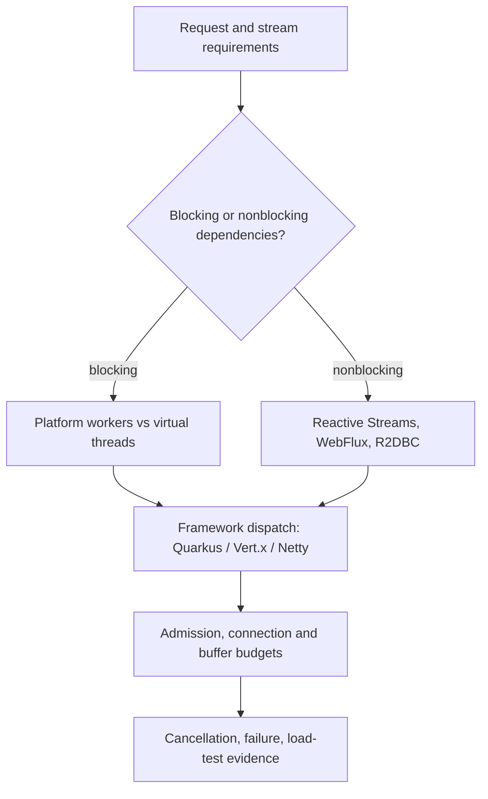

# Java concurrency and execution models

> **Status:** six bounded public-source-grounded research pages for [Issue #82](https://github.com/rouslanbaranov/tycho/issues/82). Versions, exact source sections and access limits are recorded per page. These are original technical drafts, not a completed runtime architecture volume or measured framework comparison.

## Purpose and mission

Choose a Java execution model from request/stream semantics, blocking boundaries, downstream capacity, cancellation and workload—not from a blanket assertion that reactive code or virtual threads are faster. Keep the JVM version and library release visible when explaining carrier pinning or execution dispatch.

Text alternative: begin with API and dependency semantics. Compare platform/virtual execution for blocking code, or reactive composition for end-to-end nonblocking clients. Then inspect the concrete framework dispatch and shared resource limits, followed by failure and load-test evidence. No path is a universal winner.

## Canonical reading route

| Question | Page | Primary versioned evidence |
|---|---|---|
| Who owns a spawned task, and how do cancellation, task scopes and pooled resources interact? | [Threads, tasks and structured coordination](../volumes/v03/c01/threads-tasks-structured-coordination.md) | V03/C01; Java 25 preview API, executor best-effort interruption and fictional test plan |
| When are unary, client/server/bidirectional streams and durable jobs appropriate? | [Asynchronous APIs, streaming and cancellation](../volumes/v03/c04/asynchronous-apis-streaming-and-cancellation.md) | V03/C04; gRPC/Reactive Streams public contract, no client/server test |
| How do bounded platform executors differ from virtual-thread-per-task, and what changed in JDK 24 pinning? | [Platform threads, executors and virtual-thread capacity](../volumes/v03/c02/platform-threads-executors-and-virtual-threads.md) | OpenJDK JEP 444 / JDK 21, JEP 491 primary review / JDK 24, Spring Boot 3.3.13 |
| What do Reactive Streams demand, Reactor scheduling/context, WebFlux and R2DBC actually guarantee? | [Reactive execution, WebFlux, R2DBC and backpressure](../volumes/v03/c03/reactor-webflux-r2dbc-and-backpressure.md) | Reactor 3.7.0, Spring Framework 6.2, R2DBC SPI 1.0.0.RELEASE |
| Where do Netty, Vert.x, Quarkus, Mutiny and RxJava schedule handlers and preserve ordering? | [Java framework execution boundaries](vertx-netty-quarkus-mutiny-and-rxjava.md) | Netty 4.x guide, Vert.x 4.4.9, Quarkus 3.27, Mutiny 2.9.0, RxJava v3.1.9 |
| How do we distinguish CPU, GC, heap/native memory, lock and I/O bottlenecks? | [CPU, memory, GC and blocking diagnostics](../volumes/v03/c06/cpu-memory-gc-and-blocking-diagnostics.md) | Java 21 G1 tuning, JDK 25 JFR/jcmd, open-source async-profiler; synthetic diagnosis, no recorded runtime evidence |

## Adjacent canonical research

- [Queueing and capacity](../volumes/v07/c01/queueing-littles-law.md) — arrival rate, residence time, in-flight work and overload.
- [Kafka ordering and consumer contracts](../volumes/v04/c07/kafka-partitions-replication-and-contracts.md) — message partition and effect ordering, independent of Java scheduling.
- [Outbox and idempotency](../distributed/transactional-outbox-and-idempotency.md) — retry/commit ambiguity.
- [Application boundaries](../application/README.md) — why module and service ownership precede execution optimization.

## Unresolved and verification boundaries

No application was built, compiled, load-tested or traced for these chapters. Exact framework/driver configuration, JDK 21-vs-24 JFR captures, end-to-end cancellation, connection acquisition, real p99 and event-loop stall behavior require reproducible tests. The JEP 491 canonical body could not be fully fetched; its cited primary implementation discussion and release notice are distinguished from a full reading. Netty's guide is only major-version-scoped. Search/MCP delivery and independent human review are not outputs of this issue. The hand-curated Tycho knowledge graph has been explicitly removed from the product scope; graph data systems can still be covered as educational subject matter.

The [proposed structure](../PROPOSED-STRUCTURE.md) remains the corpus-wide coverage plan; this landing links only to implemented pages.
