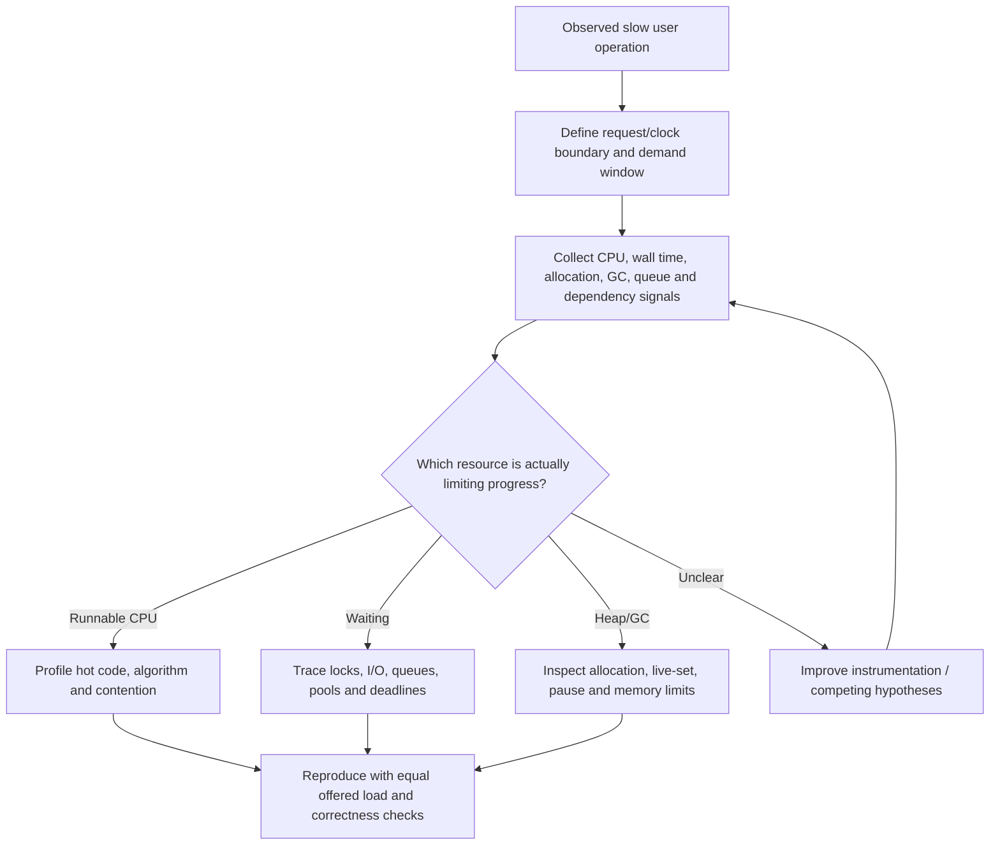

# CPU, memory, garbage collection and blocking: an evidence-first diagnosis

> **Tycho draft chapter V03/C06**, independently researched from public JDK and profiling documentation on 2026-10-19. Synthetic symptoms and decision experiments only. No process profiling, benchmarking, production recording or independent technical review has been executed for this page.

## Purpose and mission

A slow Java service may be limited by CPU execution, heap allocation and garbage collection, native memory, thread/executor contention, blocking I/O or a saturated dependency. The same user-visible latency curve can arise from each of these causes. **Thread count, low CPU utilization and heap occupancy are observations—not diagnoses and not automatic evidence for reactive programming, virtual threads or a new garbage collector.**

The central task is to identify **where elapsed time is spent**, which resource is saturated, and what evidence would falsify the leading cause. This chapter introduces a reproducible symptom-to-mechanism diagnostic workflow. The execution-model chapters own the mechanisms of [platform/virtual threads](platform-threads-executors-and-virtual-threads.md), [reactive backpressure](reactor-webflux-r2dbc-and-backpressure.md), and [event loops and frameworks](vertx-netty-quarkus-mutiny-and-rxjava.md). [Queueing](../performance/queueing-littles-law.md) and [tail latency](../performance/tail-latency-fanout-and-deadline-budgets.md) own request-level inference.

## 1. Divide wall-clock latency before selecting a remedy

A request's elapsed time may include:
- waiting to be admitted to a queue/executor and waiting to borrow a connection;
- actually running application instructions on a CPU;
- waiting for locks, network, disk or an external API;
- pauses or scheduling delays from JVM/runtime/OS behavior;
- response serialization and delivery.

A CPU profile mainly attributes **CPU-running sampled time**; it does not by itself show all waiting. Wall-clock samples can show blocked and sleeping stacks, with their own measurement biases. A distributed trace provides time bounds for instrumented spans, but does not automatically distinguish CPU use from a blocked socket or missing spans. Avoid inferring the location of a resource bottleneck from an end-to-end p99 alone.

**Text alternative:** define the user-visible slow operation, correlate resource signals in the same workload window, distinguish running versus waiting and memory behavior, then perform a controlled comparison without losing correctness guarantees.

## 2. Working symptom matrix

| Measured symptom | Possible cause (hypothesis) | Discriminating evidence | Unsafe shortcut |
|---|---|---|---|
| One CPU core saturated; large wall wait elsewhere | Serialized hot function or lock owner | Per-thread CPU stacks, lock owner, thread scheduling and request correlation | Add dozens of threads and assume useful parallelism |
| Low CPU, rising request queues and pool waits | Remote I/O or connection capacity | Connection acquisition time, downstream saturation, timeout/retry events | Switch execution model without fixing dependency ceiling |
| Sudden synchronous pauses | GC stop-the-world phase or safepoint delay | JFR/GC pause times aligned to latency spikes | Change garbage collector based only on a p99 graph |
| Heap increases throughout the run | Allocation growth, retained live objects or changed workload | Allocation profile, live-set after comparable collections, input/state cardinality | Increase Xmx indefinitely without leak hypothesis |
| Resident process memory grows while Java heap seems flat | Native allocations, thread stacks, direct buffers, memory-mapped resources | Native memory accounting/container limits, allocation sources | Assume heap GC controls all process RSS |
| Bursty tail under peak arrivals | Waiting/backlog and retry amplification | Offered/admitted/completed rates, queue age and retries per logical operation | Blame garbage collection without temporal evidence |
| Virtual-thread count is high | Many lightweight tasks, possibly waiting | Carrier scheduling, blocking/pinning diagnostics under the specific JDK | Treat task count as equivalent to OS thread count |

This table is a list of **hypotheses to test**, not a decision procedure that guarantees a diagnosis from one metric.

## 3. Java heap is only one memory domain

The JVM heap stores managed objects, but overall process memory may also include thread stacks, native libraries, direct buffers, memory mappings, JIT/compiler and runtime structures. A container can exceed its physical or configured memory limit even if recorded heap occupancy appears acceptable.

A high allocation rate can be harmless if objects die young and collection work fits the resource budget; a small allocation rate can still cause a persistent live-set leak. Heap **used before collection** is not a sufficient leak indicator. Compare live data after comparable collection points, object lifetimes, retention roots and request mix. Large allocation profiles may reflect high-throughput normal paths, not retained data.

[Oracle Java 21 G1 documentation](https://docs.oracle.com/en/java/javase/21/gctuning/garbage-first-g1-garbage-collector1.html) describes mostly concurrent G1 collection and its probabilistic pause-time goal, rather than hard pause guarantees. [G1 tuning documentation](https://docs.oracle.com/en/java/javase/21/gctuning/garbage-first-garbage-collector-tuning.html) distinguishes throughput-versus-pause trade-offs and conditions associated with full collection. A collector's default and tuning controls are version-specific. Do not assume identical semantics in a different JDK release or vendor runtime.

**Trade-off:** reducing GC pause duration can use more concurrent CPU or memory headroom; maximizing throughput can worsen individual response pauses. The user journey, offered workload, allocation rate, real live-set and latency distribution determine what to optimize—not a universal GC flag.

## 4. What the actual diagnostic tools prove

[JDK Flight Recorder (JFR) and Mission Control](https://docs.oracle.com/en/java/javase/25/troubleshoot/diagnostic-tools.html) support timestamped JVM events on configured runtimes. The [JDK 25 jcmd manual](https://docs.oracle.com/en/java/javase/25/docs/specs/man/jcmd.html) documents supported diagnostics and their possible impact. Only issue exact tool commands after confirming JVM vendor, version, access, safe recording policy and expected overhead.

The independent open-source [async-profiler](https://github.com/async-profiler/async-profiler) documents CPU, allocation, lock and native/wall-clock profiling modes. Its [profiling modes guidance](https://github.com/async-profiler/async-profiler/blob/master/docs/ProfilingModes.md) distinguishes sample sources and warns that collecting everything continuously can be inappropriate. A CPU flame graph can point to hot functions; it cannot prove request critical path, end-to-end correctness or cause of waiting without correlated evidence.

| Instrument | Evidence it can help produce | Limitation to record |
|---|---|---|
| End-to-end request trace | Parent and instrumented span durations; dependency correlation | Uninstrumented waits, sampling and clock boundaries may hide work |
| CPU sampling profile | Code executing on CPU across sampled stacks | Missing waiting states or low-frequency intermittent events |
| Wall-clock stack sampling | Running and blocked stacks in a time window | Sampling overhead, thread grouping and signal/runtime limits |
| Allocation profile | Sources and approximate volume of allocations | Does not itself identify retained live-set or leak |
| JFR/GC event records | Pause timing, allocation and runtime events by configured event set | Disabled events, inaccessible data or sampling may omit causal context |
| Thread dump / lock diagnostics | Contention candidates, stack snapshots and lock ownership | Instantaneous snapshot cannot establish prevalence |
| OS/container accounting | CPU quota, memory limit, page faults, scheduling signals | Process metrics alone cannot locate application effect or business success |

Always compare timestamps for the **same load window**. A recording from an idle, already warmed service cannot validate the behavior of a cold-start peak.

## 5. Original synthetic failure: the misleading virtual-thread fix

Invent a web application that accepts 200 attempted requests/s. The first team hypothesis is “platform threads are blocking, so switch to virtual threads.” The actual limiting condition is unknown. Suppose a *hypothetical* dependency can execute only 60 concurrent queries, and each query becomes slower as active DB connections increase.

- Replacing platform threads with virtual threads may allow far more simultaneous waiting tasks at lower thread overhead. It does **not** give the DB more query capacity.
- Increasing the JDBC pool may raise database contention, reduce throughput and enlarge request tails.
- Reducing connection hold time, adding bounded admission, reducing query cost or fixing a lock can be more effective **if the measured data supports those causes**.
- If the real workload is CPU-bound, adding concurrency alone can merely add scheduling and contention; use CPU hot-path profiling rather than an I/O-oriented execution model argument.

The hypotheses would be falsified by a correlation matrix at fixed **offered** rate and data contents: service/pool wait, CPU running fraction, query time distribution, DB saturation and completed legitimate outcomes. Without these readings, “virtual threads solved performance” would be a fictional assertion.

### An incident chronology worth collecting

1. Record offered arrivals, retries and user-visible success/failure in the degradation window.
2. Record node/container CPU use versus limits and throttling; separate process RSS and Java heap.
3. Align per-request/span latency, queue/pool waits, GC pause timestamps and runtime thread state.
4. Capture a bounded profile with the right permissions and safety controls; prevent sensitive data disclosure.
5. Form at least two rival hypotheses; test the least risky reversible intervention under equivalent load.
6. Assert business correctness and recovery, not only smaller p99, before approving a change.

A change that lowers p99 by rejecting unobserved requests or weakening data correctness is not a performance success.

## 6. How to choose the next experiment

| Hypothesis | Small, falsifiable experiment | Correctness gate |
|---|---|---|
| CPU code is expensive | Profile hot path; vary algorithmic workload at fixed data and arrivals | Identical output and error outcomes |
| Pool wait dominates | Measure acquisition/call time; adjust admission before connection ceiling | No duplicate/omitted effects, no backend exhaustion |
| GC is dominant | Correlate GC pause with user traces, allocation and live-set; modify one supported knob in isolated environment | No memory exhaustion or hidden latency regression |
| Native memory is leaking | Reconcile RSS/native allocations with buffer/thread lifetimes and workload state | Memory remains bounded and recovered resources are reusable |
| One lock serializes work | Sample lock owners and vary concurrent keys | Enforced invariants remain intact |
| Execution model limits IO concurrency | Compare bounded platform versus virtual/reactive configurations under equal downstream capacity | Same cancellation, error and backpressure behavior |

There is no automatic threshold for selecting a different garbage collector or executor. The measured critical resource and failure semantics determine whether redesign is justified.

## 7. Evidence ledger and honesty boundary

| Public material inspected | Supported scope | Not demonstrated |
|---|---|---|
| [Oracle Java 21 G1 GC](https://docs.oracle.com/en/java/javase/21/gctuning/garbage-first-g1-garbage-collector1.html) | Collector concurrency and pause-time target semantics | Runtime characteristics of synthetic service or JDK 25 configuration |
| [Oracle Java 21 G1 tuning](https://docs.oracle.com/en/java/javase/21/gctuning/garbage-first-garbage-collector-tuning.html) | Documented pause/throughput and full-GC considerations | Any observed improvement from changing flags |
| [Oracle JDK 25 diagnostic tools/JFR](https://docs.oracle.com/en/java/javase/25/troubleshoot/diagnostic-tools.html) | Diagnostic event, Mission Control and basic tooling purpose | Actual JFR recording or data collection |
| [Open-source async-profiler usage and profiling modes](https://github.com/async-profiler/async-profiler/blob/master/docs/ProfilingModes.md) | CPU, wall-clock, allocation and lock sample distinctions | Universal cross-platform sampling completeness |

All diagrams, suspected failures, rates, experiments and recommendations for the invented workload are synthetic. No sensitive process was accessed, no profiler was run, and no real user-impact claim is supported. Independent review, version-specific runtime reproduction and full text-to-source precision checks remain open.

## Navigation

- Intended book owner: **V03/C06** in [proposed TOC](../PROPOSED-STRUCTURE.md); current section [Java concurrency and execution](README.md).
- Relevant runtime: [Platform and virtual threads](platform-threads-executors-and-virtual-threads.md); [Reactive execution](reactor-webflux-r2dbc-and-backpressure.md); [Event-loop frameworks](vertx-netty-quarkus-mutiny-and-rxjava.md).
- Cross-layer: [Connection pool budgets](../scaling/connection-pools-hikaricp-pgbouncer.md); [Queueing](../performance/queueing-littles-law.md); [Tail latency](../performance/tail-latency-fanout-and-deadline-budgets.md).

## Applied M9 evidence: what transfers and what does not

The following historical cases are **time-scoped publisher/practitioner reports**, not a Tycho benchmark or proof of a universal architecture choice. Any associated decision playbook is an **original synthetic comparison**, not a decision made by the companies cited. These cases inform the specific mechanism and contraindications above:

- **[Netflix — Generational ZGC workloads](../cases/netflix-generational-zgc-workloads.md)** illustrates gC selection depends on latency, allocation, heap and memory/cpu budgets; some workloads favor alternatives. **It cannot establish:** company-reported JDK21 observations do not prove Generational ZGC is universally best or specify another service's p99.

A different system must recheck its workload, source date, version, authority boundary and failure/recovery acceptance criteria before transferring any decision. See the case's own evidence ledger for exact public references and unresolved claims.
