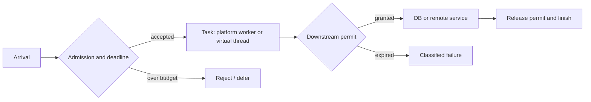
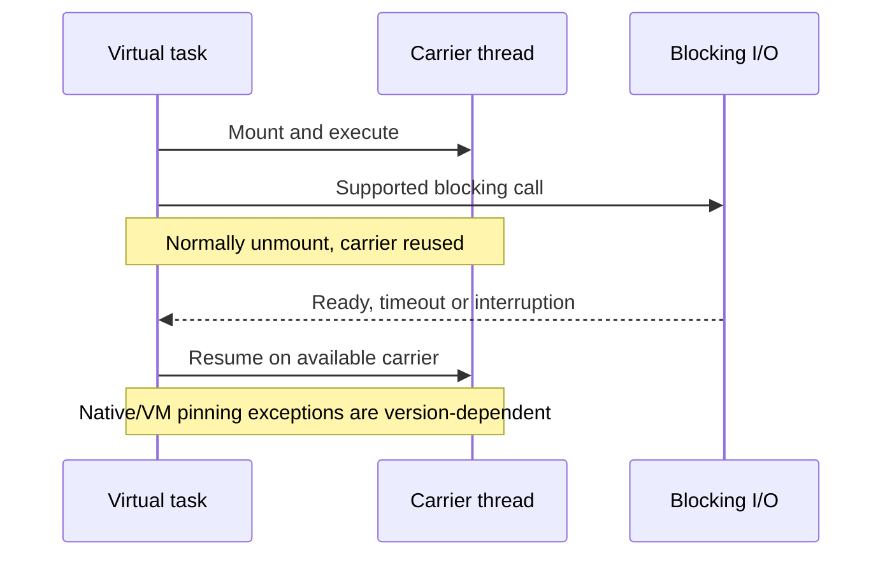

# Platform-thread executors and virtual-thread capacity

> **Tycho #82, public research inspected 2026-10-18.** Scope: OpenJDK JEP 444 (JDK 21), OpenJDK JEP 491 implementation discussion (JDK 24), Spring Boot 3.3.13. Original design reasoning and synthetic examples; no Java code was executed, no load test or independent human review occurred.

## The concurrency question

A thread is an execution resource, not a unit of business capacity. Requests can wait for sockets, database connections, locks, external APIs or CPU. Adding threads helps only while the limiting resource can accept more work. Under stable conditions Little's Law relates mean concurrency, throughput and mean residence time; see [queueing](../performance/queueing-littles-law.md). It cannot certify capacity under overload.

**Synthetic example (not measured):** at 240 completed requests/s and 250 ms mean residence time, mean in-flight work would be 60. If each request occupies a DB connection for 80 ms, mean occupied connections would be 19.2. Neither number is a safe pool size: bursts, skew, lock contention and tail latency are unknown. If a downstream service supports only 12 simultaneous operations, unlimited task submission does not create capacity.

| Execution choice | Useful property | Resource that remains scarce | Failure risk |
|---|---|---|---|
| Fixed platform-thread executor | Bounds concurrently executing blocking tasks | Worker threads, queue, downstream connections | Worker exhaustion, queue delay, rejection |
| Virtual thread per accepted task | Waiting tasks generally release carrier threads | Heap, external connections, request state, CPU | Unbounded accepted tasks and downstream overload |
| Event-loop/async execution | Multiplexes nonblocking I/O on few threads | CPU per callback, demand buffers, connection pools | A blocking callback stalls unrelated work |

OpenJDK JEP 444 says virtual threads are not faster at CPU work, should **not be pooled**, and are suitable for high-concurrency mostly waiting workloads. They are scheduled onto a smaller number of carrier platform threads. JDK-supported blocking operations can park the virtual thread and release its carrier. [E01]



Text alternative: requests first pass a bounded admission gate. Accepted tasks execute under one of the thread models and separately acquire a permit for each scarce dependency. A failed permit acquisition is visible as a timeout or rejection; the execution model alone does not enforce the dependency limit. This is a proposed architecture, not a traced implementation.

## Platform pools, queues and deadlines

A fixed platform pool bounds active blocking tasks but not waiting submissions unless its queue is also bounded. A queue can make latency worse even while the system reports few immediate errors. The deadline must include admission, executor queue wait, connection acquisition, execution and response transfer. Do not hold a database connection while waiting for unrelated network work. A rejection policy is part of the public service contract: retryable overload must be distinguished from uncertain committed effects.

Platform workers remain a simple choice for moderate concurrency and mature synchronous libraries. Neither fixed thread count nor CPU-core multiplier is universally correct: derive it from observed wait/compute fractions, heap, downstream budgets and load-test behavior.

## Virtual threads: tasks are cheap; operations are not

JDK 21 introduced `Thread.ofVirtual()` and `Executors.newVirtualThreadPerTaskExecutor()`. Each accepted request can keep a readable sequential call stack. A virtual thread blocked on supported I/O normally unmounts, but it can still retain heap state, locks and a leased DB connection. The carrier scheduler is not a backpressure mechanism. [E01]

```java
// Illustrative Java 21+ policy fragment, NOT a complete server.
// Gate accepted request count BEFORE submitting tasks.
Semaphore dbPermits = new Semaphore(12);
try (var executor = Executors.newVirtualThreadPerTaskExecutor()) {
    for (Request request : admittedRequests) {
        executor.submit(() -> {
            if (!dbPermits.tryAcquire(request.remainingMillis(),
                    TimeUnit.MILLISECONDS)) {
                throw new CapacityRejectedException();
            }
            try {
                return queryWithDeadline(request);
            } finally {
                dbPermits.release();
            }
        });
    }
}
```

This fragment deliberately omits definitions, exception mapping, interruption handling, and partial-commit recovery. **Important:** a semaphore inside unlimited submissions bounds DB calls but not the number of virtual threads waiting for permits. Use admission before task creation when pending work and memory must also be bounded. A virtual-thread executor's lifecycle must be tied to shutdown and deadline policies.

## Pinning depends on the JDK release

**JDK 21–23:** JEP 444 documents carrier pinning when a virtual thread blocks inside a `synchronized` region or native/foreign method. Long, frequent pinned waits can exhaust carriers. It describes `jdk.VirtualThreadPinned` JFR events and the historical `jdk.tracePinnedThreads` diagnostic. In-memory short monitor sections do not by themselves require replacement. [E01]

**JDK 24+:** JEP 491's OpenJDK implementation review describes monitor changes allowing virtual threads to unmount while holding a monitor, waiting to enter a monitor, and using `Object.wait()`. That specifically supersedes the blanket JDK 21 warning about blocking under `synchronized`. Native/foreign and exceptional VM paths still require diagnosis. The implementation discussion qualifies legacy locking mode; verify the exact JDK build and flags. The canonical [JEP 491](https://openjdk.org/jeps/491) text was not fully accessible in this research environment; the claim is based on the [primary OpenJDK review](https://mail.openjdk.org/pipermail/core-libs-dev/2024-November/134177.html) and [JDK 24 targeting announcement](https://inside.java/2024/11/15/jep491-target-jdk24/), not a purported full read of JEP 491. [E02, E03]


Text alternative: a virtual task temporarily uses a carrier. Supported blocking I/O normally frees the carrier until completion. JDK 21 monitor pinning differs from JDK 24 behavior; the diagram does not promise unmounting for every native library.

## Cancellation, context, failures

Interruption is a cancellation request, not a transaction rollback. A client can time out after the server committed an external effect. Retrying requires an idempotency identity and reconciliation, as explained in [outbox/idempotency](../distributed/transactional-outbox-and-idempotency.md). Propagate deadline and cancellation through executor queue, permit acquisition, driver operations and remote calls. Record what happens if each layer ignores cancellation.

JDK 21 virtual threads support thread locals, but caching one costly connection per short-lived thread is not a safe resource strategy. Test logging and tracing context propagation across async boundaries; clear sensitive context at task completion. Monitor task counts, JFR pin events, carrier availability, queue time, connection waits, CPU, heap, p95/p99 and rejected work before asserting improvement.

## Spring Boot 3.3.13 mapping

Spring Boot 3.3.13 documents `spring.threads.virtual.enabled=true` on Java 21+, changing its auto-configured `AsyncTaskExecutor` to a virtual-thread-backed `SimpleAsyncTaskExecutor`; without that property it uses a `ThreadPoolTaskExecutor`. Documented integrations include `@EnableAsync`, MVC asynchronous request processing and WebFlux blocking execution support. Custom executor beans can alter the outcome; this property alone does not prove every request, JDBC operation or scheduled task uses virtual threads. [E04]

For a migration, inspect actual executors and drivers, then compare equivalent arrival distributions and dependency limits. Reverse a virtual-thread decision if CPU saturation, native pinning, memory retention or downstream contention dominate. Prefer the simplest model that meets a measured SLO, not the model with the largest synthetic task count.

## Evidence and status

- **[E01] Published primary specification, JDK 21:** [OpenJDK JEP 444](https://openjdk.org/jeps/444), *The thread-per-request style*, *Implications of virtual threads*, *Scheduling virtual threads*, *Executing virtual threads*, *JDK Flight Recorder*. Supports execution/pinning contracts, not local throughput.
- **[E02] Primary JDK 24 implementation review:** [OpenJDK core-libs-dev review, 2024-11-06](https://mail.openjdk.org/pipermail/core-libs-dev/2024-November/134177.html), *Summary of changes*, *Unmount virtual thread while holding monitors*. Does not prove application-level freedom from pinning.
- **[E03] Primary JDK 24 release target:** [inside.java notice, 2024-11-15](https://inside.java/2024/11/15/jep491-target-jdk24/). Only confirms the targeted JDK release.
- **[E04] Published Spring Boot 3.3.13 documentation:** [Task Execution and Scheduling](https://docs.spring.io/spring-boot/3.3/reference/features/task-execution-and-scheduling.html), *Task Execution* and *Task Scheduling*. Framework documentation, not a runtime test.

**Research state:** named primary sections inspected; diagrams and workload invented. **Not performed:** compilation, JFR capture, load testing, actual Spring configuration testing, full JEP 491 body inspection or independent human review.

## Applied M9 evidence: what transfers and what does not

The following historical cases are **time-scoped publisher/practitioner reports**, not a Tycho benchmark or proof of a universal architecture choice. Any associated decision playbook is an **original synthetic comparison**, not a decision made by the companies cited. These cases inform the specific mechanism and contraindications above:

- **[Netflix — Java platform convergence](../cases/netflix-java-platform-convergence.md)** illustrates separate GraphQL composition and Java platform modernization; staged compatibility changes coordination ownership. **It cannot establish:** the historical talk and later abstract do not establish a universal RxJava-versus-Spring performance ranking or identical fleet versions.
- **[Netflix — Java 21 virtual-thread pinning](../cases/netflix-java21-virtual-thread-pinning.md)** illustrates jDK21 monitor-related carrier starvation makes tracing/instrumentation part of concurrency acceptance. **It cannot establish:** an observed JVM incident is not a general virtual-thread failure rate and must not be extrapolated unchanged to later JDKs.

A different system must recheck its workload, source date, version, authority boundary and failure/recovery acceptance criteria before transferring any decision. See the case's own evidence ledger for exact public references and unresolved claims.
