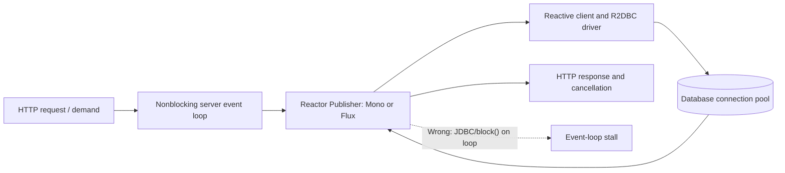
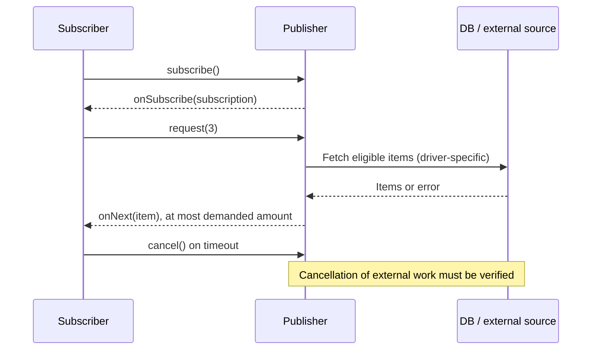

# Reactive execution, WebFlux, R2DBC and backpressure

> **Tycho #82; research inspected 2026-10-18.** Canonical question: when does a nonblocking reactive chain improve a service, and which guarantees survive a database, queue or HTTP boundary? Scope: Reactor Core **3.7.0**, Spring Framework **6.2** reference, R2DBC SPI **1.0.0.RELEASE**. No running Spring application, driver, benchmark or independent review is claimed.

## 1. Nonblocking I/O is an end-to-end contract

An event-loop server multiplexes many I/O operations across a small number of threads by returning promptly when an operation cannot complete. A callback or reactive continuation resumes later. If an application blocks an event loop while waiting for JDBC, a mutex or an HTTP response, it prevents unrelated operations assigned to that loop from progressing. Spring's WebFlux 6.2 documentation distinguishes the small event-loop execution assumption from MVC's larger blocking-worker assumption. [E01]

Reactive programming does **not** automatically mean parallel execution, faster computation, a durable queue, or a stronger transaction. Spring 6.2 says nonblocking's principal potential benefit is resource efficiency under I/O waits; it cautions that a synchronous stack is often adequate when libraries and requirements are blocking. A chain can be written declaratively and still contain a blocking call. [E01]



Text alternative: a nonblocking HTTP handler subscribes to a reactive pipeline, which uses reactive clients and an R2DBC driver to reach a bounded DB pool. Response demand and cancellation flow through the chain when supported. A blocking JDBC call or `block()` on the event loop violates the model. This diagram is conceptual; it does not assert a specific Spring deployment.

## 2. Reactive Streams is demand coordination, not a magic queue

The Reactive Streams protocol links a `Publisher` and `Subscriber` through a `Subscription`. A subscriber signals demand with `request(n)`; signals include item, completion and failure. This is a flow-control boundary **only if the producer and operators respect it**. An uncontrollable upstream producer still needs a documented buffer, drop, backoff or fail policy. Spring's 6.2 *Define “Reactive”* section explicitly warns about sources that cannot slow down. [E01]

A subscriber cancelling a subscription requests that a stream stop delivering work; it does not establish that a database transaction, HTTP request or external effect was rolled back. A hot stream, non-backpressure-aware bridge or eager prefetch can still buffer data. Record where demand is converted to queue capacity and where the protocol ends.



Text alternative: after subscription, the consumer requests a finite number of items and the publisher sends no more than requested under a compliant protocol. Cancellation asks upstream to stop; whether the driver can abort already-issued work remains a separate test.

## 3. Reactor 3.7.0: scheduler choice and context

Reactor `Mono<T>` models zero or one value; `Flux<T>` models zero to many. Their creation does not start a new thread or perform the work: subscription starts a chain. By default, most operators execute on the thread delivering their signal. `publishOn(scheduler)` changes execution of subsequent operators; `subscribeOn(scheduler)` changes the subscription path upstream. Neither makes a synchronous driver nonblocking. [E02]

Reactor 3.7.0 documents `Schedulers.boundedElastic()` for wrapping unavoidable blocking operations. It bounds backing resources but still has a queue; queue saturation and expired deadlines must be measured. It also documents a Java 21+ virtual-thread-backed variant controlled by `reactor.schedulers.defaultBoundedElasticOnVirtualThreads=true`. The virtual-thread option does not transform a blocking library into an asynchronous driver or replace explicit downstream admission. Reactor forbids certain blocking APIs on its default single/parallel nonblocking schedulers. [E02]

Illustrative reactive adaptation (not compiled):

```java
// Existing synchronous client: isolate blocking work from event loop.
Mono<Result> adapted = Mono.fromCallable(() -> blockingClient.read(key))
    .subscribeOn(Schedulers.boundedElastic())
    .timeout(Duration.ofSeconds(2));

// Prefer a genuinely reactive driver for a complete nonblocking path:
// DatabaseClient ... -> Mono<Result>, with pool/deadline controls.
```

The example does not configure a finite HTTP connection pool, retry, error mapping or server cancellation. A `timeout` signal alone is not proof that the underlying blocking operation was interrupted.

Reactor `Context` is immutable per-subscriber context propagated with subscription semantics; it is not simply a thread local. In Reactor 3.7.0 the `contextWrite` placement matters: upstream operators see context supplied by downstream subscribers, and asynchronous inner sequences have their own context boundaries. A correlation ID stored only in `ThreadLocal` may disappear or leak across interleaved requests. Test tracing, authentication and logging context through `flatMap`, scheduler switches and client adapters. [E03]

## 4. R2DBC 1.0: a reactive SQL SPI, not a database guarantee

R2DBC SPI **1.0.0.RELEASE** (2022-04-25) specifies a Reactive Streams based Java interface for SQL-oriented databases. The spec's *Introduction — The R2DBC SPI* states that execution is deferred and backpressure-aware. *Compliance — R2DBC SPI Compliance* requires a nonblocking I/O layer and transaction support. The specification explicitly distinguishes required and optional driver capabilities. [E04]

R2DBC does not erase transaction isolation, SQL locks, network round trips, pool wait or DB CPU cost. A compliant SPI does not establish that every particular driver supports every feature identically, or that cancelling a reactive subscription aborts a committed transaction. Validate the concrete driver version, connection factory/pool, isolation, timeout, cancellation and error mapping against its own documentation and executable tests.

| Question | JDBC with virtual threads | R2DBC with reactive pipeline |
|---|---|---|
| Application composition | Sequential blocking calls, simple stack | Publishers and async composition |
| Waiting Java execution | Virtual thread normally parks on supported blocking I/O | Event loop generally remains available if all operators are nonblocking |
| SQL isolation and locks | Database-controlled | Database-controlled |
| Connection budget | Required | Required |
| Cancellation of in-flight query | Driver/JDK-specific | Driver/protocol-specific |
| When to prefer | Legacy blocking libraries and simple request flow | Reactive streaming, end-to-end async clients, controlled demand |
| What must be measured | Heap, carrier pinning, pool wait, p99 | Event-loop stalls, buffer growth, pool wait, p99 |

Neither column implies universally superior throughput. The **driver**, not just the return type, determines whether the network I/O path is nonblocking.

## 5. Failure, recovery and overload boundaries

Consider an **invented** API returning a stream of 10,000 records. The HTTP client requests a small batch then disconnects. The server should stop unnecessary upstream work, release its DB connection and bound any prefetched rows. A non-cancellable driver might continue an expensive query after client disconnect. If a transaction committed before the disconnect, a replayed request needs a business idempotency key. [E01–E04; design inference]

Failure matrix:

| Failure | Visible signal | Required verification |
|---|---|---|
| Event-loop blocked by a synchronous call | Rising event-loop delay and p99 | Thread dump and deliberate slow-call fixture |
| Fast producer, slow client | Demand stall or buffer growth | Buffer cap, backpressure policy, cancel tests |
| R2DBC pool exhausted | Pending acquisition and timeouts | Configured pool cap, queue wait, no leaked connection |
| Client disconnect | Cancellation signal | Query cancellation, resource release, side-effect status |
| Retry after uncertain write | Duplicate or missing business effect | Idempotency/transaction boundary and reconciliation |
| Context loss on scheduler switch | Missing/wrong trace or auth metadata | Cross-scheduler context propagation tests |

A bounded `flatMap` concurrency setting can limit the number of inner publishers, but it does not automatically bound upstream hot sources, DB pool sizes, retries or every internal operator queue. Rate-limiting, admission, and request budgets must be placed at the correct boundaries. Refer to [virtual-thread capacity](platform-threads-executors-and-virtual-threads.md) for the same resource accounting in imperative code.

## 6. Decision procedure

Begin with actual request and stream semantics: unary vs streaming, independent vs ordered items, peak arrival, maximum buffering, DB transactions, client cancellation, and dependency quotas. Keep MVC/imperative if its measured capacity and simplicity meet requirements. If streaming and demand control matter, test an end-to-end reactive path with R2DBC or another truly nonblocking driver. If existing JDBC and sequential composition are central, evaluate virtual threads before rewriting every service as Reactor.

Run **equivalent open-loop offered-load** and bounded concurrency tests; include slow DB, slow consumer, disconnect, timeouts and retries. Record completed requests, rejection, CPU, heap, queue wait, event-loop stalls, DB connections, p95/p99 and correctness. Without these observations, no performance winner can be claimed.

## Evidence ledger

- **[E01] Spring Framework 6.2 official reference:** [WebFlux — Overview](https://docs.spring.io/spring-framework/reference/6.2/web/webflux/new-framework.html), *Define “Reactive”*, *Performance*, *Concurrency Model*, *Invoking a Blocking API*. Supports nonblocking assumptions, backpressure limits and MVC comparison.
- **[E02] Reactor Core 3.7.0 official reference:** [Threading and Schedulers](https://projectreactor.io/docs/core/3.7.0/reference/coreFeatures/schedulers.html), *publishOn*, *subscribeOn*, *boundedElastic*. Supports scheduler behavior, blocking isolation and virtual-thread option.
- **[E03] Reactor Core 3.7.0 official reference:** [Adding a Context to a Reactive Sequence](https://projectreactor.io/docs/core/3.7.0/reference/advancedFeatures/context.html), *Context API*, *Tying a Context to a Flux*, *Reading a Context*. Supports per-subscriber context semantics.
- **[E04] R2DBC SPI 1.0.0.RELEASE specification:** [R2DBC specification](https://r2dbc.io/spec/1.0.0.RELEASE/spec/html/), *Introduction — The R2DBC SPI*, *Compliance — R2DBC SPI Compliance*, *Connections*, *Transactions*. Supports SPI requirements, not a concrete driver's cancellation performance.

**Research status:** inspected the cited published sections and identified untested driver-specific behavior. **Not performed:** compilation, Spring/driver integration, latency measurement, source-code audit, formal backpressure proof or independent human review.

## Engineering walkthrough — Subscriber demand does not protect an unseen blocking queue

**Original fictional streaming endpoint:** a Reactor service subscribes to a database-backed event stream and transforms updates for WebSocket clients. A downstream subscriber requests `n=1` item at a time, but a library callback invokes a blocking JDBC query on an event-loop thread and enqueues unbounded work before the publisher honors demand. The public Reactive Streams request protocol only coordinates compliant participants; it does not cap an unrelated driver pool or hidden queue.

| Boundary | Normal behavior | Fault injection / observation |
|---|---|---|
| Publisher → subscriber | Emit within recorded demand and cancellation state | Slow consumer requests zero additional items; count retained buffers |
| Scheduler/event loop | Nonblocking callbacks do brief work | Inject 200 ms blocking call; check event-loop delays of unrelated sessions |
| R2DBC/DB connections | Bounded leases and driver-specific cancellation | Close client while SQL is in flight; prove cleanup separately from transaction effect |
| Retry/reconnect | Stable event or operation identity | Lost reply after committed mutation cannot be undone by `cancel` |

On cancellation, stop *new* useful work and release buffers/leases where supported; any durable effect already committed requires authoritative reconciliation. Moving the blocking JDBC call to `boundedElastic` can protect event-loop responsiveness but only **relocates** waiting and resource budgeting. It may still saturate the downstream. Reactor 3.7 scheduler/context documentation and R2DBC 1.0 SPI describe API contracts, not proof that any specific driver or application meets them.

**Proposed (not run):** one slow client, one disconnected client and one stalled database under equal offered messages; observe emitted/requested counts, heap growth, queue age, pool leases and final durable effects. Compare bounded reactive path with a simpler thread-per-request architecture. Choose reactive only if its true end-to-end flow control and operational costs satisfy the workload.

## Applied M9 evidence: what transfers and what does not

These examples connect the chapter's conditional mechanism to published experiences or synthetic decision exercises. A historical company report is **first-party, time-scoped evidence**, not a controlled Tycho benchmark; an M9 decision playbook is **original synthetic analysis**, not a company decision.

**Case lens — [Netflix — Zuul 2 nonblocking gateway](../cases/netflix-zuul2-nonblocking-gateway.md)**. **Relevant mechanism or architectural contrast:** Long-lived connections are a workload-specific reason to consider nonblocking gateway I/O. **Not established by this report/playbook:** Netflix's company-reported results do not prove reactive execution beats blocking APIs for all workloads or improve every failure mode.

**Transfer test:** before applying the lesson to another legacy system, identify the exact workload, source date, relevant runtime/protocol versions, state authority, failure/recovery gate and the new observation that would reverse the choice. Follow the case's public evidence ledger rather than treating its link as independent proof.
