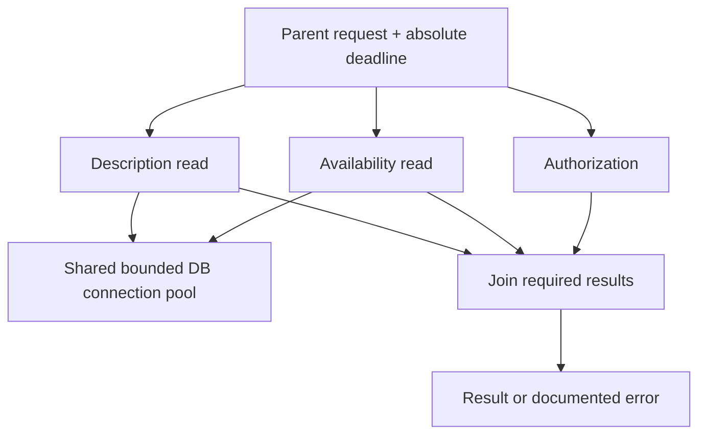

# Threads, tasks and coordination: cancellation and resource ownership

> **Independent Tycho book draft V03/C01, 2026-10-19.** The public Java SE 25 and gRPC contracts cited below are independently published. The example and test plan are invented. No Java code was compiled or executed, no profiler ran, and no reviewer accepted an implementation. Structured concurrency in Java 25 is explicitly a **preview API**, not a permanent portability contract.

## Purpose and mission

A thread is an execution mechanism, not a unit of business demand. An executor schedules tasks, but architecture still must specify who owns each task, which result the parent requires, how long work may live, and what happens if the caller leaves or a sibling fails. Many logical tasks can wait without running on a CPU; increasing their number does not give the database more connection capacity.

The companion [platform and virtual threads](platform-threads-executors-and-virtual-threads.md) chapter owns detailed Java version/throughput trade-offs. This chapter owns task coordination, cancellation, locks and scarce resource budgets.

## 1. Four distinct concurrency boundaries

| Boundary | Question | Typical limitation |
|---|---|---|
| Business operation | What is one durable user intent, across retries? | Duplicate/unknown outcomes |
| Logical task | Which subcomputations belong to one parent? | Cancellation, failure joins and cleanup |
| Execution thread | What runs and blocks on a platform or virtual thread? | CPU and scheduler resources |
| Scarce dependency | Which pool, lock, quota or remote backend is used? | Throughput and correctness regardless of thread count |

An accepted task may still sit in a queue after its user-visible deadline. A task can remain running after the caller disconnects. Durably accepted background work should be represented as an independently tracked job with a stable ID—not hidden in an unbounded in-process queue.

## 2. ExecutorService and cooperative cancellation

The [Java SE 25 ExecutorService API](https://docs.oracle.com/en/java/javase/25/docs/api/java.base/java/util/concurrent/ExecutorService.html) defines task submission, futures, shutdown and best-effort cancellation. Its shutdownNow operation attempts to stop active tasks, but code that does not cooperate with interruption may continue to execute. A Future can expose completion and cancellation; neither says that an external effect was reversed.

The intended task contract should name:
- parent logical operation ID and total deadline;
- input validation and authorization state;
- which child results must join before responding;
- response, error and cancellation propagation;
- timeout/abort behavior and connection/lock release;
- whether effects are reversible, committed or require reconciliation;
- maximum queue/concurrency budget per dependency.

Text alternative: a caller owns three bounded child tasks. Two share a scarce DB connection pool. They must meet the parent's result semantics or terminate cooperatively; timing out cannot reverse committed state.

## 3. Structured concurrency is a task-lifetime mechanism

The [Java 25 StructuredTaskScope documentation](https://docs.oracle.com/en/java/javase/25/docs/api/java.base/java/util/concurrent/StructuredTaskScope.html) describes lexical scopes, fork/join and cancellation policies. It is a **preview feature** that requires enabling preview support and may change in future releases.

Structured execution can make it clearer that child tasks do not silently outlive their parent. It does not make remote writes atomic or remove database/pool limits. If child A commits an external effect and child B then fails, cancelling A cannot undo the completed effect. That needs a business-level saga or recovery contract.

## 4. Concurrency-safe classes do not enforce business invariants automatically

**Original fictional case:** two threads reserve the last available device from a workshop catalogue. Both read an availability counter of one and attempt to decrement it. A concurrent collection or atomic increment alone may not protect a multi-step invariant across database writes and separate application instances.

Correctness requires a valid atomic transaction or state-owner protocol covering the full check-and-commit decision. A JVM-local semaphore protects one process only; it cannot serialize writes across multiple independently deployed replicas. Adding virtual threads or larger pools does not change the exclusivity rule.

A lock can also be harmful if held across unreliable remote calls. Shorten critical sections and retain explicit authorization and state ownership rules.

## 5. A cancellation is a request, not a rollback

Timeouts, explicit client cancellation, interruption and server shutdown have different observability and cleanup semantics. The [gRPC cancellation guide](https://grpc.io/docs/guides/cancellation/) recommends stopping initiated work and propagating cancellation to dependent calls where practical. Neither gRPC cancellation nor Java interruption guarantees that previously committed database or external effects never occurred.

| Mechanism | Can help | Cannot guarantee |
|---|---|---|
| Parent deadline | Limits useful wait | No prior business commit |
| Executor shutdown | Stops accepting new tasks and tries cleanup | Arbitrary uncooperative tasks terminate immediately |
| Scoped child tasks | Explicit fork/join and lifetime | Durable message/effect exactly once |
| Bounded queue | Limits waiting objects | Fast external dependency |
| Semaphore | Limits one shared resource's concurrency | Correct state authority across processes |
| Virtual threads | Reduces many blocking task costs for eligible workloads | More CPU, datastore throughput or external quota |

## 6. Proposed tests and source ledger

A reviewable fixture would: fork two tasks then force one to fail; cancel the parent with an outstanding connection; inject a lost response after write commit; force an uncooperative blocking call; vary virtual-thread count while holding the datastore pool fixed; check error, cleanup and duplicate-effect invariants. **None was run** in preparing this chapter.

| Source | Narrow support | Still unknown |
|---|---|---|
| [Java SE 25 ExecutorService](https://docs.oracle.com/en/java/javase/25/docs/api/java.base/java/util/concurrent/ExecutorService.html) | Submission, shutdown and limits of interruption | Actual library/driver interruption semantics |
| [Java 25 StructuredTaskScope preview](https://docs.oracle.com/en/java/javase/25/docs/api/java.base/java/util/concurrent/StructuredTaskScope.html) | Child lifetime and structured joins | Future API stability or empirical capacity benefit |
| [gRPC Cancellation](https://grpc.io/docs/guides/cancellation/) | Signaling no-longer-needed remote work | Undo of committed external effects |

All examples and intended outcomes are original teaching material. Full source/version/claim review, actual code-level tests and editorial acceptance remain pending.

**Navigation:** target **V03/C01** in [book outline](../PROPOSED-STRUCTURE.md), current [execution landing](README.md). Expand to [virtual-thread models](platform-threads-executors-and-virtual-threads.md), [reactive scheduling](reactor-webflux-r2dbc-and-backpressure.md), [CPU and blocking diagnosis](cpu-memory-gc-and-blocking-diagnostics.md), [connection pool budgets](../scaling/connection-pools-hikaricp-pgbouncer.md).
