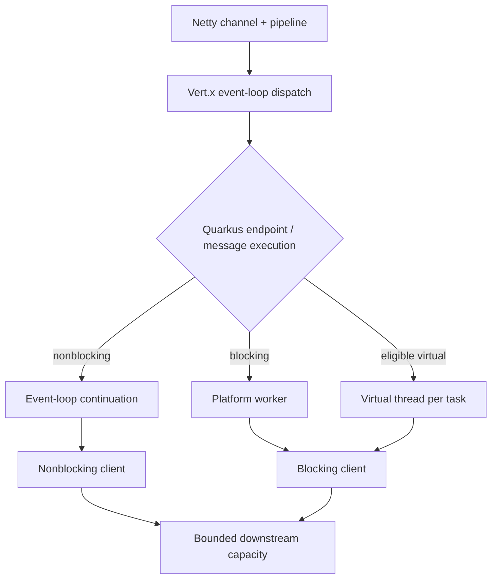
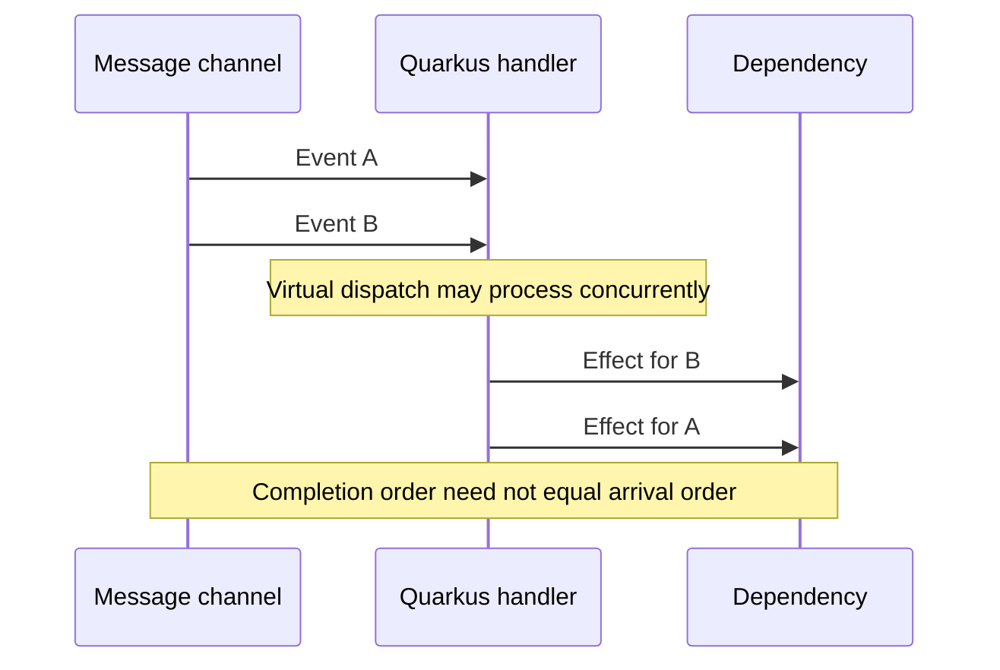

# Vert.x, Netty, Quarkus, Mutiny and RxJava execution boundaries

> **Tycho #82, public research inspected 2026-10-18.** Canonical question: how do the Java networking and reactive libraries allocate work, propagate demand and protect event loops? Source scopes: Vert.x **4.4.9** core guide, Netty **4.x** guide (rolling within major, exact patch not asserted), Quarkus **3.27**, SmallRye Mutiny **2.9.0**, RxJava **v3.1.9** tagged README. All examples are synthetic; no server or broker was run.

## 1. Runtime layers are not equivalent products

**Netty** is a network application framework with channels, pipelines, handlers and `EventLoopGroup` implementations. It is not itself a business workflow engine, SQL database or an automatic Reactive Streams backpressure protocol. The Netty 4.x user guide's *Writing a Discard Server* section uses separate boss/worker `NioEventLoopGroup` roles and explains how channels are assigned to event loops. This is a documented example, not a claim that every Netty deployment must use exactly two groups. [E01]

**Vert.x** provides event-driven, multi-event-loop application APIs. Its core guide describes the multi-reactor pattern, the invariant that a particular handler is not executed concurrently in its normal context, and the *Golden Rule — Don't Block the Event Loop*. `executeBlocking` moves a blocking task to workers; the guide distinguishes ordered execution for the same context and the option to allow parallel work. The worker pool is still a bounded resource. [E02]

**Quarkus** builds an application framework on Vert.x and exposes execution choices per endpoint or message handler. Quarkus 3.27 documents worker, event-loop and virtual-thread dispatch, including `@Blocking`, `@NonBlocking` and `@RunOnVirtualThread` under eligible signatures. Do not infer dispatch solely from a method's Java return type without checking the Quarkus version and extension. [E03]

Text alternative: Netty handles channel/pipeline I/O; Vert.x dispatches event-loop work; Quarkus may run application handlers on event loops, platform workers or eligible virtual threads. All paths still reach bounded downstream capacity. This conceptual layering is not an assertion that every Quarkus extension uses every depicted path.

## 2. The blocked event loop is a shared-fate failure

Suppose a **fictional** event-loop handler executes a 600 ms synchronous call while serving other connections. Every operation scheduled onto that same event loop can be delayed by the handler. This is a causal illustration, not a measured latency distribution. More worker threads elsewhere do not release an event loop currently blocked by user code.

The Vert.x 4.4.9 guide's *The Golden Rule — Don't Block the Event Loop* and *Running blocking code* describe blocking diagnostics and `executeBlocking`. Moving work to a worker executor isolates the event loop but transfers the queue, timeout and capacity problem to that executor. An unbounded worker queue can simply move the outage rather than solve it. [E02]

Netty channel handlers must also respect their event-loop execution assumptions. Offloading heavy work is a design decision with ordering and context consequences: callbacks may resume later, and mutable state should not be shared without a clear ownership contract. If an inbound request has a deadline, count worker queue time against it.

## 3. Quarkus 3.27: choosing worker, reactive or virtual handler

Quarkus 3.27's *Virtual Thread support reference — Use @RunOnVirtualThread with Quarkus REST* shows three models: synchronous work on worker threads, `Uni`-returning reactive handlers on event loops, and eligible synchronous handlers annotated `@RunOnVirtualThread`. The documentation notes that virtual-thread handlers can await a Mutiny `Uni` while freeing carriers when the underlying client supports it. [E03]

In Quarkus 3.27 messaging, execution mode also affects **ordering**. The virtual-thread messaging guide says `@RunOnVirtualThread` can enable concurrent processing and no longer preserves the default sequential per-channel behavior. It documents a default maximum concurrency of 1024 for annotated messaging methods and a worker configuration to change that cap. This is a framework-specific default for this version, **not** a universal JDK thread limit or a guarantee about broker partitions. [E04]

Text alternative: two incoming events may run concurrently when the handler uses virtual-thread dispatch, so B can produce an external effect before A. If per-key order is a correctness invariant, configure an ordered path or enforce ordering in application state; a concurrent dispatch annotation is not an ordering guarantee. See [Kafka partition contracts](../integration/kafka-partitions-replication-and-contracts.md).

A virtual thread waiting on a permit still represents pending work. Define an explicit cap for each downstream connection pool, and do not use the Quarkus messaging default as a database capacity setting. For Java 21 vs 24+ pinning differences, consult [the virtual-thread chapter](platform-threads-executors-and-virtual-threads.md).

## 4. Mutiny 2.9.0: Uni, Multi and execution shifts

Mutiny `Uni` models an asynchronous item or failure; `Multi` models multiple item signals. In its version **2.9.0** *What is the difference between emitOn and runSubscriptionOn?*, `emitOn(executor)` redispatches upstream item/failure/completion events downstream, while `runSubscriptionOn(executor)` changes where subscription happens. The guide warns that `emitOn` can introduce concurrency problems with non-thread-safe request-scoped objects or concurrently emitted signals. [E05]

Do not conflate thread switching with demand control. For an unbounded hot source, define whether a slow subscriber causes backpressure, bounded buffering, dropped updates or a terminal error. For a finite transactional stream, cancellation must release resources; for an already committed effect it cannot retroactively restore state.

A bounded reactive concurrency setting and a bounded virtual-thread handler count solve different problems. The former shapes publisher composition; the latter shapes accepted tasks. Both can still exceed a remote dependency quota without an explicit budget.

## 5. RxJava 3.1.9: Flowable is not Observable

The **v3.1.9** tagged RxJava README, sections *Base classes*, *Backpressure*, *Concurrency within a flow* and *Parallel processing*, distinguishes `Flowable` (Reactive Streams/backpressure) from `Observable` (no backpressure). It describes `Single`, `Maybe` and `Completable` as separate cardinality types. The README also explains that `observeOn` changes execution context, while `flatMap` may interleave independently scheduled inner streams. [E06]

A conversion from an unbounded `Observable` to a backpressure-aware `Flowable` needs a conscious overflow strategy: buffering, dropping or retaining the latest changes business semantics. Never claim the downstream `Flowable` has retroactively slowed an uncontrolled producer. RxJava's `subscribeOn`/`observeOn` terminology is similar in purpose to Reactor's `subscribeOn`/`publishOn`, but operators and edge cases must be verified in the selected library version.

| Requirement | Prefer to investigate | Contraindication |
|---|---|---|
| Custom low-level protocol and channel handlers | Netty channel/pipeline APIs | Need a complete app framework or durable messaging out of the box |
| Multi-event-loop service with callback APIs | Vert.x nonblocking core | Legacy blocking work left on event loop |
| Quarkus REST with sequential blocking libraries | Worker or eligible virtual-thread dispatch | No admission/connection budget, native pinning or unverified handler dispatch |
| Reactive Quarkus endpoint or stream | Mutiny Uni/Multi with compatible clients | Blocking JDBC directly on event loop, uncontrolled hot source |
| Backpressure-aware multi-item RxJava 3 pipeline | Flowable | Using Observable as if it had Reactive Streams demand |

These are candidate evaluations, not benchmark-derived rankings.

## 6. Failure and acceptance experiment

Design a **synthetic** endpoint that (a) reads one item, (b) streams many items, and (c) writes one idempotent effect. Run the same fixed dependency limits and workload across eligible models. Inject a slow database, a stalled consumer, client cancellation, worker saturation and out-of-order messages. Observe event-loop delay, worker/virtual task counts, connection pool wait, heap, buffered elements, p95/p99, cancellation cleanup and effect identity.

Acceptance requires verifying the exact version, thread on which handlers execute, queue bounds, ordering contract, context propagation and recovery from partial completion. A diagram or vendor guide is not an independent application test. A source claiming scalability does not establish measured savings.

## Evidence ledger and unresolved scope

- **[E01] Netty official user guide 4.x:** [User guide for 4.x](https://netty.io/wiki/user-guide-for-4.x.html), *Writing a Discard Server*, `NioEventLoopGroup` explanation and *Shutting Down Your Application*. **Patch is not pinned**; guide is rolling within major version.
- **[E02] Vert.x 4.4.9 official core manual:** [Vert.x Core](https://vertx.io/docs/4.4.9/vertx-core/java/), *Reactor and Multi-Reactor*, *The Golden Rule — Don't Block the Event Loop*, *Running blocking code*. Older release intentionally selected.
- **[E03] Quarkus 3.27 official guide:** [Virtual Thread support reference](https://quarkus.io/version/3.27/guides/virtual-threads/), *Use @RunOnVirtualThread with Quarkus REST*, *Use virtual thread friendly clients*.
- **[E04] Quarkus 3.27 official guide:** [Virtual Thread support with Reactive Messaging](https://quarkus.io/version/3.27/guides/messaging-virtual-threads/), *Use the @RunOnVirtualThread annotation*, *Control the maximum concurrency*. Framework defaults apply to the documented integration, not every app.
- **[E05] SmallRye Mutiny 2.9.0 official guide:** [emitOn vs runSubscriptionOn](https://smallrye.io/smallrye-mutiny/2.9.0/guides/emit-on-vs-run-subscription-on/), *The case of emitOn*, *The case of runSubscriptionOn*.
- **[E06] RxJava v3.1.9 tagged upstream README:** [README at tag v3.1.9](https://github.com/ReactiveX/RxJava/blob/v3.1.9/README.md), *Base classes*, *Backpressure*, *Concurrency within a flow*, *Parallel processing*. Tag was retrieved through the public GitHub source, not inferred from current main.

**Review limits:** Netty guide is major-version-scoped, not patch-pinned. No code execution, thread tracing, benchmark, full source-code audit, integration test or independent human review was performed. Other versions may differ and require new verification.
