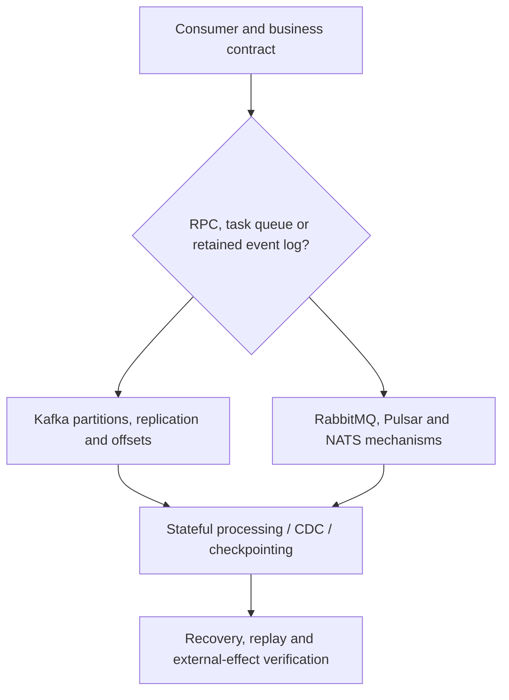

# Integration, messaging and stream processing

**Status:** first three bounded research chapters for Issue [#81](https://github.com/rouslanbaranov/tycho/issues/81). Published documentation versions are explicitly recorded; no installed broker, integration benchmark or human expert review is claimed.

## Purpose and mission

Help engineers understand which **communication guarantees**, message positions, durable states and recovery semantics an integration or stream architecture actually provides. Do not choose Kafka, RabbitMQ, Pulsar, NATS or Flink from user count or vendor popularity.

## Human and agent reading route

Text alternative: establish the consumer/replay requirement first, then examine Kafka or alternate messaging mechanisms, and only then evaluate stateful processing and replay correctness. No one flow is a default architectural choice.

## Canonical authored pages

| Question | Page | Public source scope |
|---|---|---|
| How are Kafka partition records, consumer offsets, ISR/replica failures and producer/Kafka transactions bounded? | [Kafka partitions and delivery contracts](kafka-partitions-replication-and-contracts.md) | Selected Apache Kafka 4.1 docs, gRPC core concepts |
| When do task queues, durable subjects/streams or long-running workflows make sense? | [Messaging families and durable workflows](messaging-families-and-durable-workflows.md) | RabbitMQ 4.3, NATS JetStream rolling docs, Pulsar 4.1 |
| How does checkpoint/replay work in stream processors, and what does CDC move across boundaries? | [Stateful processing and CDC](stateful-stream-processing-and-cdc.md) | Kafka Streams 4.1, archived Flink 2.1, PostgreSQL 17, Debezium 3.6 |

## Prerequisite and adjacent canonical research

- [Ordering and consensus](../distributed/causality-ordering-and-consensus.md) — what ordering and majority replication mean.
- [Saga and local isolation](../distributed/transaction-isolation-and-sagas.md) — state invariants and compensation.
- [Transactional outbox and duplicate effects](../distributed/transactional-outbox-and-idempotency.md) — source transaction/relay and consumer dedup boundary.
- [CQRS and read projections](../distributed/cqrs-event-sourcing-and-projections.md) — durable event authority versus derived state.
- [Queueing and offered load](../performance/queueing-littles-law.md) — capacity measurements and nonstationary bursts.

## Gaps and honest readiness

Version-specific Kafka Connect operational behavior, installed gRPC client deadlines, broker deployment and recovery runbooks, cross-region replication, full streaming DSL/SQL semantics, production event-time tests, unpinned recent Flink releases and named durable workflow engines need further independent research. A documentation comparison cannot establish benchmark winners, actual exactly-once external effects or availability SLOs.

The [proposed book structure](../PROPOSED-STRUCTURE.md) owns the larger coverage plan. This landing intentionally links only to currently existing pages.
