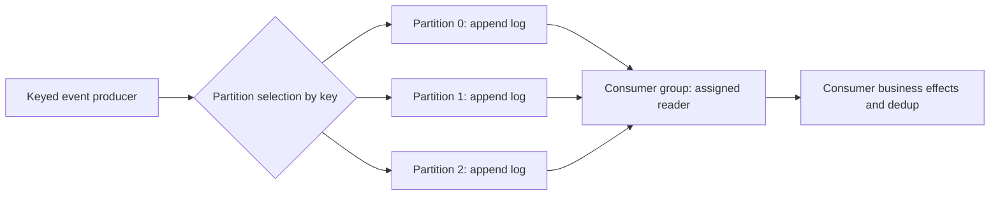
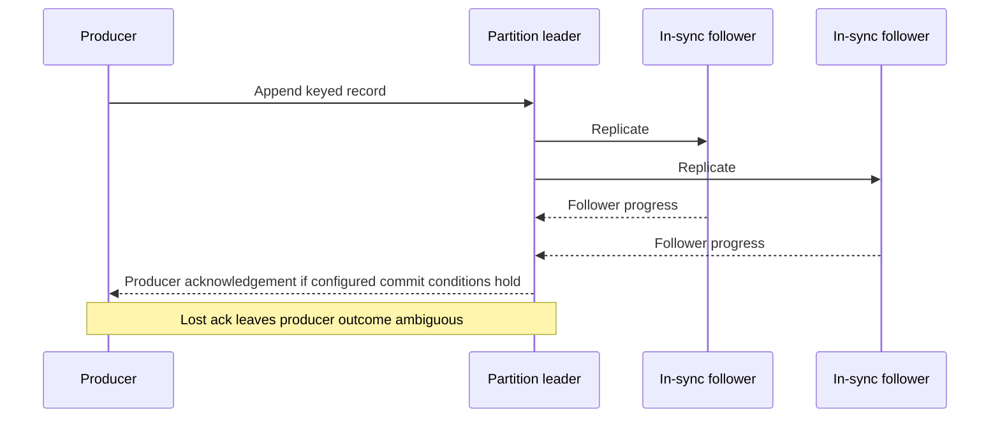
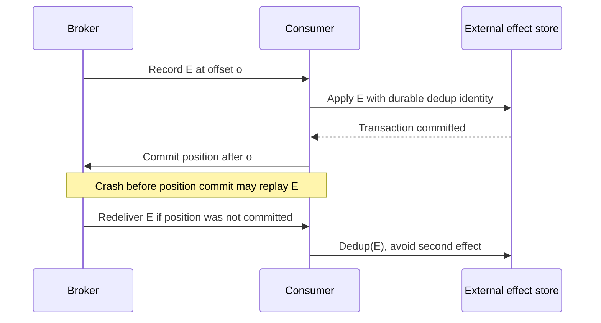

# Integration contracts, Kafka partitions and delivery boundaries

> Technical research for Tycho [#81](https://github.com/rouslanbaranov/tycho/issues/81), proposed V04/C06–C07. Source inspection **2026-10-18**, explicitly anchored to **Apache Kafka 4.1 documentation**. Version 4.1 is a selected **older documentation release**, not a claim that it is the newest. Examples and diagrams are original synthetic scenarios, not executed benchmarks or proof of external exactly-once effects.

## Purpose and mission

A reliable integration must make clear **who owns state, what is a command versus a fact, where a message is persisted, how ordering is scoped and when a consumer's external effect is durable**. A service API, an event stream and a task queue solve different requirements; Kafka has specific mechanics, not general-purpose magic "exactly once".

**Primary question:** How do Kafka's partitions, leaders, ISR, offsets, consumer groups and transactional producer/Streams contracts compose—and what happens when an acknowledgment or consumer fails?

## 1. Command, query, notification and durable event are distinct contracts

| Interface | Initiator expects | Typical failure ambiguity | Required contract |
|---|---|---|---|
| Synchronous RPC/HTTP command | A result or explicit pending/error state | Server may have committed but reply was lost | Deadline, idempotency identity, error classification and retry safety |
| Synchronous query | Named consistency/freshness/read authorization | Old snapshot, timeout, partial result | Eligible response, version/freshness, pagination and cache |
| Event notification | Something happened; subscribers may react | Missed, duplicate or reordered notification | Durable publication if required, consumer offset and schema version |
| Durable work queue | A task is processed by some eligible worker | Ack loss or worker crash yields redelivery | Visibility/ack deadline, dedup, work ownership and poison-message handling |
| Retained partitioned log | Multiple readers can consume retained ordered records | Offset may commit before/after external effect | Key/partition semantics, retention, consumer position and replay |

The official [gRPC core-concepts documentation](https://grpc.io/docs/what-is-grpc/core-concepts/) distinguishes unary, server/client-streaming and bidirectional-streaming RPCs, metadata and deadlines. Streaming does not automatically imply an authoritative event log or durable replay; a live RPC stream is a protocol/channel contract, not a substitute for persisted events. [E01]

## 2. Kafka's partition is an ordering and load unit

Apache Kafka 4.1 Design sections **The Producer — Load balancing**, **The Consumer — Consumer Position**, **Message Delivery Semantics** and **Replication** describe how a topic is partitioned, records have positions in a partition, and consumer state tracks positions. Partition ordering does **not** establish total ordering across the whole topic. [E02]

Text alternative: producer records are routed to one of several partition logs. A consumer group assigns partition consumption to members; application effects require their own idempotency/commit strategy. No single order spanning all three partitions is shown.

**Partition key choices are correctness and scaling choices**, not a transparent optimization:

- Events for one aggregate may require a stable key to land in one partition and maintain that partition's append sequence.
- A single hot key can concentrate traffic and limit parallel processing; blindly increasing partition count may not split that key.
- Changing key encoding or partition count can change the partition assignment of later records. An application requiring continuity across that change needs a transition/ordering contract.
- A group with more instances than assignable partitions cannot increase per-partition concurrent ownership without changing the consumer architecture; actual group protocol/version matters.
- At-least-once replay and idempotent consumers are still relevant even if producer retries are deduplicated by the broker.

### A source-of-truth boundary

A Kafka record is a durable log entry under a declared retention/replication policy, **not necessarily the authoritative business transaction**. A relational registration store might remain the authority while a transactional outbox relays a committed change into Kafka. The [outbox/idempotency page](../distributed/transactional-outbox-and-idempotency.md) explains why a local database commit, Kafka publication, and consumer external side effect remain separate atomic boundaries.

## 3. Replicas, ISR and acknowledgement scope

A Kafka partition has a leader and replicas. The **in-sync replica set (ISR)** tracks follower status with respect to the leader; `acks=all` and `min.insync.replicas` are relevant to the expected durability/availability trade-off. A failed leader or insufficient ISR can interrupt accepted production rather than silently grant the same guarantee with fewer replicas. The exact 4.1 behavior includes newer **Eligible Leader Replicas** rules, so older Kafka folklore should not be substituted for the selected release's design and operations text. [E02, E03]

Text alternative: a leader appends and replicates a record. The broker's acknowledgement depends on producer/topic configuration and replica progress; if the producer never receives that acknowledgement it must not assume the record was absent. This diagram is a conceptual, simplified model, not a traced Kafka 4.1 cluster.

**Do not equate "replication factor 3" with "every record always survives any one failure."** The actual durability guarantee depends on producer acks, ISR/min ISR, leader election configuration, storage health, producer retry and how a commit is acknowledged. Loss/corruption and unclean elections have explicit trade-offs. Kafka 4.1's [Eligible Leader Replicas operations guide](https://kafka.apache.org/41/operations/eligible-leader-replicas/) is version-specific and must be consulted before relying on post-4.0 failover behavior. [E03]

## 4. Consumer offset, effect and crash points

The consumer must decide when to mark its position consumed, often relative to applying an external business effect.

Text alternative: after applying the external effect, the consumer commits its position. A crash between those actions causes replay; the external store's own deduplication protocol must make the duplicate harmless. The diagram is a proposed consumer contract.

Committing offset *before* the external effect can cause that effect to be silently lost after a crash. Committing it *after* the effect can cause duplicates. No perfect ordering of two independent commits creates an automatic global transaction.

### Producer idempotence and Kafka transactions

Kafka 4.1 documentation **Message Delivery Semantics** and **Using Transactions** discuss idempotent producers and transactions coordinating records/offsets *within Kafka* under supported clients and isolation modes. [E02]

- **Idempotent producer** reduces duplicates caused by eligible retried sends within its producer/broker contract. It is not a unique business operation key across arbitrary application restarts and input sources.
- **Kafka transaction** can coordinate publication to Kafka partitions and (in supported consume-transform-produce workflows) offsets with Kafka output, but it does not automatically enclose an unrelated SQL commit, payment provider or email delivery.
- `read_committed` is an isolation choice for transactional Kafka records; it is not proof that every consumer's external side effect happens once.
- Stream-processing frameworks may offer an **exactly-once processing guarantee within a bounded Kafka state/output topology**; the scope must be explicitly stated alongside connector and external sink behavior.

**Insufficient evidence question:** "Kafka transactions are enabled, therefore our external transfer side effect can never happen twice." False inference. Need source input identity, sink transaction/idempotency, replay/failure tests, external provider contract and reconciliation policy.

### A Kafka transaction cannot atomically commit an arbitrary business database

The [Kafka 4.1 design reference](https://kafka.apache.org/41/design/design/) explains a transactional read-process-write pattern: published Kafka records and consumed offsets included in the *Kafka transaction* can be committed atomically. It does **not** describe an atomic transaction over an independent PostgreSQL row or email effect.

**Original hypothetical:** a consumer reads Kafka source offset 41, changes an authoritative shipment row in PostgreSQL, emits a new Kafka event and commits its position. Two durability authorities now coexist.

| Crash window | Durable observation | Recovery rule |
|---|---|---|
| Before PostgreSQL commit | No business-row change | Reprocess with the original operation identity |
| After PostgreSQL commit, before Kafka output/offset commit | Row changed; Kafka side can still retry the input | Durable idempotency/effect key must suppress the duplicate row transition |
| After Kafka output/offset commit, before client acknowledgment | Kafka effects may be durable, response may be missing | Resolve the logical business outcome from its authority; do not infer from reply loss |
| Kafka output delivered, external email fails | Kafka record exists; mail outcome ambiguous | Separate consumer dedup/retry and reconciliation contract |

Even with transactional producers, the business application must decide how it atomically persists its **own** state and publication intent, for example by a [transactional outbox and consumer inbox](../distributed/outbox-inbox-sagas-and-durable-workflows.md). The outbox itself has repeated-delivery windows and cannot guarantee arbitrary external exactly-once effects. A consumer group offset is a replay position, not proof that every user-visible effect succeeded.

**Decision gate:** if a use case is a simple transient task queue with bounded retries and no retained event history, Kafka's partition/replay operations may be unnecessary. If durable partition history and replay are requirements, test producer fencing, rebalance, source replay, crash-after-database-commit and expired dedup keys. These are **proposed tests, not executed Kafka/PostgreSQL experiments**. Preserve exact Kafka broker/client version and configuration in any eventual results.

## 5. Failure and recovery matrix

| Condition | Boundary affected | What to check |
|---|---|---|
| Producer acknowledgement lost | Producer cannot tell if append occurred | Idempotence configuration, stable business/event IDs, retry policy |
| Leader crash during replication | Partition ownership/ISR may change | Configured min ISR, election, error response, client retry behavior |
| ISR below required threshold | Some acks/writes may reject rather than weaken durability | Broker/producer errors and documented availability gate |
| Consumer group rebalances | Partition assignments and processing pause/change | In-flight work, offset commits and business effect identity |
| Poison record | Partition may stop making progress or skip data | DLQ/quarantine contract, observability, schema handling |
| Source DB commit but relay lags | Kafka downstream sees stale state | Outbox/CDC lag, durable source intent and replay |
| Transaction aborts | Downstream visibility depends on isolation mode | Transactional IDs, abort markers, consumer configuration |
| Retention or compaction removes needed history | Late/rebuilding consumer cannot reconstruct required state | Retention horizon, full snapshots/backfills and event contract |

## 6. When Kafka is inappropriate

Kafka is a reasonable candidate for retained high-throughput streams, multiple independent readers, replay, stateful stream derivation and partitioned scale *when* operational support, source contracts and durability/retention guarantees are adequate.

It may be excessive for a small request/response integration with no replay needs or a single bounded queue where simpler operational semantics meet the constraints. Conversely, a simple queue is not an adequate substitute if the product explicitly requires multiple rewindable readers and long-lived retained log history.

No architecture can be chosen solely by a claimed RPS threshold, feature list or brand comparison. Compare offered load, key skew, retention/egress costs, consumer failure windows, ordering scope, security, operational support and end-to-end correctness.

## Versioned public source-to-claim ledger

| ID | Official public source and actually inspected scope | Supported / excluded claims |
|---|---|---|
| E01 | [gRPC core concepts](https://grpc.io/docs/what-is-grpc/core-concepts/), RPC types, metadata, deadline concepts; web documentation observed 2026-10-18 | RPC interaction semantics, **not** guaranteed durable event history |
| E02 | [Apache Kafka 4.1 Design](https://kafka.apache.org/41/design/design/), sections **The Producer / Load balancing; The Consumer / Consumer Position; Message Delivery Semantics; Using Transactions; Replication** | Kafka 4.1 topic partitions, ordering/offset/producer and replication features; **not** current-latest behavior or tested production service |
| E03 | [Kafka 4.1 Eligible Leader Replicas](https://kafka.apache.org/41/operations/eligible-leader-replicas/), **Overview** | Version-aware leader failover eligibility and min-ISR relationship; avoids implying all old assumptions hold unchanged |
| E04 | [Kafka 4.1 Kafka Streams configuration](https://kafka.apache.org/41/configuration/kafka-streams-configs/), **processing.guarantee** | Names documented processing options `at_least_once` and `exactly_once_v2`, not arbitrary external system guarantees |

Research state: original manuscript, no executed Kafka cluster, request traces, broker tuning comparison, fault-injection or independently reviewed exactly-once proof. All examples and Mermaid diagrams here are explicitly synthetic.

## Applied M9 evidence: what transfers and what does not

These examples connect the chapter's conditional mechanism to published experiences or synthetic decision exercises. A historical company report is **first-party, time-scoped evidence**, not a controlled Tycho benchmark; an M9 decision playbook is **original synthetic analysis**, not a company decision.

**Case lens — [LinkedIn — Kafka tiers](../cases/linkedin-kafka-tiered-completeness.md)**. **Relevant mechanism or architectural contrast:** Kafka broker health and acknowledged writes do not substitute for end-to-end tier/consumer completeness audits. **Not established by this report/playbook:** Historical LinkedIn tier scale and audit numbers do not establish universal Kafka exactly-once external effects.

**Transfer test:** before applying the lesson to another legacy system, identify the exact workload, source date, relevant runtime/protocol versions, state authority, failure/recovery gate and the new observation that would reverse the choice. Follow the case's public evidence ledger rather than treating its link as independent proof.
