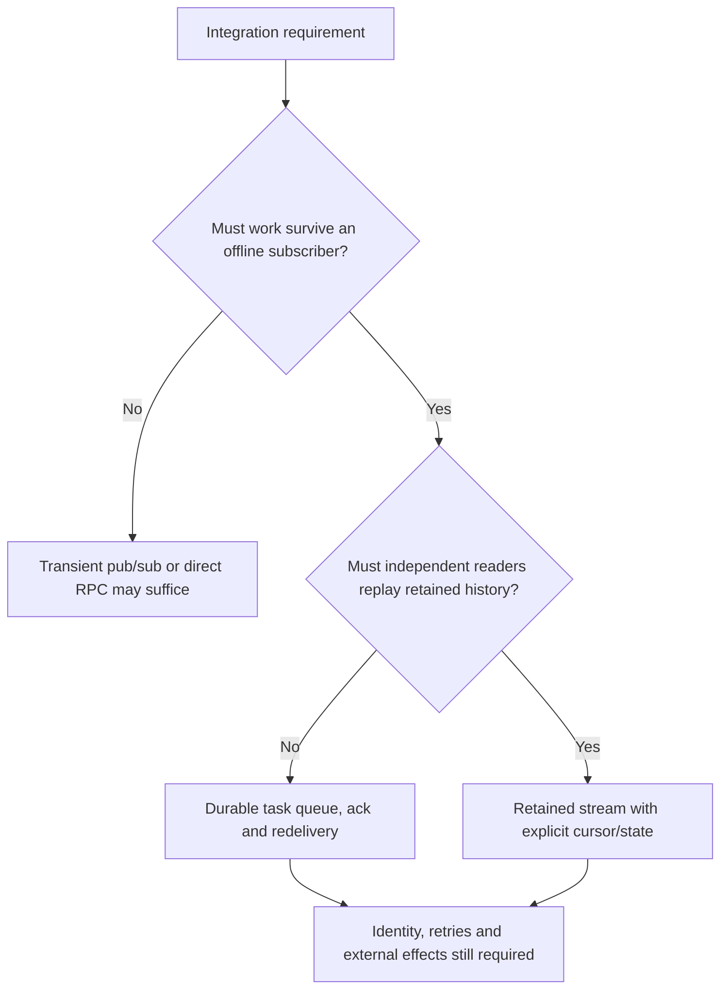
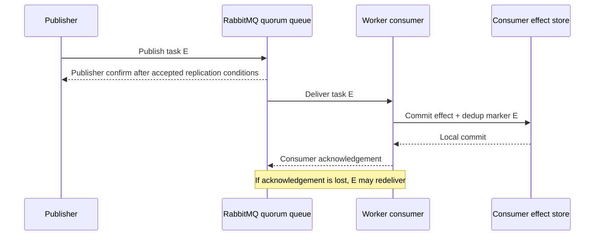
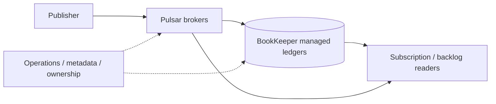
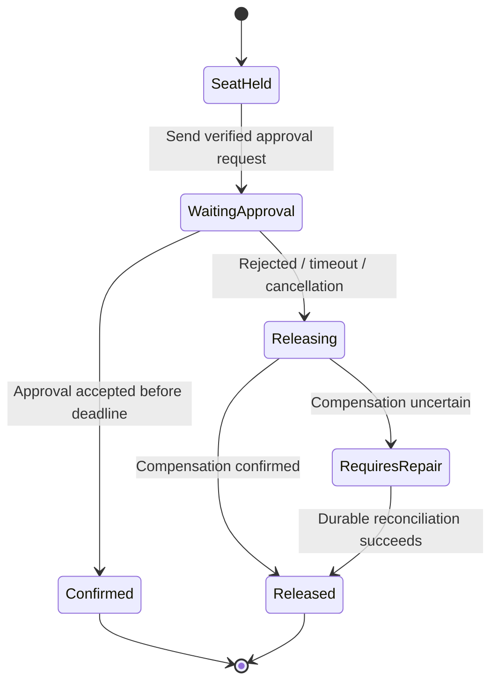

# Messaging families: RabbitMQ, Pulsar, NATS and durable workflows

> Tycho Issue [#81](https://github.com/rouslanbaranov/tycho/issues/81), proposed V04/C06. Public documentation inspected on 2026-10-18; versions indicated per vendor. Original conceptual comparisons and synthetic diagrams, **not** a benchmark or generic product ranking.

## Purpose and mission

A messaging decision is about the **observable consumer contract**, not a feature-comparison checkbox. Transient subjects, durable work queues, replicated partitioned logs and independently replayable consumer views have distinct state/ack/recovery behavior.

**Primary question:** Under what workload, ownership, replay and failure constraints do RabbitMQ quorum queues, Pulsar, NATS Core/JetStream or Kafka-style logs make an appropriate candidate—and when is a managed durable workflow needed instead of ordinary message transport?

## 1. First identify what a consumer must own

Text alternative: decide whether a publication must survive absent subscribers, then whether multiple independent consumers must replay history. The answer changes the required persistence and cursor model; every option still needs business-level identity and failure handling. This is an original question route, not a product-selection algorithm.

### RabbitMQ quorum queues and publisher confirms

Official RabbitMQ **4.3** *Reliability Guide* and *Consumer Acknowledgements and Publisher Confirms* distinguish two acknowledgements: the broker's confirmation to the publisher (acceptance/persistence responsibility according to queue mode) and the consumer's acknowledgement of processing to the broker. These are independent; publisher confirm does **not** mean the consumer performed a business transaction. Quorum queues maintain replicated queue state and rely on the publisher/consumer protocols for data safety. [E01, E02]

Text alternative: RabbitMQ can confirm taking responsibility for a task separately from a consumer acknowledging its effect. If the worker crashes after local effect but before acknowledgement, task redelivery may occur. Consumer-side deduplication is necessary for nonrepeatable effects.

Quorum queues are not automatically ideal for very short-lived temporary queues, the lowest latency or arbitrarily large replay backlogs; RabbitMQ's [quorum-queue guide](https://www.rabbitmq.com/docs/quorum-queues) explicitly discusses these choices. It also describes replicated queue members and the costs of data safety; the existence of replication does not prove a specific application's recovery SLO.

### NATS Core and JetStream

The current public [NATS JetStream concept documentation](https://docs.nats.io/concepts/jetstream) distinguishes **Core NATS** pub/sub delivery to online subscribers from **JetStream** persistent streams with server-side consumer cursors and acknowledgements. The page describes Core as at-most-once and JetStream's ordinary redelivery as at-least-once, under their respective configurations. [E03]

A fictional notification can use ephemeral pub/sub if losing a signal when no subscriber is listening is acceptable. A durable business task should not casually use Core alone if clients require recoverable delivery; a JetStream durable consumer or another persisted queue may better match that requirement.

JetStream stream retention and consumer policies still need version/configuration-specific testing, especially around publisher deduplication windows, consumer ack timeouts, replicas and restart behavior. No NATS server was installed or exercised for this page.

### Apache Pulsar broker and storage split

The publicly versioned [Apache Pulsar 4.1 Architecture Overview](https://pulsar.apache.org/docs/4.1.x/concepts-architecture-overview/) describes brokers and a **BookKeeper-backed persistent storage layer** with ledger/segment ownership. A broker endpoint is not automatically the sole durable copy of retained messages. Partitioning, subscription type, backlog and BookKeeper quorum/ledger mechanics must be examined for the actual workload. [E04]

This is a different operational decomposition from RabbitMQ queues or Kafka log replication, but the difference alone does **not** prove superior throughput or disaster recovery. It changes the components a team must scale, observe, secure, back up and restore.

Text alternative: Pulsar brokers serve publishers/subscribers while separate managed-ledger storage persists messages; a subscription's backlog and broker/ledger availability must be considered together. This simplified architecture is based on documented roles and does not represent an actual cluster's topology.

## 2. Requirement-driven comparison, not a ranking

| Question | RabbitMQ quorum queue | NATS Core / JetStream | Pulsar 4.1 | Kafka 4.1 (related chapter) |
|---|---|---|---|---|
| Primary reader model | Consumer acks durable queue deliveries | Core transient pub/sub; JetStream persistent streams and stateful consumers | Topic, subscription and persistent ledger/backlog | Ordered per-partition log, consumer offset/group |
| Retry after worker failure | Manual ack and broker redelivery semantics | JetStream ack timeout/redelivery; Core has no durable replay | Subscription ack/redelivery under configuration | Consumer re-read after uncommitted offset |
| Historical replay | Queue is not equivalent to retained independent log; RabbitMQ Streams separate option | JetStream stream supports replay modes | Subscription retention/backlog according to mode | Position-based replay inside retention |
| Replication/recovery | Quorum queue replication, leader/ISR-like safety policy specific to RabbitMQ | Stream replicas plus consumer state when configured | Broker + managed ledger/BookKeeper durability | Partition leaders/ISR/min ISR and group rebalance |
| Operational burden | Rabbit broker/queue policy, disk, connection, consumer flow | Core simple topology; JetStream adds durable stream/consumer management | Brokers, storage cluster and metadata/ledger operations | Broker/controller, partitions, ISR and producer/consumer clients |
| Typical disqualifier | Need many independent rewindable readers of same very large history | Core insufficient for offline durable work | Cost/operations of broker+BookKeeper unacceptable | Retained partition log and Kafka operations unnecessary for a simple work queue |

Rows describe **documented conceptual capabilities** of selected versions, not measured latency, pricing, throughput or operational superiority. Message ordering is typically scoped to queue/subscription/stream/partition and concrete producer/consumer behavior; no column implies global total order.

## 3. A durable workflow is more than a queue

Suppose a fictional registration process must: hold a seat, request external approval, wait up to 24 hours for a human review, then either confirm or release capacity. A message queue can deliver each step, but does not by itself persist **the entire multi-step business state machine, timers, cancellation policy and compensation outcome**.

A durable workflow engine is an architectural **candidate** if it persistently records process progress, timer deadlines, retry identities, versions, transitions and compensation logic under an explicit recovery contract. However, no named workflow engine is recommended or behavior guaranteed by this page: version-specific product analysis and failure experiments must be performed before selecting one.

Text alternative: a long-running process holds a seat and waits for approval. It either confirms or initiates release. Failed or ambiguous compensation moves into a repair state, not an invented success. This original state machine is **not** executed by a workflow engine or broker.

Use the [saga/isolation research](../distributed/transaction-isolation-and-sagas.md) for compensation and concurrency. Choosing a workflow product does not make its external SQL transactions automatically atomic.

## 4. Failure and applicability gates

| Workload/failure property | What to measure or test before recommending |
|---|---|
| One hot queue/stream subject | Arrival mix, key skew, consumer concurrency and fair scheduling |
| Producer acknowledgement loss | Broker's accepted/durable state, retry identity and duplicate risk |
| Offline consumer for days | Retention, storage growth/backlog catch-up, expiry and resumption semantics |
| Rebalanced consumer ownership | In-flight effect, ack/cursor commit and side-effect idempotence |
| Cross-region or storage loss | Quorum location, backup/restore, RPO/RTO and replay tests |
| Poison message or schema mismatch | Quarantine/retry budget, dead-letter policy and source of truth |
| Long-running process | Durable state, timers, compensation and human intervention ownership |

**Insufficient evidence:** "We send 10,000 messages/s. Which broker is fastest and cheapest?" Cannot answer without payload/size distribution, replication/durability, subscriber count, retention, batch/ack mode, failure headroom, security and an apples-to-apples benchmark. User and message counts alone are not enough.

## Public evidence and review scope

| ID | Official public source (observed version) and exact inspected section | Supports / does not prove |
|---|---|---|
| E01 | [RabbitMQ 4.3 Reliability Guide](https://www.rabbitmq.com/docs/reliability), *Data Safety, Clustering and Queue Content Replication* | Acks, confirms and replicated queue roles, not actual application end-to-end exactly-once |
| E02 | [RabbitMQ 4.3 Consumer Acknowledgements and Publisher Confirms](https://www.rabbitmq.com/docs/confirms), *The Basics, Publisher Confirms, Consumer Acknowledgements* | Publisher/consumer ack independence and recovery hazards |
| E03 | [NATS JetStream](https://docs.nats.io/concepts/jetstream), *How It Works, Streams, Consumers*, accessed 2026-10-18 (rolling site) | Core vs JetStream durable state and redelivery, not pinned server binary behavior |
| E04 | [Apache Pulsar 4.1 Architecture Overview](https://pulsar.apache.org/docs/4.1.x/concepts-architecture-overview/), *Brokers, Persistent storage* | Broker/BookKeeper architecture, not test results or ranking |
| E05 | [RabbitMQ quorum queues](https://www.rabbitmq.com/docs/quorum-queues), *When Not to Use Quorum Queues* | Documented contraindications and durability trade-offs, version observed 4.3 |

**Review state:** bounded documentation comparison, synthetic illustrations only. No software installed, measurements collected, benchmark conducted, broker disaster recovery rehearsed, full product alternatives researched or external domain review completed.
