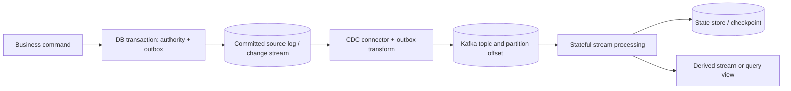
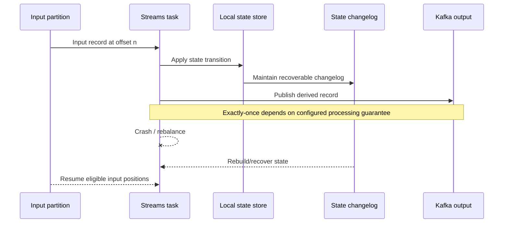
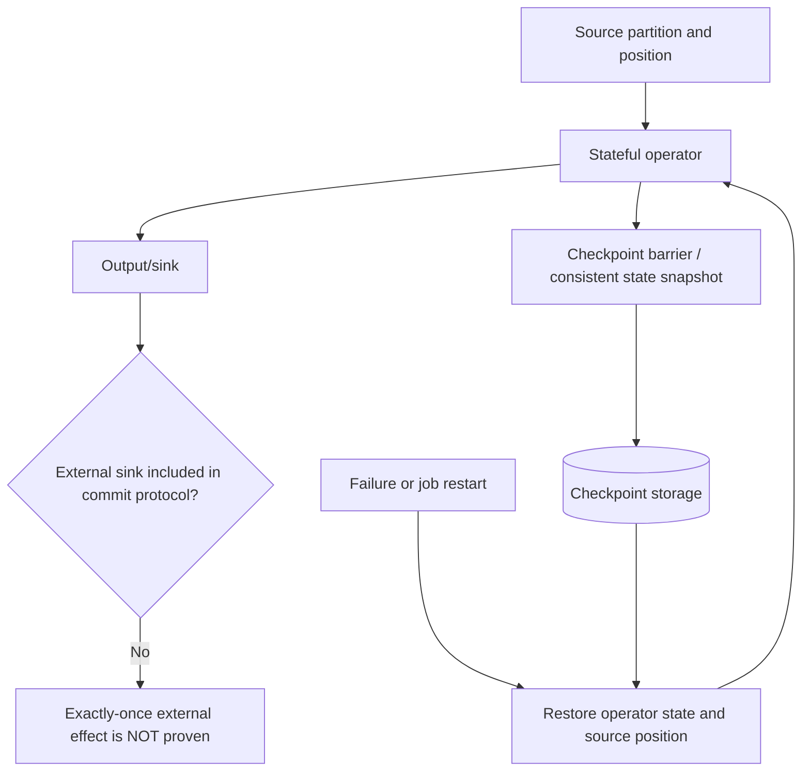

# Stateful stream processing, Kafka Streams, Flink and CDC

> Tycho Issue [#81](https://github.com/rouslanbaranov/tycho/issues/81), proposed V04/C08. Source reading 2026-10-18. **Pinned examples:** Apache Kafka Streams documentation 4.1, Apache Flink documentation release **2.1** (explicitly archived/outdated), PostgreSQL documentation 17 and Debezium 3.6. Original synthetic diagrams and arithmetic; not an executed stream processor, validated exactly-once guarantee or current-version benchmark.

## Purpose and mission

Processing records in order is not the same as calculating correct, recoverable *state* while inputs arrive late, operators restart, partitions rebalance and external systems change. This page compares the **state/position ownership** of Kafka Streams and Apache Flink, and explains how a committed database change can enter an integration stream through CDC.

**Primary question:** Which durable positions, state snapshots, event-time policies and sink semantics must align for a stream processor to recover without silently dropping or repeating material business effects?

## 1. From a database change to a replayable input

A relational database may already own an authoritative business state. A CDC pipeline observes changes after a commit and publishes records to consumers. PostgreSQL 17's logical-replication documentation describes publication/subscription and the logical change stream under PostgreSQL's configured replication mechanisms. Debezium **3.6** Outbox Event Router documents a concrete transform for outbox-table change events, including default event ID/header and aggregate key handling. [E01, E02]

Text alternative: authoritative business state and outbox intent are committed locally. A connector observes committed changes and publishes a versioned integration event into a partitioned stream. A stream task consumes it with managed state; derived outputs have their own correctness and recovery boundaries.

**Important distinctions:** database WAL position, Kafka partition offset, application state-store checkpoint and external sink commit are **not the same cursor**. An implementation must document where their alignment is guaranteed and where duplicates or gaps may be replayed.

## 2. Kafka Streams: tasks, state stores and changelogs

Kafka **4.1** Streams Architecture and 4.1 Processor API describe stateful tasks tied to stream partitions, local state stores, and fault-tolerant changelog topics that can restore processing state when tasks migrate or restart. They describe processing/parallelism under partition assignment and state restoration under rebalancing. [E03, E04]

Text alternative: a task reads from an input partition and updates a local store backed by a changelog. On crash or reassignment, a replacement task reconstructs state before continuing. Input/output/state consistency depends on Kafka Streams configuration and transactional processing scope, not on this conceptual diagram.

Kafka Streams `processing.guarantee` is documented with choices `at_least_once` and `exactly_once_v2` in the **4.1** configuration reference. This scoped guarantee does **not** by itself encompass an unrelated SQL transaction, remote payment or email provider. [E05]

### State restoration is a measurable operational cost

A persistent local store may need to replay a large changelog after task migration. The amount of state, disk/IO bandwidth, changelog compaction, standby replicas and the workload's live arrivals affect catch-up time. It is incorrect to say "state is fault tolerant, therefore recovery is instant." Monitor restoration duration, unprocessed input lag, output freshness and correctness during rebalances.

## 3. Flink: checkpoints versus deployment savepoints

The **archived Apache Flink 2.1** checkpoint documentation explains consistent snapshots of operator state and stream positions for recovery; its **Checkpoints vs. Savepoints** page distinguishes automatically managed failure-recovery checkpoints from more deliberate application state snapshots for controlled operations. This version is **not latest** and must not be assumed to describe newer installed releases. [E06, E07]

Text alternative: Flink periodically stores recoverable state associated with source progress. After failure, the operator and input position are restored consistently under its source/checkpoint model. A write to an arbitrary external sink remains outside that guarantee unless a compatible sink protocol and recovery semantics are demonstrated.

A checkpoint is not automatically a complete application migration artifact. A version upgrade can change state serialization, operator identity, topology and restore compatibility. For those decisions, use the *documented release's* savepoint/upgrade matrix plus a tested recovery plan, rather than applying outdated advice to a different installed version.

## 4. Event time, watermarks and late data are business policies

Streaming data can be observed at a different time from when the event occurred. A **watermark** or event-time windowing policy tells operators how much lateness they expect and when to finalize a result. This topic requires exact installed release and API evidence before implementation; the present section provides only a **conceptual synthetic model**, not an asserted Flink 2.1 watermark algorithm.

Consider a fictional count of booking events for a 10-minute window. One client submits an event with timestamp 09:55, but network delay causes it to arrive at 10:12. If the application's window was finalized earlier, the operator must follow a declared late-event policy: drop with an explicit metric, update/retract a prior result, send to a side output, or defer finalization. None is universally correct.

| Dimension | Required explicit choice |
|---|---|
| Event-time source | Trusted producer clock, database commit timestamp or business timestamp? |
| Window boundary | Tumbling/sliding/session, exact start/end and time zone |
| Watermark/lateness | How are delayed or idle input partitions handled? |
| Correction | Updates, retractions or immutable result with compensating event? |
| State size | Number of keys/windows retained, TTL, hot keys and replay |
| External output | Supports corrections, idempotency and checkpoint coordination? |

**Insufficient evidence:** "Flink has exactly-once checkpoints; can our external email be sent exactly once after replay?" No. Email send has its own irreversible acknowledgment and idempotency contract; snapshotting state cannot retroactively cancel an external effect.

## 5. Choose the processor for the real topology

| Criterion | Kafka Streams 4.1 documentation | Flink 2.1 documentation |
|---|---|---|
| Deployment integration | Embedded library in application instances interacting with Kafka | Distributed stream job/runtime and checkpoint-managed operator state |
| State ownership | Local task stores with changelog topics | Stateful operators and configured checkpoint/state backends |
| Fault recovery | Task migration/rebalance plus changelog restore | Restore consistent source positions/operator snapshots from checkpoint |
| Scaling boundary | Partition/task assignment and state redistribution | Parallel operators, keyed partitions, checkpoint/rescale compatibility |
| Operational burden | Application instances, task/changelog/offset/standby management | Dedicated job runtime, checkpoint storage, restart/upgrade state governance |
| Exactly-once nuance | Kafka transaction/Streams `exactly_once_v2` scope | Checkpoint + connector/sink-specific guarantee scope |
| Evidence gap | Whether observed consumer/producer modes and topic policies meet needs | Whether actual source/sink/upgrade topology supports desired semantics |

This is a comparison of **documented architectural mechanisms**, not measured product speed/price/feature superiority. Kafka Streams is not automatically better for small jobs, and Flink is not automatically necessary for complex ones.

## 6. Failure/recovery experiments

1. Build an **original synthetic** input fixture with unique event IDs, duplicate deliveries, out-of-order arrivals, and a known expected materialized result.
2. Inject a crash immediately after state update but before output/offset checkpoint; repeat near checkpoint completion.
3. Reassign a partition/operator and verify restored state, emitted output and input position, not just that the process starts.
4. Force input lag and hot-key skew; measure resource/IO impact and time to regain the advertised output freshness.
5. Upgrade schema/state serialization, rollback and restore from a controlled savepoint/changelog position.
6. Add a real external effect and test idempotency/compensation separately; **do not infer** correctness from Kafka/Flink's internal guarantees.

Without a concrete source/sink topology and the above evidence, the correct decision is **measure first**, not to promise exact once, zero loss or fixed checkpoint recovery time.

## Source-to-claim ledger

| ID | Versioned source and examined section | Bounded support |
|---|---|---|
| E01 | [PostgreSQL 17 Logical Replication](https://www.postgresql.org/docs/17/logical-replication.html), overview/publication and subscriber introduction | A public PostgreSQL mechanism for propagating committed changes, not a specific connector's operational guarantee |
| E02 | [Debezium 3.6 Outbox Event Router](https://debezium.io/documentation/reference/3.6/transformations/outbox-event-router.html), **Basic outbox table; Basic configuration; selective transformation** | Outbox-to-Kafka routed messages, event ID/key fields and transform limitations |
| E03 | [Kafka 4.1 Streams Architecture](https://kafka.apache.org/41/streams/architecture/), tasks, parallelism, stateful processing | Task/partition relation and local state |
| E04 | [Kafka 4.1 Streams Processor API](https://kafka.apache.org/41/streams/developer-guide/processor-api/), **State Stores, Fault-tolerant State Stores** | Changelog state restoration and store mechanisms, not independent external effect exactly-once |
| E05 | [Kafka 4.1 Streams Configuration](https://kafka.apache.org/41/configuration/kafka-streams-configs/), **processing.guarantee** | Documented `at_least_once` / `exactly_once_v2` options for selected release |
| E06 | [Flink archived 2.1 Checkpoints](https://nightlies.apache.org/flink/flink-docs-release-2.1/docs/ops/state/checkpoints/), **Overview, checkpoint storage and retained checkpoints** | Managed source/operator state recovery; version is explicitly outdated |
| E07 | [Flink archived 2.1 Checkpoints vs Savepoints](https://nightlies.apache.org/flink/flink-docs-release-2.1/docs/ops/state/checkpoints_vs_savepoints/), **Overview** | Lifecycle differences; not automatically applicable to the latest Flink |

**Review state:** original technical explanation, sources restricted to the named public pages. No running stream processor, source/sink integration test, checkpoint restoration measurement, Flink 2.1 production use, independent expert review or real SLO verification.
