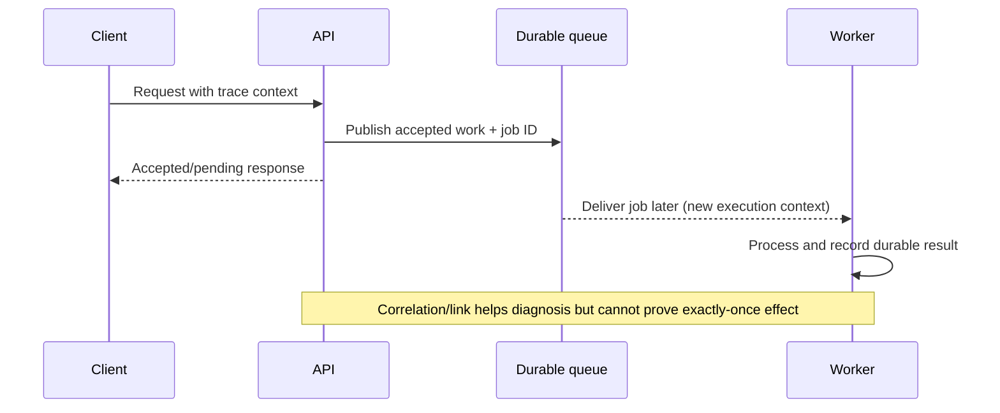

# Distributed tracing: context propagation, sampling and causal limits

> **Tycho independent book draft V09/C03, 2026-10-19.** Draws on W3C Trace Context (Recommendation of 2021) and published OpenTelemetry tracing semantics. All requests, diagrams and fault scenarios are original fiction. No trace collection, backend or distributed experiment was executed.

## Purpose and mission

Distributed tracing reconstructs *a selected execution story*: a request enters a component, starts work, calls another component and may later complete asynchronously. A trace can illuminate critical-path waiting, retries and failure propagation—but **it is not an authoritative record of every business effect**. A missing span may mean no work occurred, the instrumentation failed, or the sampling policy intentionally discarded it.

The architectural problem is to propagate enough correlation context across controlled boundaries while limiting overhead, data exposure, stale assumptions and accidental linkability. [Logging, audit and lineage](logs-audit-and-data-lineage.md) owns authoritative business and dataset histories; [metrics/SLOs](service-level-indicators-objectives-and-alerts.md) owns user-visible success and objectives.

## 1. A trace, a span and a request are different entities

| Identity | What it describes | What it does not prove |
|---|---|---|
| Trace ID | Correlates selected spans for one distributed trace | All effects, users or messages were recorded |
| Span ID and parent | A named timed operation and immediate relationship | Child timing is entirely CPU execution |
| Span link | Relationship to another span or asynchronous context | Guaranteed causal consistency or exactly-once delivery |
| Request/operation ID | Stable logical business intent where application defines one | Equivalent to a trace ID across all retries |
| Data/event identity | Durable domain effect with revision/sequence when required | A traced request committed successfully |

The [W3C Trace Context recommendation](https://www.w3.org/TR/trace-context/) standardizes HTTP propagation through traceparent and tracestate. It does not require every receiving service to create an exported span or guarantee a centralized complete trace. Trace context may be continued, ignored or regenerated at trust boundaries according to documented behavior.

## 2. Causal and temporal interpretation

A parent/child span structure records instrumented containment or relationships. This is not a global wall-clock ordering guarantee: clocks can differ across hosts, and asynchronous work may start after an HTTP response. A parent duration need not equal the sum of child durations because children overlap or traces omit work.

**Text alternative:** API accepts a durable job then responds before background processing finishes. A later worker may create a distinct trace linked to the initiating operation. The job's authoritative status remains a separate domain record. No real runtime or messaging product was used.

Trace data can help locate where a delay happened only when:
- clocks/timestamps and parent relationships are interpreted at the correct boundaries;
- instrumentation covers the suspected operation;
- spans include meaningful errors, retries, concurrency and dependency context;
- one logical business operation may have several network attempts/traces;
- sampling and export failures are disclosed.

## 3. Propagation is also a trust boundary

External callers can send headers bearing fabricated trace IDs, flags and vendor state. Do not treat externally supplied context as authorization, tenant membership, evidence of an authenticated principal, or permission to attach protected metadata to a trace.

The [W3C spec privacy/security considerations](https://www.w3.org/TR/trace-context/#security-considerations) discuss propagation risks, including sensitive data through trace context and boundaries. Do not carry credentials or personally identifying values in trace IDs, tracestate or span attributes. Generate or scrub context as appropriate for trust zones and apply policy-based access to traces and their search metadata.

**Synthetic failure:** a fictional catalog sends a full contact address as a trace label. The telemetry backend allows broad diagnostic access; an otherwise harmless trace becomes a privacy disclosure. The architecture must instead use bounded safe correlation and restrict detailed identity to the actual authorized business system.

## 4. Sampling limits what the trace can support

| Policy | Advantage | Limitation |
|---|---|---|
| Head sampling | Can limit collection near request start | Later severe error may be missed |
| Tail sampling | Can prefer slow/error traces using fuller context | Requires buffered state and collector resources; decisions can be late |
| Always-on bounded development sampling | Excellent reproduction for controlled fixtures | May be too costly or intrusive for arbitrary high-volume traffic |
| Adaptive/service-specific | Fits selected cost/diagnostic objectives | Biases populations; not a statistical census |

The [OpenTelemetry sampling concepts](https://opentelemetry.io/docs/concepts/sampling/) explain sampling decisions and trade-offs. A small selected trace set cannot accurately estimate every service success ratio unless the sampling design supports that inference and uncertainty is disclosed.

A missing trace for a transaction does not prove that no accepted write exists. A trace with a successful span status does not prove the database commit or downstream external effect was correct.

## 5. Context, async messages and retries

When an RPC call times out, the client can retry under the same logical operation key but a new span or trace. The tracing design should represent **attempt** versus **operation**, preserve optional links, and avoid inflating business throughput from multiple attempts.

An asynchronous workflow may have multiple producers and consumers; a single parent chain can be misleading. Span links or stable message/job IDs support correlation but do not enforce message order or a distributed transaction. [Outbox/idempotency](../distributed/transactional-outbox-and-idempotency.md) owns acknowledgment and duplicate-effect boundaries; [streaming](../integration/stateful-stream-processing-and-cdc.md) owns versioned event/replay state.

## 6. Original diagnostic decision

A hypothetical API's p99 worsens after a release. One proposal is to migrate to a different transport. First inspect sampled parent critical paths, dependency queues/pool wait, timeouts and retries; compare with unsampled user-level error/latency metrics. If only ten percent of requests were sampled, a p99 measurement from those traces cannot automatically be treated as the population p99.

**Falsifiable test (not run):** inject a slow dependent RPC and a separate canceled background job; verify context propagation, trace/export gaps, parent critical-path visibility, safe cardinality/labels and business operation reconciliation. The test may fail in different places: tracing is diagnostic evidence, while final effect identity and correct outcomes require domain checks.

## 7. Public source ledger and nonclaims

| Public source read | Narrow support | Not proven |
|---|---|---|
| [W3C Trace Context Recommendation, 23 Nov 2021](https://www.w3.org/TR/trace-context/) | traceparent/tracestate propagation and privacy/security context | Actual interop between fictional services |
| [OpenTelemetry sampling concepts](https://opentelemetry.io/docs/concepts/sampling/) | Sampling approaches, trace-data selection limits | Recorded trace completeness or analytical p99 validity |
| [Tycho earlier tracing/logging research](trace-context-lineage-and-audit.md) | Prior cross-domain conceptual distinctions | Separate owner acceptance or collected evidence |

All example events, diagrams and tracing behaviors are hypothetical educational work. No tracing backend, software build, distributed request, review or sampling evaluation was performed. Former combined tracing/logging research remains preserved for claim-level editorial reconciliation, not reproduced in full.

**Navigation:** proposed **V09/C03** in [book outline](../PROPOSED-STRUCTURE.md), current [observability landing](README.md). Related [Metrics and SLOs](service-level-indicators-objectives-and-alerts.md), [Audit and lineage](logs-audit-and-data-lineage.md), [Tail latency](../performance/tail-latency-fanout-and-deadline-budgets.md).
