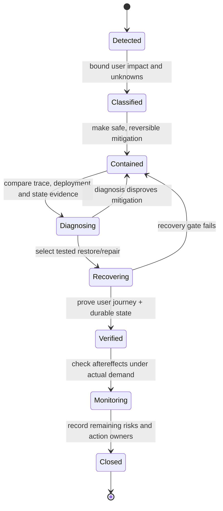

# Incident response, containment and operational change

> **Tycho System Design draft V09/C06**, 2026-10-19. Built from independently public reliability guidance and wholly synthetic scenarios. This is not an executed incident, operational playbook for a real service, incident review, tested drill, or independently approved response policy.

## Purpose and mission

Monitoring detects symptoms. Incident response is the coordinated work of **protecting users, restoring correct service outcomes, containing ongoing damage and learning from failure**. The architecture must make these actions possible: operators need trustworthy service boundaries, safe read-only diagnosis, bounded failure modes, reversible operational controls and a known separation between redeploying code and recovering authoritative data.

During a failure, technical decisions are often made under uncertainty. An incident model should prevent uncontrolled simultaneous changes and avoid declaring "resolved" simply because one dashboard returned to green while user-visible outcomes or persistent state remain incorrect.

[Google SRE's Incident Management](https://sre.google/sre-book/managing-incidents/) describes coordination and dedicated command, operations and communication responsibilities. [Google's SRE Workbook, Incident Response](https://sre.google/workbook/incident-response/) expands on the coordination, communication and control principles. Those public processes inform this original architecture explanation; they do not grant permission or confirm readiness for a specific service.

## 1. Define impact and correctness before the response procedure

An alert is evidence that a condition crossed a configured threshold. It is not automatically proof of a certain root cause or the precise population harmed. Record:

| Question | Evidence boundary |
|---|---|
| What user journey is affected? | Success, partial result, incorrect result or inability to access a required capability |
| Since when? | First observed symptoms, earliest known data change, detection/notification time and uncertainty |
| How extensive? | Affected operation/client/region/version, data sample and explicit unknowns |
| What invariant could be violated? | Duplicate committed effects, missing authoritative writes, unauthorized reads, stale output |
| What remains safe? | Known correct read-only mode, admission controls, unaffected partitions |
| Can the system recover? | Actual restore point, data reconciliation, replay/rollback contract and acceptance proof |
| Who may authorize a risky action? | Named role and applicable change/access policy, not assumed broad privileges |

A metric may improve after dropping all costly requests; business success has not necessarily improved. Similarly, a process may restart while an interrupted cross-system update remains unreconciled. Incident closure must therefore check user-visible correctness and durable recovery independently of availability.

## 2. Functional roles and a single source of operational truth

Use a scalable incident role model, adapted to team size:

- **Incident coordinator:** owns shared situation awareness, priorities, delegation, decision log and next checkpoint; does not have to execute every change.
- **Operations lead:** owns approved intervention, health verification and rollback/forward recovery steps; reduces the danger of multiple responders changing the same system independently.
- **Communications lead:** states impact, what is known/unknown and updates affected parties at an appropriate cadence; does not invent ETAs or root causes.
- **Investigation lead(s):** gather read-only evidence, form competing hypotheses and run bounded diagnostic tasks with clear ownership.
- **Follow-up owner:** records unresolved evidence, temporary mitigations and post-incident corrective actions after stabilization.

These are responsibilities rather than a mandatory staffing template. One trained person may hold multiple roles in a small event; larger events should separate them. The [Google SRE incident guidance](https://sre.google/resources/practices-and-processes/incident-management-guide/) emphasizes coordination, communication and control independent of normal reporting lines.

### Original operational flow

Text alternative: incident detection leads to classification, containment and diagnosis. Recovery is an explicit step distinct from changing software; it needs a verification gate for customer-visible results and state correctness. If diagnosis or recovery fails, restore safe containment rather than assuming that mitigation succeeded.

## 3. Response actions are architecture choices

| Mitigation | Can protect | Can damage if applied blindly |
|---|---|---|
| Stop unsafe writers | Prevent new incorrect durable effects | Block legitimate essential work; unprocessed commands may need replay |
| Reduce admitted work | Bound overload/retry amplification | Explicit rejection semantics and client backoff become necessary |
| Isolate faulty dependency | Preserve unaffected journeys | Partial responses must not imply complete authoritative truth |
| Roll back deployable version | Undo a code/config regression if state compatible | Persisted schema/events may not be readable by old code |
| Fail over a region/instance | Recover from named failure domain | Data lag, split-brain writes, fencing and stale routing |
| Restore from backup | Recover missing data when valid restore exists | May lose newer accepted operations; reconciliation required |
| Reconcile/replay durable events | Repair known missing projections/effects | Duplicate side effects without idempotency |
| Rotate compromised credential | End credential reuse | Can disable critical downstream service if dependencies unknown |

Read [safe rollout and recovery](../delivery/safe-rollout-and-recovery.md), [multi-region disaster recovery](../deployment/multi-region-disaster-recovery-contracts.md) and [idempotency](../distributed/transactional-outbox-and-idempotency.md) for the technical implementation models. An "undo" control that reverses only application code is not a safe data rollback.

## 4. Original fictional incident: search index diverges from stored truth

Consider an invented public index of local hiking trails. The authoritative trail repository is correct, but its asynchronous search index stopped consuming updates after a configuration change. Some searches return outdated trail conditions. A second proposed fix is to delete and rebuild the index while updates continue.

**Detect:** a version-lag alarm and user report show stale search entries; neither yet proves the cause. The response team compares authoritative record version/time with index offset and timestamp for a bounded sample. The impact could include unsafe or unavailable trail information, so a stale result must not be represented as verified current truth.

**Contain:** if current data accuracy is critical, disable stale search for affected partitions or present explicit stale/partial status, while retaining safe authoritative reads. Do not re-enable a broken index solely because the search server responds HTTP 200.

**Investigate:** compare connector offset, source update order, schema version, failed records and deployment/config revision. Competing hypotheses: consumer paused, poison message blocking partition, changed mapping rejecting new field, backend index quota or unrelated request cache. Each requires a different discriminator.

**Recover:** restart only after identifying safe replay position and applying stable record identity; rebuild in a separate index generation with source snapshot/offset semantics, reconcile counts and sampled critical fields, then atomically switch readers under a freshness gate. A live rebuild that permanently misses updates during the scan would not satisfy the invariant.

**Verify:** prove that a known subset of trail edits becomes searchable at an accepted freshness window, no revoked entries are exposed, alerts correctly identify lag, and the ability to revert/forward repair is documented. An index green status is insufficient proof of these user-level checks.

Everything here is a **fictional design and drill plan**, not a performed response. The general need to distinguish authoritative data, derived indexes, failover and freshness is independently described in [Tycho retrieval architecture](../search/lexical-indexing-bm25-and-sql-fts.md), [CDC/stateful streaming](../integration/stateful-stream-processing-and-cdc.md) and [safe release](../delivery/progressive-delivery-and-schema-evolution.md).

## 5. A usable incident log separates observation from explanation

| Time/event class | What belongs in the log | Why |
|---|---|---|
| Detection | Timestamp, source, scope, first symptom and detection uncertainty | Distinguish occurrence from discovery |
| Observation | Trace/sample/record revision, window, metric definition, access limitations | A graph or quote must be re-verifiable |
| Hypothesis | Candidate cause, contrary evidence, test and owner | Stop guesses from becoming retrospective facts |
| Intervention | Approver, exact version/config/action, expected outcome and rollback plan | Avoid unsafe concurrent changes |
| Result | What actually changed, user journey checks, side effects and failed tests | Green process status is not full recovery |
| Communication | Audience, confirmed impact, unknowns, next update trigger | Prevent false confidence |
| Follow-up | Remaining risks, prevention, owner and evidence for eventual closure | Preserve learning rather than merely writing a report |

Avoid pasting sensitive request bodies, tokens, private user identifiers or raw diagnostic dumps into broad incident communications. Use safe references with controlled access and retention. Incident systems are themselves data products subject to integrity, privacy and access constraints.

## 6. Practice response before production failure

The architecture should be exercised with bounded **failure drills**, preferably in a safe isolated environment first: change a response to error, pause a synthetic consumer, kill a nonauthoritative replica, simulate unavailable backup, corrupt a generated *test* index. Check not only recovery speed but whether metrics detect it, responder permissions are sufficient, instructions are unambiguous, and business invariants survive.

A complete rehearsal is explicit about:
- Which user journey/failure classes were exercised and which were not.
- What signal triggered response, including false-positive/false-negative boundaries.
- Actual detection, decision, mitigation, restored correctness and communication times from a declared clock.
- Whether restoring code, authoritative state and derived data required different actions.
- Which intervention would be unsafe under untested production conditions.
- Which corrective action can be verified later through tests, drills or changed failure exposure.

An uncontrolled real failure is not an acceptable experiment merely to validate a book diagram. Production exercises need independent risk approval, safe rollback and safeguards; Tycho's fictional exercises cannot provide it.

## 7. After-action analysis: avoid a single invented root cause

The [SRE Postmortem Culture](https://sre.google/sre-book/postmortem-culture/) emphasizes documenting impact, timeline, contributing conditions and follow-up actions rather than blaming individuals. A correct after-action record may show multiple contributing causes: one bad config, an untested schema interaction, monitoring blind spots and inadequate failover verification.

For the synthetic index scenario, a useful **hypothesis for prevention** is that the ingest consumer should reject an unrecognized mapping before publication; an independent source-to-index freshness invariant might detect lag; a repair procedure needs stable replay positions. These are *possible controls*, not proven fixes. Every action must have a responsible reviewer, reproducible acceptance test and residual-risk statement.

Postmortem publication itself does not ensure issues were remedied; track closure evidence and re-evaluate when source versions, workflow or demand changes.

## 8. Source ledger, limitations and navigation

| Independently public source inspected | Supports | Does not prove |
|---|---|---|
| [Google SRE, Managing Incidents](https://sre.google/sre-book/managing-incidents/) | Delegated incident management roles and coordination | Any actual team's staffing or exercised response |
| [SRE Workbook, Incident Response](https://sre.google/workbook/incident-response/) | Communication/control and incident procedure design | An approved operational policy for Tycho's fictional example |
| [SRE Book, Postmortem Culture](https://sre.google/sre-book/postmortem-culture/) | Learning-oriented, evidence-based postmortem practice | Root causes in a hypothetical failure |
| [Tycho safe rollout and recovery](../delivery/safe-rollout-and-recovery.md) | Separation of software rollback, persisted state and tests | A successful real restore drill |

All incident events, system names, mitigations, diagrams and example consequences above are original **synthetic** constructs; no real user incident or operational metric is asserted. A future editor must verify actual versioned source excerpts, authority and compatibility before applying the model in a specific setting.

**Navigation:** proposed owner V09/C06 in [book outline](../PROPOSED-STRUCTURE.md); section landing [Observability and audit](README.md). Related [metrics/SLOs](metrics-slo-timeseries-architecture.md), [tracing and audit](trace-context-lineage-and-audit.md), [recovery](../deployment/multi-region-disaster-recovery-contracts.md), and [safe deployment](../delivery/progressive-delivery-and-schema-evolution.md).
