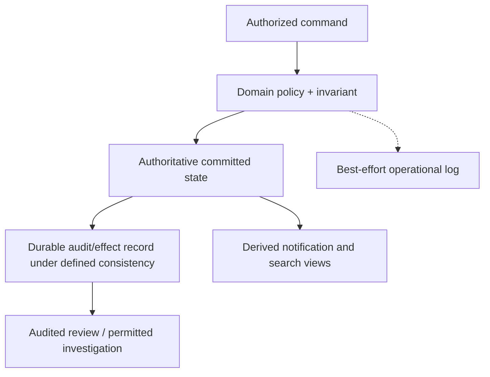

# Structured logging, authoritative audit and data lineage

> **Tycho original System Design manuscript V09/C04, 2026-10-19.** Public OpenTelemetry Logs Data Model and OpenLineage specifications support narrow data representation claims. All cases are invented, with no real logs, private identifiers, audit store, workflow run or compliance approval used.

## Purpose and mission

Logs explain what software *reported*. Traces help correlate execution. A durable business audit record states what an authorized domain operation actually committed. Data lineage describes how datasets or outputs depend on inputs and processing jobs. These are different evidence products with different completeness, identity, privacy and retention requirements.

A sampled trace or best-effort log **cannot** become a trustworthy ledger of all authorized changes merely by being stored for years. An audit trail needs an explicit integrity, access, ordering and completeness contract. A lineage graph describes declared or observed data flows, not automatically a proof that every input/output transformation executed correctly.

## 1. Separate semantics before selecting storage

| Evidence type | Primary question | Essential property | Failure or misuse |
|---|---|---|---|
| Operational log | What did this runtime report, and why? | Timestamp, level, context, safe attributes | Log drop interpreted as no event |
| Trace/span | Which instrumented work was causally correlated? | Trace/span identity, sampling/export scope | Trace regarded as every business write |
| Business audit | Who was authorized to change what authoritative state, and what committed? | Durable event/effect identity and integrity policy | Asynchronous log missing after commit |
| Dataset lineage | Which job/run consumed or produced which dataset or partition? | Source/target dataset identity and run/version | A reported dependency treated as data correctness |
| Compliance retention | How long and who can access evidence? | Policy, legal/contract owner, deletion and access scope | Raw secrets indefinitely retained |

The [OpenTelemetry Logs Data Model](https://opentelemetry.io/docs/specs/otel/logs/data-model/) documents timestamps, observed timestamps, trace identifiers, severity, resources, scope and attributes. This is a **structured telemetry model**, not a guarantee that every application log event was recorded atomically with its corresponding business transaction.

## 2. An original fictional reservation audit

A fictional public equipment library allows members to reserve shared devices. A successful booking should have one authoritative reservation identity, and a cancellation should identify the reservation and authorization decision.

An operational log such as "reservation requested" may be emitted before the database transaction commits. It is valuable diagnostic context, but it is **not evidence of accepted state**. Likewise, a log sink may be unavailable while an authorized operation commits successfully.

An **illustrative domain audit record** might contain a stable effect ID, actor/role reference within authorized access, tenant or resource scope, operation type, target state revision, commit time and an integrity mechanism. Which sensitive fields are admissible, how long they remain and whether they are immutable require actual policy decisions; they cannot be invented by a reference book.

**Text alternative:** a business command passes an authorization and correctness gate. The domain commits authoritative state with a defined audit/effect consistency boundary; separately emitted operational logs may be dropped. Derived notifications and indexes do not automatically replace domain audit evidence.

This design requires a **real implementation of atomicity/consistency** to claim the audit reflects committed state. A diagram doesn't guarantee a transactional outbox or audit record is written atomically with another database.

## 3. OpenLineage records data-flow relationships, not business approval

[OpenLineage's core specification](https://github.com/OpenLineage/OpenLineage/blob/main/spec/OpenLineage.md) describes Jobs, Runs, input/output Datasets and extensible Facets. Runs represent executions of jobs; data-flow metadata relates those executions to datasets and their change over time.

The [OpenLineage job lineage facet](https://openlineage.io/docs/spec/facets/job-facets/lineage/) can model explicit flow relationships without inferring that each input contributes to every output. This matters in multi-output processing: naïvely creating all possible input/output edges misrepresents the data provenance.

**Synthetic example:** one job reads public catalogue descriptions and device booking status to produce a public listing; a second output aggregates only anonymized usage counts. It would be false to infer that every booking attribute appears in the usage report merely because both outputs came from one job. Lineage should preserve actual mapping and processing semantics.

| Lineage element | Identity / question | Caution |
|---|---|---|
| Job | What transformation is intended? | One job definition has many runs and revisions |
| Run | Which execution occurred and what was observed? | A start event is not completion proof |
| Input dataset | Which version, partition or source was read? | A dataset name without revision can be ambiguous |
| Output dataset | Which artifact or materialized view was written? | Existence does not establish validity or freshness |
| Facet | Which versioned metadata enriches job/run/dataset? | Missing facet does not justify an invented property |

Tycho's separate source-to-claim provenance for its book is a general editorial concept; this chapter covers **data-lineage system design**, not implementation of a curated Tycho knowledge graph.

## 4. Security, retention and integrity boundaries

Storing logs and audit records can create security and privacy risks:
- Raw HTTP bodies, access tokens, emails or other sensitive fields may be too broad for operational log sinks.
- A shared audit service must enforce subject/object/tenant permissions and safe access histories.
- Tamper evidence and complete event capture require independent engineering controls; encrypting at rest alone does not prove integrity.
- Retention must balance actual business/legal requirements against minimization, deletion and incident needs. A backup archive or search index can retain data after a primary record is removed.
- A log with a malicious embedded instruction or fabricated identity should be treated as untrusted content, not as a privileged command to downstream agents.

Log redaction at a central collector may occur **after** sensitive bytes have already traversed insecure intermediate paths. Prefer limiting exposure at emission and verifying the whole ingestion chain.

## 5. Failure chronology and negative evidence

**Fictional failure:** the application emits "booking accepted", then its database transaction fails; the log sink persists the line. Another request commits a booking while the log collector is down. The operations team cannot reconstruct authoritative acceptance from logs alone.

A designed response:
1. Query authoritative effect identities and committed revisions under authorized access.
2. Reconcile telemetry and trace observations against those records rather than redefining truth.
3. Identify dropped/duplicated log windows and missing dataset/lineage events.
4. Rebuild derived views from a versioned state source if their replay contract allows it.
5. Report uncertain results as uncertain, and preserve the investigation's access/retention policy.

Do not claim an audit is durable without a tested commit boundary and safe identity/corruption model.

## 6. A source-led acceptance test

Proposed fixture only:
- Force a rollback after an operational "requested" log and ensure authoritative audit says no accepted effect.
- Commit a booking during log export failure and ensure audit remains complete under its own contract.
- Retry a committed logical operation and verify effect identity rather than duplicating state/audit.
- Run a transformation with two inputs and two outputs but only a subset of true data-flow edges; verify lineage does not invent false edges.
- Revoke a user's access and check both audit querying and derived indexes respect authorization.
- Exercise retention expiry and restore; verify no surprising recreated unauthorized data paths.

**No test ran** for any of these cases.

## 7. Public source ledger and nonclaims

| Public evidence inspected | Narrow support | Unverified |
|---|---|---|
| [OpenTelemetry Logs Data Model](https://opentelemetry.io/docs/specs/otel/logs/data-model/) | Log event fields, timestamps, trace correlation and attributes | Complete durable business audit |
| [OpenLineage core specification](https://github.com/OpenLineage/OpenLineage/blob/main/spec/OpenLineage.md) | Job/Run/Dataset/Facet distinctions | Correct lineage for invented transforms |
| [OpenLineage job lineage facet](https://openlineage.io/docs/spec/facets/job-facets/lineage/) | Explicit source-target flow edges under declared job | Full traceability for any actual dataset |
| [Tycho tracing manuscript](distributed-tracing-context-and-sampling.md) | Causal/sampling limitations of traces | Audit-complete business history |

All identities, system behavior, logging examples, risk tables, diagram nodes and trial descriptions are independent invented teaching materials. No real logs or customer data used, no records persisted, no security/privacy auditor or technical reviewer accepted this chapter. The former combined [traces/logs/lineage/audit research](trace-context-lineage-and-audit.md) remains available for editorial claim reconciliation.

**Navigation:** proposed owner **V09/C04** in [book outline](../PROPOSED-STRUCTURE.md), current [observability landing](README.md); related [Distributed tracing](distributed-tracing-context-and-sampling.md), [Agent-safe knowledge](../security/safe-agent-access-and-knowledge-isolation.md), [Outbox/idempotency](../distributed/transactional-outbox-and-idempotency.md).
