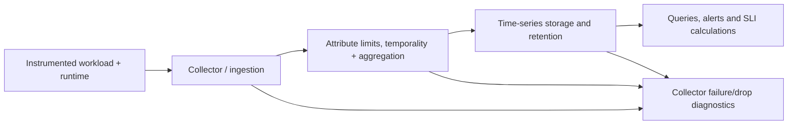

# Metrics ingestion, cardinality and time-series retention architecture

> **Tycho source-grounded System Design draft V09/C02, 2026-10-19.** OpenTelemetry and Prometheus public specifications support the narrow instrumentation and data-model descriptions. All pipelines, rate/budget figures and failure tests here are original hypothetical examples. No collector, database, remote-write service or runtime metric stream was deployed or exercised.

## Purpose and mission

A useful service-level indicator needs telemetry that preserves the intended meaning. Transport and storage choices determine what information survives collection, aggregation, label filtering, retention and backend failure. Even perfect dashboards cannot correct instrumentation that uses the wrong event denominator, while unbounded metric labels can consume substantial resources and expose sensitive identifiers.

This chapter owns **how signals are represented, transferred, stored and operated**. [SLIs, SLOs and error budgets](service-level-indicators-objectives-and-alerts.md) owns the user-visible definition and alert decision. [Tracing/log/audit](trace-context-lineage-and-audit.md) owns different evidence types.

## 1. Separate measurement generation from retrieval

A generic telemetry pipeline may include:

- Application instrumentation and runtime sampling, where measurements originate with defined identity and units.
- Collector/agent scraping or push collection, subject to scrape schedule, authentication and resource limits.
- Metric processing: safe label attributes, filtering, aggregation, temporality conversion and batching.
- Time-series backend: ingestion, indexing, durable retention, query and compaction/downsampling.
- Alert and dashboard queries against admitted time windows and stored samples.
- Independent data-quality monitoring of missing, late or duplicated telemetry.

**Text alternative:** measurements pass from emitters through collection, filtering and aggregation into bounded time-series storage. Data quality, errors and missing samples must be monitored at collection, transformation and storage. This is a proposed architecture sketch, not a deployed observability stack.

## 2. Measurement types and aggregation limitations

The [OpenTelemetry Metrics Data Model](https://opentelemetry.io/docs/specs/otel/metrics/data-model/) defines sums, gauges, histograms and exponential histograms, attribute identity, timestamps and delta/cumulative aggregation temporality. [Prometheus metric types](https://prometheus.io/docs/concepts/metric_types/) describes counters, gauges, classic/native histograms and summaries, together with version-sensitive behavior. These representations are **not interchangeable without conditions**.

| Type or transform | Suitable purpose | Failure to avoid |
|---|---|---|
| Cumulative monotonic counter | Count attempts, good/bad events or bytes over intervals | Using raw counter delta across reset without reset-aware processing |
| Gauge | Current concurrent work, cache size, memory or queue depth | Treating a snapshot as a count of completed events |
| Histogram | Bucket distribution of durations/size; estimable quantiles under known boundaries | Averaging service p99 quantiles across replicas as though they were samples |
| Summary with quantiles | Local streaming approximate quantiles for a window | Combining incompatible per-instance quantiles as one global quantile |
| Delta sum/histogram | Observations for a bounded interval | Dropping interval start/end times and double-counting on replay |
| Cumulative sum/histogram | Accumulation since a start timestamp | Misreading process restart as a negative business event |

**Critical distinction:** a system's log of individual booking outcomes can establish logical identity; a metric counter alone may double-count retries. A metric stream may show something failed but does not prove the event's authorized business meaning or provide an authoritative audit trail.

## 3. Temporality, restarts and data correctness

OpenTelemetry distinguishes **delta** data points representing bounded non-overlapping intervals from **cumulative** points that include measurements since a start timestamp. For cumulative streams, restart or stream reset changes the start time; collectors must not infer a permanent counter decrease as a legitimate negative operation. Converting temporalities requires careful handling of overlapping time ranges, missing intervals and multiple writers.

A series name, numeric value and timestamp are not enough to interpret it. Include unit, resource scope, metric kind, attribute identity, aggregation temporality and proper start/end semantics where applicable.

The [OpenTelemetry metrics model](https://opentelemetry.io/docs/specs/otel/metrics/data-model/) explicitly discusses delta/cumulative conversion and corresponding reliability/memory trade-offs; not every arbitrary collector extension is guaranteed to preserve semantics. An architecture must test the actual pipeline under restart, duplication, dropped export and mixed-version instrumentation.

## 4. Cardinality is multiplicative and architectural

Metric series identity commonly combines name and distinct label/attribute value sets. A convenient label such as a unique request ID, customer ID, trace ID or rapidly rotating ephemeral resource ID can create very many series with expensive indexing and retention and may leak sensitive data.

**Fully hypothetical arithmetic:** suppose one metric has 12 routes, 5 method/outcome groupings, 3 regions, and 40 independently emitting application instances, with all combinations present. Then its *illustrative* upper product is 12 × 5 × 3 × 40 = **7,200 series** before considering per-instance process recycling, per-tenant/URL labels or histogram buckets. With 20 classic histogram buckets per series, additional cumulative buckets, counts and sums increase the number of Prometheus float time series further. This calculation is a **model**; it is not a measured TSDB footprint or actual sample rate.

Cardinality is not the same as volume: 7,200 series scraped every 15 seconds generate different ingest/storage costs from the same series sampled every minute. Metrics type, compression, retention, index overhead, query fan-out and multi-region replication change resource costs.

**Design guidance:**
- Prefer bounded route templates and explicit status classes to raw URLs.
- Never publish secrets, unique tokens or personal identifiers as metric labels.
- Make label cardinality a reviewable instrumentation constraint with known worst cases.
- Use logs or traces with access controls for high-detail correlation rather than making one metric series per user.
- Bound per-tenant metrics and index privileges; separate access scopes.

## 5. Aggregation loses information by design

Rollups and downsampling can reduce storage while preserving some statistics. But averaging percentiles across groups is generally invalid; deleting buckets removes resolution for later quantile estimation; aggregating tenants can hide fairness and authorization failures. A sum and count can reconstruct the mean under compatible populations; they cannot reconstruct an arbitrary high-percentile distribution.

Choose retention from the question to answer: real-time alert, incident diagnosis, historical capacity trend or audit need. **An audit obligation cannot be satisfied simply by retaining sampled telemetry**, particularly when legal/business effects require complete durable event records.

The pipeline must record where transform loss occurs. For example, a daily series average can hide a 10-minute queue crisis; a histogram aggregated without compatible bucket boundaries can misrepresent the merged distribution.

## 6. Failure modes and operational economics

| Failure | Potential false conclusion | Required observability/repair |
|---|---|---|
| Scrape/export failure | Zero errors in an empty time series means full availability | Track sample freshness, target health and explicit unknown data |
| Duplicate cumulative stream | Throughput inexplicably doubled | Source/writer identity and temporality-aware deduplication |
| Cardinality explosion | Ingestion/TSDB saturation and dropped samples | Series growth and attribute-budget guard |
| Expired retention | Past incident looks clean because data vanished | Record known retention and separate long-lived source/audit evidence |
| Misconfigured downsampling | p99 appears improved | Verify histogram/quantile mathematics and preserved boundary |
| Storage unavailability | Alerts silently not evaluated | Independent monitor for pipeline health and fail-safe response policy |
| Cross-scope metric disclosure | Tenant/resource metadata leaks | Authorization over queries, labels and dashboards |

Metrics ingestion cost also includes collector resources, compression, scrape network, hot storage, query concurrency, replication, archive and operational on-call. A vendor's advertised storage price alone is not the full budget. Cost should be compared against how much a metric actually improves user-level decisions rather than retaining every raw label indefinitely.

## 7. Original synthetic architectural choice

A fictional public library catalogue needs request-success and latency metrics plus a 30-day capacity trend. Two candidates:
- **A:** bounded route/status histograms and counters plus a small set of resource/queue gauges, retained at appropriate short/long resolutions.
- **B:** raw URL + arbitrary client ID as labels on every metric, with full-resolution indefinite retention.

B may seem richer but can create unbounded series and sensitive metadata. A is a **conditionally better starting design**, provided the selected labels support needed error budget and tenant/service diagnosis. If detailed per-entity investigations are required, use controlled logs/traces with separate access/retention rather than unlimited metrics labels.

**Falsifiable test (not run):** generate known bounded route/status combinations, inject random client IDs, restart a producer, duplicate exports, drop one collection interval and replay timestamps. Compare series count, ingest resource budget, SLI numerical semantics, query correctness and exposure controls. There is no test data or result in this chapter.

## Engineering walkthrough — How one unbounded metric label multiplies storage

**Original synthetic metric:** a request-duration series records `route` (40 values), `status_class` (5), `zone` (3) and `tenant_id` (2,000). Ignoring labels added by instrumentation, the potential Cartesian product is `40 × 5 × 3 × 2,000 = 1,200,000` separate time series. Removing `tenant_id` reduces that theoretical combination count to `600`. These are *upper-bound dimensionality arithmetic*, not observed active series or a vendor price estimate.

At a purely hypothetical one sample per series every 15 seconds, a full million-plus active series would produce up to 80,000 samples/s; actual active combinations can be far lower and per-sample storage depends on compression, retention, replication and index layout. High-cardinality labels may leak tenant identity and consume query resources even when an app remains healthy.

| Pipeline boundary | Normal contract | Failure interpretation to reject |
|---|---|---|
| SDK/exporter | Counter/histogram semantics and bounded attributes | Missing samples imply no user traffic |
| Collector | Backpressure, aggregation, resource budgets | Dropped telemetry means errors disappeared |
| Time-series store | Retention and label query budget | A downsampled p99 equals p99 of original raw durations |
| Dashboard/alert | Distinguish reset, cumulative/delta and missing windows | Counter reset interpreted as negative successful requests |

The existing OpenTelemetry metric data model and Prometheus metric-type references define terminology; they do not certify a given collector's actual temporality conversion or cardinality footprint. A missing histogram bucket or restarted counter can make apparent rates nonsensical without explicit reset/missing-data handling.

**Proposed, unexecuted:** replay the same traffic with bounded route templates versus unbounded tenant/path labels; measure active series, ingestion memory, missing points, query time and retained bytes. Keep high-cardinality user IDs in access-controlled audit or trace context when justified, not automatically in globally aggregatable metric labels. A cheaper dashboard is not sufficient if it hides severe tail errors.

## 8. Public evidence, caveats and navigation

| Independently inspected public source | Narrow support | What remains unproven |
|---|---|---|
| [OpenTelemetry Metrics Data Model](https://opentelemetry.io/docs/specs/otel/metrics/data-model/) | Sums/gauges/histograms, delta/cumulative temporality, timestamps and translation constraints | Conformance of invented collector deployment |
| [Prometheus Metric Types](https://prometheus.io/docs/concepts/metric_types/) | Counters, gauges, classic/native histograms, summaries and version-related aggregation cautions | Observed TSDB cost or configured instance behavior |
| [Tycho original metrics/SLO research](metrics-slo-timeseries-architecture.md) | Earlier combined researched mechanisms and hypothetical alert controls | Independently accepted canonical split |

Everything here is original general System Design prose and wholly fictional examples. No data, measured cost, series count, alerts, collector or metric backend was actually generated. The old combined research article is **preserved** as supporting source while the V09/C01 and V09/C02 chapter ownership is separated. Further claim-level source and editorial review is required before release.

**Navigation:** proposed **V09/C02** in [planned contents](../PROPOSED-STRUCTURE.md), [observability landing](README.md); related [SLIs and error budgets](service-level-indicators-objectives-and-alerts.md), [tracing and audit](trace-context-lineage-and-audit.md), [capacity planning](../performance/capacity-planning-and-cost-performance.md).
