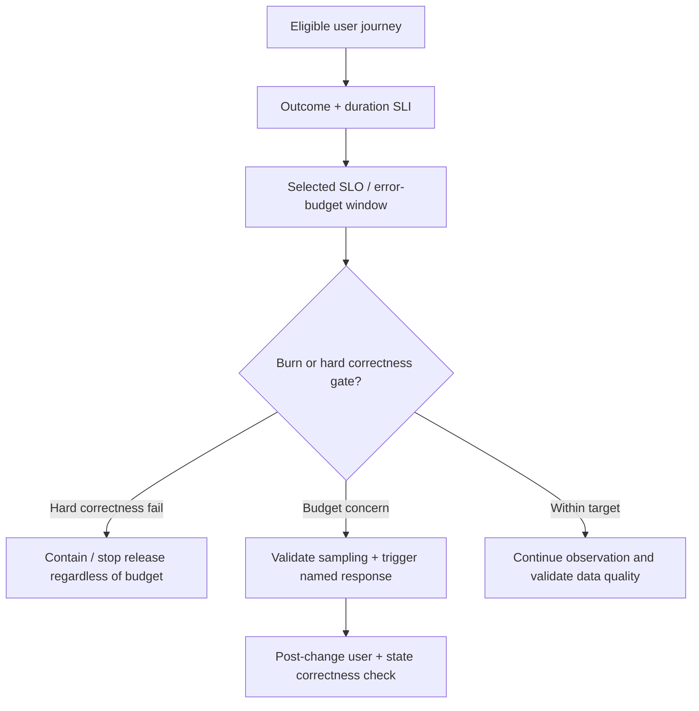

# User-visible service indicators, objectives and error-budget decisions

> **Tycho chapter-owner draft V09/C01, 2026-10-19.** Public Google SRE Workbook, Prometheus and OpenTelemetry documentation inform the explanation. The workflow, numbers and examples are original fictional teaching material. No service SLO, alert rule, monitoring deployment, traffic trace, data sample or independent technical acceptance has been observed or executed.

## Purpose and mission

A service-level objective (SLO) should make an explicit promise about **the user experience we want to preserve** and the window in which that promise is evaluated. Infrastructure utilization can help explain a problem, but a green CPU dashboard cannot show that an authorized user completed the intended operation or that a booking was not duplicated.

This chapter owns *which user events constitute success, how an indicator becomes a target, and how alerts create decisions*. [Metrics pipeline, cardinality and retention](metric-pipelines-cardinality-and-retention.md) owns instrumentation temporality, metric representation and storage costs. [Distributed tracing](trace-context-lineage-and-audit.md) owns request-causality evidence, not the definition of successful user outcomes.

## 1. Identify the service boundary and eligible population

An indicator needs a **denominator**. Consider an original fictional public equipment-reservation service. A user submits a logical attempt for a valid timeslot; it can be accepted, explicitly rejected because another reservation won, rejected for capacity, timed out, or commit without a delivered acknowledgment.

A proposed availability SLI could be the fraction of *eligible logical booking decisions* returned correctly within a deadline, where the service owner must determine which rejection classes are legitimate expected outcomes. A conflict rejection may represent correct business behavior, while a capacity rejection indicates service inability under a declared demand envelope. The treatment must be documented before measurements begin; otherwise changing the denominator can manufacture an apparent improvement.

| Defining question | Decision that must be explicit |
|---|---|
| What is one eligible operation? | Intent identity rather than HTTP attempt count across retries |
| Which boundary starts the clock? | Client, edge, API ingress, or asynchronous final decision |
| Which outcomes count as good? | Correct accepted/rejected result under business rules and deadline |
| How are pending/unknown outcomes treated? | Pending is not silently equivalent to completed; status contract matters |
| What window is meaningful? | 30 days, a shorter operating window or a stated peak event |
| Whose experience is represented? | Client type, route, operation class and authorized population |

The [SRE Workbook: Implementing SLOs](https://sre.google/workbook/implementing-slos/) begins with user-facing SLIs and deliberately asks teams to select meaningful service boundaries and objectives. It does not set a universal success percentage for this fictional scenario.

## 2. An SLI is an observation; an SLO is a chosen target

A service-level indicator is a quantified property of service behavior, such as the share of eligible requests that satisfy correctness and deadline gates. An objective is the target for that indicator over a specified rolling or calendar window. A signed external SLA is a separate agreement, not automatically the same as an internal SLO.

**Synthetic arithmetic, not a real objective:** suppose an owner elects a 99.9% good-event target over a 30-day period and exactly 500,000 eligible logical decisions occur. The allowed number of bad decisions under this arithmetic is **500**, assuming the unit, population and boundary are consistently counted.

A target without a specified event population can be meaningless. In a system with strongly varying demand, a time-based downtime ratio and a request-based failure ratio measure different effects. Neither automatically captures incorrect durable writes.

An error budget is an accounting expression of **permitted bad events under the chosen SLO**, not permission to violate a non-negotiable state invariant, authorization rule or contractual data-loss constraint. One duplicate committed allocation remains forbidden if exclusivity is a hard requirement, even if the overall availability SLO appears green.

## 3. Measure the right signals at the right level

Choose enough instrumentation to derive the end-user SLI:
- an authoritative logical operation ID spanning retries;
- attempt, admission and final outcome states, including explicit unknown/timeout;
- request/operation elapsed time from the selected clock;
- route, operation and bounded response classification;
- relevant policy/version context, without leaking private principals in metric labels;
- reconciliation outcomes after lost acknowledgments.

[Prometheus metric types](https://prometheus.io/docs/concepts/metric_types/) distinguishes counters (monotone cumulative except reset), gauges and histograms. A counter of attempted requests can be a useful measurement; it is not the same denominator as successful *unique booking decisions* if clients retry. A histogram can support latency SLO computation under its bucket/exemplar resolution and aggregation constraints. One recorded p99 without rejected/timed-out populations cannot prove user experience.

## 4. Burn rate and alerts are actions, not decorations

An error-budget burn rate compares observed bad-event consumption with the budget's expected consumption rate. A fast burn may need immediate intervention, but short windows can be noisy and long windows slow to detect severe faults.

The [Google SRE Workbook on alerting based on SLOs](https://sre.google/workbook/alerting-on-slos/) describes alert design around error-budget burn rates and time windows. This method does not imply universal thresholds, especially for services with intermittent traffic or where one incorrect operation is intolerable.

| Signal | Useful operational decision | Trap |
|---|---|---|
| Fast error-budget burn | Investigate impact and consider protecting capacity/halting rollout | Alert threshold selected without enough valid event samples |
| Sustained slow burn | Review problem history and release/quality trade-offs | Ignoring long-term harm because there is no loud incident |
| High p99 for one journey | Trace critical-path, queue and dependency wait | Inferring whole-product failure from one selected operation |
| Zero observed errors at idle time | Insufficient demand to validate reliability | Reporting “100% available” with no eligible operations |
| High CPU or pool occupancy | Supporting diagnosis and capacity control | Substituting resource usage for user correctness |
| Trace sampling dropped | Telemetry gap and reduced debugging confidence | Treating missing spans as proof no failures occurred |

## 5. An original synthetic error-budget decision

A hypothetical project owner set a 99.9% good-event target for a defined booking operation during a month. A release increases timeouts, and an operator proposes an automatic rollout pause.

A safe rule would:
1. Check that the event population is correct and the target window sufficiently sampled.
2. Compare logical operation outcomes, not simply network attempts.
3. Stop rollout if a mandatory correctness gate fails, **even with budget remaining**.
4. Use confirmed burn and impact to decide between mitigation, investigation or reversible rollback.
5. Verify that any recovery restores correct booked state rather than merely reducing HTTP errors.
6. Record the signal, source/alert version, decision and follow-up owner.

The action thresholds remain hypothetical. No PromQL query, SLO policy or alert was executed for this chapter.

**Text alternative:** a user journey produces an indicator, compared with a stated objective. A correctness failure always triggers its own mitigation; a budget alert must account for the event sample and leads to a verified response, not a purely cosmetic dashboard change.

## 6. SLOs need revision and contradiction handling

An old SLO may cease to represent user experience if a new API version changes which outcomes count as good, if retries are introduced or if the monitoring boundary shifts. Keep the numerator, denominator, units, target, data-source revision and effective date together.

A release can legitimately improve average response time while degrading the worst users. An unrelated region may hide under aggregate metrics; disaggregate by meaningful route/workload where needed without creating dangerous high-cardinality labels or data leakage. The [metrics ingestion/storage chapter](metric-pipelines-cardinality-and-retention.md) owns the telemetry cost and cardinality mechanics.

## Engineering walkthrough — What does a green SLO say about rejected business operations?

**Original fictional service window:** a booking endpoint records 10,000 *eligible* distinct user intents in a 30-day measurement interval, of which 9,970 reach the declared correct final result within the user deadline. A hypothetical target SLO of 99.9% would allow at most 10 failures among 10,000 intents, while this window has 30, **consuming 300% of the target's error allowance**. These values and target are illustrative, not a real SLO or observed incident.

An instrumentation design that counts only HTTP 2xx responses among requests **admitted into the service**, excluding 500 deliberate overload rejections before the handler, can report misleading health. Whether user cancellations, blocked abusive traffic, malformed requests and legitimate overload rejections count must be agreed before measurement; exclusion policy cannot change retrospectively to improve the score.

| Signal | Valid intended meaning | Unacceptable substitution |
|---|---|---|
| Eligible intents | Named user population and observation boundary | Completed requests only, hiding admission failures |
| Correct within deadline | Durable domain result, not merely 2xx | Queue acknowledgment called final reservation |
| Error-budget burn | Rate/quantity under chosen SLO window | Arbitrary alert threshold with no user consequence |
| Incident recovery | Correct journey restored and sustained | Process liveness or dashboard green after data divergence |

**Policy decision:** with that invented budget overspend, a sensible organization might delay nonessential risky deployments and prioritize correctness recovery while permitting necessary security fixes through a separately reviewed exception. This is a conditional governance choice, not a rule universally imposed by Google's SRE guidance.

**Proposed, not run:** inject dependency outage, client retries and admission rejections, independently count durable logical intents and compare with telemetry numerator/denominator. Recompute burn under both legitimate and unjustified exclusions and document who authorizes any change. The existing Google SRE SLO and alerting references support measurement principles, not the fictional budget.

## 7. Evidence and review boundaries

| Public source inspected | Supports | Does not establish |
|---|---|---|
| [Google SRE Workbook, Implementing SLOs](https://sre.google/workbook/implementing-slos/) | User-facing service indicators, meaningful targets and measurable populations | An approved target or availability result for any real service |
| [Google SRE Workbook, Alerting on SLOs](https://sre.google/workbook/alerting-on-slos/) | Error budget consumption and burn-rate alert considerations | Portable universal alert parameters |
| [Prometheus metric types](https://prometheus.io/docs/concepts/metric_types/) | Counter, gauge and histogram semantics | Correct configured metric labels or business outcome mapping |
| [Tycho performance and queueing](../performance/queueing-littles-law.md) | Why rate/response-time measurement boundaries matter | End-to-end SLO success for invented booking |

The equipment-booking example, logical outcomes, figures, hypothetical threshold and policy are original invented educational material. No data was collected, alert fired, recording rule executed, production target evaluated, privacy audit or technical peer review performed. The former combined [metrics/SLO/TSDB research page](metrics-slo-timeseries-architecture.md) remains as prior source material until a complete source-to-claim consolidation is accepted.

**Navigation:** proposed **V09/C01**, [observability landing](README.md). Next [Metrics pipeline, cardinality and retention](metric-pipelines-cardinality-and-retention.md), [Tracing and audit](trace-context-lineage-and-audit.md), and [Incident response](incident-response-and-operational-change.md).
