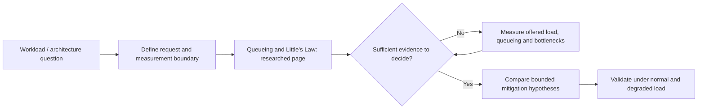

# Performance, scaling and resilience — research landing

Status: **several independently researched technical pages**, not a completed volume. This landing page only links to pages that exist and states which questions remain open; it does not stand in for an approved table of contents.

## Purpose and mission

Explain how workload, service demand, queueing, tail latency, saturation and failure affect software architecture selection. Readers and AI agents should be able to distinguish derived mathematical relationships, directly observed workload properties and unresolved resource-capacity questions before recommending scale-out or redistribution.

## Research navigation map

Text alternative: establish demand and work boundaries before interpreting mean occupancy; then examine sampling limitations and validate hypotheses through controlled experiments. This is a navigation map, not an assertion that all related chapters are complete.

## How the research questions connect

The chart is an **original reading and decision map**, not a simulated production system. The linked queueing, capacity-experiment, fan-out and autoscaling pages are researched drafts; other diagram boxes are diagnostic steps, not claims that a complete volume exists.

## Available research

| Reader question | Canonical researched page | Status / evidence |
|---|---|---|
| How do arrivals, logical operations, resource demand, concurrency and skew define a workload? | [Workload and arrival models](../volumes/v01-requirements-and-architecture/c02-workload-and-demand-models/workload-demand-and-arrival-models.md) | V01/C02; original examples and public k6/queueing boundary, not a workload forecast |
| When is a benchmark invalid because the generator, denominators or fixture changed? | [Load testing and benchmark validity](../volumes/v07-performance-scale-and-resilience/c03-load-test-methods-and-benchmark-validity/load-testing-and-benchmark-validity.md) | V07/C03; independently published k6 and histogram-model scope, no test executed |
| Which serial, contended and coordination limits defeat naive linear scaling? | [Contention, saturation and scaling laws](../volumes/v07-performance-scale-and-resilience/c02-contention-saturation-and-scaling-laws/contention-saturation-and-scaling-laws.md) | V07/C02 original model examples; Gunther scalability paper, no fitted throughput data |
| How do workload shape, operating cost and warm capacity affect a safe design? | [Capacity planning and cost/performance](../volumes/v07-performance-scale-and-resilience/c07-capacity-planning-and-cost-performance-trade-offs/capacity-planning-and-cost-performance.md) | V07/C07 public cost-method sources and invented sensitivity examples; no vendor price estimate |
| What can mean in-flight work, throughput and residence time establish, and when is Little's Law misapplied? | [Queueing, Little's Law and measurement boundaries](../volumes/v07-performance-scale-and-resilience/c01-queueing-littles-law-and-measurement-boundaries/queueing-littles-law.md) | Public-source-grounded draft from a fixed 2013 paper and specifically inspected k6/SRE documentation; not a benchmark or human-reviewed capacity study |
| How should offered load, failure and capacity hypotheses be tested? | [Workload profiles and capacity experiments](workload-profiles-and-capacity-experiments.md) | Source-bound methodology and synthetic examples; not a production load test |
| Why do p99 and user-visible deadlines worsen under dependency fan-out? | [Tail latency, fan-out and deadline budgets](../volumes/v07-performance-scale-and-resilience/c04-tail-latency-fan-out-and-time-budgets/tail-latency-fanout-and-deadline-budgets.md) | New V07/C04 evidence-based draft; no live tail benchmark |
| How do admission control, load shedding and graceful degradation preserve correct outcomes? | [Overload protection and graceful degradation](../volumes/v07-performance-scale-and-resilience/c05-overload-protection-and-graceful-degradation/overload-admission-control-and-graceful-degradation.md) | Public SRE/Builders' Library explanations and original failure fixtures; no test executed |
| When does autoscaling help, and what do startup lag and shared limits invalidate? | [Autoscaling lag and capacity limits](../volumes/v07-performance-scale-and-resilience/c06-horizontal-vertical-scaling-and-autoscaling-delay/autoscaling-lag-and-capacity-limits.md) | New V07/C06 draft against Kubernetes/AWS public docs; no executed platform test |
| How do workload shape, service demand and saturation interact with scalability laws? | [Workload shape and scalability laws](workload-shape-and-scalability-laws.md) | Workload profile, Little's Law and the Universal Scalability Law with stated synthetic boundaries; not a measured forecast |

## Planned questions — **not yet written**

- Validated, runnable scaling-law and resource-optimization experiments beyond the educational coverage.
- Deeper recovery-capacity cost trade-offs and executable overload-policy comparisons beyond the existing bounded drafts.

The planning owners are listed in the [proposed book structure](../PROPOSED-STRUCTURE.md). The source-reading procedure and stopping conditions are in the [research workflow](../../authoring/RESEARCH-WORKFLOW.md).

## Cross-domain boundaries

Execution-model and connection-pool specifics are owned by the
[execution research landing](../execution/README.md). Database shard placement is owned
by the [data research landing](../data/README.md). This page intentionally does not
duplicate those explanations or create dead links to nonexistent chapters.

## Research limits and next actions

This is the initial mechanism pilot [#38](https://github.com/rouslanbaranov/tycho/issues/38). See its chapter ledger for public-source scope, numerical example classification, unanswered experimental questions and review status. Subsequent research pilots cover event publication [#39](https://github.com/rouslanbaranov/tycho/issues/39) and recovery [#40](https://github.com/rouslanbaranov/tycho/issues/40).
