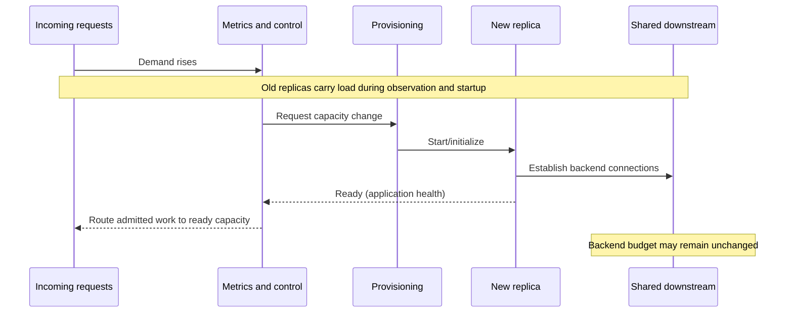

# Horizontal and vertical scaling: autoscaling lag, resource ceilings and stability

> **Original System Design chapter draft**, intended V07/C06. Public specifications reviewed 2026-10-19; synthetic examples only. No autoscaler, Kubernetes cluster, cloud instance, load generator, production telemetry or independent review was used to validate the proposed designs.

## Purpose and mission

Autoscaling is a **feedback-control mechanism**, not a promise of immediate extra capacity. A signal must be collected, interpreted, acted on, and followed by resource provisioning, application readiness and dependent-service capacity. During that delay, new demand still reaches the old infrastructure. Horizontal scaling multiplies processing replicas; vertical scaling changes resources available to existing replicas. Neither can increase throughput past a serial or externally fixed bottleneck.

This chapter answers when automatic capacity changes can help, how warm-up and stabilization affect behavior, what fails during bursts, and how to test the scaling policy *as an end-to-end system*. [Queueing](queueing-littles-law.md) owns throughput/occupancy mean identities, [tail latency](tail-latency-fanout-and-deadline-budgets.md) owns critical-path budgets, and [connection-pool budgets](../scaling/connection-pools-hikaricp-pgbouncer.md) owns backend resource multiplication.

## 1. Decompose the actual scale-out response time

Let the observed actuation delay be the sum of several **measured** stages:

- Metric event/aggregation delay: offered demand changes before a configured observation becomes visible.
- Decision delay: sampling interval, target deviation, policy threshold and stabilization.
- Capacity provisioning delay: resource scheduler, instance/image/container startup and possible quota checks.
- Application warm-up: runtime initialization, compilation, connection establishment, cache fill and readiness checks.
- Effective service delay: traffic routing and arrival at an instance that can really perform the required work.

These stages may overlap, so simply summing averages is not an empirical latency estimate. Measure earliest useful additional **completed throughput** as well as readiness timestamps. A new Pod may be marked running while its downstream DB budget remains exhausted.

[Kubernetes HPA documentation](https://kubernetes.io/docs/concepts/workloads/autoscaling/horizontal-pod-autoscale/) distinguishes horizontal replica changes from vertical resource assignment, and describes metric-driven control and scale behavior. [AWS EC2 Auto Scaling warm-up guidance](https://docs.aws.amazon.com/autoscaling/ec2/userguide/ec2-auto-scaling-default-instance-warmup.html) explains why newly started instances' initialization metrics can distort demand signals. Their control models are examples of implementation-dependent behavior, not a universal response-time SLA.

Text alternative: increased demand first reaches existing capacity; the controller observes it and requests more resources. A new replica becomes useful only after provisioning, readiness and routing, and may still be limited by a shared downstream dependency.

## 2. Feedback signals and the hot-key trap

A policy must choose a signal that reflects the **scarce resource** limiting useful progress:

| Proposed metric | Useful when | Deceptive when |
|---|---|---|
| Average CPU utilization | Work is CPU-bound and can be spread across replicas | Requests wait on DB locks or remote I/O; average hides one hot process |
| Memory pressure | Resource limit and cache footprint are known | More memory only retains more stale objects or delays leaks |
| Queue length / age | Each item has bounded work and service level is defined | A single blocked key/consumer prevents queue progress |
| Active requests | Per-request work and admitted load are stable enough | Long-polling/streaming changes what "active" costs |
| Successful completion rate | Business usefulness matters | Completed rate plateaus while offered attempts and failures rise |
| Custom downstream budget | External quota/pool is true bottleneck | Multiple upstream controllers compete over the same limited quota |

A ten-replica deployment that opens a 30-connection pool per instance can request 300 backend connections. A scale-out decision based only on CPU can exhaust a fixed database connection ceiling and make the service less reliable. [Connection pool architecture](../scaling/connection-pools-hikaricp-pgbouncer.md) explains cross-instance budgeting. Similarly, if all requests contend for the same item lock, sharding or more replicas may only increase waiting work.

## 3. Autoscaling can lose the race against a burst

**Fully synthetic example:** one replica completes at most 40 relevant operations/s *under a hypothetical independent workload and known downstream capacity*. Four warm replicas therefore have an optimistic nominal ceiling of 160 operations/s. A burst of 300 attempted operations/s begins and lasts 15 seconds. Extra replicas become useful only after an invented 45-second decision/provision/warm-up sequence.

During this burst, horizontal autoscaling **cannot** add useful capacity in time, even if the controller eventually chooses eight replicas. If admission is unlimited, unfinished work can grow; after the burst, scaled replicas may wake to a backlog and interfere with normal requests. The simplistic arithmetic surplus is (300 − 160) × 15 = **2,100 attempted operations** before accounting for service times, errors, key skew or retries. This is a **hypothetical upper-bound illustration under fixed offered/completed rates**, not a measured queue size. Dropped work, deadline expiry and admission policies change it dramatically.

| Mitigation | Benefit | Explicit trade-off |
|---|---|---|
| Pre-provision enough warm capacity | Immediate headroom under predictable peaks | Higher idle resource cost |
| Scheduled/predictive scaling | Capacity can arrive before expected patterns | Poor under surprise bursts or invalid forecasts |
| Bounded queue | Converts spikes to waiting when the user contract permits | Queue age, storage and replay/retry semantics become requirements |
| Admission control/load shedding | Prevents uncontrolled resource exhaustion | User-visible rejection and backoff behavior required |
| Faster startup/warm pools | Reduces provisioning delay | Warm resources consume capacity/cost and need correctness checks |
| Optimize/vertical scale bottleneck | Avoid unnecessary network decomposition | Physical resource and restart limits still apply |

A deferred operation is **not** equivalent to a completed synchronous operation. If a user's contract requires a final answer within 700 ms, an async queue without result retrieval and changed client semantics does not satisfy it.

## 4. Controller stability: scale-out and scale-in are asymmetric

Rapidly reacting to each metric spike can cause replica oscillation, wasted startups and termination of still-useful work. Too much smoothing can underreact during genuine sustained overload. Controllers commonly separate **scale-up urgency** from **scale-down conservatism**.

The [Kubernetes HPA configurable behavior](https://kubernetes.io/docs/concepts/workloads/autoscaling/horizontal-pod-autoscale/#configurable-scaling-behavior) documents per-direction scaling policies, stabilization windows and tolerances, with concrete API/controller version semantics. EC2 Auto Scaling also differentiates target tracking/step scaling and older simple cooldown behavior; [AWS scaling-cooldown documentation](https://docs.aws.amazon.com/autoscaling/ec2/userguide/ec2-auto-scaling-scaling-cooldowns.html) explicitly discourages applying simple cooldown-based policy as a universal modern design.

An operating design records:
1. Metric type and measurement window, handling of missing/stale data and startup/readiness exclusions.
2. Minimum/maximum resource count, quota and permission failures; zone placement and fallback.
3. Scale-up/scale-down thresholds and their evidence-based stability rationale.
4. Work draining, termination grace, request cancellations, stateful session ownership and release concurrency.
5. Whether one controller can overwrite another controller's intended resources or compete for the same backend.
6. Alerting for stuck desired-versus-ready capacity and policy misconfiguration.

**Failure example:** a slow database makes application requests wait rather than use CPU. A CPU autoscaler sees low utilization and reduces replicas, increasing pressure and the fraction of pending requests. Correct mitigation may be upstream admission limits, query/lock repair or a database budget change—not adding more application instances.

## 5. Vertical versus horizontal scale under invariants

Vertical scaling increases CPU, RAM or other limits for a workload, potentially avoiding per-node coordination but often requiring a restart or rescheduling; its effectiveness depends on whether the scarce resource is affected. Horizontal scaling can increase throughput for divisible work but introduces/raises load on shared data, caches, quotas and coordination. A replicated stateful writer does not gain safe independent commit capacity merely from duplication.

| Property | Vertical | Horizontal |
|---|---|---|
| Capacity mechanism | More resources per running unit | More units performing work |
| Typical dependency risk | Node/instance ceiling, restart and memory/CPU sharing | Network, distributed consistency, load balancing and multiplied external usage |
| Availability | Scaling operation may disrupt unit | Placement and draining must be configured; correlated faults remain |
| Stateful writing | Same authority unless explicitly changed | Requires partitioning/leader/single-owner model when state is shared |
| Cost | Larger instance/container requests and potential overprovision | Extra instances, connection pools, inter-node traffic and operational overhead |
| Evidence | Measure whether work actually uses added resource | Prove workload divisibility and backend capacity |

This is a *decision table*, not an assertion about a particular cloud pricing model. Check versions, quotas, application start times, data ownership and workload experiments before selecting.

## 6. Test plan: evaluate the complete feedback loop

An evaluation should use the same replayable offered demand for baseline and alternative and record:

- Original demand arrival timestamps versus admitted, rejected, completed and timed-out work.
- When the autoscaler **observed** a threshold, emitted a decision, requested units, and when those units became *usefully ready*.
- p95/p99 user-visible latency, queue age/size, error and rejection ratios, duplicate side effects and retry amplification.
- Backend CPU/connections, DB lock waiting, broker quota and cache hit/miss, not only app CPU.
- Resource count, total resource-seconds and costs for quiet, burst, sustained and recovery periods.
- Startup failures, maximum-replica limit, missing metrics, delayed scale-in and the ability to drain active work.

**Negative experiment:** make a downstream storage dependency slow while offered requests increase; compare unbounded upstream scaling against bounded admission, keeping correctness requirements constant. If scale-out increases backend contention and timeout rate, the hypothesis that replicas are the correct limiting resource is falsified.

**Revisit trigger:** workload variability, dependency budget changes, runtime startup regression, different read/write mix or cost envelope invalidates prior decisions. No single CPU threshold or replica number should be presented as universally optimal.

## 7. Public evidence and review limits

| Source reviewed | Narrow support | Limit |
|---|---|---|
| [Kubernetes Horizontal Pod Autoscaling docs](https://kubernetes.io/docs/concepts/workloads/autoscaling/horizontal-pod-autoscale/) | Horizontal controller concepts, target metrics, scaling behavior and limitations | Actual policy/version settings must be checked in deployed platform |
| [AWS default instance warm-up](https://docs.aws.amazon.com/autoscaling/ec2/userguide/ec2-auto-scaling-default-instance-warmup.html) | Time-to-metric readiness and why warm-up affects control | Not a startup measurement for a fictional workload |
| [AWS scaling cooldowns](https://docs.aws.amazon.com/autoscaling/ec2/userguide/ec2-auto-scaling-scaling-cooldowns.html) | Policy-family distinctions and anti-flapping considerations | Not a claim that fixed cooldowns should be universally applied |
| [Tycho queueing study](queueing-littles-law.md) and [capacity experiments](workload-profiles-and-capacity-experiments.md) | Mean workload boundary and proposed testing discipline | No empirical scaling result |

**Unverified:** everything numeric in the burst example, all diagrams, practical thresholds, cost and failure outcomes are synthetic. The chapter was not executed as a cloud/autoscaler experiment, does not prove provider interoperability, and has not been independently reviewed. It must be placed under the final V07/C06 chapter structure after content-completeness acceptance.

## Navigation

- Current landing: [Performance](README.md), future owner V07/C06 in [proposed TOC](../PROPOSED-STRUCTURE.md).
- Core limits: [Queueing](queueing-littles-law.md), [Tail latency](tail-latency-fanout-and-deadline-budgets.md), [Workload experiments](workload-profiles-and-capacity-experiments.md).
- Dependency and deployment: [Connection pools](../scaling/connection-pools-hikaricp-pgbouncer.md), [Deployment topology](../deployment/runtime-placement-and-control-plane.md), [Multi-region recovery](../deployment/multi-region-disaster-recovery-contracts.md).
