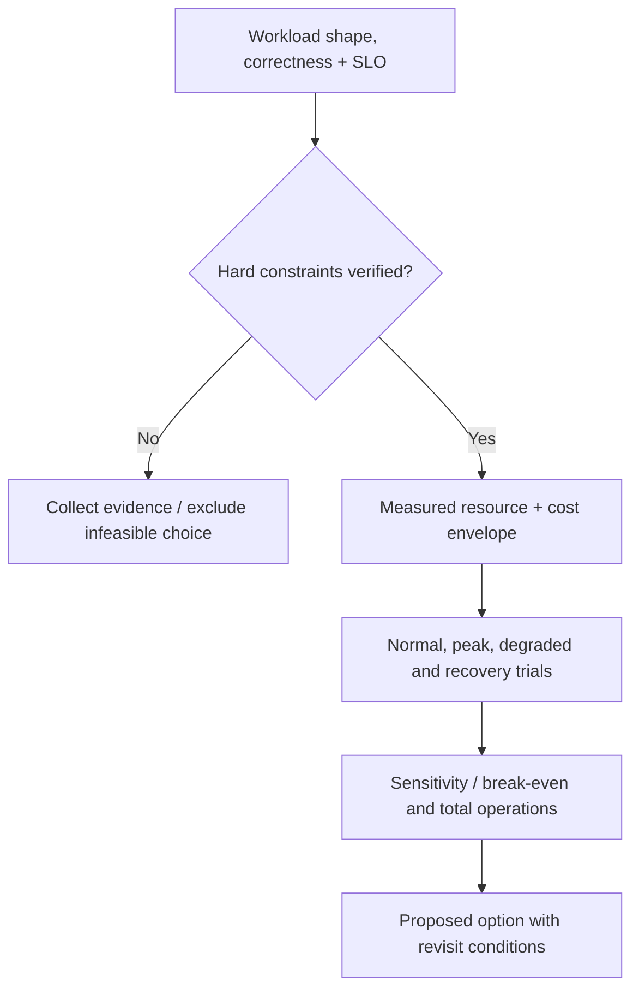

# Capacity planning and cost/performance trade-offs

> **Tycho original book manuscript V07/C07**, 2026-10-19. Calculations, scenario, parameters and diagrams are fictional; official public AWS Well-Architected cost guidance was consulted for principles, not for prices, forecasts or measured performance. No cloud bill, simulator, benchmark or production cost study was used.

## Purpose and mission

Performance decisions buy *capacity over time*, not just a lower measured p99. More replicas can reduce queueing and absorb uneven demand while increasing total resource cost, per-instance connection pressure and operational work. A larger instance can improve one CPU-bound operation without changing an upstream quota or serialized data key.

The economic question is: **What is the least costly configuration that satisfies correctness, user-visible service targets, recovery and operational constraints across the actual demand distribution?** It is different from “Which option has the lowest price per virtual machine?”

The [AWS Well-Architected Cost Optimization principles](https://docs.aws.amazon.com/wellarchitected/latest/framework/cost-dp.html) recommend measuring business output against expenditure, adopting consumption where appropriate and attributing costs to their actual owners. The [demand/supply guidance](https://docs.aws.amazon.com/wellarchitected/2024-06-27/framework/cost-mandem.html) notes the cost/latency role of scaling, throttling, buffering and deferred work. These references describe principles, not universally optimal budgets.

## 1. Write a capacity envelope, not a magic instance count

A candidate must be checked under at least:

| Load state | Required description | What changes |
|---|---|---|
| Normal | Typical arrival rate, key mix, background jobs and success outcomes | Steady resource footprint, latency and idle cost |
| Predictable peak | Known time and duration, credible scheduled work | Pre-warming, scale schedule, headroom |
| Unexpected burst | Short demand increase with unknown onset | Admission policy, queue age, warm capacity |
| Degraded dependency | Loss or slowness of one necessary or optional service | Retry amplification, fallback, bulkheads |
| Recovery | Backlog catch-up and reconciliation after outage | Extra temporary processing versus user load |
| Growth | More state/data/cardinality, not merely more registered users | Storage, index, rebalancing, data transfer, retention |

A 60-second spike cannot necessarily be served by a replica that takes two minutes to become genuinely ready. Provisioning lag and scale-down stabilization are distinct costs. See [autoscaling lag](autoscaling-lag-and-capacity-limits.md).

## 2. Cost must include more than infrastructure instance prices

Define a review period and consistent cost categories:

- Compute resources, idle headroom, reserved minimum replicas and cold starts.
- Datastore storage, IOPS/queries, replication, backups, restoration and growth.
- Network egress/transfer and cross-region data propagation.
- Queues, cache memory, index builds, search replicas and retained events.
- Logging, metrics, traces, high-cardinality ingestion and data retention.
- CI, test environments, deployment machinery, security reviews and vulnerability handling.
- Operator/on-call skill, incident response, upgrades, backup drills, dependency support.
- Migration effort, temporary double-running, data-copy traffic and irreversibility exposure.

**Operational labor and risk are not made zero by using a managed service.** Managed systems can shift some tasks and price the remaining constraints differently. A low monthly hosting estimate that excludes restorable backups and staffed response cannot be ranked against a fully operated alternative as though they were comparable.

## 3. Original synthetic comparison

Imagine a public audio-transcript reading application with daily normal demand, a short weekly import surge and a relatively expensive search index. Two invented deployment options exist:

- **A — two warm read replicas**, one shared authoritative data service, bounded optional import workers, simple cache and fixed minimum capacity.
- **B — one warm read replica plus a scale-out policy**, same source authority and index, with new replicas arriving after an assumed startup delay.

The following invented values are **not provider prices**:

| Invented monthly cost component (units) | A | B |
|---|---:|---:|
| Warm application resources | 400 | 210 |
| Extra scale-out resources | 0 | 90 |
| Datastore and replication | 300 | 300 |
| Backup, observability and index | 180 | 180 |
| Platform management and recovery allowance | 100 | 145 |
| **Subtotal excluding migration and risk** | **980** | **925** |

At this simplistic accounting boundary, B is 55 units cheaper, but only if it satisfies the same failure, cold-start and user-journey gates. If B's single warm instance fails during a burst, its scale-up may arrive too late; that violates an availability requirement regardless of cost. A's second warm replica may be required for redundancy, not performance. Both options need a test for shared datastore and index ceilings.

These invented numbers should never be converted to actual currency or used as a procurement estimate without vendor prices, region, usage schedule, resource class and pricing validity.

## 4. Unit cost and sensitivity

Useful unit costs include:
- total relevant cost per **correct user journey**, rather than per HTTP attempt;
- per indexed/retained object at an agreed freshness and query quality;
- per durable asynchronous job completed within its age SLO;
- cost per recoverable acknowledged operation under a named RPO/RTO.

**Example:** if a synthetic environment costs 1,000 units/month and completes 500,000 correct user journeys, then illustrative unit cost is 0.002 units per journey. If the same hosting cost produces only 250,000 correct journeys because of overload/retries, unit cost doubles. This is arithmetic on invented values, not a measured service efficiency result.

Sensitivity analysis must vary:
- offered arrivals and burst frequency/duration;
- per-operation CPU/DB/I/O work and key skew;
- storage growth and retention;
- replica startup time and minimum headroom;
- downtime cost, recovery staffing and data-loss constraints;
- egress, logs, inter-zone traffic and non-peak idle capacity;
- utilization versus request latency/quality.

A decision can reverse when any of these change. Report break-even conditions and credible uncertainty rather than one precise ranking from guesses.

## 5. Capacity cannot be extrapolated from one benchmark

Suppose four replicas complete 1,000 operations/s in a controlled test. Doubling replicas does **not** imply 2,000 correct operations/s: shared DB locks, network, index rebuilds, quota ceilings, connection pools and per-key serialization may cap useful throughput. [Contention and scaling laws](contention-saturation-and-scaling-laws.md) discusses serial/coherence limits. [Load-test validity](load-testing-and-benchmark-validity.md) explains why generator saturation and omitted requests invalidate apparent improvements.

A trustworthy capacity study should:
1. Pin workload input, dataset, versions and runtime ceilings.
2. Measure *offered* versus admitted and correctly completed business operations.
3. Check each independent scarce resource and reject hidden data loss.
4. Run multiple steps in concurrency and replica count, normal and degraded.
5. Compare equivalent cost and end-to-end correctness, not just per-node throughput.
6. Test warm-up and failure recovery, especially during the demand peak.
7. Record uncertainty and revisit when the workload changes.

## 6. When deferral, throttling and a simpler design win

A delayed batch may process a short surge economically if its **accepted/pending** status and deadline are part of the business contract. A bounded queue does not make synchronous work complete. Similarly, a modular monolith can have a lower operating cost than many services when independent lifecycle is not required, but one deployable may be a poor fit under mandatory isolation.

An economically rational architecture can deliberately choose higher idle cost to meet a strict recovery or availability gate. Cost optimization is constrained optimization; it does not license breaking correctness or authorization.

Text alternative: establish requirements and hard constraints before comparing cost. Evaluate realistic resource use across varied workload and failure states, and test sensitivity; any unknown mandatory constraint blocks unconditional selection.

## 7. Public sources and nonclaims

| Source reviewed | Supports | Not demonstrated |
|---|---|---|
| [AWS Well-Architected: Cost Optimization design principles](https://docs.aws.amazon.com/wellarchitected/latest/framework/cost-dp.html) | Cost attribution, consumption, outcome efficiency and operation | Current provider pricing or a real bill |
| [AWS Well-Architected: Demand/supply resources](https://docs.aws.amazon.com/wellarchitected/2024-06-27/framework/cost-mandem.html) | Workload-aligned supply, buffers/throttling, scaling-lag consideration | Economic viability of the invented options |
| [AWS Cost Based on Workload Metrics](https://docs.aws.amazon.com/wellarchitected/latest/framework/cost_monitor_usage_allocate_outcome.html) | Output-based unit economics and allocation principles | Real cost-per-journey data |
| [Tycho scaling-law chapter](contention-saturation-and-scaling-laws.md) | Conditions for saturation and diminishing returns | Per-service measured fit |

All amounts, charts, load assumptions and architectural examples are original teaching models. They are not measured prices or actual workloads. The proposed decisions have no independent financial/operational reviewer, validated capacity curve, tool run, or final edition metadata.

## Engineering walkthrough — Provision, shed, optimize or simplify under uncertain prices

**Original synthetic envelope:** a hypothetical catalogue expects 100–400 requests/s depending on a publication event, with 10% writes and one hot resource. Direct unit prices and exact staffing rates are **unknown**. The architect must compare not a single monthly VM bill but correct peak outcomes, shared database budget, retention, multi-zone idle capacity and time to recover from overload.

| Candidate | Potential strength | Variable that may reverse choice |
|---|---|---|
| Provision extra replicas | Faster response to burst if app CPU is bottleneck | Shared DB lock/pool remains the limit; unused warm capacity costs money |
| Shed/defer optional work | Protect invariant and critical journeys | Product cannot accept deferred confirmation or unfair priority |
| Optimize query/key access | Less demand per correct operation | No meaningful backend query cost in measured bottleneck |
| Simplify/remove unnecessary distributed hop | Lower operational and retry overhead | True isolation/deployment requirement outweighs coordination cost |

A defensible cost model exposes quantities: instance-hours, data bytes×retention, egress GB, high-cardinality time-series, human on-call hours, migration person-days, repeated backup/DR exercises and expected rework risk. It must vary each cost input over a documented plausible range rather than pretend an invented provider price is a source-backed rate.

**Synthetic sensitivity rule:** if one candidate only wins when app instance prices fall 90% or when a known critical correctness constraint is waived, mark it fragile or inadmissible. Report correct throughput per total operating cost *conditional on* tested workload, not raw RPS per VM. **Proposed experiment, not run:** test steady/peak/degraded load, keep shared-state integrity, record actual unit use and capacity drain after overload; select an option only after gating security and recoverability separately. The existing Well-Architected cost guidance supports modeling categories, not numerical market forecasts.

## Navigation

Proposed owner **V07/C07** in [outline](../PROPOSED-STRUCTURE.md), currently [performance landing](README.md). Read first [workload arrivals](workload-demand-and-arrival-models.md), [contended resources](contention-saturation-and-scaling-laws.md); continue with [autoscaling](autoscaling-lag-and-capacity-limits.md), [overload protection](overload-admission-control-and-graceful-degradation.md), [full book decision criteria](../decisions/architecture-alternatives-experiments-and-adrs.md).
