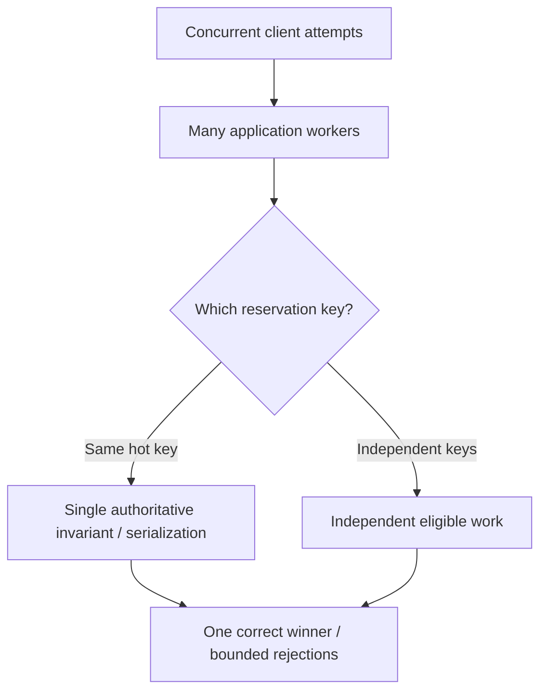

# Contention, saturation and scalability laws: distinguishing capacity limits

> **Tycho V07/C02 draft**, 2026-10-19. Original equations worked under explicit assumptions and invented load examples, not observed performance. Independently public queueing literature and Gunther's Universal Scalability Law paper are cited with narrow scope. No scaling experiment, fit or independently verified hardware benchmark was performed.

## Purpose and mission

An architecture can have many processors and still process work at almost a fixed rate. Some fraction of execution may serialize on a lock or data authority; more concurrent callers may contend for a shared connection, exhaust a quota or induce coherence overhead. The important question is not “Does horizontal scaling work?” but **which scarce resource sets the useful completion rate for this workload, and what measurable mechanism limits further growth?**

This chapter explains serial fractions, queue saturation, hot-key contention and the limited role of fitted scalability curves. [Queueing/Little's Law](queueing-littles-law.md) owns mean resident-work accounting, [workload profiles](workload-demand-and-arrival-models.md) owns demand/arrival semantics and [benchmark validity](load-testing-and-benchmark-validity.md) owns generator and observation methods.

## 1. Concurrency, parallel execution and completed throughput differ

- **Concurrency:** tasks or operations are simultaneously in progress or resident at a defined boundary, perhaps mostly waiting.
- **Parallelism:** useful operations execute on different processors/resources at the same time.
- **Throughput:** logical operations correctly completed per unit time at an identified system boundary.
- **Saturation:** a resource or policy cannot provide additional useful service at rising offered demand; backlog, rejection, latency or failure may grow.
- **Scalability:** the relationship between resources and useful completed capacity for a *specified workload and configuration*.

Adding application workers increases potential concurrency but does not guarantee processor time, DB write throughput, network quota, exclusive-key authority or larger useful completion rate. Increasing throughput by skipping correctness checks or quietly refusing requests is not a valid scale gain.

## 2. Amdahl's conditional bound

If an idealized fixed total computation has a serial share s and a perfectly parallel remaining share (1−s), its ideal speedup with N processors is

S(N) = 1 / [s + (1−s)/N].

This is a **model**, not a universal service scalability theorem. Assume s = 0.2 and N = 8. The theoretical speedup is 1 / (0.2 + 0.8/8) = **3.33**, not 8. That result ignores memory contention, cross-processor communication, queues, storage, workload redistribution, hardware and software overhead. It does not predict throughput for arbitrary API traffic.

A system may change its parallel fraction when the workload or partitioning changes. Do not infer the serial share from a single latency sample.

## 3. A model for contention and coordination overhead

Neil J. Gunther's [general theory of computational scalability](https://arxiv.org/abs/0808.1431) discusses rational scalability functions and a synchronous throughput bound. A commonly used *normalized* form of the Universal Scalability Law is

C(N) = N / [1 + α(N−1) + βN(N−1)].

Here N is a relative concurrency/processor count; α and β are empirical fitting parameters interpreted (with important model qualifications) as contention and coherence/coordination penalties. The expression is **not** a mechanism detector. Fitted coefficients cannot prove that a particular lock, network link or cache-invalidation flow is the cause.

The curve may show:
- roughly linear growth for small N when penalties are weak;
- diminishing returns when shared-resource contention dominates;
- **retrograde** throughput at higher N if coordination work increases faster than useful work.

Any fit must be made across enough observations with the same workload mix and bounded resource costs. Compare predictions with withheld test points, retain confidence/uncertainty and investigate observed bottleneck signals. A pretty curve with little data is not evidence that microservices or more replicas will help.

## 4. Identify the actual contended authority

**Original synthetic scenario:** many users attempt to reserve the same shared workshop device at the beginning of an event. The server runs on eight application instances, but only one operation at a time can safely commit an exclusive reservation for a particular device/time combination.

More application instances can perform authentication and independent reads concurrently. They **cannot** create two successful exclusive allocations for the same slot, however many CPUs exist. If request attempts against one slot arrive faster than its safe serialization capacity, queue age and rejections may grow while accepted bookings remain capped by the invariant.

**Text alternative:** many workers can process independent reservation keys, but calls for the same exclusive key contend for one authoritative allocation rule. The output count is constrained by valid business effects, not only by available execution threads.

Sharding can spread *independent* keys, but hashing one hot key does not split that key's exclusivity invariant. A queue may smooth demand or offer pending status only if it meets the user contract. [Sharding/hot keys](../scaling/shard-keys-hotspots-and-resharding.md) owns data-routing mechanics; [admission/degradation](overload-admission-control-and-graceful-degradation.md) owns bounding overload effects.

## 5. Resource bottlenecks can move after optimization

Suppose a fictional query spends most elapsed time waiting for DB connections. Increasing a connection pool may reduce acquisition delay for a brief period and worsen DB locking under sustained load. Faster CPU processing can make a downstream API quota the next limiter. Changing a bottleneck is a success only if the overall **useful user journey** improves at the target workload and budget.

| Candidate constraint | Distinguishing metric | Misleading signal |
|---|---|---|
| CPU compute | Per-core saturation and CPU hot samples aligned to useful work | Average node CPU without throttling or hot-core detail |
| DB lock/transaction | Wait/hold time, owner, per-key skew and correct commits | Total SQL RPS without transaction outcome |
| Connection pool | Acquisition time, active/idle/pending, DB limits | Thread count alone |
| Broker partition | Per-partition lag/rate, key distribution and consumer ordering | Cluster-wide aggregate throughput |
| Remote quota | Provider rejection/throttle and retry amplification | Application-side successful request count |
| Cache coherence | Invalidation/rebuild work and stale data under writes | High hit rate without correctness test |
| Work-queue bound | Queue age, deadlines, admitted/completed/rejected distinction | Resident task count mistaken for parallel work |

Measure under normal, peak and degraded conditions; a single average can hide transient saturation or starvation.

## 6. A discriminating scalability experiment

A meaningful test holds input data, authorized outcomes and total resource envelope controlled while varying concurrency/replica count:

1. Freeze input fixture, key skew, data size, service versions and dependency limits.
2. Replay an open arrival schedule at staged offered rates; capture dropped-generator iterations separately.
3. Record useful logical completions, explicit rejections, timeouts, queue age, p95/p99 and wrong/duplicate effects.
4. Vary application replicas at constant DB/backend resource ceiling; observe whether bottleneck shifts.
5. Repeat with independent keys and one hot-key scenario, and compare dependency traces.
6. Fit a simple capacity model **only after** collecting enough stable comparable observations; reserve independent loads for checking predictions.
7. Reject the interpretation if measurements are confounded by a different dataset, warm-up, retries, missing denominator or correctness loss.

**Hypothesis:** scale-out helps independent read-heavy keys until another resource becomes limiting, but may not help one serialized reservation key. These are proposed tests only, not reported outcomes.

## 7. Choosing a response to saturation

Options are conditional: optimize a hot query or lock critical section; reduce unnecessary dependency calls; change transaction/concurrency model when invariants permit; partition independent keys; add capacity at the verified scarce resource; enforce admission and backoff; or change the business outcome to a deferred job only when allowed.

A system that sustains a high RPS with unbounded queue age might still fail a latency SLO. A system that returns many fast 429 responses can legitimately protect state but must count reduced availability honestly. The best architecture is the one that satisfies the declared combination of correctness, availability, latency and operating constraints—not the one with the highest raw request counter.

## 8. Evidence and limits

| Independently public source | Narrow statement supported | Unknown |
|---|---|---|
| [Gunther, *A General Theory of Computational Scalability Based on Rational Functions* (2008)](https://arxiv.org/abs/0808.1431) | Rational scale functions, queueing-bound relation and fit concept | Actual coefficient values or mechanism in a real service |
| [Little, *A Proof for the Queuing Formula*, 1961](https://doi.org/10.1287/opre.9.3.383) | Conditional mean occupancy/throughput/residence relation | Capacity or tail prediction |
| [Tycho capacity experiment page](workload-profiles-and-capacity-experiments.md) | Original experiment design, failure and measurement boundaries | Executed tests or reproducible measured curve |

All numerical values, diagrams, equations applied to imagined inputs and architecture conditions are educational interpretations. No actual data was fitted, no benchmark performed, and no technical review accepted any architecture for production. Full source-to-claim precision and edition metadata are pending.

## Navigation

Proposed **V07/C02** in [book outline](../PROPOSED-STRUCTURE.md), [performance entry](README.md). Read before: [workload demand](workload-demand-and-arrival-models.md), [queueing](queueing-littles-law.md). Next: [load-test validity](load-testing-and-benchmark-validity.md), [connection pools](../scaling/connection-pools-hikaricp-pgbouncer.md), [autoscaling lag](autoscaling-lag-and-capacity-limits.md).

## Applied M9 evidence: what transfers and what does not

These examples connect the chapter's conditional mechanism to published experiences or synthetic decision exercises. A historical company report is **first-party, time-scoped evidence**, not a controlled Tycho benchmark; an M9 decision playbook is **original synthetic analysis**, not a company decision.

**Case lens — [Netflix — HotSpot sharing](../cases/netflix-hotspot-false-true-sharing.md)**. **Relevant mechanism or architectural contrast:** CPU scaling must test true/false sharing at representative offered load, not equal low-load canaries. **Not established by this report/playbook:** HotSpot behavior from the historical version is not evidence of the same bug in current JVMs or all low-CPU-scaling incidents.

**Transfer test:** before applying the lesson to another legacy system, identify the exact workload, source date, relevant runtime/protocol versions, state authority, failure/recovery gate and the new observation that would reverse the choice. Follow the case's public evidence ledger rather than treating its link as independent proof.
