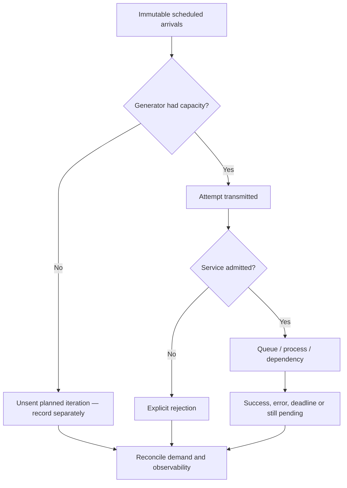

# Load-test methodology, generator validity and defensible benchmark evidence

> **Tycho book draft V07/C03 (2026-10-19).** Original method and fictional examples. Primary public k6, HdrHistogram and SRE documentation is cited at limited scope. No test run, recorded benchmark, independent statistical review, or hardware comparison was performed. This chapter does not claim that a threshold or test tool creates an architecture decision automatically.

## Purpose and mission

A performance benchmark can produce precise-looking numbers while measuring the wrong population. A system that slows its *load generator* may appear more responsive than one that actually serves its intended traffic. A synthetic workload whose key distribution, user decisions or failure mix does not resemble the stated engineering problem may yield impeccable charts and still choose an unsuitable architecture.

The objective is to design a test whose **demand, observation, correctness and resource boundaries are reproducible and honestly limited**. The [workload and capacity-experiment chapter](workload-profiles-and-capacity-experiments.md) describes what demand variables to model; [queueing](queueing-littles-law.md) gives mean mathematical boundaries; [tail latency](tail-latency-fanout-and-deadline-budgets.md) explains why parent latency is not a simple addition of per-hop percentiles. This chapter owns the **validity protocol**.

## 1. Write the experiment claim before starting a load generator

Use a falsifiable statement rather than “the new design is faster”. Example:

**Original fictional case:** a public reading-list application has a query endpoint with an index built from a known synthetic dataset. We want to compare a local in-process cache against direct indexed reads. Both must serve the same authorized content and satisfy a defined maximum-staleness contract.

Proposed hypothesis: under the *same actual offered arrival sequence* and skew, caching reduces user-observed p95/p99 response time without creating a freshness violation or increasing timeouts. Reject the hypothesis if reduced reported latency is explained by requests omitted from the test, a changed dataset, stale invalid results or different infrastructure ceilings.

Every experiment contract needs:

| Dimension | Required frozen specification |
|---|---|
| User operation | Input/output definition; logical request ID; success, rejection and timeout classification |
| Environment | Exact application/dependency versions, CPU/memory quotas, placement/network, container and runtime settings |
| Dataset | Size, selectivity, distribution, mutation history, integrity checks and cache warm/cold state |
| Demand | Scheduled arrival timestamps, operation mix, burst, key/tenant skew, retries and intended duration |
| Generator | Tool version, executor mode, virtual-user capacity, client machines, connection reuse, clocks and saturation checks |
| Observation | Client boundary, raw timestamps, histograms, errors, queue wait and per-dependency telemetry |
| Acceptance | Named correctness invariant, error/time budget, uncertainty and stop condition |
| Repetition | Trial count, order/randomization, warm-up, reset procedure and environment-drift tracking |

A timestamped statement “we sent 1,000 RPS” is not evidence until the **actual sent** and **unsent intended** workloads are available.

## 2. Open versus closed arrivals: the generator can hide degradation

The [Grafana k6 open/closed model documentation](https://grafana.com/docs/k6/latest/using-k6/scenarios/concepts/open-vs-closed/) distinguishes arrivals independent of iteration completion from a fixed-VU loop whose next iteration starts after the previous finishes. An open arrival model is appropriate when the externally imposed arrival rate should remain independent of service latency. A closed model is suitable when the real population genuinely waits before initiating another operation. Neither is universally “more realistic”.

Suppose a fictional generator runs 20 concurrent virtual users, each repeatedly issuing a request and waiting. At 0.2 s average iteration time, an ideal ceiling would be about 100 iterations/s. If service time becomes 2 s, the same closed population can offer only about 10 iterations/s. This arithmetic ignores scheduling and think-time details; it illustrates why response-driven generators can hide the queue that *independent* arrivals would create.

The [k6 dropped-iterations documentation](https://grafana.com/docs/k6/latest/using-k6/scenarios/concepts/dropped-iterations/) explicitly records unsent scheduled iterations and explains that missing free virtual users can reflect generator configuration, degradation in the target, or both. A dropped-iteration counter is not the same as an HTTP rejection recorded by the application: one never started the intended request, while the other reached some defined ingress boundary.

**Text alternative:** distinguish a planned arrival never executed by the generator from a transmitted attempt rejected by the service and from one admitted but unfinished. These populations must not silently disappear from the denominator.

## 3. Define denominators and avoid coordinated omission

Four different rates can coexist during one window:

- **Scheduled arrivals:** logical operations intended by the workload fixture.
- **Transmitted attempts:** actual requests emitted by the generator, including configured retries.
- **Admitted operations:** server-accepted work before queue/service.
- **Completed useful operations:** correct business outcomes within the selected time window.

A single logical operation may produce multiple attempts. Timeouts and client disconnects do not automatically imply the server committed nothing. A test should retain operation identity and terminal state when possible; counting attempts as distinct successful business operations can falsely inflate throughput.

The [HdrHistogram coordinated-omission discussion and correction API](https://github.com/HdrHistogram/HdrHistogram/blob/master/src/main/java/org/HdrHistogram/AbstractHistogram.java) shows how a correction may reconstruct *modeled* missing intervals when an expected interval is known. Corrected samples are **not direct observations** of requests that never happened. Preserve both raw data and correction assumptions. Without a credible intended arrival schedule, a synthetic corrected p99 cannot be presented as measured user latency.

For each percentiled metric, state:
1. What event starts and ends the clock; client or server perspective.
2. Which operations populate the histogram, including timeouts and never-started operations.
3. Whether result values are raw, modeled, corrected, sampled or censored.
4. How sufficient sample size and temporal correlation affect interpretation; no universally magic p99 sample count.
5. Why aggregated p99 across heterogeneous tenants, operation types or versions can hide a regression.

A lower p99 with fewer successful and more rejected requests is not a performance improvement without an explicit service-level contract allowing that trade-off.

## 4. Control confounders without erasing real behavior

A warmed cache or JIT can make a benchmark unrepresentative of cold start; a perpetually cold cache can likewise exaggerate steady-state cost. Record both states when relevant. If the experiment aims to compare architecture changes, changing request distribution or backend quotas at the same time confounds the conclusion.

Candidate controls:
- Pin artifact/container, dependencies, data snapshot, tool version and test script.
- Declare warmed, cold and recovery phases rather than discarding inconvenient transients.
- Use equal offered demand traces, or disclose which differences are intentional.
- Detect background contention and noisy-neighbor effects; repeat with randomized trial order.
- Record node/container throttling, GC, connection wait, and load-generator saturation.
- Collect per-operation/tenant successes and side effects, not just aggregate bandwidth.
- Preserve full test and measurement configuration in version control where legally appropriate.
- Treat local test passes as **bounded results** rather than proof of global production behavior.

### Fictional comparative trace

Consider two invented runs under 200 scheduled operations/s for 60 s: 12,000 operations intended. Run A transmits all but returns many explicit 503 responses. Run B reports excellent p99 for 8,000 completed requests but has 4,000 **unsent** scheduled iterations due to generator exhaustion. The runs **cannot** be ranked based on the response histogram alone. Run B's apparent improvement might simply be missing demand. The numbers are invented to illustrate denominator errors; no generator executed them.

A valid repair is to increase generator capacity, capture actual arrivals, repeat under equal demand and compare logical outcomes and resource cost. If generator capacity cannot be improved, report the limitation rather than silently using an unsupported ranking.

## 5. Fault injection must preserve the claim being tested

Different failure classes require distinct tests:

| Fault | What to observe | What a passing run cannot establish |
|---|---|---|
| One slow downstream response | Parent deadlines, per-hop waits, cancellation and retry amplification | All failure classes are tolerated |
| Partial dependency outage | Queue bounds, explicit errors, unaffected user journeys | Correct durable state after all recovery paths |
| Generator overload | Scheduled versus sent arrivals and generator metrics | That service throughput was limited at all |
| Database lock contention | Per-key skew, transaction success, deadlock outcomes | That sharding would cure the hot key |
| Replica restart | Readiness, drain, in-flight effects, recovery backlog | Region disaster recoverability |
| Search-index lag | Query correctness/freshness and controlled stale responses | Total integrity of authoritative records |

A failure experiment must define a safe abort condition. Never run disruptive load against uncontrolled real systems or collect restricted production content for this independent reference book.

## 6. Decide from distributions, invariants and cost together

An architecture should be compared at a **comparable resource budget** as well as at a comparable offered workload. If one candidate deploys twice as many instances, lower latency may be a capacity purchase rather than an efficiency gain; this distinction may still be acceptable if cost constraints permit it.

For candidate A/B, report:
- correctness and authorized-user outcome distribution;
- offered, transmitted, admitted, completed, rejected and unsent rates;
- median, p95/p99 and timeout outcomes by operation class;
- CPU, heap, network, DB concurrency, queue age and error budget;
- minimum/peak replicas, startup delay and total resource-seconds;
- trial variability, parameter sensitivity and whether the selected option wins under alternate representative demand.

A result can be **inconclusive** because variance is high, samples are insufficient, the generator saturated, or the system differs too much from the target environment. That is valuable evidence and should lead to a better scoped experiment, not a stronger conclusion.

## 7. Public source ledger and limitations

| Independently reviewed public source | Exact applicable scope | Not established |
|---|---|---|
| [Grafana k6: open and closed models](https://grafana.com/docs/k6/latest/using-k6/scenarios/concepts/open-vs-closed/) | Iterator/arrival coupling and executor distinctions | That a test with k6 sustained its configured rate |
| [Grafana k6: dropped iterations](https://grafana.com/docs/k6/latest/using-k6/scenarios/concepts/dropped-iterations/) | Unsent iterations when VU capacity is insufficient and multiple causal interpretations | A universal correction or numerical service throughput ceiling |
| [HdrHistogram: AbstractHistogram correction API](https://github.com/HdrHistogram/HdrHistogram/blob/master/src/main/java/org/HdrHistogram/AbstractHistogram.java) | Modeling a missing-interval series with an explicit expected interval | Measured latency for requests not actually issued |
| [Google SRE: Handling overload](https://sre.google/sre-book/handling-overload/) | Capacity-aware overload and admission controls | Any particular project's safe request threshold |

The example reading-list system, arithmetic, diagrams, proposed experiments and matrix are all **original synthetic material**. These sources describe methods; they do not prove any Tycho benchmark occurred. Full link/anchor verification, dataset fixtures, rendering, repeatability exercises and independent technical/statistical acceptance remain open.

## Navigation

- Proposed V07/C03; current [performance topic landing](README.md).
- Prerequisite: [Workload and capacity experiment method](workload-profiles-and-capacity-experiments.md).
- Related: [Queueing and Little's Law](queueing-littles-law.md), [tail latency](tail-latency-fanout-and-deadline-budgets.md), [autoscaling feedback](autoscaling-lag-and-capacity-limits.md), and [pattern selection](../decisions/pattern-applicability-and-contraindications.md).
