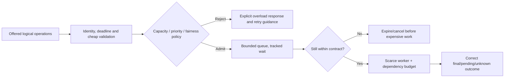

# Overload protection, admission control and graceful degradation

> **Tycho book chapter draft V07/C05 (2026-10-19).** Original examples and diagrams, with scope-bound published SRE and Builders' Library guidance. No deployed protection, incident, load generator, performance comparison or independent expert review has been executed.

## Purpose and mission

When offered work exceeds a scarce resource's sustainable capacity, unlimited waiting is not reliability: it converts excess arrivals into growing queues, missed deadlines, retries and possible cascading failure. A sound architecture decides **which work to accept, reject, defer, cancel or degrade**, and makes those decisions visible to callers while protecting correctness invariants.

This chapter owns *overload policies and failure containment*, not the mathematical foundations of [Little's Law](queueing-littles-law.md), the [autoscaling control loop](autoscaling-lag-and-capacity-limits.md) or [load-test validity](load-testing-and-benchmark-validity.md). Their evidence is necessary to size a control but does not itself supply a universal threshold.

## 1. Define the scarce resource and the acceptance outcome

Potential constraints include CPU, thread/connection pools, DB locks, broker quotas, external API limits, expensive query operators, request buffers and sustained storage I/O. More application instances do not relax a shared database quota or single-key transaction bottleneck. Protect the resource that actually limits **useful completed operations**.

Distinguish these outcomes:

| Event | Meaning | Client behavior |
|---|---|---|
| Accepted and completed | Authoritative logical operation reached defined correct result | Use result and do not duplicate effect |
| Rejected before acceptance | No durable work accepted, assuming that boundary is verifiable | Back off/try later under policy, or tell user capacity unavailable |
| Accepted as durable pending | Work is stored and promised under an asynchronous contract | Read stable operation status; do not treat pending as completed |
| Deadline expired before admission | Work is not useful/eligible for processing | Abort or return explicitly, avoiding stale queue |
| Outcome unknown after possible commit | Acceptance/effect status cannot be inferred from timeout alone | Reconcile by stable identity; never blindly recreate irreversible effect |
| Degraded partial result | Only an explicitly optional capability omitted | Display partial/stale scope to user; never claim required data complete |

A fast rejection can be safer than admitting an operation that inevitably misses its deadline, but this does not allow rejecting required work and reporting a higher success rate. Track offered, admitted, rejected, completed and failed populations separately.

## 2. Admission must precede the expensive operation

[Google SRE's Handling Overload](https://sre.google/sre-book/handling-overload/) explains why operations with unequal costs cannot be controlled solely by requests per second and describes client-side throttling, request criticality and retry policy. [AWS Builders' Library load shedding](https://aws.amazon.com/builders-library/using-load-shedding-to-avoid-overload/) motivates accepting bounded useful work rather than collapsing under unlimited demand. These are published operational lessons, not a proof that any proposed local limit is safe.

**Text alternative:** validate cheap, essential input and check its remaining deadline before admission. Bounded admission either explicitly rejects or queues within a policy. Queue entries whose useful time has expired leave without consuming expensive downstream resources. An accepted effect whose outcome becomes ambiguous still requires reconciliation rather than pretending rejection.

**Design caveat:** cheap authentication/validation is still needed to enforce permission; overload controls must not bypass authorization or permit malicious clients to reserve disproportionate capacity.

## 3. Queues, limits and priority create new contracts

A bounded queue must name both **number of items** and **maximum age**. A small queue of slow operations can still exceed caller deadlines. An old task may be useless even if the system has capacity after the peak; cancel it only where cancellation semantics and any committed effects permit.

Choose concurrency/queue limits from observed service-time and downstream saturation behavior rather than a universal rule. A token bucket rate limiter constrains arrival over time according to configured tokens and burst capacity; a concurrency semaphore limits simultaneous resident work. These solve related but different problems. Neither prevents unbounded work within the other dimension unless combined with deadlines and measured downstream budgets.

**Fairness and priority:** reserving some capacity for critical operations can preserve essential user journeys, but naive priority queues can starve ordinary work forever. Define which classes may overtake, maximum wait, starvation policy and tenant isolation. Do not treat one high-paying or high-volume client as entitled to consume all shared resource without an explicitly authorized service policy.

## 4. Bulkheads, circuit breakers and retries have different responsibilities

| Control | Primary purpose | Dangerous misuse |
|---|---|---|
| Admission/rate limit | Bound offered or admitted work before resource exhaustion | Hide rejected attempts from service-level outcomes |
| Queue limit/deadline | Bound waiting memory and usefulness | Queue accepted irreversible writes without durable tracking |
| Bulkhead | Reserve bounded workers/pools for independent classes/dependencies | Partition too tightly and waste capacity, or allow bypass |
| Circuit breaker | Avoid repeated costly calls to a failing dependency; probe recovery | Treat opening the breaker as permanent recovery or a substitute for backpressure |
| Retry budget + jitter | Spread bounded safe transient retries across time | Multiply load during outage or repeat non-idempotent effects |
| Load shedding | Discard lower-priority eligible work when explicitly permitted | Silently lose acknowledged business commands |
| Optional feature degradation | Preserve core outcome when nonessential enrichment fails | Present missing mandatory data as a complete result |

Across multiple layers, retries compound. If three independent layers make three attempts per incoming logical operation, a pathological path can create up to **27 downstream attempts** per logical intent (under a deliberately simplified fully nested retry model). No such amplification was observed here. [AWS Builders' Library retry and jitter discussion](https://aws.amazon.com/builders-library/timeouts-retries-and-backoff-with-jitter/) explains why coordinated repeated retries can worsen overload. [Tycho's RPC and idempotency chapter](../application/http-rpc-contracts-and-compatibility.md) owns effect-safe retry identity.

## 5. Original synthetic failure: one optional dependency poisons core work

A fictional public trail guide serves a **required** trail description and an **optional** community photo suggestion. Both initially use one shared worker pool. During a picture-service slowdown, photo calls hold most workers; required trail descriptions fail their deadlines even though authoritative trail records remain healthy.

**Candidate A:** enlarge the shared pool. It might only increase calls to the failing photo dependency and thread/buffer use. **Candidate B:** give optional images a separate small concurrency budget, deadline and circuit breaker; serve core trail information without the optional image when its deadline expires. **Candidate C:** queue user operations for minutes waiting on the photo service—contradicts the intended interactive contract.

A bounded test (not executed) would keep offered arrival schedule and resource ceiling equal, inject image-service slowness and observe correct core responses, missing-photo labelling, queue age, retry attempts, errors and recovery. A result where A appears faster only because it drops unknown user attempts is invalid.

The optional nature of photos is a **fictional stated requirement**. If actual user safety depends on a recent trail-closure update from another service, substituting stale information would be unacceptable; the safe response might need a clearly denied/unknown result.

## 6. Recovery and hysteresis must be deliberate

When load drops or a dependency becomes healthy, prematurely reopening traffic can cause a second collapse. Circuit-breaker recovery may use bounded probes; admission thresholds may need stability windows and progressive recovery. However, an excessive cooldown can strand healthy capacity. Review the actual demand and dependency recovery curve, not a generic constant.

Failure and restoration conditions should include:
- dependency/probe success and bounded error-rate sample;
- backlog, queue age, retries and in-flight state, not only CPU;
- completeness of accepted operations and reconciliation of unknown outcomes;
- fair re-admission and a controlled ramp to prevent a thundering herd;
- independent confirmation of user-facing core journey correctness.

A successful health endpoint check is not proof that old accepted writes were processed or that a stale derived read is safe.

## 7. Experiments, acceptance criteria and costs

A valid test matrix compares baseline and treatment under **the same attempted arrivals, key skew, logical outcomes and total resource limits**:

| Situation | Expected observation | Stop / failure condition |
|---|---|---|
| Normal steady traffic | Low rejection and bounded queue within defined target | Priority classes unexpectedly starved |
| Short burst beyond warm capacity | Some explicit shedding; critical work stays bounded | Unbounded queue or hidden timeout population |
| Dependency slowdown | Healthy unrelated class continues within agreed limits | Shared pool exhausted despite bulkhead |
| Repeated ambiguous command timeout | Safe identity reconciliation, no duplicate effect | Blind retries create extra committed operations |
| Recovery after fault removal | Gradual return without queue avalanche | Probe/retry surge collapses dependency again |
| Unauthorized or high-cost user input | Deterministic permission and quota enforcement | Overload bypass leaks data or monopolizes resources |

Record the **cost of protective capacity**: extra reserved pools, higher rejection ratios, additional deferred-work storage, alerting/operations, idle headroom and possibly less total peak throughput. A graceful degradation mechanism is a justified architecture choice only when the user contract makes its reduced outcome acceptable.

## 8. Source-to-claim ledger and review limitations

| Public material inspected (2026-10-19) | Supported topic | Unverified |
|---|---|---|
| [Google SRE, Handling Overload](https://sre.google/sre-book/handling-overload/) | Resource-dependent overload costs, priorities, client throttle and retry concerns | Any universally correct rate or priority policy |
| [AWS Builders' Library, Using load shedding to avoid overload](https://aws.amazon.com/builders-library/using-load-shedding-to-avoid-overload/) | Shedding strategies and failure containment rationale | Measured benefit in the synthetic trail-guide scenario |
| [AWS Builders' Library, Timeouts, retries and backoff with jitter](https://aws.amazon.com/builders-library/timeouts-retries-and-backoff-with-jitter/) | Retry multiplication and bounded backoff motivation | Real retry traffic or safe unconditional retry behavior |
| [Tycho capacity experiment chapter](workload-profiles-and-capacity-experiments.md) | Defined workload/queue and synthetic failure methodology | Completed independent experiment |

All example data, percentages, capacity statements and system behavior are hypothetical. No fault injection, cloud service, policy configuration, correctness exercise or independent review has been performed. Do not present this as an operational playbook without verifying actual target workload, authorizations, deadlines and state semantics.

## Navigation

- Proposed **V07/C05** in [planned TOC](../PROPOSED-STRUCTURE.md), current [Performance landing](README.md).
- Prerequisite: [Workload demand](workload-demand-and-arrival-models.md), [Queueing](queueing-littles-law.md).
- Related: [Autoscaling delay](autoscaling-lag-and-capacity-limits.md), [Tail latency](tail-latency-fanout-and-deadline-budgets.md), [Benchmark validity](load-testing-and-benchmark-validity.md), [Outbox/idempotency](../distributed/transactional-outbox-and-idempotency.md).

## Applied M9 evidence: what transfers and what does not

The following historical cases are **time-scoped publisher/practitioner reports**, not a Tycho benchmark or proof of a universal architecture choice. Any associated decision playbook is an **original synthetic comparison**, not a decision made by the companies cited. These cases inform the specific mechanism and contraindications above:

- **[Uber — Cinnamon fairness](../cases/uber-cinnamon-admission-and-fairness.md)** illustrates static edge quotas may fail to protect storage; storage-local feedback can handle load and fairness. **It cannot establish:** uber's reported later controller improvements are not proof that every database or customer tier supports the same policy.

A different system must recheck its workload, source date, version, authority boundary and failure/recovery acceptance criteria before transferring any decision. See the case's own evidence ledger for exact public references and unresolved claims.
