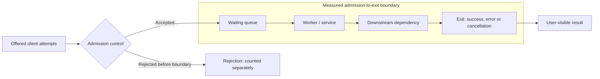
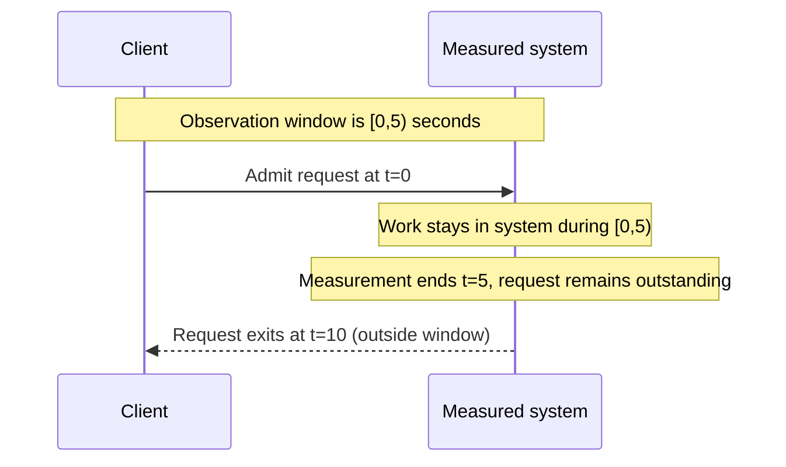
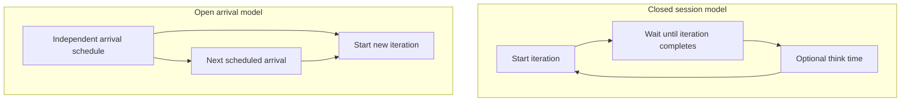
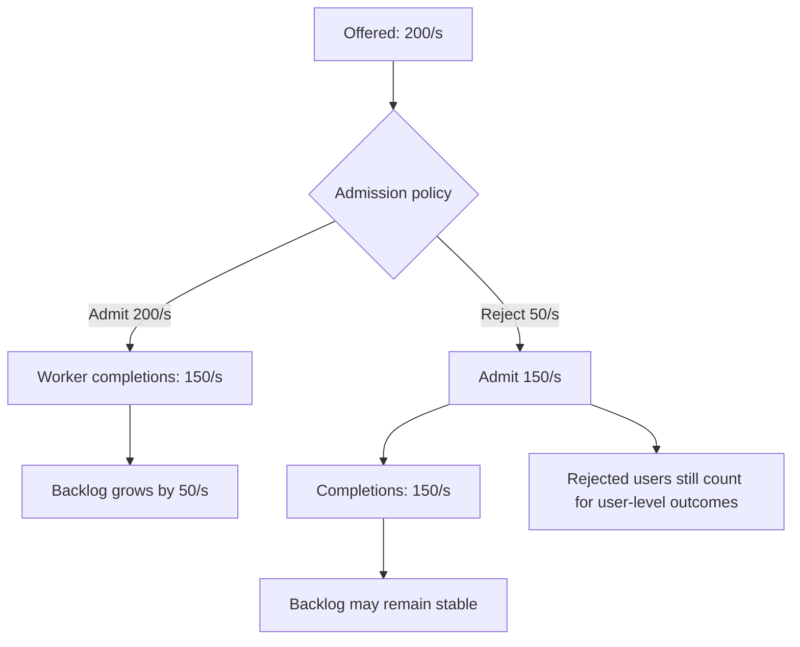

# Queueing, Little's Law and workload measurement boundaries

> **Tycho technical chapter — first evidence-backed pilot**, issue [#38](https://github.com/rouslanbaranov/tycho/issues/38), proposed volume V07/C01. Research/read date: **2026-10-18**. Status: independently public-source-grounded draft, self-reviewed mechanically; **not** human-reviewed, a performance benchmark, production deployment or a capacity estimate.

## Purpose and mission

Understand what offered demand, admitted work, completions, in-flight concurrency, queue waiting and response-time distributions actually mean, so that an architect can distinguish a genuine workload bottleneck from a misleading measurement. We investigate a foundational *relationship*, not a general architecture-selection rule.

**Primary question:** Under which assumptions can average work in a precisely defined system boundary be related to throughput and average time in that boundary by Little's Law—and why can the resulting equality neither choose a thread pool size nor predict tail latency or success under bursts?

**Reading route:** define the boundary → understand the conservation of work → apply the conditional mean identity → test the finite-window counterexample → distinguish load-generator feedback → analyze overload → collect missing evidence before making a scaling decision.

This page owns the mechanics of occupancy, rates and time. Other proposed chapters will eventually own database pools, distributed partitions, service isolation and deployment strategies; their absence is not an invitation to fabricate a linked chapter.

## Orientation: four numbers that are not interchangeable

Consider a request passing through a fictional gateway and worker, possibly waiting for a downstream resource. Choose **one** boundary with ingress at admission and egress when a request exits *for any reason*. For example:



The Mermaid diagram is an **original synthetic model**, not an observed deployment. Text alternative: client attempts are either rejected before the boundary or accepted into a queue; accepted work passes through execution and a dependency to a recorded exit. The arrows represent an **original illustrative model**, not a deployed system. Real systems may reject or cancel work at several places. The endpoint and termination rule must be documented before measuring time or concurrency.

| Quantity | Unit | Meaning and common mistake |
|---|---|---|
| Offered arrival rate, `λ_offered` | operations/s | Requests clients attempt to send. An overload reject may never enter the measured boundary. |
| Admitted rate, `λ_admitted` | operations/s | Work entering the boundary after admission. This may differ from offered demand during shedding. |
| Exit/completion rate, `λ_exit` | operations/s | Requests leaving the boundary, including successful, failed and cancelled exits **when the occupancy definition counts those as departures**. A success-only metric is not total flow. |
| Successful throughput | successful operations/s | A subset of exits. A stable queue can deliver many errors; high throughput alone is not a healthy user-level SLO. |
| Instantaneous in-system population, `N(t)` | operations | Work admitted but not yet exited, including waiting and processing stages inside the chosen boundary. |
| Mean in-system population, `L` | operations | A time average or stationary mean of `N(t)`; not the peak, an exact count of threads or users. |
| Mean residence time, `W` | seconds/operation | Average time in that same boundary, including waiting and service. Not p95/p99 and not necessarily client-perceived round trip. |

**Registered users, DAU, active sessions, open connections, in-flight work and RPS are distinct.** A user might make no request for minutes or produce many concurrent operations; an automated event stream can have no human user at all. A closed-user model also requires action and think-time assumptions before an activity count has rate meaning. See the already established [requirements/workload model](../../authoring/models/requirements-workload-profile.md).

### Conservation before prediction

For cumulative **accepted** arrivals `A(t0,t1)` and **all exits** `D(t0,t1)`, the exact count balance is

```text
N(t1) = N(t0) + A(t0,t1) - D(t0,t1)
```

provided each accepted entity is counted once and every termination is represented consistently; no hidden transfers, recycled jobs or entity redefinitions. This balance holds for a finite observation interval. It does **not** assert that arrival and exit rates are equal during an overloaded burst.

In a stable, non-growing population over a sufficiently representative horizon, the long-run admitted arrival rate and exit rate converge under the corresponding flow assumptions. Otherwise distinguish offered, admitted, completed and abandoned events instead of picking whichever rate makes a model look plausible.

## Architecture: Little's Law is an average identity

For a stable system with a consistent customer/work definition and well-defined steady-state or long-run averages, Little's Law relates average in-boundary work to throughput and *mean* time spent there:

```text
                 L = λ × W

L:    average work in boundary        [operations]
λ:    throughput or admitted rate     [operations / second]
W:    mean residence time             [seconds / operation]
```

This is not a rule that response time is *always* occupancy divided by offered RPS. The mathematical literature distinguishes stationary/long-run theory from finite-interval estimators. Kim & Whitt (2013), Abstract, §§1–2, explain why finite-window edge effects arise if a measurement begins or ends with customers still present; §2.2 identifies a special finite-interval equality when the observed system begins **and** ends empty. [E01, E02]

For a single, purely **synthetic conditional scenario**:

- Suppose completed throughput at the named boundary is **120 operations/s** and the *measured mean* in-system residence time is **0.20 seconds/operation** during a sufficiently stable period.
- Then `L = 120 × 0.20 = 24` *average outstanding operations*.
- If those inputs were observed and appropriately bounded, 24 would be an inferred **mean occupancy for that boundary**, **not** an observed maximum, database connection requirement, queue capacity, worker count or memory budget.
- In this Tycho example they have **not** been measured. They are invented to demonstrate the arithmetic, and 120 offered requests/s alone would not establish 120 completed requests/s.

There is no conclusion here about CPU saturation, the size of a connection pool, the number of virtual threads, a good number of service instances or whether to shard data. Those require service-time/resource-demand distributions, constraints, actual waiting, downstream capacity, failure headroom, queue policy and measurements.

### Average latency cannot be replaced by a tail percentile

Suppose an *invented* request-time distribution has 95% of requests at **0.10 s** and 5% at **2.10 s**. Its arithmetic mean is `0.95 × 0.10 + 0.05 × 2.10 = 0.20 s`. Its 99th-percentile threshold (under the usual nearest-rank interpretation at a population with these proportions) is **2.10 s**, not 0.20 s.

At a completed rate of 120/s and the same stable-boundary conditions, Little's Law uses **0.20 s** to infer mean occupancy 24. Inserting **p99=2.10 s** and concluding that `120 × 2.10 = 252` is the "required concurrency" is an invalid use of the law. A single mean equation does not reveal the full latency distribution or guarantee an SLO.

Likewise, a pool size must respect the *actual* pool ownership and hold time, queueing policy, timeouts and downstream bottlenecks. Many in-flight requests can be waiting for an already saturated small pool. Making the pool larger can increase downstream contention rather than magically create capacity.

## Evidence-based counterexample: a short finite window

In the following fully original toy timeline, **one** request arrives at time `t=0`, remains inside the boundary for **10 seconds**, then exits at `t=10`. Observe only the interval `[0,5)`.

| Finite-window observation | Value |
|---|---:|
| Accepted arrivals in window | 1 |
| Window length | 5 seconds |
| Mean in-boundary population during window | 1 |
| Arrival count / window | 0.20 arrivals/s |
| That request's full eventual residence time | 10 seconds |
| Naive `(arrivals/window) × full W` | `0.20 × 10 = 2` |
| Actual observed mean population | **1**, not 2 |

The apparent mismatch is not a failure of Little's Law. The interval ends with unfinished work and the full residence time extends **beyond** the observation boundary. The finite-time quantities have incompatible accounting; Kim & Whitt's §1.1 and §2.2 discuss precisely this kind of edge effect. [E01, E02]

**Engineering consequence:** do not estimate a team's timeout, p99 or pool occupancy by slicing unrelated dashboards into arbitrary windows and substituting one mean for another. Record start/end backlog, arrival/exit counts, residence-time cohort, sampling, warmup and whether the window is stationary. A real finite-window estimator needs uncertainty analysis; a screenshot of three averaged metrics is not such an analysis.

### Visualizing the finite-window edge effect


Text alternative: the only request enters at t=0, remains outstanding at t=5 when observation stops, and exits at t=10. Using its full eventual residence time in the five-second window mixes incompatible intervals and produces the counterexample above.

## Workload generators: closed feedback versus independent arrivals

An apparently successful load test may be invalid for its stated demand assumption.

The official **Grafana k6 Open and closed models** documentation, viewed in the *v2.2.x* documentation family on 2026-10-18, distinguishes two executor semantics. In the **closed model**, a virtual user's next iteration waits for the previous iteration to finish. In the **open model**, starts are paced independently of prior iteration duration. The documentation explicitly discusses the slowed-arrival/coordinated-omission pitfall. [E03]

A simple invented illustration, **one request per iteration and no think time**:

| 100 closed virtual users | Estimated iteration starts/s |
|---|---:|
| Each iteration completes in 2 s | `100/2 = 50` |
| Each iteration slows to 4 s | `100/4 = 25` |

If the target slows under load, the closed scenario automatically offers fewer new operations. This can hide what would happen under independently arriving clients, while still being a valid model for some feedback-controlled interactive populations. A k6 iteration may perform multiple HTTP calls, so **iterations/s must not be relabelled RPS** without inspecting the script.

An open-arrival generator can target 50 starts/s independently of completion, but that is still only a **target**: the generator itself can become resource-limited or drop scheduled starts. A valid experiment records planned and actually started iterations, offered/admitted/completed requests, generator health, refused connections, errors and end-to-end latency.

### Visual comparison of offered work



Text alternative: a closed virtual user waits for its previous iteration (and think time) before issuing the next one. An open scheduler issues starts according to an external arrival plan rather than waiting for prior completion. Neither representation guarantees a healthy load generator.

### When a closed model is appropriate

When modelling a fixed number of clients who genuinely wait between operations, the completion-coupled behavior may be exactly the desired premise. When modelling external transactions arriving regardless of service slowdown (e.g., independent events, bursts), a controlled open-arrival model is usually more relevant. Neither choice is universally superior without the question and workload.

## Partial failure, saturation and recovery

Assume a synthetic 30-second interval:

- Clients **offer 200 operations/s**.
- Workers **complete 150 operations/s**, and initial in-flight backlog is zero.
- No requests are abandoned, shed or retried inside this boundary.

Admitted and offered rate are equal, so **backlog grows by** `(200 - 150) × 30 = 1,500` operations. This is exact balance for the hypothetical interval, **not** a valid claim that the growing queue is in steady state or that `L = 200 × W` predicts a fixed response time during it.

Change the admission policy: if **50 operations/s** are rejected *before* they enter this boundary and the remaining **150/s** are completed, backlog need not grow. But legitimate rejected requests may harm user-level success SLOs, and the rejection path itself consumes resources.

The public SRE *Handling Overload* chapter (2017 edition), specifically **Client-Side Throttling** and its final discussion of protecting backend tasks, describes why rejected calls can consume meaningful backend work and why distributed overload may require limiting work before it reaches an overloaded server. [E04] This is an author's described implementation and practice, **not** a measurement of the invented Tycho service.

### Queue growth and admission control — synthetic flow



Text alternative: without pre-admission rejections, offered work exceeds completions by 50/s and accumulates. Rejecting 50/s before the boundary can balance arrivals and exits there but must not be interpreted as successful user-level service.

| Situation | What the operator can observe | False inference to avoid | Next measurement / mitigation |
|---|---|---|---|
| Upstream burst exceeds completions | Growing boundary occupancy, waiting time, possible timeouts | "Little's Law says concurrency is constant" | Separate arrivals, admits, exits, errors; bound queues and overload behavior |
| Dependency or pool saturates | Increased residence time, connection waits, unchanged CPU elsewhere | "Add more application threads" | Inspect named downstream concurrency, hold times, pending waits and utilization |
| Retries after timeout | More offered attempts than unique business operations | "Success rate is unchanged if attempts are counted as users" | Measure attempts, unique operations, retry rate, timeout and idempotency behavior |
| Client-side throttling | Declining backend offered traffic; local client rejections | "Server capacity improved automatically" | Count locally dropped traffic and resulting user outcomes |
| Capacity restored | Departures may exceed new arrivals while backlog drains | "Transient rates must still be equal" | Monitor queue drainage, tail latency, admission recovery and business SLOs |

A response timeout does not prove the underlying work was cancelled. That distinction can change queue accounting and duplicate side effects; it must be established for the concrete protocol. This is especially important for later event/retry work in the [second pilot contract](../../authoring/contracts/PILOT-02-transactional-outbox.md).

## Alternatives and applicability boundaries

Little's Law is an **accounting/estimation relationship**, not a scheduler, control strategy or bottleneck finder. Alternative or complementary tools answer different questions:

1. **Direct instrumentation:** track per-stage queue depths, service timings and downstream wait spans; sufficient when the key problem is local resource saturation.
2. **Queueing models or simulation:** describe arrival/service distributions and scheduling assumptions to investigate variability and tail behavior; requires model validation and uncertainty, not just a mean identity.
3. **Controlled open/closed workload tests:** choose based on the real behavior of clients and the goal of the experiment; inspect achieved load, failures and generator limits.
4. **Admission/overload controls:** bound new work and report rejected requests instead of allowing unbounded queues; trade off accepted throughput, error budgets and fairness.
5. **Application simplification:** reduce unnecessary request fan-out or slow operations when evidence says distribution is not the problem. Adding a broker, cache or shard is not an automatic step up.

**Disqualifying misuse:** given only registered users, RPS and p99, do not estimate instance count; given an overloaded transient queue, do not apply the stable-state identity to each second; given a synthetic calculation, do not claim demonstrated production capacity.

## Engineering walkthrough — Short-window queue growth is not steady-state Little's Law

**Original synthetic arrival trace:** for 20 seconds, 120 new requests per second reach a bounded service capable of 80 correct completions per second. Suppose it rejects none during the first 20 seconds. With no initial backlog, the queued/in-flight surplus grows at roughly `(120−80)×20 = 800` requests, before considering cancellations or finite buffers. It is **invalid** to infer that `L = λW` gives a stable average W by substituting 120 offered requests/s and a transient L of 800: arrival and departure boundaries differ and the finite window is not stationary.

If no new requests arrive at second 20 and the system can sustain 80 correct completions/s, clearing 800 queued requests takes *at least* ten additional seconds under idealized service assumptions, while earlier in-flight work and timeout/retries alter actual results. If 300 already timed out and 100 actually committed without acknowledgment, neither queue depth nor request count directly expresses 800 remaining distinct *business effects*.

| Rate/quantity | Correct accounting |
|---|---|
| Offered | Distinct intents and retry attempts separately at ingress |
| Admitted | Work accepted within bounded deadline/queue policy |
| Completed | Correct business outcomes and transport responses, separated |
| Outstanding | Pending in system + ambiguous committed effects, with snapshots at consistent times |

The published Little's Law proof supports mean conservation under its assumptions, not transient percentile predictions. **Proposed test, not executed:** send a calibrated open arrival burst, stop new arrivals, measure backlog and time-to-drain, then repeat with bounded rejections and lost replies. A design that avoids an infinite queue through explicit admission may meet a stronger usability requirement despite lower accepted-RPS metrics.

## Independent public sources and exact claim support

These references were read to the **named portions** on 2026-10-18. No complete external book, paid text, source repository or benchmark dataset was copied into this chapter.

| Evidence ID | Public work / fixed or observed version | Exact section read | What it supports / does not support |
|---|---|---|---|
| **E01** | Kim & Whitt, *Statistical Analysis with Little's Law*, *Operations Research* **61(4)**, 2013, pp. 1030–1045, DOI **10.1287/opre.2013.1193**; [author PDF](https://www.columbia.edu/~ww2040/LL_OR.pdf) | **Abstract; §§1, 1.1–1.2** | Long-run/stationary versus finite observation estimates, need for statistical reasoning, boundary effects. Not a tested application capacity model. |
| **E02** | Same fixed 2013 primary paper | **§2.1 definitions; §2.2 finite-time relation / Theorem 1 and interval edge effects** | Finite-window equality requires appropriate boundaries (special case begins and ends empty). Does not make arbitrary sampled averages exact or justify percentile substitution. |
| **E03** | Grafana k6 official documentation, *Open and closed models*, observed **v2.2.x** online page on 2026-10-18; [source](https://grafana.com/docs/k6/latest/using-k6/scenarios/concepts/open-vs-closed/) | **Closed Model; Drawbacks of using the closed model; Open model** | Feedback-coupled vs independent iteration scheduling and potential coordinated omission. Not a performance measurement of this synthetic service. |
| **E04** | *Site Reliability Engineering* (Google SRE authors), **Handling Overload**, public 2017 book edition; [source](https://sre.google/sre-book/handling-overload/) | **Client-Side Throttling** and closing per-task overload discussion | Cost of rejection and motivation for upstream throttling; behavior of the source's described context, not universal numbers or Tycho's measured results. |

**External source status:** these are exact chapter-reading observations; the source inventory's broad discovery status is retained because its current schema lacks claim/section-level reading fields. The per-page ledger here records the narrower inspected scope. Do not silently overwrite broader source-level status to "entire book verified".

**Evidence claims vs original inference:** E01–E04 support the named concepts only. All numerical scenarios, request-flow diagrams, finite-window toy request and arithmetic here are **original synthetic constructions**. Discussion of pool sizing and architecture choice is reasoned guidance contingent on actual workload evidence, not a direct assertion that any named deployment failed.

## Verification checklist and next bounded research

- [x] One canonical reader question and named measurement boundary.
- [x] Long-run mean formula, units and exact finite-window counterexample.
- [x] Open-versus-closed distinction tied to identified official documentation.
- [x] Normal, burst/overload, dependency saturation and recovery cases.
- [x] Synthetic numbers and outcomes clearly separated from empirical measurements.
- [x] At least one valid **insufficient-evidence** answer.
- [ ] User-independent human/subject expert review (not claimed).
- [ ] Benchmark / service instrumentation / real capacity test (not claimed).
- [ ] Full book metadata schema / graph / indexed retrieval (planned in other issues).

**Decision example — deliberately insufficient evidence:** "An application has 100,000 users, receives 120 RPS and has p99 of 2 seconds. How many nodes and DB connections should it have?" **Answer:** Cannot determine from those figures. Request actual arrival/mix, completed throughput, mean time per named boundary, resource/service demand, queue/connection limits, timing distribution, peak/failure assumptions, SLOs and a representative load experiment.

**Next technical scope:** [Pilot #39](https://github.com/rouslanbaranov/tycho/issues/39) studies whether state commit and event publication remain correct across retries and partial failure. This page does not attempt to prove its transaction/event behavior.
