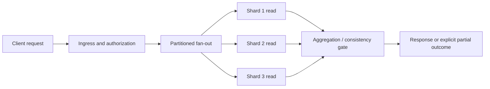

# Tail latency, fan-out and end-to-end deadline budgets

> **Tycho chapter draft:** intended canonical topic V07/C04 of the provisional 69-chapter table of contents. Source scope reviewed 2026-10-19. This page is original explanatory material with synthetic numbers; no live trace, experiment, performance benchmark, independent reviewer acceptance or production SLO is claimed.

## Purpose and mission

A system can have fast median service times and still miss a user-visible latency objective. The architecture question is not merely "how fast is each component?" but **how waiting, parallel dependency calls, retry fan-out, queueing and uncertainty combine along the user's critical path**. The tail of a service-time distribution is not an implementation nuisance: if a request needs many dependent results, a slow outlier can determine whether the entire result meets its deadline.

This chapter teaches the distinction between a measured percentile and an illustrative probability model, how to budget latency and cancellation end to end, and when mitigation patterns decrease *user-visible* tail latency without creating more load. Queueing and throughput conservation have their own canonical explanation in [queueing and Little's Law](queueing-littles-law.md); falsifiable workload experiments are covered in [workload profiles and capacity experiments](workload-profiles-and-capacity-experiments.md); [API/RPC contracts](../application/http-rpc-contracts-and-compatibility.md) own exact retry identity and protocol semantics.

## 1. One percentile cannot describe a distributed request

A latency sample must be named by boundary: client-observed request, ingress-to-egress request, queue wait, individual dependency call, DB lock wait or full background job. A percentile is a value of a **distribution**, not a single request's maximum. Define the observation window, whether timed-out requests are included, how sampling works, and whether successful, rejected and failed requests share the same population.

Suppose the fictional service above a user interface has ten independent operations at a downstream service. Each operation responds within a proposed threshold in 99% of independently sampled calls. The probability that all ten finish within this threshold is **0.99^10 ≈ 90.4%**, meaning about 9.6% of composed requests have at least one slow dependency *under these assumptions*. At fifty calls, **1 − 0.99^50 ≈ 39.5%** have at least one such outlier. These numbers are elementary model arithmetic using deliberately invented populations; they are not observations or universal distribution laws.

For N calls with identical independent latency CDF F(t), and a parent that waits for **all** replies, the maximum's distribution is:

\[
P(\max(T_1,\ldots,T_N)\le t)=F(t)^N.
\]

Real dependencies can be correlated through a shared database, GC event, network congestion, regional fault or request mix. Fan-out can include conditional branches, quorum/first-success logic and optional results, so the formula cannot simply be applied to every service graph. The published [Dean and Barroso, *The Tail at Scale*, 2013](https://research.google/pubs/the-tail-at-scale/) studies this phenomenon and mitigation strategies in large-scale services; it does not measure our synthetic system.

**Important distinction:** p99 of the *parent* is not the sum of p99 of each child; nor is the p99 of a parallel fan-out equal to the p99 of one child. Percentiles do not generally add. Sum latency across serial critical-path steps can be bounded by hard upper limits, but adding percentile values is not a valid quantile theorem without additional joint-distribution assumptions.

## 2. Draw the critical path and distinguish parallel from serial

Original model of a fictional "preview and analysis" request:

Text alternative: after ingress, several shard reads start concurrently. The aggregation stage may require all results, a quorum, or a defined partial response. Which of these is correct is a business invariant; only after choosing that correctness condition can we tell whether the slowest shard is on the critical path.

| Dependency policy | Parent latency relationship | Correctness question |
|---|---|---|
| All results required | Wait for slowest prerequisite, plus serial stages | Is partial output prohibited? |
| First successful response among replicas | Wait for first acceptable result; cancel remaining speculative work | Are replicas fresh/consistent enough to interchange? |
| Quorum reads | Wait for required qualifying responses | Which conflicts/staleness are acceptable? |
| Optional enrichments | Return partial result at a defined cutoff | Does the client understand missing information? |
| Sequential dependencies | Add actual elapsed work/queue waits on each critical-path segment | Could stages overlap without changing business meaning? |

Avoid claiming an architecture is "parallel" just because it launches asynchronous code: a shared connection pool, global lock, fan-in serialization or constrained executor can reintroduce an effectively serial bottleneck.

## 3. Deadlines are a resource and correctness contract

A **deadline** is the latest useful completion time for a request at a named boundary. A per-hop timeout is a local waiting limit. An unlimited chain of generous per-hop timeouts can outlive the caller, waste resources, and amplify queueing after an upstream failure. The [Google SRE cascading failures chapter](https://sre.google/sre-book/addressing-cascading-failures/) describes why outstanding work past caller deadlines contributes to cascading problems; the [gRPC deadlines guide](https://grpc.io/docs/guides/deadlines/) describes deadline propagation and time remaining.

**Synthetic budget:** a 1,000 ms end-to-end ceiling is allocated at the start of a fictional request as:

| Segment | Planning reservation (not a measured percentile) |
|---|---:|
| Ingress and authorization | 60 ms |
| Parallel fan-out and required consistency | 600 ms |
| Aggregation and response formatting | 120 ms |
| Network, scheduling and explicit safety reserve | 220 ms |
| **Total hard planning envelope** | **1,000 ms** |

These are *negotiated planning limits*, not statistical predictions. If ingress takes 130 ms instead of 60 ms, no component should keep the original 1,000 ms from that point: remaining time must be recomputed against the original absolute deadline. Some processing may still complete after the response deadline if the domain explicitly requires durable accepted work and exposes a later outcome; that is a **separate durable job contract**, not an invisible extension of a synchronous request.

An implementation-aware deadline design records:

1. Clock and deadline propagation semantics; monotonic elapsed-time measurement locally, converted remaining duration for remote calls where appropriate.
2. Maximum time spent queued before work begins; a queue that admits already-expired work contributes cost without useful output.
3. What cancellation stops (further calculation, network reads, speculative replicas) and what it **cannot undo** (committed state, external side effects).
4. Per-hop retry ownership, attempts, backoff, cumulative budget, and which operation identities make retries safe.
5. How late replies are drained/ignored, how resources are released, and how partial results are represented to the caller.

**Failure example:** a parent invokes a slow service, times out, retries at two independent layers, then the retrying work saturates a shared pool. Even if each individual retry was below its local maximum, aggregate offered load can rise sharply while completed useful work falls. [Amazon Builders' Library: Timeouts, Retries, and Backoff with Jitter](https://aws.amazon.com/builders-library/timeouts-retries-and-backoff-with-jitter/) discusses timeout selection, retry multiplication and load spreading. A retry must be a business-safe, bounded, capacity-aware action, not a reflex triggered by every high latency.

## 4. Hedging, replication and selective degradation

A **hedged request** sends an additional equivalent read to another viable replica when an earlier attempt appears unexpectedly slow, then uses an acceptable response and cancels remaining attempts. It can reduce an independent slow-replica tail; it can also double work exactly when a shared dependency is already saturated. The 2013 *Tail at Scale* paper describes deferred hedges and other tail-tolerance mechanisms; it is not evidence that hedging is safe in all deployments.

| Mitigation | Needed condition | Failure / contraindication |
|---|---|---|
| Improve slow path | The slow suboperation is identified in traces and controlled samples | Tuning a fast dependency changes no parent critical path |
| Parallelize independent reads | Outputs truly independent and resources available | Fan-out increases load, pool contention and tail exposure |
| Hedge delayed reads | Equivalent replicas; bounded speculative budget; cancellation; measured independent tails | Shared bottleneck, expensive writes, inconsistent replicas |
| Retry with jitter | Transient failure, safely repeatable effect and spare capacity | Retries magnify overload; caller deadline already expired |
| Return partial / cached result | Business semantics explicitly permit stale or absent optional data | Incomplete mandatory result presented as valid |
| Shed excess work | Defined admission priority, bounded queue and explicit caller outcome | Rejection without backoff creates retry storm |
| Async durable job | User need not block until completion; job state survives crash | Reinterpreting a synchronous contract without client agreement |

Speculative duplicate **writes** are not a general tail-latency technique. Different replicas may accept divergent effects, and a client receiving one reply cannot assume the other attempt did nothing. See [outbox/idempotency](../distributed/transactional-outbox-and-idempotency.md) and [HTTP/RPC operation identity](../application/http-rpc-contracts-and-compatibility.md) before recommending retries for effects.

## 5. Why test-tool latency can be deceptively low

A closed workload generator that waits for a response before issuing the next request reduces offered load when the system stalls. A test can therefore hide the backlog users would create under externally timed arrivals. Observe the demand schedule and **offered/admitted/completed rates separately**, not only completed-response histograms. Latency under open arrivals, bounded connection pools, drops, timeouts and queue age gives a different service picture.

For a representative evaluation:

- Define user-visible start/end points, full journey and correctness assertions before choosing percentile targets.
- Preserve a repeatable arrival schedule (bursts, skew, coordinated operations, client geography) and record its clock semantics.
- Instrument queue wait, service time, dependency subcalls, failed requests, cancelled calls, retry counts and error/timeout outcomes.
- Include the failed or timed-out *intended* user operations when computing success and latency SLOs; do not silently omit requests that never entered the measured service.
- Compare baseline and treatment at equivalent **offered** demand, resource ceilings and logical outcomes, with confidence/variance limits.
- Inject one failure at a time (slow shard, unavailable replica, pool exhaustion, degraded network) and verify both parent latency and recovery correctness.
- Report resource cost and load on the underlying infrastructure, not solely a smaller parent percentile.

The original [queueing chapter](queueing-littles-law.md) explains why finite measurement windows and completed-only sampling require careful interpretation; [workload experiment design](workload-profiles-and-capacity-experiments.md) extends this with reproducible arrival and evidence expectations.

## 6. Worked decision: retain, hedge, or split?

**Fictional case:** A read page queries eight independent views, but only five are required for the user's core operation. The three optional views may be absent with a visible explanation. Parent p99 is not yet measured, and it is unknown whether all views share one backend. A proposed "optimization" is to split the service and hedge every call.

**Baseline option:** retain the existing topology, trace the critical path, bound queue/admission, and measure the distribution of required versus optional views. This adds little operational complexity and is testable.

**Conditional improvement:** enforce a cutoff for optional views; render the core result once the five required views meet their correctness gates. If independently healthy replicas exist, test a narrowly budgeted hedge **only** on a selected required idempotent read after controlled tail evidence is collected.

**Rejected for now:** mandatory eight-result synchronization, blanket retry/hedge multiplication and service decomposition chosen solely because one parent's p99 is high. These options may increase latency variance, resource use or uncertainty without preserving core outcomes.

**Falsifiable claim:** at the same offered request mix and resource budget, limiting optional waits produces fewer user-visible deadline misses *without* suppressing mandatory content or worsening sustained backend overload. Measure p95/p99 and outcome ratio with a defined window; if not supported, revert the treatment.

### Original latency-budget counterexample: a retry consumes the same deadline

Suppose a fictional API has a **300 ms total caller deadline**, two parallel dependency reads and a 40 ms response/composition allowance. A proposal grants each dependency a 280 ms timeout plus one 280 ms retry. These independent timers do **not** fit inside one 300 ms user deadline; a retry made after 280 ms cannot be treated as a fresh 300 ms operation without violating the caller contract.

| Hypothetical timeline | Budget principle |
|---|---|
| T=0–20 ms: admission/authentication | The downstream work inherits **remaining** deadline, not initial 300 ms |
| T=20–240 ms: first dependency attempts | Protect capacity with bounded per-hop work and cancellation propagation |
| T=240 ms: one dependency times out | Only about 60 ms remain; a full 280 ms retry cannot complete on time |
| T=240–300 ms: optional fallback | Return degraded/explicit failure if allowed, not fabricated fully successful data |
| After T=300 ms: late commit/reply arrives | User timeout means outcome **unknown**, not that a prior write did not occur |

A hedge to a second replica can sometimes improve a read tail, but it multiplies dependency work and may exacerbate shared saturation. Hedging **mutations** without a stable intent/effect identity can create duplicate user-visible effects. Retry eligibility must consider idempotency and the *remaining* deadline; retry storms should be bounded by admission budgets and backoff policy.

The [gRPC deadline guidance](https://grpc.io/docs/guides/deadlines/) supports propagation of time budgets and the [AWS Builders' Library retries analysis](https://aws.amazon.com/builders-library/timeouts-retries-and-backoff-with-jitter/) discusses retry amplification. They are design references, not a tested latency prediction. **Proposed, not run:** inject a slow dependency and a shared overload condition under the same offered requests, compare deadline correctness, successful results, duplicate effects and additional backend calls with and without hedging.

**Reversal:** if correct partial responses are impossible, prefer a clear deadline error and reconciliation to a misleading success; if one dependency is optional, a bounded fallback may be preferable to a retry that cannot fit. Actual workload correlations and observed distributions—not independent p99 multiplication—must determine architecture choice.

## 7. Source-to-claim ledger and review boundary

| Public source inspected | Narrow supported role | Evidence boundary |
|---|---|---|
| [Dean and Barroso, *The Tail at Scale*, Communications of the ACM 56 (2013)](https://research.google/pubs/the-tail-at-scale/) | Parallel dependency tails and deferred hedging motivation | Paper case study ≠ performance result for fictional examples |
| [Google SRE Book, Addressing Cascading Failures](https://sre.google/sre-book/addressing-cascading-failures/) | Deadlines, overload and cascading work | Published production lessons, not portable numerical SLO thresholds |
| [gRPC Guides, Deadlines](https://grpc.io/docs/guides/deadlines/) | Propagated deadline and cancellation concepts | Language-specific implementations must be verified |
| [AWS Builders' Library, Timeouts/Retries/Backoff/Jitter](https://aws.amazon.com/builders-library/timeouts-retries-and-backoff-with-jitter/) | Overload amplification and retry-jitter design considerations | Vendor experience, not empirical evidence for this book's hypothetical topology |
| [Tycho queueing page](queueing-littles-law.md) | Original explanation of throughput versus mean and finite-window limits | Educational derivation; does not validate tail measurements |

**Author-owned inference:** the independent-max CDF and example calculations follow the stated probability model; the budget table, diagrams, choices and workload scenario are entirely fictional. Correlated latency distributions, real hedging effectiveness, throughput under overload, timeout-success ratios, latency sampling bias and third-party review remain **unverified**. No benchmark was run and no production recommendation is made. The page must be reconciled with the final V07 volume/section hierarchy before edition release.

## Reading and navigation

- Current landing: [Performance, scaling and resilience](README.md); target V07/C04 in [proposed book contents](../PROPOSED-STRUCTURE.md).
- Background: [Queueing and Little's Law](queueing-littles-law.md); [Workload experiments](workload-profiles-and-capacity-experiments.md).
- Implementation boundaries: [Java concurrency](../execution/platform-threads-executors-and-virtual-threads.md); [Connection pools](../scaling/connection-pools-hikaricp-pgbouncer.md); [API deadlines and retries](../application/http-rpc-contracts-and-compatibility.md).
- Failure actions: [Safe rollout/recovery](../delivery/safe-rollout-and-recovery.md); [Distributed idempotency](../distributed/transactional-outbox-and-idempotency.md).
