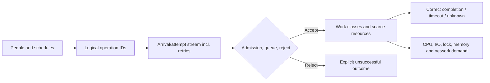

# Workload and demand models: from user behavior to measurable offered work

> **Original Tycho book draft V01/C02**, prepared 2026-10-19. Independently public queueing and load-model references, with invented examples. No population analytics, experiment, observed user trace, or validated production forecast exists for this chapter.

## Purpose and mission

“Ten thousand users” is not a sufficient workload specification. A system may have ten thousand accounts and almost no concurrent work; another with the same account count may receive a short burst of writes against one state key. Architecture decisions need a model of **arrivals, logical operations, concurrency, resource demand, key skew and time**. A good model makes assumptions visible and can be disproved by real observations.

This foundational chapter describes how to define those quantities and estimate offered work without converting user population into requests per second by an invented universal constant. The [V10 architecture requirement profile](../decisions/requirements-and-workload-architecture-profiles.md) applies workloads to option selection; [capacity experiments](workload-profiles-and-capacity-experiments.md) and [benchmark methodology](load-testing-and-benchmark-validity.md) own testing procedures. The [Little's Law chapter](queueing-littles-law.md) owns the conservation identity and its finite-window limits.

## 1. Workload nouns that must not be interchanged

| Term | Meaning at a declared boundary | Misuse to prevent |
|---|---|---|
| Registered users | Accounts capable of future activity | “Registered = concurrent” |
| Active users (DAU/MAU) | People active in an observation interval | “Active = simultaneous requests” |
| Sessions/connections | Client interactions or open transports; may be idle | “Connection count = CPU concurrency” |
| Scheduled logical operations | Independent business intents offered over time | “Retries are new business demand” |
| Attempts | Actual transmitted requests including retries | “All attempts = distinct successful operations” |
| Offered rate | Arrivals presented to a defined boundary/window | “Completed throughput = offered rate” |
| Admitted rate | Work allowed into processing | “Rejected requests never existed” |
| Completed rate | Work reaching a reported exit state in a window | “Every exit was timely and correct” |
| In-flight concurrency | Work resident inside a stated system boundary | “More tasks always increase useful capacity” |
| Resource demand | CPU, storage I/O, locks, connections, memory and external quotas consumed per operation | “Equal RPS means equal backend cost” |

For any quantity, record **units, observation interval, measurement point, data source and confidence**. A ratio such as “requests per active user” requires an observed or explicitly assumed behavioral model and time window. RPS is a rate, not a storage capacity or business correctness measure.

## 2. Arrival shape is part of the architecture requirement

Averages conceal peaks, clustering and correlations. A design must distinguish:
- baseline arrivals from short bursts and periodic batch imports;
- independent external arrivals from clients waiting for previous responses;
- retries after ambiguous outcomes from new logical operations;
- read operations from mutation and expensive analytical queries;
- broad key distributions from a few high-contention keys;
- time-varying payload sizes, tenant mixes, feature flags and geography;
- workload growth from workload **composition** changes.

A simplistic stationary rate is useful for bounded math, but should not be treated as an empirical forecast of bursts. Workload rates can vary within seconds; a one-hour mean hides a 10-second surge. A model without key skew can understate the cost of exclusive lock ownership even when total attempts match.

The public [k6 open/closed modeling guidance](https://grafana.com/docs/k6/latest/using-k6/scenarios/concepts/open-vs-closed/) explains why closed client loops can reduce new arrivals as service time increases, whereas arrival-rate executors schedule arrivals independently. This is a generator-model distinction, not proof that all real users behave as open arrivals.

## 3. Original example: two identical account counts, different costs

Invent two standalone educational scenarios, both with **12,000 registered accounts**:

**Case A — reading lists:** in a fictional hour, 600 users read static public descriptions, mostly without writing. Suppose a synthetic schedule produces 3,000 read operations spread fairly evenly and 50 small writes. The derived mean is 3,050/3,600 ≈ **0.85 operations/s** for that hour. That does not predict p99 or the busiest ten seconds.

**Case B — short publication window:** suppose 1,800 attempts arrive in one 15-second window to claim access to the same small set of unique resources. The derived offered rate in that interval is **120 attempts/s**, but completed successful unique claims can be far lower if key contention and duplicate retries dominate. The two systems have the same number of accounts but incomparable peaks and synchronization costs.

These numbers are **fictional assumptions and elementary arithmetic**. They are not survey data and do not recommend any particular technology. The relevant question is which state/resource boundary must process the work, not whether one scenario earns the label “high traffic”.

**Text alternative:** user behavior generates logical intents and attempts; retries may multiply attempts. Admission separates rejected from accepted work, after which processing consumes different resources. Completion and resource cost must both be measured. The graph is a model, not a deployed architecture or manually curated knowledge graph.

## 4. Simple demand arithmetic and its boundaries

At a steady compatible boundary, completed average throughput λ and average time W spent resident inside it relate to average occupancy L by **L = λW**. This does **not** say that adding concurrency increases useful throughput, or that one p99 value may replace W. If λ represents only successful completed operations while long-running/rejected work is excluded, the measured boundary may no longer satisfy the accounting assumptions. See the canonical [queueing page](queueing-littles-law.md) for the precise limitations.

For a hypothetical request mix, suppose:
- 70% small metadata reads at *assumed* mean CPU demand 2 ms;
- 20% object reads at 7 ms;
- 10% writes at 15 ms.

Expected CPU demand under that **illustrative** mix is 0.7×2 + 0.2×7 + 0.1×15 = **4.3 ms of CPU per operation**. At 100 completed operations/s, this would require about **430 ms CPU/s** if those demands are stable and perfectly accounted, before overhead or contention. It does *not* mean a quarter/half core is universally sufficient; I/O, locks, pauses, scheduler overhead, burst, hardware and other work can dominate.

A workload model should explicitly mark whether an operation's “service time” is **CPU time**, wall time, DB execution, queue wait or a distribution derived from measurements. Adding unrelated quantities into a single demand average invites incorrect capacity planning.

## 5. Distribution and correlation matter

Suppose read latency is bimodal—many requests hit a cache, a small fraction miss and perform costly database work. An average hides the parent tail and the backend's miss-driven peak. Alternatively, all writes may target one popular resource and serialize despite spare average CPU capacity.

Record joint information when it changes the decision: operation type *by key skew*, request bytes *by tenant*, retries *by failure class*, cache misses *by dependency*, peak arrivals *by time window*. A single global request histogram is not a substitute for such conditional samples.

**Synthetic counterexample:** a load test chooses keys uniformly while real hypothetical users overwhelmingly request the newest published item. The system appears to scale with additional app replicas in the synthetic test, but the real hot key remains serialized in an authoritative datastore. The correct next step is a representative skewed-key experiment, not a stronger extrapolation from the uniform result.

The [Tycho sharding and hot-key explanation](../scaling/shard-keys-hotspots-and-resharding.md) owns partitioning consequences. [Autoscaling lag](autoscaling-lag-and-capacity-limits.md) owns the controller startup delay that makes short bursts especially difficult.

## 6. Workload state and unknowns: a usable input contract

A workload record could include the following fields as a **methodological table**, not a claimed final machine-readable schema:

| Field | Value example | Evidence status |
|---|---|---|
| User journey | Reservation final-decision command | Proposed synthetic scope |
| Window | 15 seconds during a publication event | Assumed, not observed |
| Operation mix | Reads 70%, writes 30% | Hypothetical |
| Offered arrival schedule | Timestamped independent intents, duplicates separately tagged | Requires source trace |
| Data model/skew | Top five keys account for 60% of writes | Hypothetical and decision-changing |
| Resource ceilings | CPU quota, pool limit, DB write lock, external call rate | Unknown until instrumented |
| Outcome SLO | Final correct result within specified time and population | Requirement, not achieved result |
| Security and cost constraints | Authorization checks, operating budget, retention | Requires owner and exact acceptance |
| Validation plan | Replay workload at low/peak/degraded rates | Future experiment, not run |

The values and constraints must be revisited when client behavior or schema changes. A workload profile is a versioned hypothesis, not a permanent truth about a product.

## 7. Architecture implications are conditional

| Evidence | Candidate action | Why a premature action may be wrong |
|---|---|---|
| CPU hot path dominates under valid representative load | Reduce CPU cost or increase CPU capacity | Pool/thread changes may only worsen contention |
| Database connection acquisition dominates | Bound concurrency and inspect total pool budget | More connections can saturate the DB |
| One key dominates writes | Reconsider state/lock policy and key ownership | Sharding does not split one indivisible invariant |
| Synchronous user deadline too short for actual durable work | Re-negotiate outcome; consider accepted/pending semantics where allowed | Async acceptance is not a completed synchronous command |
| Cacheable public reads dominate | Evaluate cache with freshness and miss cost | Cache adds invalidation risk and may not fix writes |
| Short unpredictable burst exceeds warm capacity | Admission control or pre-warm under explicit cost/SLO | Autoscaling may arrive after the burst |

This table does **not** choose an architecture. It identifies what to measure and when a mechanism could become applicable. [Pattern applicability](../decisions/pattern-applicability-and-contraindications.md) is the later choice layer.

### Worked example: lost offered load versus server rejection

In an **original hypothetical** ten-second burst, a test schedules 1,200 iterations, starts 800, observes 500 correct completions, 100 explicit rejections and 200 timeouts, while dropping 400 iterations before starting them. These invented counts distinguish scheduled load from actual attempts and correct business effects. The server cannot be blamed for 400 attempts that never reached it. The 200 timeouts might conceal durable commits and require operation-ID reconciliation.

The [k6 open/closed workload contract](https://grafana.com/docs/k6/latest/using-k6/scenarios/concepts/open-vs-closed/) explains why clients that wait for prior responses may hide overload by reducing their own arrival rate. Its [dropped-iterations reference](https://grafana.com/docs/k6/latest/using-k6/scenarios/concepts/dropped-iterations/) identifies both generator sizing and system slowdown as possible reasons for drops; a drop counter alone cannot distinguish them. Actual ingress observations and generator resource measurements are necessary.

**Proposed, not executed:** rerun the same planned arrival schedule with sufficient generator headroom, then compare ingress attempts, admission, correct durable outcomes and post-burst backlog. Do not treat 50 correct completions per second as a tested maximum capacity or equate timeout with non-commit. The [queueing chapter](queueing-littles-law.md) owns finite-window conservation; [benchmark validity](load-testing-and-benchmark-validity.md) owns workload-generator bias.

### Paired arrival traces under the same constrained service (original synthetic calculation)

The following **matched six-second comparison is arithmetic, not a k6 run**. The backend can execute two operations concurrently; each admitted operation occupies its slot for exactly two seconds. Service is FIFO, no retries or failures occur, and there is no think time after a completed closed-loop operation. Both generators have access to the same logical catalogue and identical server capacity. Only the *client arrival contract* changes; this is deliberate, not a measured estimate of a population.

- **Closed generator:** two users each submit a new intent immediately after their previous two-second request finishes. Starting at `t=0`, arrivals are two at 0, 2 and 4 seconds.
- **Open generator:** an external schedule presents **two new independent intents every second**, even when older operations are unfinished. It is not throttled by the server's response time. Twelve intents arrive at 0–5 seconds.

| Second `[t,t+1)` | Closed arrivals | Open scheduled/started arrivals | Cumulative correct completions by `t+1`: closed / open | Open outstanding by `t+1` |
|---|---:|---:|---:|---:|
| 0 | 2 | 2 | 0 / 0 | 2 |
| 1 | 0 | 2 | 2 / 2 | 2 |
| 2 | 2 | 2 | 2 / 2 | 4 |
| 3 | 0 | 2 | 4 / 4 | 4 |
| 4 | 2 | 2 | 4 / 4 | 6 |
| 5 | 0 | 2 | 6 / 6 | 6 |

**Clock convention and reconciliation:** a pair of occupied slots finishes at the exact boundaries `t=2`, `t=4`, and `t=6`, freeing two slots for queued work. Thus, by `t=6`, the closed model offers and completes six intents and has no remaining work. The open model offers twelve, completes six, and has **six outstanding** (two running, four queued). Those totals exclude repeated attempts, timeouts and scheduled-generator drops by construction. With a real load generator, scheduled iterations, started iterations, backend ingress, admitted operations, and correct completions must be recorded separately. The shared two-user population is *two logical client identities*: the open scheduler is allowed to issue concurrent independent intents for them, while the closed scheduler waits for a response before each identity issues its next intent. This difference is the comparison's variable, not an observed user behavior claim.

**Architectural consequence:** sizing from *completed requests per second alone* cannot distinguish the two cases. The open model requires bounded admission, queue/deadline policy and possibly pre-warm for a sustained offered rate above one correct completion per second. The closed generator silently slows its offered arrival rate as requests take longer. If the same six-second population is instead scheduled at a lower open rate, the backlog conclusion must be recomputed from that offered trace. The [k6 generator documentation](https://grafana.com/docs/k6/latest/using-k6/scenarios/concepts/open-vs-closed/) provides the modeling distinction; it does **not** establish the invented two-second service time or that the live backend can sustain it. **Not run or benchmarked.**

## 8. Public evidence and unverified claims

| Source consulted | Scope | Limitation |
|---|---|---|
| [Grafana k6 Open and Closed Models](https://grafana.com/docs/k6/latest/using-k6/scenarios/concepts/open-vs-closed/) | Arrival coupling and generator model semantics | Not a survey of user behavior |
| [Grafana k6 Dropped Iterations](https://grafana.com/docs/k6/latest/using-k6/scenarios/concepts/dropped-iterations/) | Explicit unsent scheduled arrivals and multiple causes | No observed Tycho or fictional system load |
| [John D. C. Little, 1961 queueing identity (DOI)](https://doi.org/10.1287/opre.9.3.383) | Classical mean occupancy/throughput/residence relation under its assumptions | Not a tail-latency or capacity prediction |
| [Tycho Little's Law study](queueing-littles-law.md) | Original derivation and finite-window caveats | No exercised benchmark |

The user populations, arrival rates, averages, resource budgets, diagrams and work schedules are **wholly synthetic**. No customer data or restricted sources were used. Neither the forecast nor a benchmark has been independently validated. Editorial source-to-claim verification, case selection and final volume/page structure remain open.

## Navigation

- Proposed owner **V01/C02** in [book outline](../PROPOSED-STRUCTURE.md); current [performance topic](README.md).
- First read: [System framing](../application/problem-framing-and-system-boundaries.md).
- Expand: [Queueing](queueing-littles-law.md), [benchmark validity](load-testing-and-benchmark-validity.md), [capacity experiments](workload-profiles-and-capacity-experiments.md), [architecture requirements](../decisions/requirements-and-workload-architecture-profiles.md).
