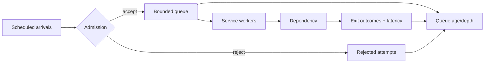

# Workload profiles and falsifiable capacity experiments

> Tycho E14-08 research draft, 2026-10-19. Synthetic examples only; no production measurement, benchmark, or independent review is claimed.

## Decision question

Before choosing a scale-out strategy, what evidence distinguishes arrival bursts, uneven keys, slow dependencies, and exhausted worker capacity? The answer is a **measured workload profile**, not a universal requests-per-second threshold.

## Record the boundary before the number

A workload contract should record: unique active users; offered requests per second (RPS); successful and failed exits; transaction boundaries and transactions per second (TPS); concurrent in-flight requests; bytes per request and response; key popularity and tenant skew; peak-to-median arrival ratio; growth assumptions; and downstream resource budgets. RPS and TPS cannot be substituted: one business transaction can require several requests and retries. Distinguish attempts from logical operations and admitted from offered demand. Record percentile latency and error rate **per operation class**, not only aggregate averages.

A synthetic example: 1,000 offered requests/s with a 90/10 tenant distribution is not equivalent to a uniformly distributed 1,000 requests/s workload when one tenant's writes serialize on one key. No real system is represented by these numbers.

## Measurement model

For a stable boundary, Little's Law relates mean in-flight work L, admitted throughput λ and mean residence time W: **L = λW**. This is an accounting relationship under its assumptions, not a saturation prediction. See [the canonical mechanism and finite-window caveats](queueing-littles-law.md).

Queueing delay grows as utilization approaches a bottleneck's capacity, but service-time variability and arrival burstiness affect tails. The Universal Scalability Law is a *model to fit against observations*, not a law that identifies contention or coherence costs from a single data point. Fitting its coefficients to too few samples is not evidence of the mechanism. Compare model predictions against withheld measurements and inspect bottleneck telemetry.

## Open versus closed load

An **open** generator schedules arrivals independently of previous responses. A **closed** generator maintains a fixed number of users that wait for a response and optional think time before submitting more work. Closed models can reduce offered traffic as response times rise, hiding overload. For either model, record intended arrival schedule, actual arrival schedule, dropped/suppressed iterations, queue depth and generator CPU saturation.

**Coordinated omission:** when a blocked load generator stops scheduling requests, recorded latency excludes waits that would have occurred under the intended arrival schedule. Never treat corrected histograms as observed requests without disclosing the correction model. Record both raw observations and the intended schedule; do not manufacture unobserved response times as facts.

## Experiment sequence

1. Define success, failure, cancellation and admission metrics; keep latency histograms per endpoint and tenant.
2. Run a baseline at low offered load and then multiple stepped loads, recording actual offered/admitted/completed rates and latency distributions.
3. Introduce a controlled burst and a skewed-key scenario; compare against uniform arrivals with equal aggregate traffic.
4. Degrade one dependency and measure retry amplification, queue depth, timeout propagation and recovery after removing the fault.
5. Compare scale-up and scale-out under identical workload and cost boundaries, noting state locality, coordination overhead and autoscaling delay.
6. Repeat trials, preserve configurations and disclose generator saturation, clock/measurement limitations and statistical uncertainty.

**Decision gate:** if p99 and error budgets are undefined, or the generator cannot maintain scheduled load, report *insufficient evidence*. No architecture is selected from an arbitrary RPS threshold.

## Original illustrative experiment map

Text alternative: independently scheduled arrivals pass an admission decision; rejected attempts are counted, admitted requests wait in a bounded queue and pass through workers and a dependency. Exit and queue metrics are collected separately. This is a synthetic diagram, not a deployed topology.

## Evidence and limitations

- John D. C. Little, *A Proof for the Queuing Formula: L = λW*, Operations Research 9(3), 1961, pp. 383–387, DOI [10.1287/opre.9.3.383](https://doi.org/10.1287/opre.9.3.383). Primary historical mathematical result; exact proof not reproduced here.
- Neil J. Gunther, *Guerrilla Capacity Planning*, Springer, 2007, chapters on the Universal Scalability Law. Model reference; no fitted coefficients or independent verification for this chapter.
- Gil Tene, *How NOT to Measure Latency*, 2015 talk ([recording](https://www.youtube.com/watch?v=lJ8ydIuPFeU)). Source pointer for coordinated omission; talk not re-inspected in this run.
- [Grafana k6 arrival-rate executors](https://grafana.com/docs/k6/latest/using-k6/scenarios/executors/constant-arrival-rate/) and [closed-model executors](https://grafana.com/docs/k6/latest/using-k6/scenarios/executors/constant-vus/). Documentation pointers; current version and sections require exact source verification before editorial acceptance.

The source pointers above are **not** claims of a fresh full primary-source review. Required follow-up: inspect the named source sections and versions, add precise claim-to-section ledger, independently review the chapter, and exercise a reproducible synthetic generator test. This page is a bounded draft and does not satisfy the entire issue acceptance.

## Overload controls and failure containment

**Autoscaling** is a delayed feedback loop, not an instantaneous capacity guarantee. Specify the measured signal (for example, queue age or admitted concurrency), observation interval, startup and warm-up delay, minimum and maximum replicas, and a scale-down stabilization rule. Test a burst shorter than the full provisioning delay: an autoscaler cannot protect that interval by adding instances that are not yet ready. Scaling application replicas may also exhaust a fixed downstream connection or rate-limit budget.

**Admission control** must be applied before expensive work. Define a bounded in-flight limit and queue, a deadline-aware rejection policy, and distinct metrics for offered, accepted, rejected, timed-out and completed logical operations. A rejection is an explicit availability outcome, not successful throughput. Prefer fast, documented overload responses to unlimited queues that convert a burst into stale work.

**Load shedding** may prioritize work classes, but the policy must name fairness and correctness constraints: never silently drop acknowledged writes or violate per-key ordering. Test priority inversion and starvation under sustained overload. For clients, expose an actionable backoff signal when supported, without promising immediate recovery.

**Retry budgets** constrain the number and duration of extra attempts. Model amplification across layers: if each of three layers retries an operation up to three times, a pathological path may trigger up to 27 downstream attempts for one logical operation (assuming all layers independently make three attempts). Avoid retrying non-idempotent operations without deduplication or an idempotency key. Apply deadlines, jittered backoff, and an overall retry-rate budget; count retries separately from original demand.

**Bulkheads** isolate bounded pools, concurrency slots or queues per dependency/work class so one slow dependency cannot consume all workers. A bulkhead's limit can itself reject valid work: measure isolation benefits and wasted capacity. Circuit breakers can reduce repeated calls to an unhealthy dependency, but require explicit half-open probe limits and recovery criteria; they do not replace admission control.

### Synthetic failure experiment and acceptance signals

Use two independent request classes, A (healthy dependency) and B (degraded dependency), with fixed scheduled arrival traces. Run a baseline and a B-only latency/failure injection while recording A and B p50/p95/p99, completions, rejections, queue age, concurrency, downstream attempts per logical operation and recovery time. Compare shared and isolated worker pools with the same aggregate resource budget. **Hypothesis:** isolation can preserve A's latency under B degradation; this is a testable expectation, not an observed result. Reject the hypothesis if A's tail latency or correctness remains unacceptable, or if throughput gains are entirely caused by dropping work outside the agreed SLO. Preserve raw timestamps and intended arrivals to detect coordinated omission.

**Decision record:** document offered and admitted workload, peak duration, maximum queue wait, deadlines, retry and rejection policy, measured downstream ceiling, scale-out warm-up, and the rollback trigger. Do not select a universal replica count, queue length, or RPS threshold without workload-specific evidence.

## Additional source pointers requiring editorial verification

- [AWS Builders' Library, *Timeouts, retries, and backoff with jitter*](https://aws.amazon.com/builders-library/timeouts-retries-and-backoff-with-jitter/): retry amplification, timeout and jitter mechanisms; exact sections not freshly checked for this addition.
- [AWS Builders' Library, *Using load shedding to avoid overload*](https://aws.amazon.com/builders-library/using-load-shedding-to-avoid-overload/): overload response design; exact sections not freshly checked for this addition.
- [Microsoft Azure Architecture Center, *Bulkhead pattern*](https://learn.microsoft.com/en-us/azure/architecture/patterns/bulkhead): isolation trade-offs; documentation version not freshly checked.

These references are candidate primary documentation, **not** a verified claim-to-section ledger. No load generator was run and no independent review occurred for this addition.

## Verified reference review and reproducible synthetic trace

Editorial inspection of the linked public documentation below was performed on 2026-10-19. These are **scope-specific source inspections**, not proof that the versions of components used by any real deployment match, or that an independent expert approved the interpretation. Living documentation URLs can change; the listed headings and inspection date are the reference boundary.

### Source-to-claim ledger (scope verified)

| Ref | Public source and inspected section | Narrow supported claim | Not established |
|---|---|---|---|
| V01 | [Kubernetes, Horizontal Pod Autoscaling](https://kubernetes.io/docs/concepts/workloads/autoscaling/horizontal-pod-autoscale/), *Algorithm details* and *Pod readiness and autoscaling metrics*, accessed 2026-10-19 | HPA's per-pod CPU scaling calculation sets aside missing metrics and not-yet-ready pods; CPU initialization and readiness timing influence effective scale decisions | A specific cluster's actual autoscaling delay, policy configuration, readiness, or ability to serve a burst |
| V02 | [Grafana k6, Open and closed models](https://grafana.com/docs/k6/latest/using-k6/scenarios/concepts/open-vs-closed/), *Open Model* / *Closed Model*, accessed 2026-10-19 | Arrival-rate executors schedule work independently of iteration completion; closed-model iteration pacing responds to service duration | That any configured run generated its intended traffic at saturation |
| V03 | [Grafana k6, Dropped iterations](https://grafana.com/docs/k6/latest/using-k6/scenarios/concepts/dropped-iterations/), *Dropped iterations*, accessed 2026-10-19 | For arrival-rate executors, lack of free virtual users may cause scheduled iterations not to start; the counter must be captured for honest offered-load analysis | Whether a drop was caused by the SUT rather than under-provisioned generator capacity without additional evidence |
| V04 | [HdrHistogram, AbstractHistogram implementation](https://github.com/HdrHistogram/HdrHistogram/blob/master/src/main/java/org/HdrHistogram/AbstractHistogram.java), *addWhileCorrectingForCoordinatedOmission* API documentation, inspected master 2026-10-19 | Correction adds modeled samples when a known expected interval is supplied; corrected distributions are not direct observations of requests never sent | A uniquely correct latency reconstruction from an unknown intended arrival schedule |
| V05 | [Google SRE book, Chapter 21: Handling Overload](https://sre.google/sre-book/handling-overload/), *The Pitfalls of Queries per Second*, *Client-Side Throttling*, *Criticality* and *Deciding to Retry*, accessed 2026-10-19 | Operation resource costs vary; client-side throttling, criticality-aware shedding and per-request/per-client retry budgets address cascading overload | Universally safe request quotas or direct applicability of Google's example thresholds to another system |
| V06 | [Microsoft Azure Architecture Center, Bulkhead pattern](https://learn.microsoft.com/en-us/azure/architecture/patterns/bulkhead), *Solution* and *Problems and considerations*, accessed 2026-10-19 | Isolated service instances, queues, or connection pools limit shared-resource failure propagation, at utilization and management cost | That particular pool sizes or isolation boundaries improve any unmeasured workload |
| V07 | [Envoy 1.24.9, Circuit breaking](https://www.envoyproxy.io/docs/envoy/v1.24.9/intro/arch_overview/upstream/circuit_breaking), *Circuit breaking*, version 1.24.9 inspected 2026-10-19 | Configurable per-upstream-cluster/per-priority connection and request limits provide network-level backpressure; overflow counters and limit semantics are observable and may be approximate | That all Envoy versions/configurations have identical behavior or guarantee no requests beyond a specified limit |

The AWS Builders' Library references listed earlier remain **unverified source pointers** for this review because the English entry URLs redirected to a different publishing host; this ledger does not claim their body text was re-inspected. The Microsoft entry above *was* inspected and narrows the earlier pending pointer. Historic Gunther and Little references still need editorial line/section review before being labeled independently verified.

### Reproducible, explicitly limited model

The repository includes a standard-library, deterministic trace demonstration: [capacity_trace_lab.py](../../scripts/capacity_trace_lab.py) and [its tests](../../tests/test_tycho_capacity_trace_lab.py). To reproduce from the repository root with Python 3.10+:

~~~sh
python3 scripts/capacity_trace_lab.py
python3 -m unittest discover -s tests -p 'test_tycho_capacity_trace_lab.py' -v
~~~

The Python 3.10+ floor is required by the type-annotation syntax, not a benchmark prerequisite. An isolated local execution of the five deterministic tests on 2026-10-19 passed; the fifth test rejects non-finite time values and boolean integer parameters. This is **not** a claim that the entire repository's premerge suite ran, that a load generator drove an actual service, or that the GitHub PR's environment was verified.

Trace (all times in seconds, intentionally fictional): B at 0.00 and 0.01 with service duration 5.00; A at 0.02 and 0.12 with service duration 0.05. Compare two **total concurrent slots** in (i) one shared pool and (ii) dedicated A=1, B=1 pools. Admission is immediate with **no queue**. The deterministic model yields:

| Model | A admitted | A rejected | B admitted | B rejected |
|---|---:|---:|---:|---:|
| Shared two slots | 0 | 2 | 2 | 0 |
| Dedicated A=1, B=1 | 2 | 0 | 1 | 1 |

This shows a **constructed** example of a trade-off: isolation protects class A's opportunities by reserving capacity, but rejects one B request. It is NOT empirical evidence that an isolated deployment improves p99 latency or cost. The open example schedules starts at 0.0, 0.1, 0.2, 0.3, 0.4; a closed single virtual user with service time 0.5 and think time 0.1 schedules starts at 0.0, 0.6, 1.2, 1.8, 2.4. Because both schedules are synthetic, these demonstrate pacing semantics and not measured coordinated omission.

**Missing experimental fidelity:** No waiting queue, capacity-dependent service times, autoscaler warm-up, bursty operating system scheduling, network retries, virtual-user availability, downstream failures, fairness, or actual latency histograms are modeled. For real architecture selection, preserve offered/started/completed counters and timestamps, use the chosen k6 executor with a monitored load generator, capture dropped iterations, inject faults safely, repeat trials and judge explicitly named SLOs and correctness invariants. Report *insufficient evidence* until the target system has been measured.

### Editorial acceptance remaining

- Review Little's Law and USL primary passages precisely and ensure chapter statements align with bounded assumptions.
- Reconcile the branch with current main, verify all relative links and run repository-wide local premerge checks.
- Inspect the full PR diff and request independent architectural/domain review; **self-authorship and four synthetic unit tests are not independent review**.
- Only after source/structure/correctness gates should #86 be considered for completion; completion of this trace is not completion of the milestone.

## Narrow primary-paper abstract verification (2026-10-19)

The following are **primary publisher/author-hosted abstracts inspected in this pass**, not claims that the entire papers or their proofs were read. They refine two source pointers left pending above.

- **Little (1961)** — [INFORMS publisher abstract, *A Proof for the Queuing Formula: L = λW*](https://pubsonline.informs.org/doi/abs/10.1287/opre.9.3.383), *Abstract*, volume 9(3), pages 383–387, published online 1961-06-01. The abstract explicitly names finite means, strict stationarity, and a metrically transitive arrival process with nonzero mean among its conditions. It **supports the conditional mean identity** in the chapter; it does not assert transient-window validity, a percentile relationship, bottleneck localization, queue sizing or a universal workload threshold. The body/proof was **not inspected** in this pass.
- **Gunther (2008)** — [arXiv author-submitted abstract, *A General Theory of Computational Scalability Based on Rational Functions*](https://arxiv.org/abs/0808.1431), version 1 dated 2008-08-11, *Abstract*. The abstract describes a computational-capacity rational function with linear numerator and second-degree denominator, its relation to a queue-theoretic synchronous throughput bound, and statistical modeling/prediction. This **supports why a capacity-fit model is relevant**; it does not independently establish a particular fitted value of contention or coherency for an application, or provide production results for the Tycho synthetic scenarios. The full derivation was **not inspected**; use the exact USL coefficient formula above as a published model representation pending a primary full-text algebra review.

**Editorial consequence:** report both references as "publisher/author abstract verified; full-text derivation outstanding," rather than "unverified" or "full paper independently checked." A credible load-study outcome still requires measured inputs, fit validation against held-out data, workload definitions and actual system tests.
