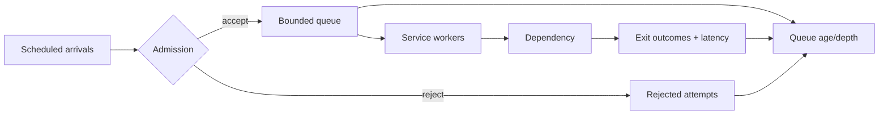

# Workload profiles and falsifiable capacity experiments

> Tycho E14-08 research draft, 2026-10-19. Synthetic examples only; no production measurement, benchmark, or independent review is claimed.

## Decision question

Before choosing a scale-out strategy, what evidence distinguishes arrival bursts, uneven keys, slow dependencies, and exhausted worker capacity? The answer is a **measured workload profile**, not a universal requests-per-second threshold.

## Record the boundary before the number

A workload contract should record: unique active users; offered requests per second (RPS); successful and failed exits; transaction boundaries and transactions per second (TPS); concurrent in-flight requests; bytes per request and response; key popularity and tenant skew; peak-to-median arrival ratio; growth assumptions; and downstream resource budgets. RPS and TPS cannot be substituted: one business transaction can require several requests and retries. Distinguish attempts from logical operations and admitted from offered demand. Record percentile latency and error rate **per operation class**, not only aggregate averages.

A synthetic example: 1,000 offered requests/s with a 90/10 tenant distribution is not equivalent to a uniformly distributed 1,000 requests/s workload when one tenant's writes serialize on one key. No real system is represented by these numbers.

## Measurement model

For a stable boundary, Little's Law relates mean in-flight work L, admitted throughput λ and mean residence time W: **L = λW**. This is an accounting relationship under its assumptions, not a saturation prediction. See [the canonical mechanism and finite-window caveats](queueing-littles-law.md).

Queueing delay grows as utilization approaches a bottleneck's capacity, but service-time variability and arrival burstiness affect tails. The Universal Scalability Law is a *model to fit against observations*, not a law that identifies contention or coherence costs from a single data point. Fitting its coefficients to too few samples is not evidence of the mechanism. Compare model predictions against withheld measurements and inspect bottleneck telemetry.

## Open versus closed load

An **open** generator schedules arrivals independently of previous responses. A **closed** generator maintains a fixed number of users that wait for a response and optional think time before submitting more work. Closed models can reduce offered traffic as response times rise, hiding overload. For either model, record intended arrival schedule, actual arrival schedule, dropped/suppressed iterations, queue depth and generator CPU saturation.

**Coordinated omission:** when a blocked load generator stops scheduling requests, recorded latency excludes waits that would have occurred under the intended arrival schedule. Never treat corrected histograms as observed requests without disclosing the correction model. Record both raw observations and the intended schedule; do not manufacture unobserved response times as facts.

## Experiment sequence

1. Define success, failure, cancellation and admission metrics; keep latency histograms per endpoint and tenant.
2. Run a baseline at low offered load and then multiple stepped loads, recording actual offered/admitted/completed rates and latency distributions.
3. Introduce a controlled burst and a skewed-key scenario; compare against uniform arrivals with equal aggregate traffic.
4. Degrade one dependency and measure retry amplification, queue depth, timeout propagation and recovery after removing the fault.
5. Compare scale-up and scale-out under identical workload and cost boundaries, noting state locality, coordination overhead and autoscaling delay.
6. Repeat trials, preserve configurations and disclose generator saturation, clock/measurement limitations and statistical uncertainty.

**Decision gate:** if p99 and error budgets are undefined, or the generator cannot maintain scheduled load, report *insufficient evidence*. No architecture is selected from an arbitrary RPS threshold.

## Original illustrative experiment map

Text alternative: independently scheduled arrivals pass an admission decision; rejected attempts are counted, admitted requests wait in a bounded queue and pass through workers and a dependency. Exit and queue metrics are collected separately. This is a synthetic diagram, not a deployed topology.

## Evidence and limitations

- John D. C. Little, *A Proof for the Queuing Formula: L = λW*, Operations Research 9(3), 1961, pp. 383–387, DOI [10.1287/opre.9.3.383](https://doi.org/10.1287/opre.9.3.383). Primary historical mathematical result; exact proof not reproduced here.
- Neil J. Gunther, *Guerrilla Capacity Planning*, Springer, 2007, chapters on the Universal Scalability Law. Model reference; no fitted coefficients or independent verification for this chapter.
- Gil Tene, *How NOT to Measure Latency*, 2015 talk ([recording](https://www.youtube.com/watch?v=lJ8ydIuPFeU)). Source pointer for coordinated omission; talk not re-inspected in this run.
- [Grafana k6 arrival-rate executors](https://grafana.com/docs/k6/latest/using-k6/scenarios/executors/constant-arrival-rate/) and [closed-model executors](https://grafana.com/docs/k6/latest/using-k6/scenarios/executors/constant-vus/). Documentation pointers; current version and sections require exact source verification before editorial acceptance.

The source pointers above are **not** claims of a fresh full primary-source review. Required follow-up: inspect the named source sections and versions, add precise claim-to-section ledger, independently review the chapter, and exercise a reproducible synthetic generator test. This page is a bounded draft and does not satisfy the entire issue acceptance.
