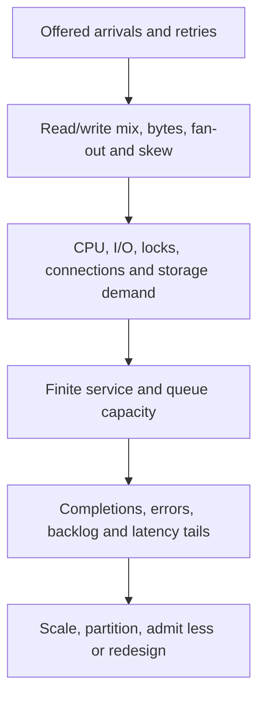
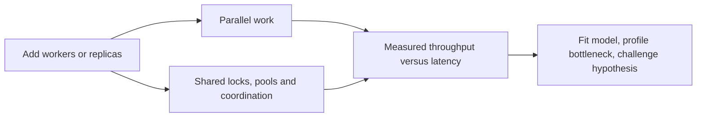

# Workload shape and scalability laws

> Tycho [#86](https://github.com/rouslanbaranov/tycho/issues/86). Original synthetic examples; public sources inspected 2026-10-19. No deployed workload or measured scalability is claimed.

## Purpose and question

How do users, request rates, business transactions, concurrency, data volume, skew and growth determine which architecture change can actually increase useful throughput? The answer begins with **offered work and finite resources**, not registered-user counts. The canonical [queueing chapter](queueing-littles-law.md) owns the deeper Little's Law derivation.

## 1. Workload profile before technology

| Signal | Record | Why it changes a decision |
|---|---|---|
| Registered / active users | Distinct populations and observation windows | Neither number directly equals simultaneous requests |
| Offered / admitted / completed RPS | Count attempts, retries, rejected and successful work separately | Backlog and load shedding can hide saturation |
| Business TPS | Define one business transaction and its downstream fan-out | One transaction may execute several HTTP and SQL operations |
| Concurrent in-flight requests | Include waiting and executing work | Bounded buffers, queues and pool pressure |
| Data size and distribution | Payload percentiles, retained records, hot keys/tenants | Hotspots can dominate uniform average load |
| Burst and growth | Peak duration, growth and seasonality | Autoscaling may react after the burst |
| SLO and invariants | p95/p99, errors, freshness, correctness, recovery | A faster response is not success if data becomes wrong |

Fictional illustration: 250 offered RPS comprise 70% catalogue reads, 20% availability reads and 10% registration writes. Twenty-five registration TPS does **not** mean twenty-five database queries per second. A hot tenant may account for 45% of writes; a uniformly distributed request model would miss that bottleneck. These numbers are invented test inputs.

Text alternative: request arrivals and per-request costs consume finite resources. Only measured completions, backlog, errors and latency identify which change may help. This is an explanatory model, not an observed topology.

## 2. Little's Law and saturation

For a stable system, mean work in system `L`, throughput `λ` and mean response time `W` obey `L = λ × W`. At a fictional admitted 200 requests/s and mean 0.15 seconds, the mean number in flight is 30. That does **not** imply 30 database connections or 30 CPU threads: each request occupies those resources for only part of its lifetime. At overload, arrival rate can exceed completion rate and queues grow, invalidating careless steady-state interpretation.

Differentiate **response time** from **resource service demand**. A 300 ms response may include only 4 ms CPU, 40 ms DB time and the remainder waiting. Adding CPU replicas will not resolve a serialized database lock. Capture CPU saturation, query plans, lock waits, pool acquisition, queue depth, timeouts and downstream rate limits.

## 3. Universal Scalability Law

Gunther's 2008 [primary paper](https://arxiv.org/abs/0808.1431) derives a rational-function model of relative computational capacity. A commonly used normalized form is `C(N) = N / (1 + α(N−1) + βN(N−1))`, where α represents contention and β represents coherency overhead. Fit these parameters to **comparable measured points** before using the curve to discuss limits. Positive contention can cause diminishing returns; coordination can produce retrograde throughput. The equation is not proof of a particular bottleneck and does not predict capacity from registered-user counts alone. [E01]

Text alternative: adding parallelism can increase capacity and contention simultaneously. A measured scaling curve plus profiles is needed to separate these effects.

## 4. Vertical, horizontal and partition scaling

**Vertical scaling** gives a process more cores, memory or I/O; it can help a measured single-resource bottleneck but does not remove single-node availability limits. **Horizontal scaling** adds independently serving instances, but multiplies shared downstream connections and coordination. **Partition scaling** changes key ownership and may reduce hotspots while complicating cross-partition transactions, ordering and migration. Compare [pool budgets](../scaling/connection-pools-hikaricp-pgbouncer.md) and [sharding](../scaling/shard-keys-hotspots-and-resharding.md) before adopting either.

A defensible ADR names the limiting resource, workload profile, correctness invariants, proposed change, simpler alternatives, rollback and reversal criterion. A universal threshold such as "microservices after 1,000 RPS" is not supported.

## 5. Reproducible evidence required

Sweep offered arrival rate and concurrency independently with fixed data snapshot and representative request mix. Record warm-up, p50/p95/p99, errors, retry amplification, queue depth, resource saturation, hardware, software revisions and generator limits. Repeat with hot keys, large payloads, cold cache and failed dependency. Compare completed **correct** transactions and operational cost, not throughput alone. No such run was performed for this page.

## Source-to-claim ledger

| ID | Primary public source and inspected scope | Supports / excludes |
|---|---|---|
| E01 | [Gunther, 2008, *A General Theory of Computational Scalability Based on Rational Functions*](https://arxiv.org/abs/0808.1431), abstract and USL model | Analytical capacity model; no fitted Tycho curve |
| E02 | [Existing Tycho queueing research](queueing-littles-law.md) | Little's Law interpretation; no independent empirical verification |
| E03 | [Existing pool and sharding research](../scaling/README.md) | Downstream coupling and partition trade-offs; no live scaling test |

**Review:** self-authored, not independently reviewed. Synthetic arithmetic only; no actual USL fit, application benchmark or milestone Python CI.
