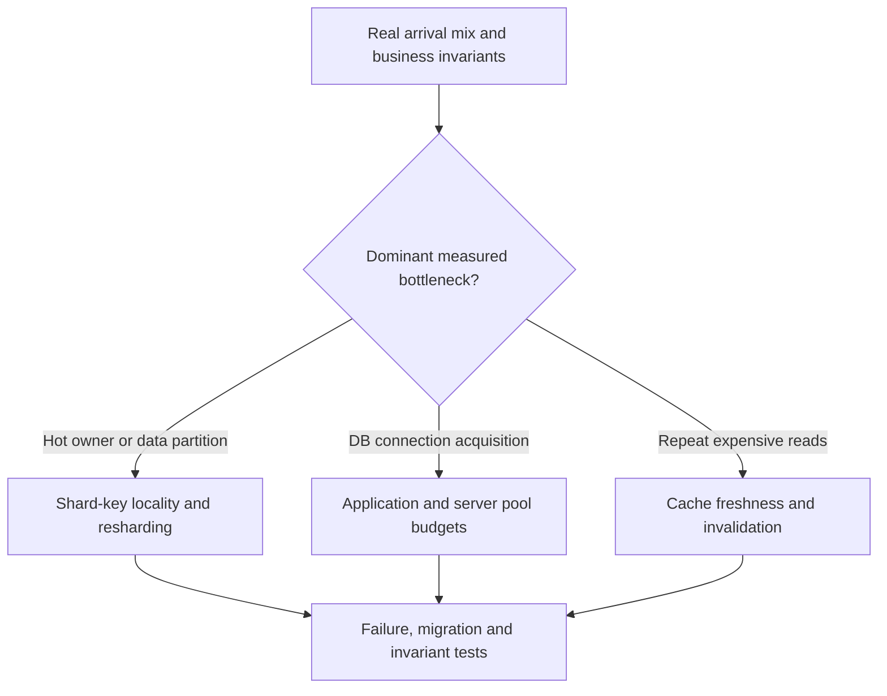

# Scaling: sharding, connection pools and caches

> Status: independently source-grounded draft pages, now with distinct V06/C01–C02 owner manuscripts for [Issue #84](https://github.com/rouslanbaranov/tycho/issues/84). Version scopes and uncertainty are recorded in the pages. Not a full implementation/benchmark or a finished scaling volume.

## Purpose and mission

Explain why bottlenecks follow scarce resources and data ownership: splitting keys, pooling connections or caching reads only helps when it addresses an **observed** workload limit without violating correctness or recovery.

## Route through the mechanisms

Text alternative: identify whether a workload is limited by hot partition ownership, database connection admission or repeated reads, then study the corresponding mechanism and perform failure/invariant tests. The diagram is **not** an automatic scaling selector.

## Canonical researched pages

| Reader question | Page | Public evidence |
|---|---|---|
| Which shard key preserves locality, avoids hot partitions and supports a safe re-shard? | [Shard keys, hotspots and resharding](shard-keys-hotspots-and-resharding.md) | Vitess 24.0 resharding, VSchema and PostgreSQL 17 partitioning |
| How should JVM pools and PgBouncer share an actual PostgreSQL connection budget? | [Connection pool budgets and modes](connection-pools-hikaricp-pgbouncer.md) | HikariCP public configuration, PgBouncer pooling modes, PostgreSQL 17 connections |
| When do local, shared or absent caches fit freshness, authority and operational constraints? | [Local and distributed cache design](local-and-distributed-cache-design.md) | V06/C01; Redis cache-aside and Caffeine eviction/refresh evidence; no measurements |
| How do stale fills, hot-key expiration and refresh locks threaten source/correctness? | [Cache invalidation, stampedes and hot-key failures](cache-invalidation-stampede-and-hot-keys.md) | V06/C02; original races and negative test matrix; no executions |
| What did the initial combined cache research cover? | [Preserved cache study](local-distributed-caching-and-invalidation.md) | Historical primary reference; no longer sole canonical owner for C01/C02, pending claim audit |

## Related canonical owners

- [Queueing and Little's Law](../performance/queueing-littles-law.md) — offered/admitted rates, occupancy and overload.
- [PostgreSQL data architecture](../data/README.md) — transaction isolation, indexes, WAL and alternatives.
- [Java execution and virtual threads](../execution/README.md) — thread budget versus finite downstream resources.
- [Outbox and consumer idempotency](../distributed/transactional-outbox-and-idempotency.md) — safely updating derived state.
- [Safe rollout and recovery](../delivery/safe-rollout-and-recovery.md) — compatibility, migration and user-level recovery.

## Important limits

The pages use wholly synthetic scenarios and original Mermaid figures. No Vitess, HikariCP, PgBouncer, Caffeine or Redis instance was deployed; full pool/load tests, distributed cache consistency proof and operational failover measurements are future work. These pages establish *mechanism reasoning*, not guaranteed scaling gains or a universal tuning recipe.
