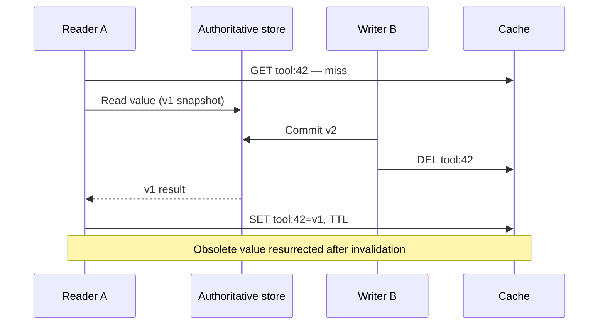
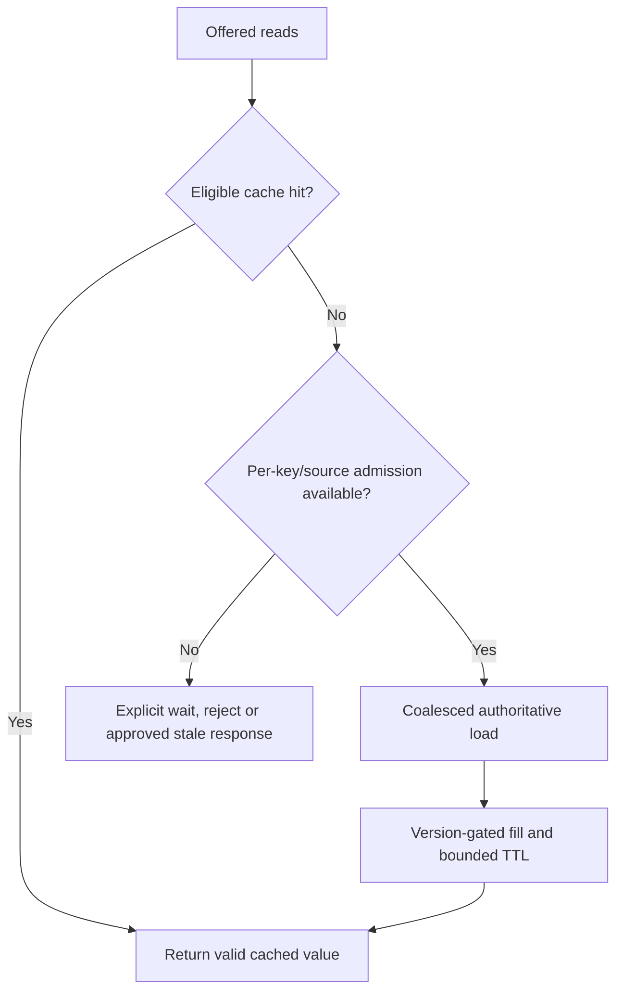

# Cache invalidation, stampedes and hot-key failure modes

> **Original Tycho V06/C02 chapter draft**, 2026-10-19. Public Caffeine refresh, Redis cache-aside and EXPIRE sources describe mechanisms. All races and load examples here are educational inventions; no cache, Redis lock, version guard, database or benchmark was run or reviewed. The earlier [combined cache research](local-distributed-caching-and-invalidation.md) remains intact until claims are reconciled.

## Purpose and mission

A cache may perform well under ordinary traffic and become a **load amplifier** precisely during a key expiration, a write burst or an outage. Expiring an entry and asking all waiting clients to refetch it can overload a healthy authoritative store. Invalidating after a write can also be undone by a slower in-flight read filling an obsolete value.

This chapter owns concurrent cache correctness and overload boundaries. [V06/C01 cache placement and freshness](local-and-distributed-cache-design.md) owns local/shared/no-cache choice and base TTL/refresh semantics. [V07/C05 overload protection](../performance/overload-admission-control-and-graceful-degradation.md) owns general system admission policies.

## 1. The stale-fill-after-invalidation race

**Original synthetic sequence:** cache key tool:42 has no value. Reader A begins an authoritative read of version v1. Meanwhile writer B commits v2 and deletes the key. The older reader completes and stores v1 after the delete; future readers may see obsolete data.

**Text alternative:** reader A starts loading an older version before a newer write. The writer commits and invalidates. A then repopulates the key with the obsolete value. Normal cache-aside with database-write-then-delete and an unguarded fill cannot eliminate this race by itself.

Possible mitigations have different complexity:
- accept bounded staleness for noncritical content, with a clearly defined maximum interval under real renewal rules;
- attach monotonic source versions and only allow cache writes that do not regress version;
- compare-and-set/atomic scripts at the shared key for a properly modeled version guard;
- avoid serving cache as authority for effect/authorization checks;
- route updates through a versioned projection with replay and tombstone semantics when justified.

A TTL is *not* itself a monotonic-version or consistency guarantee. Source and cache clocks or refreshing a stale value may complicate any claimed maximum-age contract. [Redis cache-aside](https://redis.io/docs/latest/develop/use-cases/cache-aside/) presents the basic flow, not a universal proof of protection from this concurrent fill order.

## 2. Stampede at a synchronized expiry

A cache stampede occurs when many concurrent readers miss or decide that a cached value needs refreshing, then issue many redundant expensive origin loads.

**Illustrative fiction:** one key receives 600 reads/s. Its TTL expires and 300 clients overlap before the first origin read returns. Without per-key coalescing or a source admission budget, the origin may receive hundreds of near-identical queries even though normally it receives few. These are invented counts, not observed measurements.

Potential countermeasures:

| Technique | Can reduce | Required caveat |
|---|---|---|
| Single-flight within process | Multiple concurrent source loads per key on one instance | Many replicas still load in parallel |
| Distributed refresh lease | Duplicate concurrent refreshes across instances | Lease expiry/failure, fencing and stale writer concerns |
| Jittered TTL | Simultaneous expiry of *different* keys | One extremely hot key can still stampede |
| Stale-while-revalidate | User wait during refresh | Stale result must be acceptable for that operation |
| Proactive refresh/prewarm | Cold-start miss spike | Extra background origin work and false freshness assumptions |
| Source admission/bulkhead | Limits origin overload | Some reads must wait, reject or degrade explicitly |
| Versioned projection | Controlled update and monotonic read semantics | Extra storage, ordering/replay and version migration |

Single-flight may deduplicate only loads triggered inside one process. Caffeine's [Refresh documentation](https://github.com/ben-manes/caffeine/wiki/Refresh) describes eligible asynchronous refresh while an old value may remain available and a refresh operation may deduplicate concurrent refresh requests. That does not, by itself, provide global cross-replica coalescing or make the stale value safe for sensitive decisions.

## 3. A refresh lock is not automatically a correctness lock

Imagine worker A acquires a distributed refresh lock, then pauses. Its lease expires and worker B acquires a new lease, fetches v2 and publishes it. Worker A resumes with stale v1 and writes it to cache. The lock allowed two overlapping active owners in time.

A safe design needs to specify whether refresh ownership is merely a **performance optimization** (duplicate loads are acceptable) or whether it must protect a **monotonic correctness property**. In the latter case, use source revision/fencing or conditional update at the destination; do not rely on time-based lease expiration alone. A Redis scripting capability can make one cache operation atomic, but cross-resource correctness still requires an appropriate model.

## 4. Negative caching and evicted authorization

Caching an absent result can protect against repeated misses for nonexistent IDs. But it creates a freshness question: if a new object is created, a cached not-found may hide it. A stale *allow* or *deny* decision can have more serious authorization consequences than an old description.

Define:
- no-entry versus cached-negative versus actual deletion/tombstone;
- whether unknown data-source errors may be cached at all;
- TTL/backoff with a bounded denial or stale-visibility contract;
- consistency with create/delete and access-revocation paths;
- tenant/key namespaces, malformed IDs and probe-driven resource attacks.

A cached negative must never become a universal statement that an object does not exist for all authorized principals if visibility varies by principal or tenant.

## 5. Cache-loss and source-protection policy

Losing the cache might cause every request to hit the source. “Fallback to DB” is not automatically a safe policy when the source cannot handle full offered traffic.

**Text alternative:** a cache miss checks scarce source capacity and same-key load sharing. Admitted loads may fill the cache only under a valid version rule. Excess requests wait, fail or use an explicitly permitted stale result, not unlimited source queries.

The correct fallback depends on data importance. For public noncritical descriptions, serving a labeled stale value may be acceptable. For an authoritative reservation or access grant, a stale cache value may be forbidden; reject and explain lack of current state instead.

## 6. A discriminating failure experiment

Reproducible candidate tests (not performed):
1. Concurrent source v1 read and v2 write/delete, with delayed fill; detect regression.
2. 300 simultaneous misses across multiple replicas to one hot key; observe source requests and admission.
3. Refresh lock expiry followed by stale worker resumption; verify fence.
4. Cache cold start and complete loss at peak offered arrivals.
5. Mutation of an authorization-sensitive value during a permitted TTL.
6. Backend read error returning no result; ensure it is not negatively cached as “absent”.
7. Cache TTL jitter with many keys; compare with one-key hotspot.
8. Mixed application/cache versions and replay of invalidation events.

Report correctness and valid outcomes first, then hit ratio, p95/p99, DB utilization, queue age and added memory/network costs. A performance win based on unreported errors or stale authorization is not valid.

## 7. Public references and limitations

| Independently inspected material | Supports | Not established |
|---|---|---|
| [Redis cache-aside](https://redis.io/docs/latest/develop/use-cases/cache-aside/) | Cache-aside, TTL, invalidation and stampede concerns | Strong consistency for concurrent cache writes |
| [Redis EXPIRE](https://redis.io/docs/latest/commands/expire/) | Key expiry policies and clock/lifetime behavior | Automatic transactional coordination with source DB |
| [Caffeine Refresh](https://github.com/ben-manes/caffeine/wiki/Refresh) | Refresh eligibility, async reload and old-value serving | Cross-node refresh serialization |
| [Earlier Tycho combined cache study](local-distributed-caching-and-invalidation.md) | Original version-scoped source research | Executed race/lock proof |

All race participants, diagrams, metrics and design results are synthetic. No cache service, load generator, source DB or reviewer was involved.

**Navigation:** proposed **V06/C02** in [the 69-question outline](../PROPOSED-STRUCTURE.md), [scaling entry](README.md), [cache placement/freshness](local-and-distributed-cache-design.md), [pool budget](connection-pools-hikaricp-pgbouncer.md), [overload](../performance/overload-admission-control-and-graceful-degradation.md).
