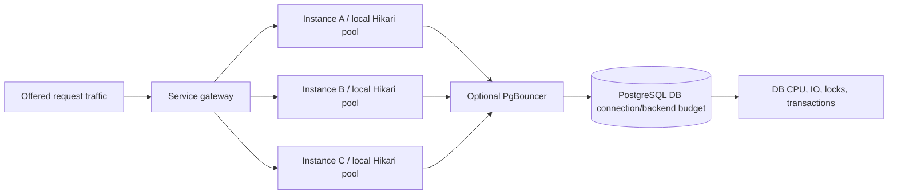
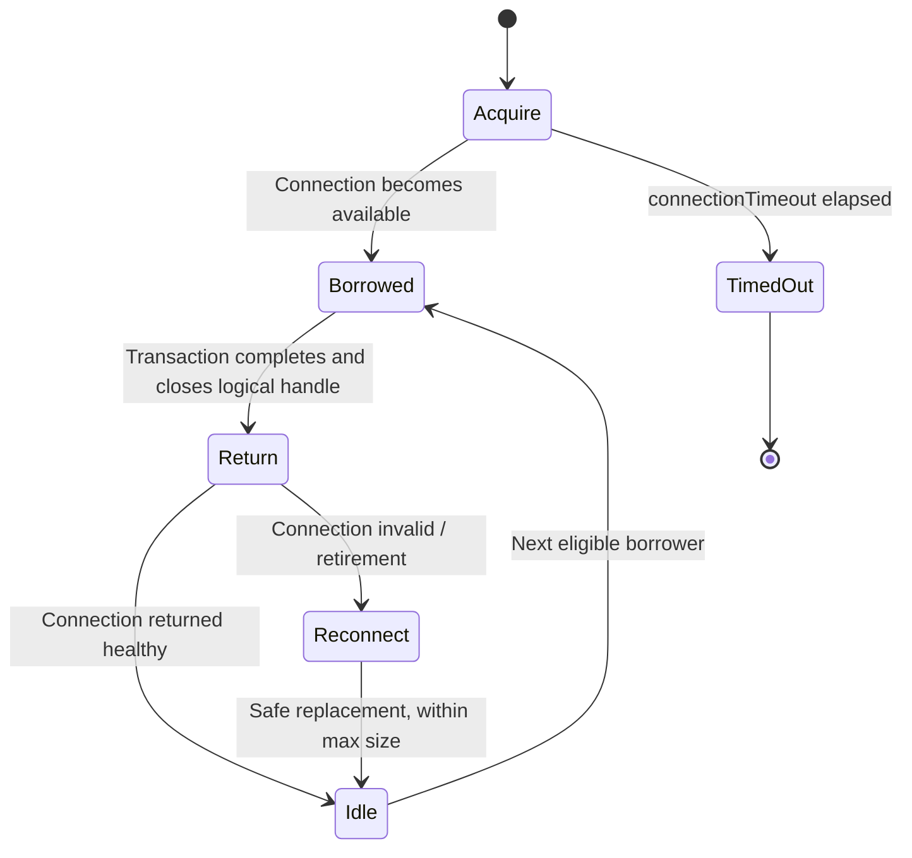
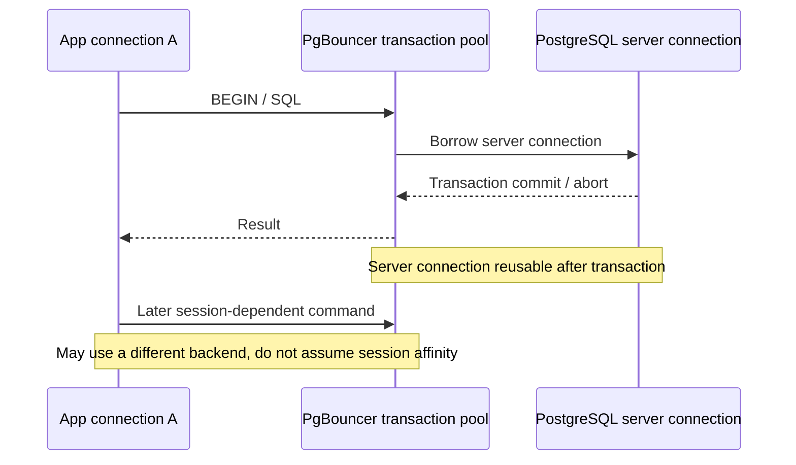

# Connection pools: HikariCP, PgBouncer and end-to-end database budgets

> Tycho research chapter for [Issue #84](https://github.com/rouslanbaranov/tycho/issues/84), public docs inspected **2026-10-19**. Main source scopes: HikariCP public README configuration, official PgBouncer configuration and PostgreSQL 17 server connections. Original examples and Mermaid diagrams only; no running connection pool, benchmark or independent expert review.

## Purpose and mission

A connection pool protects finite resources and amortizes connection setup. It is **not** an engine that increases the database's useful query capacity. Larger application request concurrency, virtual threads or reactive task count can increase time waiting for a smaller and fixed connection budget.

**Primary question:** How should a system apportion a fixed database connection budget across instances, reserve headroom, select session/transaction/statement pooling, and test overload without relying on arbitrary universal pool-size advice?

## 1. Capacity belongs to the entire dependency topology

Text alternative: three service replicas independently admit requests into local pools and possibly a shared PgBouncer layer. All ultimately compete for a finite server connection/backend budget and downstream CPU/IO/lock resources. The drawing describes a fictional topology.

The number of connections allowed by a pool is a **limit on concurrent access**; it says nothing about how long each transaction holds a connection. If query time or locks increase, each connection is occupied longer and request queues can grow. Pooling should bound overload rather than hide it.

### Synthetic capacity arithmetic, not a deployment recommendation

Suppose an entirely fictional deployment has **4 application instances**, each configured with `maximumPoolSize=25`. The combined nominal pool upper bound is **100** open backend connections **if** each pool directly opens to PostgreSQL and is fully populated. Adding a fifth replica increases that bound to 125 unless orchestration/budgets change.

If the database's operational cap for application sessions is **110**, those numbers leave only 10 for other application instances/maintenance connections under the first topology and would violate the cap under the second. However:

- actual live connections can be fewer than maxima;
- PgBouncer can multiplex client and server connections under appropriate pooling mode;
- other services/users, replicas, migrations and monitoring need independent allowance;
- the database's true concurrent useful work may saturate well **below** maximum_connections;
- connections are not users, threads, transactions per second or operations.

Compute headroom for worst-case auto-scaling and failover, *then* verify measured active/idle/pending and service limits. The figures above merely test arithmetic.

## 2. HikariCP bounds per-process JDBC connection use

The official HikariCP README configuration explains:

- `maximumPoolSize` caps actual pool connections, including busy and idle connections.
- `connectionTimeout` limits how long a request waits for an available connection before failing.
- `minimumIdle` controls efforts to keep a minimum of idle connections; the README recommends considering a fixed-sized pool by leaving it unset for some spike scenarios.
- `maxLifetime`, `idleTimeout`, validation and connection-health settings have independent operational constraints.
- The library recommends proper pool sizing through measured DB capacity rather than simply increasing threads. [E01]

Text alternative: a request borrows a connection when available or times out waiting. A returned healthy connection can serve another request; invalid ones require replacement. This simplified state machine does not model every HikariCP implementation detail or thread scheduling.

### The critical mistake: connection held across unrelated work

A request can obtain a DB connection and then call a slow remote API or sleep while still inside a transaction. That prevents other requests from borrowing the connection. Increasing pool size shifts the queue into the database, often increasing lock contention and memory instead of improving useful throughput.

Measure **connection hold time** by operation, query execution time, waiting for locks and transactions left idle. Use transaction scopes aligned with genuine database atomicity, not entire user interaction lifetimes. When concurrency grows, choose admission/deadline behavior that preserves database health.

## 3. PgBouncer's pool modes change semantics

The official PgBouncer configuration reference defines distinct reuse boundaries:

| PgBouncer `pool_mode` | When server connection can be reassigned | Typical compatibility concern |
|---|---|---|
| **session** | Client disconnect/session ends | Clients can retain session state; fewer multiplexing gains for many long-lived clients |
| **transaction** | Each transaction completes | Session-specific state across transactions can break; review prepared statements, temporary objects, LISTEN/NOTIFY, session settings and driver behavior |
| **statement** | Each statement finishes | Multi-statement transactions are not permitted in this mode |

These are **exactly the official configuration definitions**, not a statement that all applications can switch modes without adaptation. PgBouncer's feature matrix and prepared-statement settings must be matched to its version and the actual driver. [E02]

Text alternative: in transaction mode, one client uses a server connection for its transaction. After commit it can be returned for another client; later statements need not reach the same backend. Session state cannot be presumed to persist across transactions.

PgBouncer `max_client_conn` limits accepted client sessions; `default_pool_size` is a default maximum **server connections per user/database pool**. The actual total server connections can exceed one pool size when multiple database/user pairs exist, and file descriptors/memory limits must be considered. [E02]

## 4. Connection pooling is not queuing-capacity magic

Suppose a stable hypothetical service has a single pool of 20 connections and every operation holds a connection **0.10 seconds on average**. Even under unrealistic perfect utilization and no additional bottleneck, the simple upper-bound arithmetic would be **20 / 0.10 = 200 connection-holding operations/s**. This is *not* a measured throughput SLO and not a queueing-theoretic tail latency prediction; locks, CPU, I/O, variance and overhead can lower achieved throughput dramatically.

If hold time rises to 0.25s due to lock or network contention, the same arithmetic upper bound becomes **80/s**. Adding platform or virtual threads does not alter the 20-connections limit.

The [Little's Law chapter](../performance/queueing-littles-law.md) explains the steady-state occupancy identity and why it cannot be converted into arbitrary thread/connection recommendations. The [Java execution chapter](../execution/platform-threads-executors-and-virtual-threads.md) distinguishes virtual-task abundance from scarce downstream resources.

## 5. Failure modes and recovery

| Condition | What the user/operator observes | Evidence and mitigation |
|---|---|---|
| Too many replicas with large independent pools | PostgreSQL connection exhaustion after scaling | Bound total replica×pool count with operating headroom |
| Pool saturated despite idle DB CPU | Waiting clients and timeouts; perhaps long-held sessions | Trace connection hold time, transaction boundaries and pool wait |
| DB already CPU/lock saturated | Larger pools worsen queue, p99 or deadlocks | Stop scaling concurrency; optimize query and admission |
| PgBouncer transaction mode breaks app | Errors or missing session state across requests | Audit driver/session features and run compatibility tests |
| Database failover | Broken/invalid connections, transaction abort, retry storm | Detect invalid connections, jitter/retry budget, idempotent commands |
| Slow connection creation after outage | Recovery lag and thundering herd | Warm pools carefully, cap simultaneous retries/connection attempts |
| Stale or leaked connection | Long-lived wait, resource exhaustion | Leak/timeout instrumentation, closing resources and lifetime limits |

### Cancellation and transaction correctness

Client cancellation can occur after a database has committed. Returning the connection to the pool or throwing a timeout does **not** prove the business operation was undone. Use logical request keys and replay/reconciliation where necessary; see [outbox and idempotency](../distributed/transactional-outbox-and-idempotency.md).

## 6. Design choice procedure

1. Inventory every DB client: services, replicas, async workers, migrations and administrative tools.
2. Define how many backends the actual PostgreSQL configuration safely supports **for this workload** (not merely its hard max).
3. Reserve failure, failover, admin, monitoring and migration headroom.
4. Measure connection acquisition wait, active/idle counts, hold time percentiles, transaction duration, lock waits and resource utilization.
5. Choose per-service `maximumPoolSize` as a bounded share of the aggregate budget; account for peak replica count, not normal replica count.
6. Choose PgBouncer mode only after driver/session/transaction compatibility tests.
7. Under overload, shed or queue with explicit bounded budgets; do not accumulate arbitrary infinite waiting.
8. Test failure recovery and auto-scale spikes, then change settings from evidence.

**Insufficient evidence:** "An API has 30,000 concurrent users, so the JDBC pool should have 30,000 connections." Cannot infer that. Concurrency of logged-in users is not active DB operation count; actual pool budget depends on query/transaction demand, holds, topology, DB service capacity and SLOs.

## Source-to-claim ledger

| ID | Primary public reference and inspected scope (2026-10-19) | Supports and limits |
|---|---|---|
| E01 | [HikariCP project README](https://github.com/brettwooldridge/HikariCP), **Configuration: frequently used, maximumPoolSize, minimumIdle, connectionTimeout, maxLifetime**; rolling main documentation at inspection | Documented Java pool settings and their bounded behavior, not a benchmark of the synthetic example |
| E02 | [PgBouncer Configuration](https://www.pgbouncer.org/config), **pool_mode, max_client_conn, default_pool_size** and pooling semantics; rolling public docs observed 2026-10-19 | Session/transaction/statement backend reuse, pool cardinality considerations; actual installed release unpinned |
| E03 | [PostgreSQL 17 Connection Settings](https://www.postgresql.org/docs/17/runtime-config-connection.html), `max_connections` and limits | Server connection limits, not a universal optimal pool size |

**Review state:** conceptual guidance and original arithmetic, no Java Hikari pool test, real PostgreSQL backend measurement, PgBouncer compatibility integration, failover or independent human approval. The current online HikariCP/PgBouncer docs require commit/release pinning before product-specific operational rollout.
