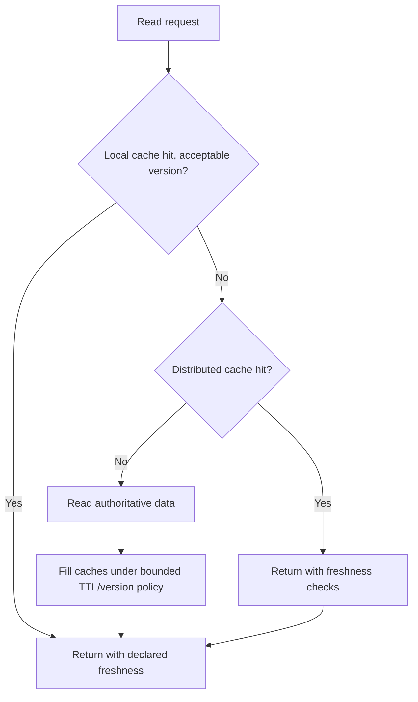
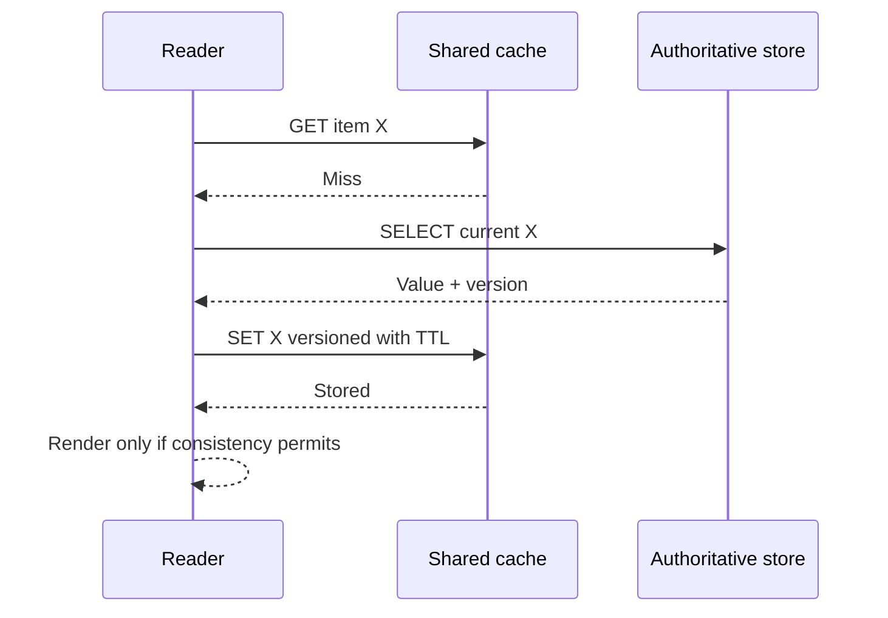
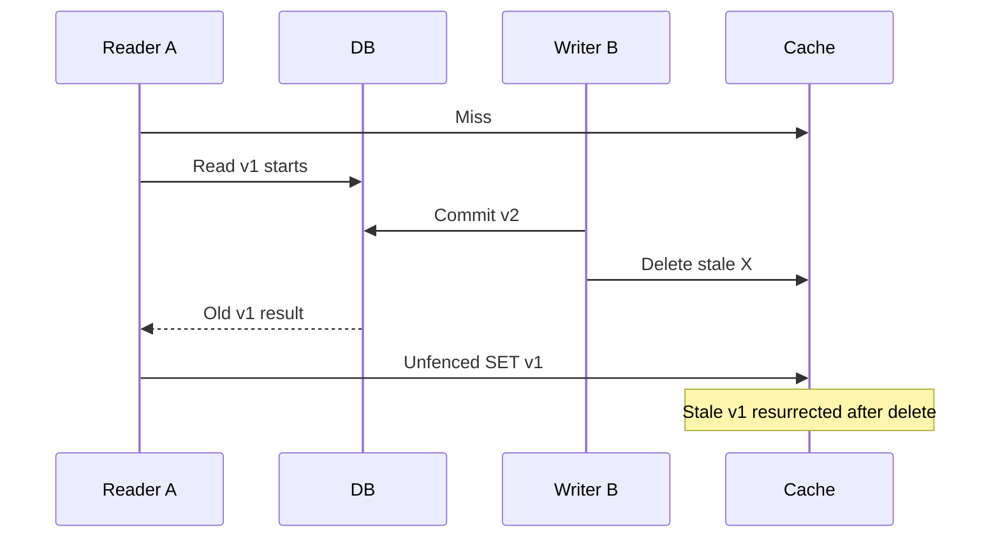
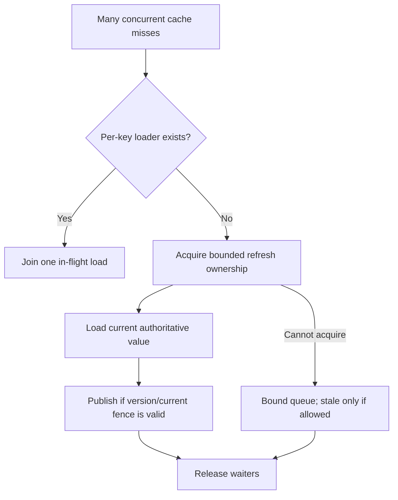

# Local and distributed caching: correctness, invalidation and overload boundaries

> Tycho [Issue #84](https://github.com/rouslanbaranov/tycho/issues/84), original technical research based on publicly accessible Redis and Caffeine documentation, inspected **2026-10-19**. All scenarios and data are fictional. No measured cache hit rates, end-to-end speedup, consistency guarantee or independent review is claimed.

## Purpose and mission

A cache can reduce repetitive read cost while adding an independent **stale-state and failure layer**. Local caches and distributed caches differ in visibility, memory replication and invalidation ownership, but neither automatically implements coherent transactions. The architectural question is what can safely be served **without consulting the authority**, for how long, and how the system behaves when entries or entire caches disappear.

**Primary question:** Under which workload, consistency and failure constraints should an application cache data locally or in a distributed service, and what safeguards prevent TTL expiry, invalidation races and cache misses from overwhelming the source?

## 1. First name the authoritative value

Use a fictional workshop application:

- **Registration confirmation and remaining seat allocation** are integrity-critical authority in a database transaction. Cached counts cannot directly authorize additional allocations.
- **Workshop title, agenda and public description** are read-mostly, often eligible for controlled staleness.
- **Per-user authorization state** can change abruptly and has security consequences; a stale cache entry can be much more dangerous than a stale title.
- **Analytics dashboard aggregates** may naturally be a separately timestamped projection; caching is not a substitute for declaring freshness semantics.

Text alternative: a read may be served by a local cache, shared cache or authoritative data source depending on freshness requirements. Cache misses read the authority and may populate layers. This is an original cache-aside model, not a claim that every architecture should have both caches.

A cache invalidation method must specify the **key/tenant namespace, owning writer, change event/version, order of operations and fallback behavior**. "We set TTL to five minutes" does not mean every newly written value becomes visible within five minutes if an old update can repopulate the cache after invalidation or clocks/renewal rules are misunderstood.

## 2. Local in-process cache: fast reads, isolated knowledge

The public **Caffeine** project wiki's **Eviction** page documents size-bound caching and expiration policies such as `expireAfterWrite`, `expireAfterAccess` and variable expiration. Its **Refresh** page distinguishes refresh from eviction: with refresh a previously stored value can continue being returned while an asynchronous load is in progress; refresh eligibility does not itself initiate work until queried. [E01, E02]

```mermaid
stateDiagram-v2
    [*] --> Absent
    Absent --> Fresh: Initial load
    Fresh --> RefreshEligible: Refresh interval reached
    RefreshEligible --> Refreshing: Next eligible read schedules refresh
    Refreshing --> Fresh: Successful new load
    Refreshing --> RefreshEligible: Refresh fails; old value may remain
    Fresh --> Absent: Evicted or expired
    RefreshEligible --> Absent: Expired/evicted
```

Text alternative: an absent value loads, then stays fresh until refresh becomes eligible. An eligible read can trigger an asynchronous refresh while old data remains available; eviction/expiration is a different path. This is a schematic behavioral outline; installed release, error handling and eviction policy must be checked.

Advantages of a local cache are reduced network round trips and dedicated per-process memory. Costs are duplicated warmup across replicas, loss of contents on restart, stale values that differ between instances and potentially high heap/GC cost. A Java heap cache does not become a shared coherent database when more instances are added.

When correctness requires a single globally current authoritative value, either fetch from authority or design a rigorously validated version/fencing strategy. A local cache alone is insufficient.

## 3. Distributed cache and cache-aside policy

Redis's public **Cache-aside** use-case documentation illustrates a common flow: read cache, load source on miss, write cache with expiry; when the application writes to the source, invalidate cache entries that could be stale. It also discusses cache stampede when many requests miss a popular key. The page is **a solution guide, not an independently benchmarked capacity promise** for Tycho. [E03]

Text alternative: cache miss falls back to an authoritative read. The response and version can be cached with a bounded TTL. This simple flow **does not protect against a concurrent invalidation race by itself**.

### The subtle race: old fetch overwrites new invalidation

1. Reader A misses cache and begins fetching version **v1** from the database.
2. Writer B commits version **v2** and deletes the cache key.
3. Reader A finishes its old query and **sets v1** after the invalidation.
4. Subsequent readers receive stale v1 until expiry or another correct invalidation.

Thus "write database then DEL cache" alone may not be enough for a hard consistency requirement under arbitrary concurrent fills. Mitigations include version-fenced cache writes, compare-and-swap/atomic scripts, short bounded TTL for tolerable staleness, change-event replay with versions, or direct authoritative reads for correctness-critical operations.

Text alternative: a read in progress can return an older value after a newer write invalidated the cache, and then reinsert the stale version. The example is a general synthetic race, **not** a measured Redis bug.

## 4. Stampede, hot keys and failure admission

When a popular key expires, thousands of concurrent request handlers can all fall through to a slower database, overwhelming a backend that normally handles only a fraction of the offered read traffic.

Possible safeguards, each with separate correctness/operational costs:

- **Single-flight/coalescing:** within one instance, combine concurrent cache misses for the same key into one source load.
- **Distributed lease/mutex:** one refresh owner per key, with expiry, fencing/version rules and safe recovery when the owner crashes. A simplistic Redis lock without a correctness model is not globally sufficient.
- **Stale-while-revalidate:** permit previously cached data during refresh *only when its bounded staleness is acceptable for that specific use*.
- **Jittered TTL:** reduce synchronized expiry when many entries were populated simultaneously; does not eliminate a single hot-key burst.
- **Rate limiting/bounded fallback:** protect source DB/pool when cache disappears; report degraded quality or reject low-priority work instead of making every request miss simultaneously.
- **Prewarming:** load selected expensive keys before a planned restart, while controlling total database demand and source version.

Text alternative: a key's miss storm is coalesced or permitted to create one bounded source load. Other callers wait or use an explicitly allowed stale/degraded response. A version check prevents obsolete refreshes from silently overwriting a newer value. This is a **proposed approach**, not a lock-algorithm correctness proof.

## 5. Cache choices and invalidation matrices

| Choice | Good fit when | Hard question / contraindication |
|---|---|---|
| No cache | Source read cost within SLO, correctness/security strict | Why introduce incoherent state when source is affordable? |
| Local Caffeine-style cache | Read-mostly data, per-replica independence acceptable | Replicas diverge and heaps/GC are finite |
| Shared Redis-style cache | Many replicas reuse common hot keyspace and shared invalidation matters | A shared cache is now another dependency/failure domain |
| Cache-aside | Cache only requested data; source remains clear authority | Concurrent fill/invalidation race and cold-miss amplification |
| Write-through | Explicit cache update integrated into command path | Two separate writes are not atomic by default |
| Write-behind | Noncritical, replayable writes with controlled loss policy | Delayed persistence may lose acknowledged data under crash |
| Versioned projection cache | Monotonic update identities and derived view tolerance | Version, replay, retention, duplicate event and schema governance |
| Stale-while-revalidate | Public catalogue/metadata with bounded stale tolerance | Must never authorize security or capacity decisions on stale data |

Never put credentials, authorization rules or payment/seat-allocation finality behind an assumed best-effort TTL without explicit security/integrity approval.

## 6. Measure before adding cache or another layer

A useful experiment reports cache hit rate by key popularity, size distribution, origin query timing, source IO, p95/p99 under representative offered arrivals, eviction, cold start, stampede under TTL expiry, node loss and operational recovery. A high hit ratio is not enough if the rare misses coincide with a high-cost query and violate p99.

One **synthetic** example: a service handles 1,000 reads/s and has a 90% cache hit ratio, resulting in **100 source reads/s only if every miss leads to exactly one source read**, with no retry/background refresh. This arithmetic does not show that the cache reduces end-to-end latency, saves money or survives stampede. Coalescing, refresh work and write invalidations change the actual workload.

For source size/cost and pooling, see [connection budgets](../volumes/v03/c05/connection-pools-hikaricp-pgbouncer.md) and [queueing](../volumes/v07/c01/queueing-littles-law.md).

**Insufficient evidence:** "Redis cache hit rate is 95%; can we halve the database instance count and still meet p99 under failover?" Cannot conclude. Need source query mix, cache-loss behavior, cold start, DB capacity without cache, staleness policy, retry/admission and a degraded-mode test.

## Public evidence and limitations

| ID | Exact public source and inspected section, 2026-10-19 | Supports / limitations |
|---|---|---|
| E01 | [Caffeine Wiki — Eviction](https://github.com/ben-manes/caffeine/wiki/Eviction), **Size-Based, Time-Based, Reference-Based** | Local eviction/expiration modes, not guaranteed global cache consistency |
| E02 | [Caffeine Wiki — Refresh](https://github.com/ben-manes/caffeine/wiki/Refresh), refreshing vs eviction | Old-value retention while asynchronous refresh occurs; current wiki not pinned to a library tag |
| E03 | [Redis Docs — Cache-aside](https://redis.io/docs/latest/develop/use-cases/cache-aside/), **When to use, Why it is hard, How Redis supports the solution** | Typical GET/SET/DEL/TTL caching and stampede concerns; vendor-reported performance examples not independently verified or reused |
| E04 | [Redis EXPIRE command](https://redis.io/docs/latest/commands/expire/), TTL behavior | Expiry mechanics, not a global strong-consistency guarantee |

**Review state:** original reasoning/diagrams with bounded public source reading, no running Redis/Caffeine, race reproduction, cache-load benchmark, cost calculation or independent expert review. All numerical quantities are labelled synthetic.
