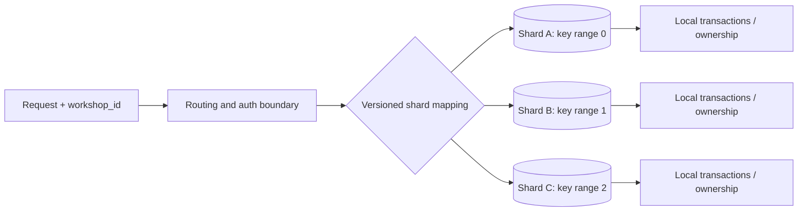
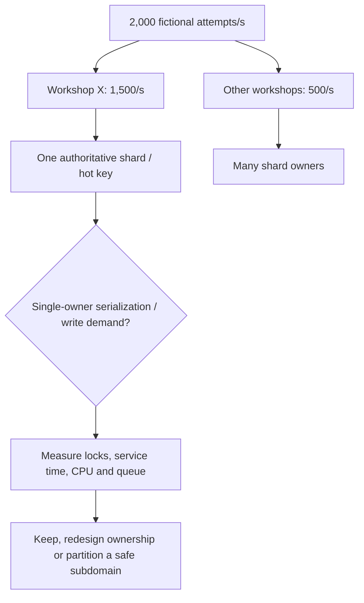

# Sharding, partition keys, hotspots and safe resharding

> Tycho bounded technical research for [Issue #84](https://github.com/rouslanbaranov/tycho/issues/84). Public source reading: **2026-10-19**. Selected implementation reference: **Vitess 24.0** Resharding/VSchema documentation. All workload numbers and diagrams are original synthetic models; there is no database shard cluster, measured benchmark or independently approved migration.

## Purpose and mission

Splitting a database into shards is useful only if **resource or operational constraints** justify distributing ownership and the application can tolerate the resulting coordination and migration requirements. More shards cannot automatically spread a single hot tenant or repair a poorly chosen authorization/data consistency boundary.

**Primary question:** How should an architect select a shard key, handle skew and high-cardinality access, preserve co-located transactions and move data to a new shard map without losing correctness?

## 1. Distinguish physical partitions, logical ownership and replicas

| Term | What it controls | Does not guarantee |
|---|---|---|
| **Shard / partition** | A subset of an authoritative keyspace assigned to storage owners | Independent throughput for every hot key |
| **Shard key / routing function** | How an item maps to a keyspace ID/range and its owner | Stability through routing/hash algorithm changes |
| **Replica** | Additional copy under defined replication/failover semantics | New independent write capacity or global linearizability |
| **Co-location** | Related entities share one authority/transaction domain when intended | Arbitrarily distributed joins without cost |
| **Resharding** | Changes assignment of key ranges/ownership | Safe schema, key, consistency and protocol compatibility automatically |

Vitess's publicly versioned **24.0 Resharding** guide explicitly discusses primary vindexes, high-cardinality shard key choices, co-location for joins/transactions and reviewing real high-QPS WHERE clauses. It also explains source/target migration and cutover. Its mechanisms are implementation-specific, not universal sharding algorithms. [E01]

Text alternative: a request carries a declared partition identity, is authorized, then uses a versioned mapping to reach one authoritative shard. Transactions within each shard remain local; no cross-shard transaction guarantee is implied.

A sharding route must not be an authorization shortcut. Compute or verify the tenant/workshop identity against authenticated credentials; never let a caller select an arbitrary shard and bypass data access policy.

## 2. Why shard-key selection cannot be made from average RPS

A candidate key should be evaluated against:

- **Cardinality and skew:** are most keys independent, or does one customer/workshop dominate writes?
- **Access-path fit:** can the main query identify its shard without scatter-gather across all owners?
- **Co-location:** which entities must share an atomic state transition, JOIN, deletion/retention or business invariant?
- **Growth:** what happens when a shard approaches storage, index or write contention limits?
- **Migration:** can an old and new routing scheme coexist during data copy and cutover?
- **Security/data residency:** may two tenants or countries share physical storage under the requirements?
- **Operational bounds:** team support, backups, failover and the cost of N independent storage owners.

Vitess **VSchema** distinguishes logical keyspace IDs, shard maps and primary vindexes. This indirection can permit resharding without redefining every application identity, but a primary vindex and its mapping must be checked for actual queries and versioned deployment behavior. [E02]

### Synthetic hot-key counterexample

Suppose a fictionally modeled system receives **2,000 write attempts/s** across 100 workshops. Ninety-nine workshops combined account for 500 attempts/s while one popular workshop accounts for **1,500 attempts/s**. If workshop ID is the chosen atomic shard key, the popular workshop remains a 1,500/s hot key even after adding more shards.

- Average across 100 workshops is 20 attempts/s but profoundly misrepresents the hottest owner.
- Even distribution of the other 500 attempts across shards does not split the 1,500/s single-owner workload.
- Hashing *requests* rather than workshop ownership across shards might spread CPU yet destroy a one-workshop seat-capacity invariant unless a new coordination protocol is introduced.
- A defensible alternative may optimize that owner's hot transaction/index/lock, introduce independently allocatable seat IDs, or separate nonauthoritative reads; none is proven by this arithmetic alone.

The figures are invented for illustrating skew, not capacity or a recommendation to run 2,000 RPS.

Text alternative: most operations target one workshop; distributing the rest of the keyspace cannot remove contention on that workshop's authoritative state. Measure where the bottleneck is before changing transaction ownership.

## 3. Four partition strategies and their drawbacks

| Strategy | Strength under its assumptions | Failure/compatibility cost |
|---|---|---|
| Range by ordered key | Efficient range pruning/time-based lifecycle and data locality | Right-edge hotspot from sequential inserts, uneven key ranges, split planning |
| Hash of high-cardinality key | Usually reduces skew from otherwise uniformly distributed distinct keys | Single hot key still hot; cross-key queries scatter; remapping costs |
| Directory/lookup routing | Can deliberately place particular owners and manage hot tenants | Control-plane availability, routing cache freshness and split-brain mappings |
| Geographic/compliance partition | Residency or regional latency alignment | Cross-region transactions, failover jurisdiction, legal and recovery constraints |

An **application-shard label** and a **DB table partition** are not identical. PostgreSQL 17's table partitioning supports physical organization and pruning inside its server/database, but it does not by itself turn one database cluster into a set of independently coordinated distributed database systems. [E03]

Co-locate data **only as far as the business invariant requires**. Unnecessary co-location may make the largest key unshardable. Moving tightly coupled joins across shards can introduce network fan-out and retries.

## 4. Resharding is a multi-state data transition

A correct target topology is insufficient: clients, source stores, replica/backfill state, transaction changes and destination ownership must remain consistent **during** migration.

```mermaid
stateDiagram-v2
    [*] --> Existing
    Existing --> Prepare: Version target routing and compatibility
    Prepare --> Copy: Copy historical data to target ownership
    Copy --> CatchUp: Replay ongoing committed changes
    CatchUp --> Verify: Compare counts, identities and invariant state
    Verify --> Switch: Freeze/route/fence source writes and cut over
    Verify --> Repair: Divergence detected
    Repair --> CatchUp: Correct and revalidate
    Switch --> Observe: Route requests, compare errors and lag
    Observe --> Final: Retirement after rollback window
    Observe --> Repair: Unexpected issue; assess forward repair
    Final --> [*]
```

Text alternative: prepare compatible routing, copy source data, catch up in-flight changes, verify exact business invariants, fence conflicting writers and switch ownership before retiring old storage. If a mismatch is found, reconcile rather than declaring success. This is a **synthetic safe-transition outline**, not a real Vitess command sequence.

The current Vitess 24.0 resharding guide includes an online workflow and staged cutover, but its described behavior depends on exact source/target configuration. It must not be copied as a generic, zero-downtime promise for any datastore. [E01]

### Migration validation checklist

1. Identify shard authority and data ownership for each key; record old/new mapping epoch.
2. Test read/write compatibility while old and new clients coexist.
3. Design snapshot/backfill with source change capture and a determinate resume position; prevent loss/double-application.
4. Verify counts **and domain invariants**; equal row counts alone do not prove referential correctness.
5. Fence stale writers and stale mapping caches at cutover.
6. Observe hot-key traffic, transaction retry rate, tail latency and replication lag before and after.
7. Define a *forward repair* if new writes cannot be safely read by old shard ownership; do not promise reversible rollback after irreversible changes.

### Original migration trace: moving a hot tenant while writes continue

A **fictional** catalog stores bookings by tenant and item ID. Tenant A has become hot, and engineers propose moving its records from shard S1 to S2. The authoritative reservation invariant is **one successful booking per physical item and interval**, including during rebalancing. Merely copying equal row counts does not enforce it.

| Stage | Allowed writer / routing | Acceptance gate | Crash and recovery response |
|---|---|---|---|
| S0 baseline | S1 alone owns the tenant; fixed routing revision | Snapshot identifiers, committed-operation IDs and skew are measured | Remain on S1 |
| S1 shadow | S1 alone accepts writes; copy and ordered catch-up populate S2 | Key/tenant ownership, deletes and late updates reconcile | Resume bounded copy/checkpoint, do not expose S2 as an independent writer |
| S2 fenced handover | New routing epoch authorizes a *single* writer only after previous epoch is fenced | Concurrent client retries and stale routers cannot commit on both shards | Freeze new writes or return to S1 **only if** no S2-only effects occurred |
| S3 stable | S2 is authoritative; S1 is read-only/retired according to a documented compatibility horizon | Bookings, access policies, delayed messages and restore path verified | Forward-repair/reconcile if old epoch later reappears |
| S4 retire | Old data and routing removed only after replay/restore requirements pass | No unsupported historical reader remains | No image-only rollback across incompatible new state |

A dangerous counterexample occurs when an old client caches the S1 routing epoch and commits after another client has switched to S2. Even a perfect initial data copy cannot prevent two writers without an authority/fencing protocol. Another failure is a delete followed by a delayed old-version update that resurrects a record in S2. Stable event identity and source ordering must be specified before exposing the new owner.

The [Vitess 24 resharding workflow documentation](https://vitess.io/docs/24.0/user-guides/configuration-advanced/resharding/) and its [versioned MoveTables reference](https://vitess.io/docs/24.0/reference/vreplication/movetables/) describe copy, verification, traffic switch and, with suitable preconditions, reverse traffic. These are examples of product-specific mechanisms; **reverse routing is not a universal promise that a business write can always be undone**, and a destructive completion step is not an ordinary rollback. The fictional stages above are a design-level synthesis, not a tested Vitess sequence.

**Alternative:** repair a hot query, introduce a bounded per-tenant work queue, cache genuinely immutable reads, or isolate a high-traffic tenant without general sharding if the real bottleneck supports it. **Proposed, not run:** inject stale routing, interrupted copy, duplicate retry, deletion replay and two simultaneous writers; refuse cutover unless the single-authority invariant and recoverability can be demonstrated. The [semantic-migration owner](../data/schema-lifecycle-and-semantic-migration.md) covers domain identity; this chapter owns physical ownership transfer and key skew.

## 5. Alternatives before sharding

Database query/index optimization, bounded connection pools, increasing storage/CPU, read replicas, caching suitable immutable/read-mostly data and removing unnecessary cross-domain locks can delay or remove the need for sharding. These tools address different bottlenecks; read replicas usually do not expand single-authority write serialization capacity.

**Insufficient evidence:** "The database has 500 million records; we must shard by user ID into 64 clusters." Cannot determine. Need growth, actual key and query distributions, hot tuples, disk and index IO, transactional ownership, compliance constraints, restore objectives, operational support and a measured comparison of simpler improvements.

## Bounded public evidence and status

| ID | Public primary reference and inspected scope | Supports, not an empirical deployment |
|---|---|---|
| E01 | [Vitess 24.0 Resharding guide](https://vitess.io/docs/24.0/user-guides/configuration-advanced/resharding/), **Preparation, Vindexes, Apply VSchema, Create New Shards, Start the Reshard** | Versioned real example of keys/co-location, copy/cutover; not universal online migration guarantee |
| E02 | [Vitess VSchema reference](https://vitess.io/docs/reference/vschema/), **Vindexes and Primary Vindex**; rolling documentation observed 2026-10-19 | Keyspace ID and lookup indirection, not a tested migration for this hypothetical service |
| E03 | [PostgreSQL 17 table partitioning](https://www.postgresql.org/docs/17/ddl-partitioning.html), **Declarative Partitioning and Partition Pruning** | Physical table partitioning and planner behavior; not an application-wide distributed transaction protocol |

All diagrams are original; no Vitess cluster, data move, load generator, index benchmark or independent technical review ran. **Shard count, key and traffic thresholds are not prescribed** by this chapter.

## Applied M9 evidence: what transfers and what does not

These examples connect the chapter's conditional mechanism to published experiences or synthetic decision exercises. A historical company report is **first-party, time-scoped evidence**, not a controlled Tycho benchmark; an M9 decision playbook is **original synthetic analysis**, not a company decision.

**Case lens — [Netflix — Cassandra time-series splits](../cases/netflix-cassandra-dynamic-time-series-splits.md)**. **Relevant mechanism or architectural contrast:** Wide partitions require adaptive ownership and reader compatibility, with workload-dependent split strategies. **Not established by this report/playbook:** Netflix results do not mean every Cassandra partition should be dynamically split, or that reported gains apply to another dataset.

**Transfer test:** before applying the lesson to another legacy system, identify the exact workload, source date, relevant runtime/protocol versions, state authority, failure/recovery gate and the new observation that would reverse the choice. Follow the case's public evidence ledger rather than treating its link as independent proof.
