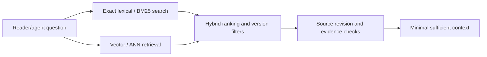

# Search and retrieval architecture

> Bounded public-source technical coverage for [Issue #85](https://github.com/rouslanbaranov/tycho/issues/85). These pages explain system-design methods; no production search cluster, vector index, agent-answer evaluation or deployed MCP endpoint is claimed.

## Purpose and mission

Enable readers and AI agents to find the **right canonical architecture knowledge with exact source evidence** by comparing lexical, semantic and metadata retrieval methods; graph traversal is discussed independently as a System Design option. Ranking speed alone does not establish answer correctness.

## Question-driven reading route

Text alternative: exact tokens and vector similarity provide candidate sets, hybrid ranking merges them and source revisions are checked before assembling small evidence-backed context. This is a retrieval *design*, not live service architecture.

## Canonical research pages

| Question | Technical page | Evidence |
|---|---|---|
| How do inverted indexes, BM25, PostgreSQL FTS and Lucene differ? | [Lexical indexing, ranking and SQL FTS](../volumes/v06/c03/lexical-indexing-bm25-and-sql-fts.md) | PostgreSQL 17 FTS, Lucene 10.3 BM25 API |
| What are exact vs approximate vector search, HNSW, IVF, Faiss and pgvector? | [Vector/ANN and filtered retrieval](../volumes/v06/c04/vector-hnsw-faiss-pgvector.md) | Official pgvector/Faiss index guides; versioned caveats |
| When is a graph model and bounded traversal preferable to indexed relational joins? | [Graph data models and traversal](../volumes/v06/c06/graph-data-models-and-traversal.md) | V06/C06; graph architectures as a theoretical topic only, not a Tycho knowledge graph |
| How do relevance judgments, index freshness and answer evidence determine search quality? | [Retrieval evaluation and index lifecycle](../volumes/v06/c07/retrieval-evaluation-and-index-lifecycle.md) | V06/C07; NIST TREC/BEIR methods; no benchmark/index built |
| When does hybrid retrieval and graph expansion actually improve answer quality? | [Hybrid, graph and evaluation](../volumes/v06/c05/hybrid-ranking-graph-and-evaluation.md) | Elasticsearch RRF, Neo4j graph, pgvector and explicit evaluation protocol |

## Cross-domain context

- [Source-driven architecture foundations](../application/README.md).
- [PostgreSQL physical/query models](../data/README.md).
- [Architecture dependency and event semantics](../distributed/README.md).
- [25-question pilot methodology limits](../../evaluation/PILOT-ASSESSMENT.md).

These pages provide independent **System Design education** and knowledge for future index, retrieval and MCP work. No curated Tycho knowledge graph is required, planned or implemented. The actual Tycho knowledge index, embedded vectors, permission and source gates, query evaluation and shared Rocinante specialist are separate roadmap capabilities and must not be falsely marked completed.

## Unresolved experiments

Measure indexing size, update/rebuild speed, recall against independent judgments, freshness/tombstones, filtered ANN recall, p95/p99 under load, end-to-end answer correctness and output/input token cost. No universal search engine ranking is claimed.
