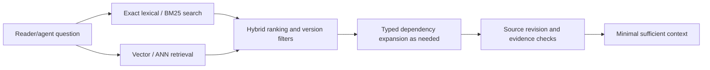

# Search and retrieval architecture

> Bounded public-source technical coverage for [Issue #85](https://github.com/rouslanbaranov/tycho/issues/85). These pages explain system-design methods; no production search cluster, vector index, agent-answer evaluation or deployed MCP endpoint is claimed.

## Purpose and mission

Enable readers and AI agents to find the **right canonical architecture knowledge with exact source evidence** using a cost-effective mix of lexical, semantic, metadata and graph relationships. Ranking speed alone does not establish answer correctness.

## Question-driven reading route

Text alternative: exact tokens and vector similarity provide candidate sets, hybrid ranking merges them, optional typed dependency links are followed, and source revisions are checked before assembling small evidence-backed context. This is a retrieval *design*, not live service architecture.

## Canonical research pages

| Question | Technical page | Evidence |
|---|---|---|
| How do inverted indexes, BM25, PostgreSQL FTS and Lucene differ? | [Lexical indexing, ranking and SQL FTS](lexical-indexing-bm25-and-sql-fts.md) | PostgreSQL 17 FTS, Lucene 10.3 BM25 API |
| What are exact vs approximate vector search, HNSW, IVF, Faiss and pgvector? | [Vector/ANN and filtered retrieval](vector-hnsw-faiss-pgvector.md) | Official pgvector/Faiss index guides; versioned caveats |
| When does hybrid retrieval and graph expansion actually improve answer quality? | [Hybrid, graph and evaluation](hybrid-ranking-graph-and-evaluation.md) | Elasticsearch RRF, Neo4j graph, pgvector and explicit evaluation protocol |

## Cross-domain context

- [Source-driven architecture foundations](../application/README.md).
- [PostgreSQL physical/query models](../data/README.md).
- [Architecture dependency and event semantics](../distributed/README.md).
- [25-question pilot methodology limits](../../evaluation/PILOT-ASSESSMENT.md).

These pages provide knowledge for **future** index, retrieval and MCP implementation work. The actual Tycho knowledge index, embedded vectors, graph relationship store, permission and source gates, query evaluation and shared Rocinante specialist are separate roadmap capabilities and must not be falsely marked completed.

## Unresolved experiments

Measure indexing size, update/rebuild speed, recall against independent judgments, freshness/tombstones, filtered ANN recall, graph expansion quality, p95/p99 under load, end-to-end answer correctness and output/input token cost. No universal search engine ranking is claimed.
