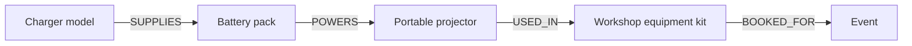

# Graph data models and traversal: when relationships are the query

> **Tycho educational System Design manuscript V06/C06 (2026-10-19).** Graph models are a general architectural topic; **a manually curated knowledge graph for Tycho itself is explicitly excluded** from the product/infrastructure roadmap. This page is original explanatory prose and synthetic scenarios with public Neo4j Cypher references. No graph database was installed, queried or benchmarked.

## Purpose and mission

Some questions start from an entity and follow relationships: “Which components depend on this library?”, “What sequence of connections leads from station A to station B?” or “Which permissions allow this user to reach that resource?” A graph model represents **vertices, edges and their identities/attributes**, and graph traversal is useful when relationship paths are central to the workload.

The decision is not simply “use a graph database”. Many bounded relationship queries can be answered by relational joins, adjacency lists or document links. A graph engine becomes plausible only when traversal shape, depth, mutation frequency, transactional requirements and operating cost justify the additional model.

## 1. Clarify the meaning of an edge

A useful graph schema identifies:
- node identity and node type;
- relationship type, direction, endpoints and cardinality;
- whether multiple parallel relationships are allowed;
- temporal validity/version of the relation;
- authorization and visibility of nodes **and edges**;
- whether the relationship is authoritative or derived;
- deletion, cycle, duplicate and integrity policies.

The [Neo4j Cypher pattern manual](https://neo4j.com/docs/cypher-manual/current/patterns/) explains declarative patterns over nodes and relationships, including traversals and paths. A path is a specific sequence of matched graph elements, not a guarantee that all reachable nodes or every shortest path were enumerated within a query budget.

## 2. Original fictional example: a workshop equipment dependency map

A community event uses portable devices with replaceable parts. A battery pack is compatible with a charger, a projector uses a specific cable, and a setup checklist requires a functioning power supply. The question is whether an unavailable charger affects a set of planned equipment kits.



**Text alternative:** the fictional charger supplies a battery, which powers a projector used in a kit booked for an event. Querying the paths could show affected event kits. The arrows express modeled relationships, not measured physical behavior, actual inventory or authoritative compatibility certifications.

A direct question “Which chargers supply battery B?” is one hop. “Which events might depend transitively on charger C?” follows a variable-length typed path. But a path is a potential dependency chain, **not automatically a proof that the event cannot proceed**: spare batteries, alternate chargers and temporal availability matter.

## 3. Graph traversal and relational joins can express similar answers

| Requirement | Relational option | Graph-model option |
|---|---|---|
| One-hop fixed relationship | Indexed join on foreign keys/link table | Match one typed edge |
| Small known-depth chain | Several joins or recursive CTE | Bounded path pattern |
| Arbitrary-depth reachability | Recursive CTE with cycle detection and limits | Variable-length traversal with path/cycle constraints |
| Frequent evolving relationship types | Schema/model discipline and relation tables | Explicit typed edges/property graph |
| Complex OLTP transaction | Relational integrity and transactions may be strong fit | Graph engine needs its own ACID/consistency verification |
| Search by terms/meaning | Full-text/vector index may be simpler | Traversal only helps when reliable relations change result |

Traversal can generate many possible paths in dense/cyclic graphs. Limit max depth, result cardinality, type/direction, visited-state and request resources. A high-degree hub can make a path search expensive even if the graph holds few total nodes. The [Neo4j variable-length pattern guide](https://neo4j.com/docs/cypher-manual/current/patterns/variable-length-paths/) explicitly discusses path explosion, path quantifiers and pruning predicates.

## 4. Query specification must include semantics and bounds

A graph question needs more than a starting node:
1. Edge types and direction allowed.
2. Maximum number of hops and maximum returned results.
3. Whether paths may repeat nodes/relationships.
4. Snapshot/time validity.
5. Required filters on nodes/edges, including permission checks.
6. Whether output expects *all paths*, *any path*, *shortest path*, or just reachable node IDs.
7. What to do when traversal exceeds budget or a node/edge has missing provenance.

A graph's linked structure can expose sensitive information through edge labels or relationship counts even if hidden node contents are not returned. Enforce authorized scope at query execution and result construction, not solely at UI display.

## 5. Derived graphs and provenance

A dependency edge extracted from a software build has different authority from a human-reviewed architectural statement. A graph constructed from source references should record:
- source file/version or admitted document;
- inference/extraction method and date;
- confidence or evidence status;
- edge freshness and deprecation/removal rule;
- ownership of conflict resolution.

An edge is not fact merely because a visualization draws it. Source revision drift can invalidate it. For a system design reference book, **there is no requirement to materialize a graph service**: ordinary cross-references and precise source/claim links may be enough to explain the architecture.

## 6. Architecture decision and falsifiable benchmark

**Original synthetic decision:** keep the equipment dependency model in normalized relational tables at first. A graph engine becomes a conditional candidate if representative deep reachability/path questions dominate, static join/CTE approaches cannot meet the required latency/complexity, and operational/recovery/security constraints favor it.

A fair experiment would compare:
- identical entity/edge snapshot, degree distribution and mutation volume;
- equivalent permission/time filters and path semantics;
- query mix across one-hop, deep reachability and negative cases;
- p95/p99, CPU, memory, index/build cost and data freshness;
- update and deletion correctness, cycles and duplicate edges;
- recovery cost and total operations.

Reject any claimed advantage caused by returning fewer paths, omitting authorization or changing the query semantics. **No such test was performed.**

## 7. Public evidence and explicit product-scope boundary

| Independently inspected public source | Supports | Not established |
|---|---|---|
| [Neo4j Cypher — Patterns](https://neo4j.com/docs/cypher-manual/current/patterns/) | Property-graph query patterns and path semantics | Implementation for fictional equipment model |
| [Neo4j Cypher — Variable-length paths](https://neo4j.com/docs/cypher-manual/current/patterns/variable-length-paths/) | Bounded variable-length traversal and explosion/pruning concerns | Performance of any real graph DB under a target workload |
| [Tycho hybrid retrieval](hybrid-ranking-graph-and-evaluation.md) | Prior theoretical distinctions of retrieval mechanisms | Actual hybrid search or graph infrastructure |

All graph nodes, edges, diagrams, inferred rules and experiments are original invented educational examples. No graph was created, indexed, traversed or independently reviewed. **This chapter does not reintroduce a curated Tycho knowledge graph.** It covers graph *architectures as a subject of System Design*, not a product feature.

**Navigation:** proposed **V06/C06** in [planned book contents](../PROPOSED-STRUCTURE.md), current [search/data information architecture](README.md). Related [Hybrid lexical/vector ranking](hybrid-ranking-graph-and-evaluation.md), [Storage alternatives](../data/storage-model-alternatives-and-workload-fit.md), [Authorization boundaries](../security/identity-authorization-and-isolation.md).

## Engineering walkthrough — A bounded dependency path is not proof of causation

**Original fictional equipment graph:** nodes are physical `Unit`, `Module` and `Supplier`; edges `DEPENDS_ON` have direction, effective date and source identity. Query: "Which currently operational units depend on a part supplied by vendor X within at most three transitions?" A graph path of unlimited depth risks cycles, irrelevant historical dependencies and unbounded query cost.

Graph design must define whether dependencies are direct or inferred, what "current" means, and which edge source/version supports it. A Cypher-style bounded expansion such as `(unit)-[:DEPENDS_ON*1..3]->(part)` is meaningful only under a declared schema and direction policy; it is *not* a test of a deployed query or an authorization contract. A relational schema with `dependency(source_id,target_id,valid_from,valid_to)` plus a recursive CTE can answer a similar bounded reachability question; the appropriate storage choice depends on actual traversal frequency and update costs, not the visual elegance of graph arrows.

| Contradiction | Required handling |
|---|---|
| A→B and B→A cycle | Enforce visited/depth budget; repeated traversal is not extra evidence |
| Historical edge expired | Time-filter before interpreting path as current |
| Supplier changed identity | Reconcile stable owner and evidence revision |
| Tenant A path crosses forbidden tenant B | Authorization must apply to intermediate vertices/edges, not just final result |

**Proposed, not run:** compare bounded Cypher and recursive relational queries on the same versioned synthetic topology with skew/cycles, measuring completeness, latency, updates and access control. A graph could be unnecessary for shallow stable joins, and useful for variable-depth relationship-rich questions. **This chapter teaches graph data architecture only; it does not introduce a manually curated Tycho knowledge graph or platform implementation.**

### Paired graph and relational traversal with the same answer (unexecuted synthetic fixture)

**Question:** which *Tenant t1* physical units depend, within **one to three current directed `DEPENDS_ON` edges**, on `Part C`? Fix evaluation date `2026-10-20`. Fixture nodes are `U1` (Unit, t1), `U2` (Unit, t1), `U3` (Unit, t2), `A` (Part, t1), `B` (Part, t1), `C` (Part, t1); all node IDs are globally unique here. Active edges: `U1→A`, `A→C`, `U2→B`, `B→C`, plus an *unauthorized cross-tenant* `U3→C`; each edge carries `tenant`, `valid_from`, `valid_until`. A separate `C→A` cycle is included to test path safety. Expected authorized distinct unit IDs: **`U1, U2`**, never U3. Tenant authorization is an explicit *assumed query scope*, not proven by these queries.

**Illustrative Neo4j Cypher variable-length relationship syntax** (Neo4j Cypher 5/25 manuals; label and property schema defined above):

```cypher
MATCH p = (u:Unit {tenant: 't1'})-[:DEPENDS_ON*1..3]->
          (target:Part {id: 'C', tenant: 't1'})
WHERE ALL(n IN nodes(p) WHERE n.tenant = 't1')
  AND ALL(r IN relationships(p)
          WHERE r.tenant = 't1'
            AND r.valid_from <= date('2026-10-20')
            AND (r.valid_until IS NULL OR r.valid_until > date('2026-10-20')))
RETURN DISTINCT u.id AS unit_id ORDER BY unit_id;
```

The `*1..3` syntax is the older still-supported variable-length form; the [Neo4j reference](https://neo4j.com/docs/cypher-manual/current/patterns/reference/variable-length-paths/) distinguishes it from modern quantified relationship syntax. The bounded path and per-node/per-edge checks are important: matching only the end node's tenant is **not** sufficient to prevent forbidden intermediate disclosure.

**Equivalent illustrative PostgreSQL 17 recursive CTE** assumes `nodes(id text PRIMARY KEY, kind text, tenant text)` and `edges(src text, dst text, tenant text, valid_from date, valid_until date)`, populated with the same fixture:

```sql
WITH RECURSIVE walk(tenant, origin, node_id, depth, visited) AS (
    SELECT n.tenant, n.id, n.id, 0, ARRAY[n.id]::text[]
      FROM nodes n WHERE n.kind = 'Unit' AND n.tenant = 't1'
    UNION ALL
    SELECT w.tenant, w.origin, e.dst, w.depth + 1, w.visited || e.dst
      FROM walk w
      JOIN edges e ON e.src = w.node_id AND e.tenant = w.tenant
      JOIN nodes n ON n.id = e.dst AND n.tenant = w.tenant
     WHERE w.depth < 3
       AND e.valid_from <= DATE '2026-10-20'
       AND (e.valid_until IS NULL OR e.valid_until > DATE '2026-10-20')
       AND NOT (e.dst = ANY(w.visited))
)
SELECT DISTINCT origin AS unit_id FROM walk
 WHERE node_id = 'C' AND depth BETWEEN 1 AND 3
 ORDER BY unit_id;
```

The [PostgreSQL 17 recursive CTE and cycle-detection documentation, §7.8.2](https://www.postgresql.org/docs/17/queries-with.html) explains recursive evaluation and cycle handling; here `visited` stops revisiting nodes. The Cypher path-match engine and recursive SQL have different physical execution strategies and may have different path-multiplicity semantics, but **the distinct authorized endpoint set** should match for this fixture. The toy queries are **not executed**, not a claim about performance and not a substitute for access control enforced in storage/query authorization. Real tenancy demands graph-wide object/edge permission enforcement, not just a caller-supplied `tenant` literal. No Tycho infrastructure knowledge graph is created or implied.

## Applied M9 evidence: what transfers and what does not

These examples connect the chapter's conditional mechanism to published experiences or synthetic decision exercises. A historical company report is **first-party, time-scoped evidence**, not a controlled Tycho benchmark; an M9 decision playbook is **original synthetic analysis**, not a company decision.

**Case lens — [Meta — TAO graph serving](../cases/meta-tao-social-graph-serving.md)**. **Relevant mechanism or architectural contrast:** Graph-shaped access over authoritative relational data and tiered caches is a targeted domain serving architecture. **Not established by this report/playbook:** TAO does not imply every domain needs a graph database, eventual consistency policy or manually curated Tycho graph.

**Transfer test:** before applying the lesson to another legacy system, identify the exact workload, source date, relevant runtime/protocol versions, state authority, failure/recovery gate and the new observation that would reverse the choice. Follow the case's public evidence ledger rather than treating its link as independent proof.
