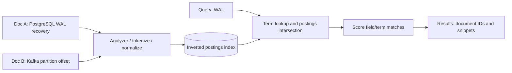
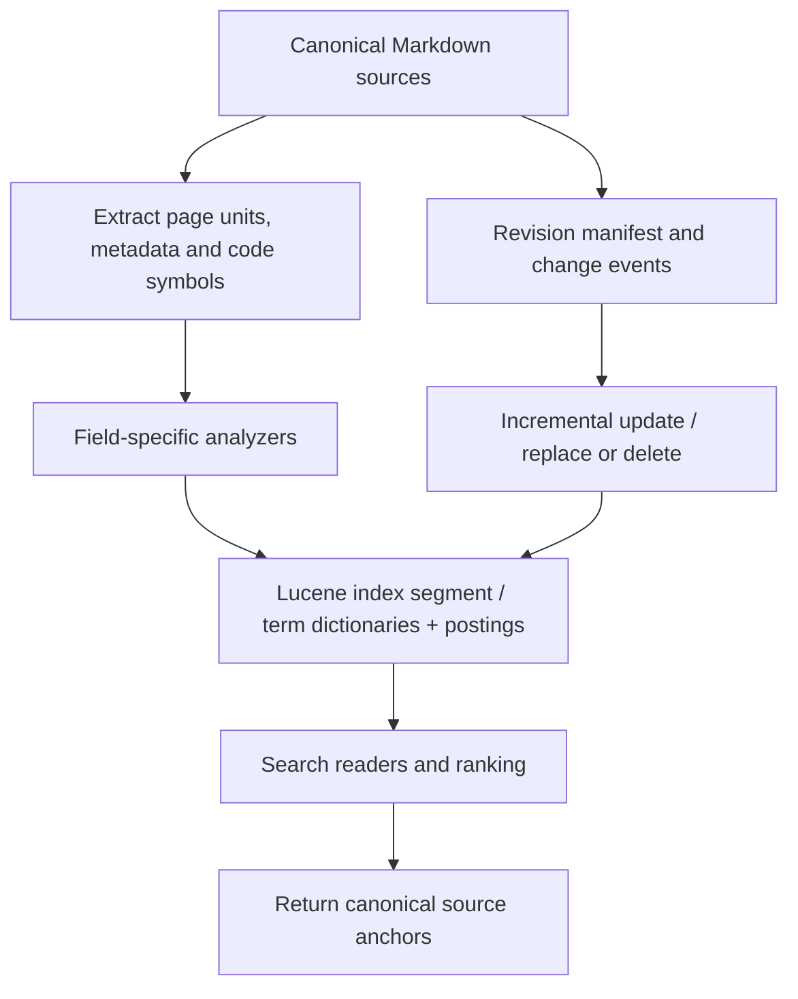
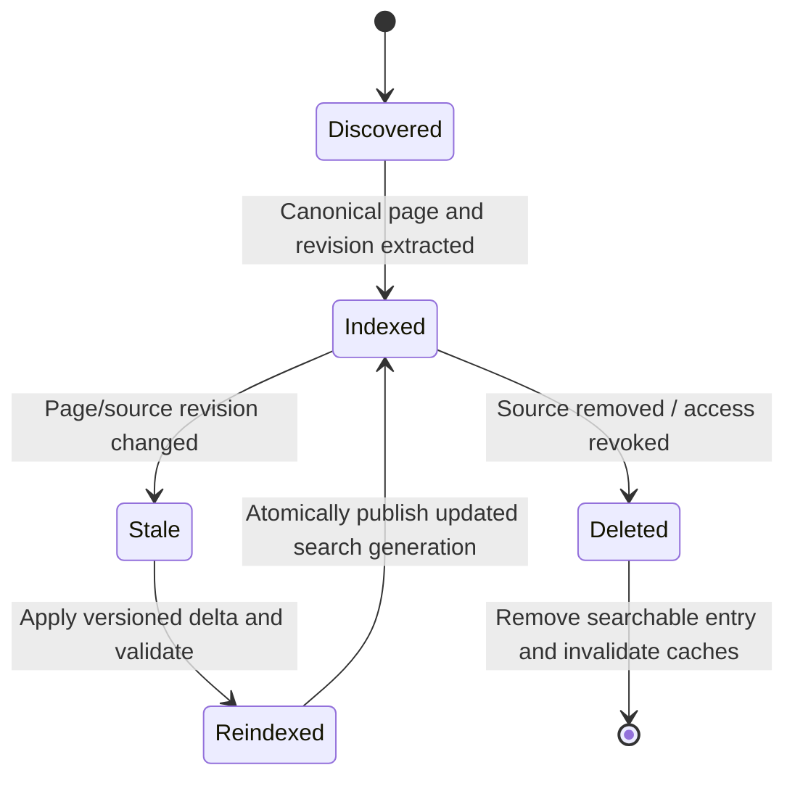

# Lexical retrieval: inverted indexes, BM25, PostgreSQL FTS and Lucene

> Technical research for Tycho [Issue #85](https://github.com/rouslanbaranov/tycho/issues/85). Public source reading 2026-10-19; PostgreSQL docs **17**, Lucene concepts/version references as explicitly cited. Entirely original illustrations and synthetic examples, not a search deployment or benchmark.

## Purpose and mission

Technical documents contain precise symbols: class names, APIs, issue IDs, error codes, configuration keys and product versions. A lexical index preserves this exact-token evidence and can answer questions poorly served by paraphrase-only similarity. But word overlap alone cannot guarantee that a retrieved page explains the requested architecture, version or failure behavior.

**Primary question:** How do tokenization, postings, field weighting, ranking and index update mechanisms affect the quality and freshness of retrieving technical knowledge?

## 1. Why inverted indexes work

An **inverted index** associates each indexed term with the document IDs (and often positions/frequencies) where that term occurs. This reverses a document-to-words list into term-to-doc lookup, avoiding a full scan of all text for many queries.



Text alternative: a document analyzer extracts terms and builds postings. A query's terms select candidate document IDs, and ranking chooses which evidence pages to present. This is an original schematic; Lucene's actual codec/layout choices can vary.

Tokenization must consider code identifiers, dotted package names, camelCase, hyphenated configuration fields, Unicode and stemming. Overaggressive stemming or splitting can erase distinctions such as `Serializable` vs `serialization_failure`; exact-match fields and preserved code symbol forms may be needed alongside language-analyzed prose.

### BM25 and field weighting

BM25-style ranking combines term evidence, document-length normalization and inverse-document-frequency weighting; Apache Lucene's BM25Similarity class is a concrete scorer implementation. It is a **text relevance model**, not a guarantee that results are technically true. Scores from different indexes, analyzers or corpora need not share a common calibration.

| Field | Example | Relative retrieval importance (hypothesis) |
|---|---|---|
| Canonical title and stable term IDs | `PostgreSQL WAL`, `JEP 491` | Strong exact-match signals |
| Technical paragraphs | Failure handling, constraints, alternatives | Broad contextual relevance |
| Version/technology tags | `postgresql-17`, `kafka-4.1` | Precise filtering, not free-text guessing |
| Source anchors/revisions | URL, section, commit hash | Evidence navigation and freshness proof |
| Navigation breadcrumbs | Volume/chapter owner | Discovery routing, not duplicate technical content |

An arbitrary field boost (e.g. 10× title) is only a tuning hypothesis. Evaluate it on unseen queries and judgment labels; too much title boost can rank a shallow overview above an exact failure explanation.

## 2. PostgreSQL 17 full-text search is a real candidate

PostgreSQL 17 Chapter 12 describes `tsvector`, `tsquery`, search configuration and ranking via `ts_rank` / `ts_rank_cd`. The §12.3.3 ranking section explicitly treats relevance as application-dependent rather than an objectively sufficient measure. A GIN index can help certain match operations, but planner/transactional limits must be tested against workload. [E01]

```sql
-- Fictional document-search schema; NOT executed or benchmarked.
SELECT id, title,
       ts_rank(search_vector, websearch_to_tsquery('english', $1)) AS score
FROM technical_pages
WHERE search_vector @@ websearch_to_tsquery('english', $1)
ORDER BY score DESC
LIMIT 10;
```

A SQL-based FTS system is attractive if the corpus is modest, transactional ownership and simpler infrastructure matter, and capabilities cover field/phrase/fuzzy requirements. It may be insufficient if the product requires specialized relevance tooling, large distributed shards, analyzers or cross-cluster search operations that a SQL instance cannot efficiently serve.

Beware material differences between **full-text search indexing** and **vector embedding similarity**: SQL text rank remains lexical, regardless of whether its results are later used by an LLM.

## 3. Lucene indexing and search clusters

Apache Lucene is a Java indexing/search **library** with analyzers, fields, postings, term dictionaries and scoring components. A Lucene-based cluster adds storage topology, distributed segments/replicas, shard ownership, refresh and operational recovery **outside the bare library**; Elasticsearch/OpenSearch are separate products, not simply Lucene API calls in a database.



Text alternative: index builders parse canonical Markdown and provenance, analyze text into fields/postings, then publish searchable segments. Revisions update/delete affected documents and search results retain pointers to authoritative pages.

A search cluster can add replication and parallel shard execution; it also creates index management, schema mapping, rollout, query fan-out and staleness complexity. An index replica is a **derived search artifact**, not a replacement for the canonical source repository and its version lock.

## 4. Incremental indexing and the stale citation problem

A document page may change title, content, source revision, security status or canonical owner. If an index holds old contents after a source edit, an agent can receive **wrong or stale evidence**. The indexing pipeline must explicitly handle change detection, tombstones/deletions, old-ID redirects, partial failures and rollback/rebuild.



Text alternative: a page enters the index at a known revision. Source changes make that entry stale until a validated update is published. Deletions and permission changes must remove obsolete results. The diagram is a **proposed index maintenance contract**, not implemented Tycho infrastructure.

### What to measure before choosing a product

Index disk size by field/segment and N documents, indexing/refresh time, query p95/p99, ranking quality, corpus change rate, tombstone and recovery overhead, and agent payload tokens to get **sufficient evidence**. A 900-page book does not automatically need a distributed search cluster.

An exact query like `jdk.VirtualThreadPinned` should retrieve the versioned Java pinning page ahead of a generic scheduling document. A query like "why does a rollback fail after new-schema writes?" may benefit from semantic/hybrid navigation. The [hybrid retrieval chapter](hybrid-ranking-graph-and-evaluation.md) defines how to evaluate this distinction.

## 5. Failure and decision criteria

| Failure | Symptom | Required check |
|---|---|---|
| Analyzer destroys exact code symbol | Queries for configuration/API names miss target | Unit fixtures for exact token and normalized forms |
| Index update lags source | Agents cite obsolete passage/commit | Version/freshness gate and source-pointer validation |
| Too much title weight | Short low-evidence overview outranks mechanism | Blind NDCG/recall judgments and error analysis |
| Index expansion duplicates canonical text | Conflicting truth across index and book | One source of truth; index derived, rebuildable |
| Cluster shard unavailable | Partial or delayed results | Completeness flags, degraded routing and operational recovery |
| Synonyms expand too broadly | "Partition" finds unrelated DB/network/stream concepts | Domain context and exact canonical owner filtering |

**Insufficient evidence:** "Lucene is faster than PostgreSQL FTS because it is a search engine." Not established. Need representative queries, corpus fields, analyzer configs, hardware, data volumes, warmup, freshness, quality labels and total maintenance cost.

## Evidence and status

| ID | Public source and bounded examined scope | Supports and limitations |
|---|---|---|
| E01 | [PostgreSQL 17 §12.3 Controlling Text Search](https://www.postgresql.org/docs/17/textsearch-controls.html), **Parsing Queries, Ranking Search Results**; [Chapter 12 indexes](https://www.postgresql.org/docs/17/textsearch-indexes.html) | tsvector/tsquery, scoring and index support; no Tycho benchmark |
| E02 | [Apache Lucene BM25Similarity API](https://lucene.apache.org/core/10_3_0/core/org/apache/lucene/search/similarities/BM25Similarity.html), selected **10.3.0** API | BM25 scorer as one versioned library implementation; full Lucene indexing docs not independently read end-to-end |
| E03 | [Lucene Overview](https://lucene.apache.org/core/10_3_0/core/overview-summary.html), selected 10.3.0 | In-process full-text indexing/search APIs, not a managed distributed product deployment |

**Review state:** original model with bounded official docs, no Lucene index built, PostgreSQL search executed, relevance judged by external annotators or human technical review. Full benchmark and choice remain future issues.
