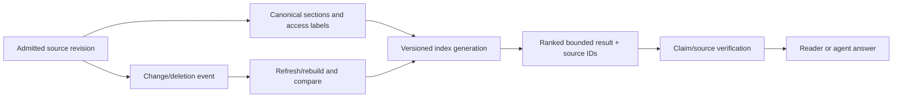

# Retrieval evaluation and index lifecycle: relevance, freshness and evidence budgets

> **Tycho System Design book manuscript V06/C07, 2026-10-19.** This describes evaluating *any* information retrieval system. It does not implement Tycho's ranked retrieval, embeddings, MCP or a curated graph. Public TREC/NIST and BEIR methodologies are cited; all queries, metrics and diagrams here are illustrative. No retrieval experiment, indexed corpus or independent judging exercise was executed.

## Purpose and mission

A search index can return results quickly and still fail users by missing the one relevant document, returning stale access instructions, hiding a change or supplying a section whose citation does not support the final answer. Information retrieval quality therefore spans **relevance, coverage, freshness, authorization, latency and cost**. A high similarity score alone is not evidence of a correct answer.

An index has a lifecycle: source admission → normalization/segmentation → build/version → update or rebuild → ranking → permission-aware result delivery → evaluation → retention/removal. An architecture must make failures and stale snapshots visible throughout that sequence.

The [BEIR project](https://github.com/beir-cellar/beir) publishes a framework for evaluating lexical, dense and reranking approaches across diverse datasets, including ranking metrics. [NIST TREC relevance judgments](https://trec.nist.gov/data/reljudge_eng.html) describe a query/document relevance-judgment setup and pooling limitations. Neither gives a free ground truth for a private or synthetic corpus.

## 1. Build an evaluation set before choosing a vector model

A meaningful test set includes:
- exact entity identifiers, abbreviations and rare symbols;
- broader natural-language conceptual questions and synonyms;
- multi-part questions requiring more than one source;
- false friends: terms that match but describe a different version, system or meaning;
- negative/unanswerable questions with explicit expected no-result behavior;
- renamed/deleted content and contradictory editions;
- permission scopes where relevant, including restricted sections;
- changed documents and stale index refresh windows.

Document which users/questions the test represents. A dataset containing only automatically generated simple keyword queries cannot establish real expert search quality. Label questions and their relevant documents/sections with reviewer context and snapshot/version identity; disagreements and unjudged results remain uncertain.

## 2. What ranking metrics actually measure

| Metric | Question it helps answer | Common misuse |
|---|---|---|
| Precision@k | How many of the top k retrieved items were judged relevant? | Treating unjudged as definitely irrelevant |
| Recall@k | How much of the judged relevant set appears in top k? | Assuming judgments include every relevant item |
| MRR@k | How early is the first relevant result found? | Using it when an answer needs many sources |
| nDCG@k | How good is ranking with graded relevance and position discount? | Treating grades as true probabilities or ignoring evaluation pool |
| Coverage/no-answer accuracy | Are necessary classes of queries and unsupported questions handled? | Scoring only queries with easy positives |
| End-to-end answer correctness | Does the synthesized answer use sufficient valid evidence? | Assuming retrieval relevance guarantees correct reasoning |
| Time to useful evidence | How quickly can an agent/person obtain verifiable source spans? | Only measuring raw index lookup latency |
| Cost per resolved task | CPU, storage, tokens/reads, maintenance and reindex effort per correct answer | Optimizing token count by suppressing necessary evidence |

For a given k, Precision@k = (judged relevant retrieved items in first k) / k. Recall@k uses a denominator of **all judged relevant items** under the chosen qrels. NIST TREC documentation makes clear that pooled judgments are assumptions/approximations for a particular collection, not an eternal complete map of relevance. BEIR's reported nDCG/MAP/Recall/Precision comparisons are benchmark procedures, not guaranteed results for another corpus.

### Original fictional example

Imagine five documents about a device's usage rules. A query has two judged relevant items. System A returns both relevant documents in positions 1 and 3; system B returns one relevant at position 1 and another outside top 5. Under the stated *complete fictional* judgments, Recall@5(A)=2/2=1 and Recall@5(B)=1/2=0.5. This says nothing by itself about trustworthiness, version freshness, citations or total user outcome.

## 3. Lexical, vector and hybrid need matched comparisons

A defensible comparison uses the **same source snapshot, chunk/section boundaries, qrels, permission filters and evaluation queries** where possible. Normalize only what the task requires. For each candidate report:
- index build/update time, disk size and RAM;
- p50/p95/p99 query time under controlled concurrent demand;
- freshness lag and deletion/revocation latency;
- Precision/Recall/nDCG under fixed judgments;
- handling of exact symbols and negative questions;
- citation/source span recoverability;
- operational cost and maintenance failure modes.

Lexical retrieval may excel for exact identifiers; vector retrieval may help vocabulary mismatch; hybrid fusion/reranking can combine evidence but adds complexity and needs benchmarking. Neither semantic similarity nor “top result found” certifies that a source supports the requested claim. Read [BM25 and inverted indexes](lexical-indexing-bm25-and-sql-fts.md), [vector/ANN](vector-hnsw-faiss-pgvector.md) and [hybrid ranking](hybrid-ranking-graph-and-evaluation.md).

## 4. Snapshot and index identity prevent silent staleness

Text alternative: index generations belong to an admitted source revision and access scope. A result must resolve back to canonical source evidence. Changes and deletion must trigger versioned refresh or a documented stale result condition; this is a design plan, not a running index.

Define rebuild consistency: what happens when source changes mid-build, how a candidate generation is validated before promotion, whether queries pin one generation, and how old generations are retired safely. A mix of document versions can produce an internally plausible answer whose sources never coexisted at one point in time.

## 5. Permission and provenance are part of retrieval correctness

If the caller cannot read a document, its title, section count, relevance score, embedded neighbor relationships or citation may also leak information. Authorization must constrain the actual search result and follow-up source retrieval; caching a previous authorized user's result is not a shortcut.

Provenance records must distinguish:
- the source **cited** from the source **actually read**;
- source revision or access date and the question's version requirement;
- direct evidence from synthesized inference;
- missing/contradictory sources from positive answers.

The book chapter [Safe agent-accessible knowledge](../security/safe-agent-access-and-knowledge-isolation.md) owns security boundaries. Retrieval rank does not confer authority to execute instructions embedded in returned documents.

## 6. Evaluate the end-to-end information task

An agent may retrieve one compact entry card and then fetch targeted source spans instead of loading 100 documents. This can reduce cost while preserving quality *if* the end answer is correct and has sufficient cited evidence.

A proposed evaluation would compare:
1. Retrieval Recall@k and relevance position on the same corpus.
2. End-to-end answered-task success, including correct no-answer outcomes.
3. Citation validity at exact source section/revision, independently judged.
4. Number of tokens/section reads and latency through the *complete* decision.
5. Permission, deleted-source, contradictory-version and overload cases.
6. Index generation/retention disk and refresh expense.
7. Correctness after a corpus edit or new source snapshot.

A method producing fewer tokens but worse claim support has **failed** a correctness gate, even if its query latency is lower. Likewise, reporting a high Recall@k on a toy dataset is not proof that human readers can answer practical architecture questions.

## 7. Failure and recovery

| Failure | Safe behavior or required repair |
|---|---|
| Mid-build crash | Retain known-good index generation; resume/rebuild with explicit source snapshot |
| New source revision | Publish valid new index only after integrity and retrieval smoke checks |
| Deleted/revoked source | Stop unauthorized exposure and invalidate caches/index references according to policy |
| Embedding/model change | Rebuild compatible vectors; compare exact/semantic benchmark results rather than mixing spaces |
| Missing qrels | Label judgment gap, do not count all unjudged documents as false |
| Index overload | Bound result size/work, explicit errors, no silently truncated relevant evidence |
| Source citation no longer resolves | Show unresolved evidence, do not invent a matching source |

These scenarios are proposed requirements, not observed incidents.

## 8. Source ledger and explicit Tycho scope

| Public source inspected | Narrow claim supported | Unproven |
|---|---|---|
| [NIST TREC relevance judgments](https://trec.nist.gov/data/reljudge_eng.html) | qrels, test collections and judged relevance limitations | Complete truth set for hypothetical documents |
| [BEIR evaluation framework](https://github.com/beir-cellar/beir) | Standard lexical/dense retrieval comparison using nDCG, MAP, Recall, Precision | Benchmark scores for the Tycho corpus |
| [Tycho hybrid retrieval theory](hybrid-ranking-graph-and-evaluation.md) | Existing educational retrieval mechanisms | Built hybrid index or deployed MCP API |

All queries, scores, data, diagrams, source snapshots and tests here are original hypothetical examples. No index, embeddings, graph, training, test fixture, evaluation run or independent expert review was executed. The chapter adds **System Design education only**, and does not change Tycho's separate retrieval infrastructure roadmap or resurrect a curated knowledge graph.

**Navigation:** proposed **V06/C07** in [book outline](../PROPOSED-STRUCTURE.md), current [search architecture landing](README.md). Read [Lexical full-text](lexical-indexing-bm25-and-sql-fts.md), [Vector/ANN](vector-hnsw-faiss-pgvector.md), [Hybrid retrieval](hybrid-ranking-graph-and-evaluation.md), [Graph traversal as educational topic](graph-data-models-and-traversal.md).

## Applied M9 evidence: what transfers and what does not

The following historical cases are **time-scoped publisher/practitioner reports**, not a Tycho benchmark or proof of a universal architecture choice. Any associated decision playbook is an **original synthetic comparison**, not a decision made by the companies cited. These cases inform the specific mechanism and contraindications above:

- **[Discord — Search index cells](../cases/discord-search-index-cells.md)** illustrates index cells, queue changes and shard-key evolution address different search availability and growth constraints. **It cannot establish:** search-cell results do not establish universal optimal shard sizes or retrieval quality for unrelated indexes.

A different system must recheck its workload, source date, version, authority boundary and failure/recovery acceptance criteria before transferring any decision. See the case's own evidence ledger for exact public references and unresolved claims.
