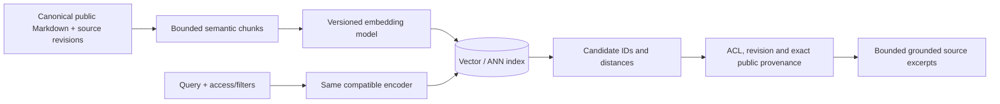
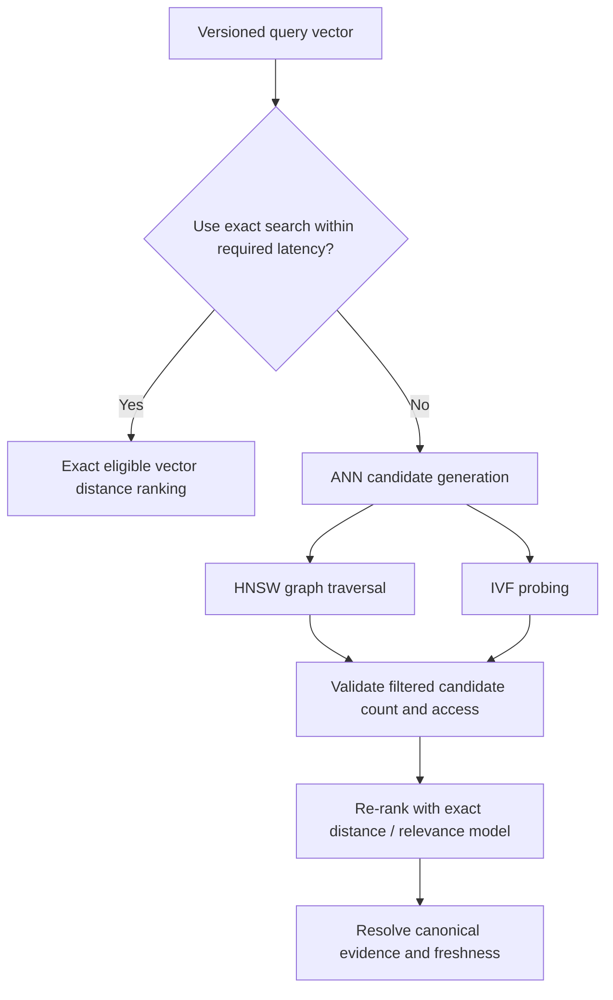
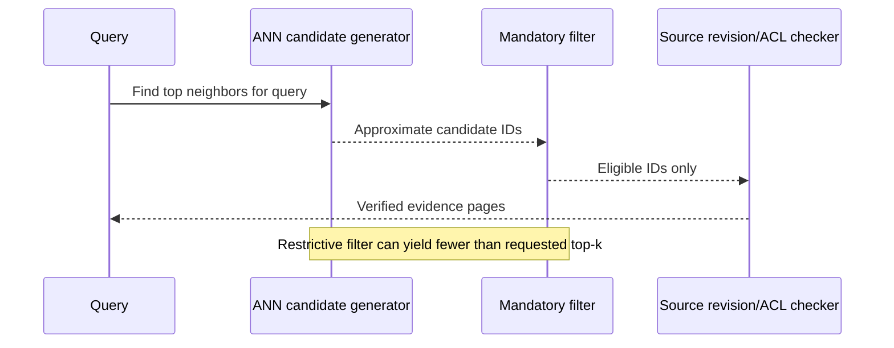

# Vector retrieval: exact distance, HNSW, IVF, filtering and pgvector/Faiss

> Tycho [Issue #85](https://github.com/rouslanbaranov/tycho/issues/85), independent official/public-source review on **2026-10-19**. Examples and diagrams are original. Versioned pgvector and Faiss claims are scoped to the *public documentation inspected*, not a claimed running database, embedding API or benchmark.

## Purpose and mission

A semantic embedding maps text, code or another input to a numerical vector. A distance operation can identify **nearby representations** but says nothing by itself about technical truth, source freshness, ACLs or correctness of a proposed architecture. Approximate nearest-neighbor (ANN) indexing exchanges some accuracy or operational cost for latency/throughput trade-offs.

**Primary question:** How should a system select exact/vector index strategies, measure ANN recall and candidate filtering effects, and preserve precise source evidence when using embeddings in a knowledge book?

## 1. The retrieval contract begins before embeddings

A valid vector search workflow requires:

1. A **canonical document/page** identifier and source revision.
2. An explicit chunk/paragraph boundary with relative navigation to its parent page.
3. A documented embedding model/version, dimension, preprocessing and tokenizer.
4. One distance metric (L2, cosine similarity or inner product) with correct normalization and query conventions.
5. Tenant/privacy/access filters enforced before a result can be returned.
6. Exact or approximate search with candidate IDs, distances and freshness information.
7. Retrieval of the **canonical page and precise source anchor** before a final factual answer.

Text alternative: canonical pages are chunked and embedded with a documented model. Queries are embedded compatibly; approximate candidates are checked against identity, access and revisions, then resolved to authoritative source text. The model does not replace source verification.

A vector distance measures representation proximity, **not business applicability**. A request to choose an architecture for 100,000 users requires constraints and evidence rather than a nearest paragraph.

## 2. Exact nearest neighbors are the reference baseline

An exact search can compare a query vector against every eligible candidate and rank by distance. This is a useful **ground truth for approximate search recall**, within the same model, metric, filtering and corpus version. It does not establish that the embedding ranking matches human relevance labels.

The public **pgvector** project README states that nearest-neighbor search is exact by default and supports approximate HNSW and IVFFlat indexes. The README documents distance/operator classes for L2, inner product and cosine distance. [E01]

A *fictional* mathematical sketch: three 2-D vectors `A=(1,0)`, `B=(0,1)`, `C=(0.8,0.2)` with query `q=(1,0)`. Under ordinary Euclidean distance, `A` ranks first at distance 0, `C` has distance `sqrt(0.08)≈0.283`, `B` has distance `sqrt(2)≈1.414`. This arithmetic says nothing about semantic quality or trained embedding behavior.

## 3. ANN index types and their trade-offs

| Index | Conceptual mechanism | Benefits and costs to evaluate |
|---|---|---|
| **Flat/exact** | Compare against every eligible vector | Deterministic exact top-k by chosen metric; potentially higher scan cost |
| **HNSW** | Multi-layer navigable proximity graph; approximate traversal | Recall/latency trade-off, graph memory/build/update costs |
| **IVF/IVFFlat** | Assign vectors to coarse lists and search selected lists | Adjustable probes/recall; training/centroid and load-skew considerations |
| **PQ/quantization** | Store compressed codes, sometimes with exact re-ranking | Smaller memory and faster candidate selection at added approximation/encoding complexity |
| **Hybrid index/cluster** | Couple ANN with metadata filters, replication and source lookup | More components, freshness/ACL coordination, operational failover |

Faiss's official open [Faiss Indexes wiki](https://github.com/facebookresearch/faiss/wiki/Faiss-indexes), including the table of flat, HNSW, IVF and PQ methods, documents these index families and approximate/exhaustive distinctions. That is an index toolkit, not automatically a persistent, multi-tenant distributed vector database. [E02]

Text alternative: prefer exact search when it meets constraints. Otherwise use a graph or coarse-list ANN to generate candidates, apply correct filtering and optionally precise reranking, then return source-backed pages. This is an **original selection sketch**, not a software algorithm recommendation.

Neither HNSW nor IVF is an invariant that guarantees a particular recall percentage across all data distributions. Duplicate/near-duplicate vectors, dimension, cluster shape, vector quantization and deletion/update behavior can change efficiency and accuracy.

## 4. Metadata filtering creates a subtle recall and security boundary

The pgvector project README states that when using approximate indexes, filtering can happen **after** scanning candidates. If only a small fraction of nearest neighbors meet a restrictive filter (e.g. topic, version, tenant), the first approximate scan may return fewer than the requested `LIMIT` and lower observed recall. The README documents *iterative index scans*, partitioning and partial indexes as mitigations, with version-specific options. [E01]

Text alternative: ANN produces candidates, which are filtered for required topic/version/ACL constraints and checked against authoritative source revisions. A selective filter may leave too few candidates; search design may need filtered indexes, broader scans or exact fallback.

**Security matters:** do not allow an approximate index to reveal restricted titles/excerpts through pre-filter snippets, side-channel counts or postfilter leakage. The intended Tycho corpus is independently public, but general methods should still model permission filtering and redaction explicitly.

## 5. pgvector versus Faiss versus a vector database

- **pgvector:** extension co-locates vector data with PostgreSQL tables/transactions. Attractive when source records and metadata already live in SQL and a single DB's resources suffice. Adds ANN index build/update pressure to that DB.
- **Faiss:** vector index/search library with CPU/GPU algorithms, often embedded in a service. Durable source-of-truth, data ingestion, ACLs, service replication and consistency are *additional responsibilities*, not implied by a Faiss index.
- **Dedicated vector-search service/database:** may provide distributed ingestion/sharding/metadata features, but product/edition semantics vary. Do not name a winner without pinned documentation and equal evaluation conditions.
- **Plain arrays in Python:** for a small corpus, exact similarity with a compact local index may be sufficient, easier to rebuild and cheaper to maintain than a distributed ANN platform.

For a 900-page corpus the index size and latency need **measurement using actual chunk count, dimension, precision, metadata, distance and device**, not a universal extrapolation from document pages. A rough raw-vector budget can be calculated as `chunks × dimensions × bytes/component`, then add index graph/codebook, metadata, documents, replicas and persistence overhead.

### Original size arithmetic

A purely illustrative corpus of **4,500 chunks × 768 dimensions × 4 bytes (FP32)** requires **13,824,000 bytes** (about 13.2 MiB) of raw components. This is **not** a memory/SSD estimate for HNSW, metadata, source text or an actual Tycho build, and it assumes a model/dimension not selected by the project.

## 6. Failure cases and evaluation

| Condition | Common failure | Minimum check |
|---|---|---|
| Embedding model upgraded | Old/new vectors incomparable or ranking shifts | Model version lock, re-embed and dual-evaluation |
| ANN index stale | Deleted or revised page still retrieved | Source revision lock and rebuilding/tombstones |
| Highly selective filters | Too few eligible results returned | Recall@k against exact *filtered* baseline |
| High-volume ingestion | Build/merge contention or query latency | Throughput, p95/p99 and state/freshness under write load |
| Quantization enabled | Relevant neighbor drops from candidate set | Blind judgments and exact-distance re-rank comparison |
| Multi-tenant filter lost | Private material surfaced | Authorization-before-result policy and adversarial tests |
| Dense-only search on code symbols | Exact exception/API tokens lost | Hybrid lexical recall and code-term tests |

**Insufficient evidence:** "HNSW is always faster and more accurate than IVF, and it will save tokens." Not established. Need the actual corpus, dimensionality, query distribution, recall targets, hardware, update rate, latency/cost and bounded agent answer-quality tests.

## Source-to-claim evidence

| ID | Primary public source / exact inspected scope | Supports, not empirical Tycho outcomes |
|---|---|---|
| E01 | [pgvector project README](https://github.com/pgvector/pgvector), *Indexing, HNSW, IVFFlat, Filtering, Iterative Index Scans, Hybrid Search*, rolling main revision observed 2026-10-19 | Exact default and ANN choices, candidate postfilter and tuning features; pin tag before deployed version-specific instructions |
| E02 | [Faiss Indexes](https://github.com/facebookresearch/faiss/wiki/Faiss-indexes), table of method classes, HNSW, IVF and PQ; wiki inspected 2026-10-19 | Index family properties, not an installed managed search service |
| E03 | [Faiss Index factory](https://github.com/facebookresearch/faiss/wiki/The-index-factory), IVF/PQ/HNSW construction overview | Index composition, not measured universal index ranking |

No embeddings were generated, model API invoked, index built, recall computed or human relevance annotated for this page; all numeric examples are synthetic.
