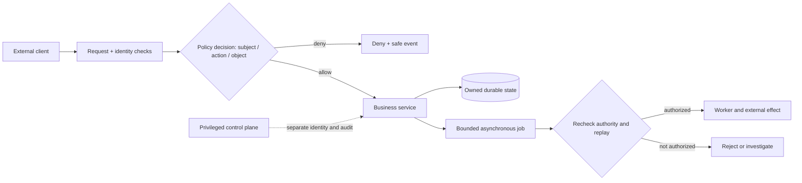

# Security architecture: identity, authorization, trust boundaries and isolation

> Tycho E14-12 [issue #90](https://github.com/rouslanbaranov/tycho/issues/90), original technical manuscript. Public references inspected on 2026-10-19: NIST SP 800-207, IETF RFC 9700 and OWASP API Security Top 10 (2023). This is a source-bounded explanation with fictional examples; it is **not** a security assessment, proof of compliance, exploit test, deployed policy or independent human review.

## Purpose and mission

Security architecture answers **what resource is protected, against which capabilities and actors, at which enforcement boundaries, with what failure behavior and audit evidence**. Authentication, authorization, tenancy separation, encryption, transport security and incident recoverability are distinct; one successful mechanism cannot be substituted for another.

Decision question: How should an application enforce least privilege and isolate its data and operations when requests cross clients, API gateways, services, asynchronous workers, databases and administrative control planes?

A defensible design begins with the assets and threats, not a vendor identity product or universal microservice topology.

## 1. Model assets, principals and actions

For a wholly invented workshop registration service, protect: participant contact data, capacity counters, committed registrations, audit evidence, signing keys, deployment credentials, backup contents and administrative mutation interfaces. Model these separately:

| Principal or object | Meaning | Ambiguous boundary requiring explicit policy |
|---|---|---|
| Human participant | Person interacting through a client | A valid login does not authorize reading someone else's registration |
| API client | Application presenting authorization credentials | Client authentication alone does not identify the end user or authorize every resource |
| Service workload | Backend job or process identity | A service allowed to read a queue may not have permission to change registration records |
| Administrator | Operator with bounded privileged functions | Break-glass identity must not imply unlimited routine data access |
| Tenant | Organizational isolation domain | Tenant membership may not authorize all objects/properties/actions within it |
| Resource | Specific registration, report, message or storage object | Direct object IDs, filters, batch requests and caches must be subject to the same policy |
| Delegated authority | Explicit scope and audience accepted by downstream service | Passing the same credential downstream can expand its blast radius |

**Authentication** establishes a claimed subject according to a selected identity proof and assurance level. **Authorization** decides whether the subject can execute a specific action on a specific resource under current context and obligations. A signed token authenticating a subject is not an authorization decision for every business object, nor a promise that current account rights have not changed since issuance.

## 2. Trust boundaries, policy decisions and enforcement

NIST SP 800-207 describes a zero-trust architecture centered on protecting *resources* rather than treating the network segment itself as sufficient trust. Its conceptual policy engine, administrator and enforcement points are architectural responsibilities; naming them does not supply a ready-made complete deployment. [E01]

Partition the synthetic request path:

1. **External request entry** validates transport, request size, authentication material and allowed operations. Reject malformed credentials and unexpected audiences.
2. **Service/API handler** authorizes subject–resource–action pairs with authenticated context and explicit tenant ownership; check both parent collection and each addressed child object.
3. **Internal service call** authenticates the workload, confines delegated authority and rechecks downstream permissions; neither internal IP nor mTLS alone proves permission for a business mutation.
4. **Data plane** enforces least-privilege queries/rows/objects and correct transaction boundaries. Database roles, row-level policies or separate databases can contribute defense in depth but must be tested against actual query patterns and administrative bypasses.
5. **Asynchronous path** binds actor/context and authorized work intent at enqueue time, then performs a new validity/replay/expiry decision when execution occurs. A delayed job is not automatically authorized forever.
6. **Control plane** isolates build/release credentials, policy edits, identity configuration, secret rotation and emergency access. Operational change can affect all tenants; it deserves stronger change evidence.

### Original boundary diagram

Text alternative: an untrusted client passes entry validation, a resource/action policy decision, and a business handler. A delayed job requires a new authority/replay decision; administrative control is separate from ordinary operations. This does not assert a secure deployed workflow.

A policy decision must be reproducible: record policy revision, identity assurance, resource ownership snapshot, action, expiry, reason code, enforcement point and outcome. Never expose sensitive predicates or secret claims back to an unauthorized client.

## 3. Object-level, function-level and property-level authorization

The OWASP API Security Top 10 2023 documents three distinct risks:

- **API1 broken object-level authorization**: an attacker changes a legitimate-looking object identifier and accesses another person's resource. Check ownership/permission after resolving that exact object, including batch, search and nested-resource paths. [E02]
- **API3 broken object-property-level authorization**: reading an allowed object is not authorization to see every field or set every attribute. Return explicit allowed projections and validate mutable property sets. [E02]
- **API5 broken function-level authorization**: knowing a valid administrative route or method does not authorize that operation. Apply explicit function policy with deny-by-default semantics, not just a hidden UI button. [E02]

A single role string such as `user` or `admin` is frequently too coarse for resource ownership, delegated time windows and tenant boundaries. Attribute-based or relationship-aware policies can encode richer conditions, but they add policy authoring, caching/invalidation and explainability costs; this chapter **does not** prescribe a universal policy engine.

### Original authorization-test matrix

| Subject | Resource/action | Expected outcome | Why |
|---|---|---|---|
| Participant A | Read A's registration with allowed fields | Permit | Active ownership plus selected allowed projection |
| Participant A | Read B's registration by guessed ID | Deny | Object-level ownership |
| Participant A | Read A's hidden internal fraud marker | Deny/omit | Property-level projection |
| Participant A | Cancel another participant's slot | Deny | Resource and function policy |
| Worker W | Consume scheduled notification message | Conditional permit | Workload role, event validity and intended operation |
| Worker W | Change global application security policy | Deny | Separate control plane |
| Suspended administrator | Use previously issued privileged token | Deny according to required revocation/freshness gate | Token validity alone is insufficient |

These are **expected outcomes of a fictional policy**, not executed tests. An implementation must measure eventual-consistency policy caches, permission revocation latency, stale identities and recovery after policy-service failure.

## 4. OAuth2, token scope, proof and replay

RFC 9700 (BCP 240, January 2025) strengthens OAuth 2.0 security guidance. It requires or recommends protections such as exact redirect URI matching, PKCE for public clients, audience-restricted access tokens, sender-constraining where appropriate, and strict redirect/credential handling. Read its precise normative language before declaring a given flow compliant. [E03]

- A **bearer token** can be replayed by an unauthorized holder until invalidated or expired. TLS protects transit, not storage/logging/token theft or a compromised endpoint.
- **Sender-constrained tokens** (such as mutual-TLS-bound tokens or DPoP) bind token use to proof of possession of corresponding key material; they introduce key lifecycle, proxy, replay-window and client support requirements.
- **Audience** restricts intended resource servers. An access token issued for service A should not automatically be accepted by unrelated service B.
- **Scopes** are coarse delegated authority and may require an additional object-level business decision. A scope named `registrations.read` cannot authorize every registration.
- **Refresh-token rotation and lifetime** constrain stolen long-lived refresh material, with exact replay and response handling requiring version-specific implementation tests.
- Use secure authorization-code flows with PKCE, not unprotected redirect constructions. A client credential flow authenticates a client, not a participant.
- Tokens and identity assertions must not be written into normal logs or source-linked document excerpts.

Security architecture includes operational failure behavior: if a remote policy service times out, protected writes may need to fail closed, but a critical read-only recovery function might use a deliberately pre-authorized emergency policy with strong audit and expiration. Such deviations require **explicitly documented** risk acceptance and tests.

## 5. Isolation is multidimensional

| Dimension | Typical mechanism | What it does not prove |
|---|---|---|
| Process/host | OS user permissions, VM/process/container isolation | A container boundary is not automatically a separate kernel or tenant-proof guarantee |
| Network | Segmentation, identity-aware ingress/egress, service policy | Being on an allowed subnet does not imply resource authorization |
| Compute | CPU/memory/request/queue quotas, admission gates | Equal CPU limits alone do not prevent shared storage or connection-pool starvation |
| Data | Row/object policies, tenant key checks, isolation by schema/database when justified | A tenant filter may be bypassed by direct SQL, cache keys, exports or privileged jobs |
| Cache/index | Tenant-scoped keys, per-request filters and invalidation | A correct database policy does not protect a shared cache or search index automatically |
| Cryptographic | TLS, envelope keys and rotation, backup encryption | Encryption does not detect unauthorized use of an already authorized decrypting service |
| Control plane | Separate identities, two-person change controls where required, protected release paths | Source review alone does not prove safe runtime permission changes |

For a shared-tenant design, measure noisy-neighbor effects, per-tenant failure containment, cross-tenant information leaks in error messages/logs/search suggestions and query paths missing tenant binding. Moving tenants into separate databases can reduce some blast radius while multiplying schema deployment, backup, failover and operational costs.

## 6. Threat-model decisions and abuse cases

Start with actors, assets, trust boundaries, entry points and a short threat list. Treat assumptions explicitly as unvalidated. Common classes in this example include credential replay, guessed object IDs, forged internal identities, tenant confusion, request amplification, malicious attachment/URL requests, untrusted dependency updates, exfiltration through logs or search, and compromised operator credentials.

For each threat, record:
- preconditions and attacker capability (external user, internal workload, stolen token, control-plane actor);
- affected data and business invariant;
- preventive enforcement point and **independent** detection signal;
- residual risk, incident containment and reauthorization behavior;
- one test that could falsify the mitigation.

**Example:** a worker accepts user-supplied URL and fetches it without target validation. A network allowlist alone may not cover DNS rebinding, redirect chains and internal address access. Safer alternatives include typed reference resolution, no arbitrary outbound fetch for ordinary users, strict destinations and isolated egress. OWASP API7 identifies SSRF as a separate API risk. [E02]

**Decision gate:** a new security mechanism is not automatically worth its complexity. If resource/action policy, key lifecycle or recovery behavior cannot be clearly documented and tested, a simpler deployment with fewer cross-domain trust boundaries may be more defensible.

## 7. Verification: evidence hierarchy and negative tests

1. **Document intended policy** for subjects, objects, actions, tenancy and privileged workflows, including a denied-default case.
2. **Generate negative authorization tests**: cross-tenant object ID, hidden property, privilege escalation, arbitrary filter, bulk read, delegated token reuse, expired/rotated credentials and old background job.
3. **Validate at all access paths**: API, background tasks, export, cache, search, data admin and internal service calls. One positive API test is insufficient.
4. **Exercise failure**: policy engine unavailable, stale authorization cache, credential renewal failure, transport outage, denied secret rotation and long-running transaction against revoked rights.
5. **Inspect evidence**: access-denied counters, minimally sufficient safe audit events and traces without credentials or personal data; unauthorized requests should neither reveal existence of protected objects nor generate unbounded logging costs.
6. **Review architecture trade-offs**: local/remote policy latency, caching consistency, developer ergonomics, privilege boundaries, isolation costs and recovery. Reject universal zero-trust claims from diagrams alone.

No production access, penetration test or external service authorization was performed for this chapter.

## Exact public source-to-claim ledger

| ID | Inspected primary public source and scope (2026-10-19) | Supported / deliberately excluded |
|---|---|---|
| E01 | [NIST SP 800-207: Zero Trust Architecture](https://www.nist.gov/publications/zero-trust-architecture), publication overview/abstract and resource-first principle | Resource-centric trust-model rationale; **not** validation of a specific policy deployment or control effectiveness |
| E02 | [OWASP API Security Top 10 — 2023](https://api-security.owasp.org/editions/2023/en/0x00-header/), risk categories API1, API3, API5 and API7; [API3 detail](https://github.com/OWASP/API-Security/blob/master/editions/2023/en/0xa3-broken-object-property-level-authorization.md) | Distinct object/property/function access and SSRF risks; categories are not a replacement for tested policy enforcement |
| E03 | [IETF RFC 9700](https://www.rfc-editor.org/rfc/rfc9700.html), Sections 1, 2.1, 2.2, 2.5, 2.6, normative OAuth guidance | Exact redirect handling, PKCE, sender-constrained-token recommendations, client auth; **not** proof of any OAuth library or architecture's conformance |

This chapter is a bounded engineering explanation, not a universal threat catalogue. Version-specific deployment, operational access controls, data classification and independent review are **outstanding**, not silently assumed.
