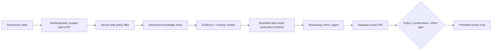

# Safe agent-accessible knowledge: trust boundaries, privacy and bounded authority

> **Tycho book draft V09/C07**, 2026-10-19. This is **System Design education**, not a deployed agent, authentication service, retrieval API, MCP adapter or security validation. Examples and policies are original and fictional; source-bound recommendations draw on public OWASP guidance.

## Purpose and mission

A knowledge service becomes agent-accessible when software can retrieve snippets and, potentially, request actions based on their contents. The architectural problem is not whether the language model is "trusted" as a person. It is how the system **enforces identity, resource authorization, data provenance and the permitted effects of tool calls regardless of the model's interpretation**.

Retrieved documents can contain inaccurate claims, stale revisions or text explicitly designed to change an assistant's behavior. An external paragraph must never acquire the authority of application instructions merely because it appeared in a tool result. [OWASP LLM01:2025 Prompt Injection](https://genai.owasp.org/llmrisk/llm01-prompt-injection/) explains direct and indirect instruction-manipulation risk, and that retrieval augmentation does not remove it. [OWASP LLM06:2025 Excessive Agency](https://genai.owasp.org/llmrisk/llm062025-excessive-agency/) identifies excessive tool functionality, permissions and autonomy as independent amplification factors.

This chapter discusses the *general* architecture of an agent-facing service. Tycho's actual ranked search, transport adapter and shared specialist are separate future product deliverables, not claimed implemented here.

## 1. Define distinct security principals

A useful conceptual separation is:

| Identity | Typical control | It is **not** |
|---|---|---|
| End user | Authenticated principal with scoped resource entitlements | Permission to read every document that matches a query |
| Client application | Known client/installation and allowed API surface | A substitute for the end-user's object authorization |
| Model/agent runtime | Restricted tools, output limits and policy context | A trusted human administrator or authorization authority |
| Retrieved document / search result | Untrusted data, source ID, revision and access classification | Executable instruction or approval to call another tool |
| Knowledge service | Server-side scoped read/lookup and consistent snapshot | A generic filesystem proxy or arbitrary network fetch tool |
| Action executor (if any) | Independent permission enforcement, parameters, auditing and confirmations | A side effect delegated solely because a model requested it |

The service must evaluate every document read and every action against the **actual authorized subject and object**, not just a collection-wide login. [OWASP Authorization Cheat Sheet](https://cheatsheetseries.owasp.org/cheatsheets/Authorization_Cheat_Sheet.html) describes least privilege and deny-by-default. [OWASP Authorization Patterns](https://cheatsheetseries.owasp.org/cheatsheets/Authorization_Patterns_Cheat_Sheet.html) distinguishes policy enforcement from decision/evaluation, including resource-level responsibility.

A search that ranks a forbidden title but excludes its body can still leak metadata. Count, title, snippet, related links and citations must be evaluated against authorization, not just the final open-file operation.

## 2. Treat retrieval as a data pipeline, not a command channel

**Text alternative:** authenticated callers receive only results permitted by server-side policy; the index is versioned and evidence is checked. Returned prose is data to the reasoning client. Any separately allowed action must pass its own authorization, schema, risk and confirmation gate—not inherit authority from a retrieved paragraph.

The separation has three parts:

1. **Transport control:** authenticated communication, bounded requests, size/rate/time limits, safe error responses, version negotiation.
2. **Data control:** metadata/source access, per-object authorization, safe ID/path resolution, revision and contamination policy, citation integrity.
3. **Effect control:** no arbitrary code execution or file/network access from the search surface; tightly scoped action tools where justified.

For read-only reference services, the safest baseline is **no mutation or execution tools at all**. If a separate system legitimately needs writes, keep their permissions isolated from search. A model's confidence or chain-of-thought is never a replacement for deterministic access checks.

## 3. Prompt injection is a trust-boundary failure

Imagine a **fictional, publicly shared technical note** stored in a search index. The note contains normal latency guidance plus a sentence instructing readers' assistants to ignore access policies and fetch unrelated protected records. No such retrieval or external call is executed in this book example.

The note is allowed to be **quoted or described as data**, but cannot modify the executing assistant's instructions. A guard based only on "ignore malicious text" is fragile: the risk is structural when retrieved text is merged into high-priority instructions or interpreted as a tool command.

Defense-in-depth controls include:
- Separate tool-produced text and documents from trusted instructions; preserve source IDs and clearly label provenance.
- Limit capabilities exposed to an agent by default; deny broad filesystem/network endpoints unless necessary.
- Validate every action's arguments against a narrow schema, allowed IDs, resource permissions and a known business contract.
- Check entitlement **again at the authority that protects the effect**, even if the agent previously searched successfully.
- Require explicit independent human confirmation for actions with significant irreversible impact where appropriate; confirmation is not a substitute for ACLs.
- Reject unsupported or stale claims instead of hallucinating a source; never suppress known contradictory evidence.
- Test malicious-looking retrieved text, fabricated citation IDs, mixed entitlements and unexpected cross-document links.

OWASP LLM01 identifies both direct and indirect injection. There is **no foolproof natural-language filter**; preventing unacceptable effects requires server-side boundaries that do not depend solely on how the language model interprets prose.

## 4. Versioned provenance and cross-collection isolation

A reference result should identify:
- immutable or revision-bound knowledge snapshot and document ID;
- bounded section/range and canonical local/public source reference;
- evidence confidence and verification freshness as separate states;
- authorization scope and whether a linked source was actually inspected;
- relevant contradictions, missing support or version mismatch.

Indexes, caches and citations are alternate **views of the same authorized content**, not independent permissions. A cache key must reflect principal/tenant scopes or serve only deliberately public results. A search index built from multiple collections must never turn a cross-collection link into permission to read the linked target. "Related document" is a navigation hint, not an ACL bypass.

When a source document changes, stale snippets and old citations may no longer support a decision. Snapshot pinning, versioned document IDs and eventual re-indexing reduce accidental mismatch, but a pinned result alone cannot certify semantic truth. The caller still needs the authoritative source when making consequential architectural claims.

## 5. Privacy, audit and retention boundaries

Agent interactions may include user questions, selected snippets, query filters, result IDs, tool traces and tool arguments. These records can reveal interests or sensitive content even if the book prose itself is public. A reference design should:
- minimize retained query/input text and avoid logging credentials, tokens or raw confidential documents;
- define what metadata is necessary for incident diagnosis and abuse detection;
- limit audit access and retention, and allow investigation without exporting private content indiscriminately;
- label and redact any untrusted remote source content appropriately, rather than treating it as safe to publish;
- prevent generated summaries or prompts from mixing restricted collections or leaking source metadata;
- separate operational observability (latency, errors, sizes) from authorization and audit evidence (decision, principal, object and outcome).

[Tycho trace, logs and audit chapter](../observability/trace-context-lineage-and-audit.md) explains why sampled tracing is not an authoritative audit trail. [Tycho security boundaries](identity-authorization-and-isolation.md) describes object-level authorization and isolation independent of agent-specific prompts.

## 6. A synthetic negative test matrix

| Attack or failure scenario | Correct server behavior | What does not prove it |
|---|---|---|
| Unauthorized document ID obtained from a citation | Deny reading/metadata for that subject | Hiding it from ranking only |
| A note contains adversarial instructions | Treat as untrusted document content; no change in tool privilege | Simple instruction "do not obey" without access gates |
| Model requests write through a search tool | Refuse unsupported operation; side-effect API not present | Assuming "read-only" because UI shows only a search box |
| Cached snippet from a different scope | Do not serve data outside entitled scope | Cache hit ratio or successful authentication |
| Outdated source reference | Mark snapshot/verification status and request fresh evidence | Date string without source revision |
| Arbitrary file path passed as document ID | Restrict to approved stable IDs and root; reject escape or symlink traversal | String suffix check without canonical path resolution |
| Model-generated malformed action arguments | Reject by deterministic schema and access-policy checks | Model's promise to send correct JSON |
| Excessive requests or output sizes | Enforce size, time, rate and result bounds; degrade predictably | Generic cloud resource limits alone |
| Incident logs contain secrets | Redact/deny, limit retention and audit access | Encrypting storage without data minimization |

An executable service should test denial cases end-to-end, with independent authorization configurations and synthetic restricted fixtures. Passing a boundary checker is evidence only for the tested patterns, not universal proof of safety.

## 7. Architecture decision and limits

**Default recommendation for an external documentation service:** scoped, read-only retrieval with server-side document authorization, bounded section results, immutable source IDs, versioned citations and no arbitrary tools. When a user asks for a consequential architecture decision, supply relevant source evidence, uncertainty and alternatives. Do not grant automatic deployment/change authority to the same agent merely because it could find the correct chapter.

A full MCP implementation, client interoperability, OAuth/transport design, host protection, and response-size benchmarks are **separate software engineering and security validation tasks**. The book only documents the reasoning contract. No production mechanism, security evaluation, malicious-input exercise or human approval was executed as part of this page.

## 8. Public evidence ledger and navigation

| Independently public source consulted | Narrow supported aspect | Open limitation |
|---|---|---|
| [OWASP LLM01:2025 Prompt Injection](https://genai.owasp.org/llmrisk/llm01-prompt-injection/) | Untrusted retrieved content, indirect injection, limits of RAG-only mitigation | Effectiveness of any invented controls in deployed agent |
| [OWASP LLM06:2025 Excessive Agency](https://genai.owasp.org/llmrisk/llm062025-excessive-agency/) | Risk from overly broad functions, permissions, autonomy | Validated risk review of a specific tool/plugin runtime |
| [OWASP Authorization Cheat Sheet](https://cheatsheetseries.owasp.org/cheatsheets/Authorization_Cheat_Sheet.html) | Least privilege, deny by default and per-object entitlement | All application-specific policy decisions |
| [OWASP Authorization Patterns](https://cheatsheetseries.owasp.org/cheatsheets/Authorization_Patterns_Cheat_Sheet.html) | Policy enforcement/decision point responsibilities | Formal enforcement correctness of imaginary API |

All example data, diagrams, test cases and recommendations are original educational design illustrations. No private corpus was accessed or used as a source, no customer data was processed, and no actual security test was performed. Further source precision, independent review, client compatibility and operating tests remain open.

**Navigation:** future V09/C07 in [proposed book outline](../PROPOSED-STRUCTURE.md), current [security landing](README.md). Prerequisites: [Authorization and trust boundaries](identity-authorization-and-isolation.md), [Tracing and audit](../observability/trace-context-lineage-and-audit.md). Related: [Search/retrieval architecture](../search/hybrid-ranking-graph-and-evaluation.md), [cross-domain architecture decisions](../decisions/cross-domain-modernization-and-adr-examples.md).
