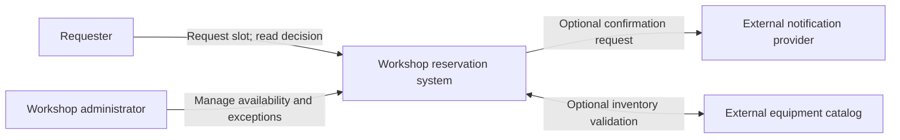

# Outcomes and system context

**Owning question:** Which user outcome and external actors define the problem boundary?

This page belongs to [V01/C01 — Problem framing and system boundaries](README.md). Use the integrated walkthrough for the surrounding decision; the sections below own this narrower mechanism and its limits.

<!-- tycho-question-source:tycho.page.4318e542ac7e445b9e8b3150effd2cff:1 -->
## 1. Begin with observable outcomes

Define the first boundary with a sentence that can be tested:

**Original synthetic system:** a small community workshop accepts reservations for shared equipment. A valid request chooses a timeslot and either creates **one durable accepted reservation** or returns a meaningful rejection. Two accepted reservations must never claim the same exclusive timeslot. An optional confirmation message does not determine whether the booking itself succeeded.

This definition states more than "build a booking microservice": it tells a reviewer what can be correct, what can fail and what must be verified. It does **not** yet specify whether the design is a monolith, a service, a queue, an event-driven architecture or a database engine.

A problem framing record answers:

| Dimension | Concrete design question | What a premature assumption would hide |
|---|---|---|
| Actors | Who initiates, confirms, cancels and administers reservations? | One broad "user" role hides different authorization scopes |
| User journey | What exact externally visible result finishes the operation? | HTTP success may precede durable business success |
| State authority | Which boundary owns exclusive allocation and cancellation? | Two systems could both decide they are authoritative writers |
| Partners | Which external systems are required, optional or unreliable? | An email outage may incorrectly cancel a valid allocation |
| Interface meaning | What requests, outcomes and error/uncertainty states are visible? | A lost reply could result in duplicate allocations |
| Constraints | Which consistency, privacy, cost and availability gates are hard? | Ranking convenience above correctness or authorization |
| Evidence | Which facts are documented, observed, synthetic or still unknown? | An architecture sketch becomes an unearned production assertion |

The [arc42 Introduction and Goals §1](https://docs.arc42.org/section-1/) treats requirements, stakeholders and quality goals as architecture input; measurable scenario details are expanded in [Requirements and workload profiles](../../v10-decision-support-and-modernization/c01-architecture-requirement-and-workload-profiles/requirements-and-workload-architecture-profiles.md). A boundary without a named success condition is insufficient to choose a technical solution.

<!-- /tycho-question-source -->
<!-- tycho-question-source:tycho.page.4318e542ac7e445b9e8b3150effd2cff:2 -->
## 2. Separate business context from technical context

A **business context** answers who exchanges what *meaningful information or effect* with the system. A **technical context** answers through which channels or protocols it may be realized. Their boundaries should correspond, but they are not interchangeable.

Original business-level context (illustrative, not a C4-compliant rendering guarantee):

**Text alternative:** the requester creates and checks reservations; an administrator controls availability and exceptional changes. The reservation system is the black box of interest. A notification service and an equipment catalog are external neighbors, and their availability/authority requirements are intentionally left to the contract rather than inferred from drawing an arrow.

A **possible** technical realization could expose HTTP JSON to requesters, use an application client for administrators and integrate notifications through a durable asynchronous connector. That would be a **proposed mapping**, not a fact implied by the business diagram. If business correctness depends on catalog availability, decide whether stale cached catalog data is admissible and how a request behaves when the catalog cannot answer; do not hide the rule behind a line labeled HTTP.

| Business interaction | Required semantic guarantee | Candidate technical contract | Unresolved design choice |
|---|---|---|---|
| Reserve timeslot | At most one accepted owner for an exclusive slot | POST command with scoped operation key, durable transaction | How is commit outcome discovered after lost reply? |
| Query reservation | Return authoritative or clearly qualified state | Authenticated resource read | What freshness and authorization policies apply? |
| Update availability | Administrator-only, auditable transition | Authorized update with concurrency check | Can an in-progress booking conflict with closure? |
| Notify requester | Must not change already committed truth | Outbox-backed dispatch, or other explicit asynchronous workflow | Are duplicates tolerable; is delivery mandatory? |
| Read catalog | Determine equipment compatibility | Read contract with stated freshness/timeout | Is booking permitted during outage? |

The table illustrates an explicit **business-to-technical mapping**. The technical mechanisms belong to their respective canonical chapters: [HTTP/RPC contracts](../../v02-application-boundaries-and-contracts/c05-public-apis-http-rpc-and-compatibility/http-rpc-contracts-and-compatibility.md), [transactional outbox](../../../distributed/transactional-outbox-and-idempotency.md), and [authorization boundaries](../../v09-observability-security-and-operations/c05-identity-authorization-and-threat-modeling/identity-authorization-and-isolation.md).

<!-- /tycho-question-source -->

## Navigation, prerequisites and source scope

| Route | Destination |
|---|---|
| Parent and source ledger | [Chapter introduction and exact source rows](README.md#chapter-source-ledger) |
| Previous / prerequisite | [Read preceding context](problem-framing-and-system-boundaries.md) |
| Next | [Continue the reasoning](authority-dependencies.md) |
| Integrated question | [Original scenario and limits](problem-framing-and-system-boundaries.md) |

The source material keeps its original published/inferred/synthetic/unverified distinctions. Chapter-wide citations are shared reference context, not proof that every cited source supports every sentence on this page. Freshly inspected text is identified explicitly; absent dates and unknowns are retained.
