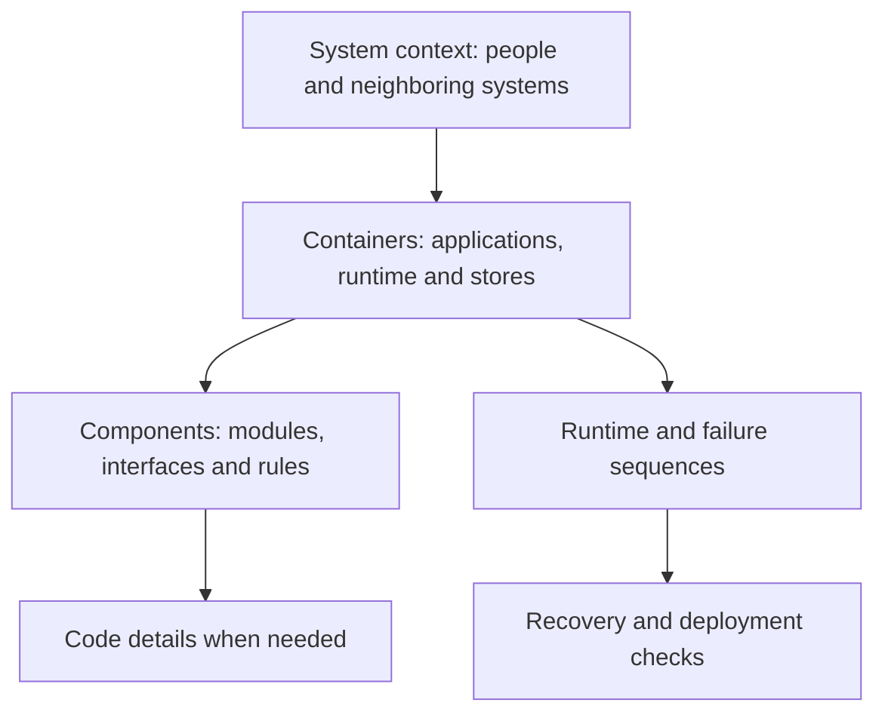

# Views, trade-offs and rejected candidates

**Owning question:** How do the same traffic and different constraints lead to different architecture decisions?

This page belongs to [V01/C03 — Quality attributes and trade-offs](README.md). Use the integrated walkthrough for the surrounding decision; the sections below own this narrower mechanism and its limits.

<!-- tycho-question-source:tycho.page.06b70cb83d4f490ea9ef698a025e7684:3 -->
## 3. Different diagrams answer different questions

A single "architecture diagram" often combines people, components, build modules, Kubernetes pods and database internals into one uninterpretable picture. A reader needs a consistent abstraction level and clearly labelled relationships.

The official **C4 model** introduction distinguishes system context, container, component and code views; its purpose is to progressively show scope and ownership rather than force all levels into one drawing. C4 is **notation- and tooling-independent**; this book uses Mermaid to make these explanations editable and accessible, but a Mermaid flowchart should not be mislabelled a formally complete C4 diagram without respecting the described abstraction. [E03]

| View or question | What it must show | Example omission that misleads |
|---|---|---|
| System context | Actors, external systems and trust/business boundaries | Omitting an external billing/identity dependency while discussing availability |
| Container/deployment | Runtime components, executable ownership, storage and interactions | Conflating a logical module with an independently deployed process |
| Component/module | Internal responsibilities, published interfaces and dependency direction | Showing packages as independent services |
| Runtime/sequence | Request, message, transaction and timeout order | Hiding the ambiguous response after a committed side effect |
| State/data | Authoritative owner, schema/replication and consistency boundary | Drawing a broker queue as the source of truth without justification |
| Failure/recovery | Failure domain, degraded path, cutover, recovery and irreversible states | Showing a successful traffic rollback without data-format compatibility |

Text alternative: progressively zoom from external context to runtime containers, internal components and code. Sequence and recovery diagrams are complementary perspectives on behavior, not replacements for the structural view. This diagram is an original navigation aid; the canonical C4 abstractions come from the cited public model.

### Diagram evidence and accessibility rules

Every useful diagram in Tycho must indicate whether it shows a published mechanism, proposed design or entirely synthetic example; add enough nearby text to explain the path without Mermaid rendering. Cite exact authoritative source sections for real behavior claims. A neat drawing is not proof of feasibility, consistency, capacity or compliance.

Mermaid is a **representation**; a C4-style concept diagram is an **architecture view**. The source-to-claim model and future graphs/index metadata must point to canonical material, not create an alternative undocumented truth about the system.

<!-- /tycho-question-source -->
<!-- tycho-question-source:tycho.page.06b70cb83d4f490ea9ef698a025e7684:4 -->
## 4. Decision cases: same traffic, different constraints

Suppose two wholly fictional registration products each see *offered* 120 requests/s during a peak. That number alone does not select an application style.

- **System A** has a small cohesive team, a stable single local transaction for capacity allocation, infrequent deployment and tight operating budget. A modular monolith with enforced boundaries may be a viable candidate if performance and recovery tests meet its targets.
- **System B** has independent capabilities, different release schedules, separate ownership, tested APIs, mature telemetry and sufficient operational support. A bounded service split might be feasible if downstream state and cross-service failure behavior remain correct.
- **System C** has undocumented shared tables, incompatible clients, unreliable release rollback and no meaningful telemetry. **Insufficient evidence** is the appropriate outcome until its baseline and transition constraints are known.

None of these assertions is a real measured system. They demonstrate why equal arrival rates can coincide with different architectural constraints. Stable process boundaries and consistent transaction semantics often matter more for a decision than headline RPS.

<!-- /tycho-question-source -->
<!-- tycho-question-source:tycho.page.06b70cb83d4f490ea9ef698a025e7684:5 -->
## 5. Quality and evidence review checklist

Before marking an architecture comparison ready for decision support, establish:

- Who approved the user objectives, who owns each constraint and what environment/window it applies to.
- That every scenario specifies eligible inputs and a measurable success or correctness rule.
- That throughput, occupancy, p99, capacity and user counts are not used interchangeably.
- Which constraints are hard gates and which are negotiable preferences.
- A baseline or model with explicit uncertainty, expected failure domains and resource ownership.
- At least one realistically simpler option and the evidence that could reverse the preferred choice.
- Source origin, edition, exact section, review scope and no dependence on uninspected paid content.
- Valid diagrams: named boundaries, direction, assumptions, failure paths and text alternatives.
- A record of automated checks, manual technical review and actual experiments **as separate statuses**.

This creates a reusable method for evaluating architecture patterns, but the complete pattern applicability cards and legacy-specific modernization model are further work. **A method alone is not a populated knowledge base.**

<!-- /tycho-question-source -->

## Navigation, prerequisites and source scope

| Route | Destination |
|---|---|
| Parent and source ledger | [Chapter introduction and exact source rows](README.md#chapter-source-ledger) |
| Previous / prerequisite | [Read preceding context](quality-scenarios.md) |
| Next | [Continue the reasoning](README.md) |
| Integrated question | [Original scenario and limits](quality-drivers-and-architecture-views.md) |

The source material keeps its original published/inferred/synthetic/unverified distinctions. Chapter-wide citations are shared reference context, not proof that every cited source supports every sentence on this page. Freshly inspected text is identified explicitly; absent dates and unknowns are retained.
