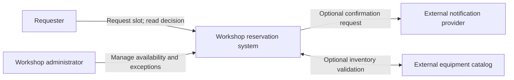

# Problem framing and system boundaries: architecture begins outside the code

> **Tycho V01/C01, original System Design book draft (2026-10-19).** This is a question-led architectural explanation using independently public arc42, C4 and the openly available ISO/IEC/IEEE 42010:2022 abstract. Every example and diagram below is invented. No actual client system, stakeholder interview, verified production boundary or independent architecture assessment is claimed.

## Purpose and mission

Before selecting a database, architecture style or runtime, define **the system whose success will be judged**. A user wants an outcome, not a particular distribution of classes and processes. A software system owns some decisions and persistent effects, delegates others to neighboring services, and depends on actors it cannot directly control. The wrong boundary can turn a local latency, ownership or authorization decision into an unsolvable distributed problem.

The system boundary has two distinct purposes: (1) frame *which user results and correctness invariants* the proposed solution must provide; and (2) establish *which components, interfaces and effects the design team actually controls*. If these disagree, surface the mismatch as a requirement or ownership question. Do not silently make another team's system a component of your proposed service merely because it appears in a dependency diagram.

[arc42 Context and Scope §3](https://docs.arc42.org/section-3/) expressly separates the in-scope system from neighboring users/systems and distinguishes business exchanges from technical channels. The [C4 system context diagram](https://c4model.com/diagrams/system-context) provides a high-level, non-implementation-focused way to show people and directly connected external systems. These published methods guide the diagram, not the facts of our synthetic scenario.

## 1. Begin with observable outcomes

Define the first boundary with a sentence that can be tested:

**Original synthetic system:** a small community workshop accepts reservations for shared equipment. A valid request chooses a timeslot and either creates **one durable accepted reservation** or returns a meaningful rejection. Two accepted reservations must never claim the same exclusive timeslot. An optional confirmation message does not determine whether the booking itself succeeded.

This definition states more than "build a booking microservice": it tells a reviewer what can be correct, what can fail and what must be verified. It does **not** yet specify whether the design is a monolith, a service, a queue, an event-driven architecture or a database engine.

A problem framing record answers:

| Dimension | Concrete design question | What a premature assumption would hide |
|---|---|---|
| Actors | Who initiates, confirms, cancels and administers reservations? | One broad "user" role hides different authorization scopes |
| User journey | What exact externally visible result finishes the operation? | HTTP success may precede durable business success |
| State authority | Which boundary owns exclusive allocation and cancellation? | Two systems could both decide they are authoritative writers |
| Partners | Which external systems are required, optional or unreliable? | An email outage may incorrectly cancel a valid allocation |
| Interface meaning | What requests, outcomes and error/uncertainty states are visible? | A lost reply could result in duplicate allocations |
| Constraints | Which consistency, privacy, cost and availability gates are hard? | Ranking convenience above correctness or authorization |
| Evidence | Which facts are documented, observed, synthetic or still unknown? | An architecture sketch becomes an unearned production assertion |

The [arc42 Introduction and Goals §1](https://docs.arc42.org/section-1/) treats requirements, stakeholders and quality goals as architecture input; measurable scenario details are expanded in [Requirements and workload profiles](../../v10/c01/requirements-and-workload-architecture-profiles.md). A boundary without a named success condition is insufficient to choose a technical solution.

## 2. Separate business context from technical context

A **business context** answers who exchanges what *meaningful information or effect* with the system. A **technical context** answers through which channels or protocols it may be realized. Their boundaries should correspond, but they are not interchangeable.

Original business-level context (illustrative, not a C4-compliant rendering guarantee):

**Text alternative:** the requester creates and checks reservations; an administrator controls availability and exceptional changes. The reservation system is the black box of interest. A notification service and an equipment catalog are external neighbors, and their availability/authority requirements are intentionally left to the contract rather than inferred from drawing an arrow.

A **possible** technical realization could expose HTTP JSON to requesters, use an application client for administrators and integrate notifications through a durable asynchronous connector. That would be a **proposed mapping**, not a fact implied by the business diagram. If business correctness depends on catalog availability, decide whether stale cached catalog data is admissible and how a request behaves when the catalog cannot answer; do not hide the rule behind a line labeled HTTP.

| Business interaction | Required semantic guarantee | Candidate technical contract | Unresolved design choice |
|---|---|---|---|
| Reserve timeslot | At most one accepted owner for an exclusive slot | POST command with scoped operation key, durable transaction | How is commit outcome discovered after lost reply? |
| Query reservation | Return authoritative or clearly qualified state | Authenticated resource read | What freshness and authorization policies apply? |
| Update availability | Administrator-only, auditable transition | Authorized update with concurrency check | Can an in-progress booking conflict with closure? |
| Notify requester | Must not change already committed truth | Outbox-backed dispatch, or other explicit asynchronous workflow | Are duplicates tolerable; is delivery mandatory? |
| Read catalog | Determine equipment compatibility | Read contract with stated freshness/timeout | Is booking permitted during outage? |

The table illustrates an explicit **business-to-technical mapping**. The technical mechanisms belong to their respective canonical chapters: [HTTP/RPC contracts](../../v02/c05/http-rpc-contracts-and-compatibility.md), [transactional outbox](../../../distributed/transactional-outbox-and-idempotency.md), and [authorization boundaries](../../v09/c05/identity-authorization-and-isolation.md).

## 3. Ownership boundaries are not deployment boundaries

A system context diagram says who interacts; it does not prove which processes, repositories, teams or servers implement the behavior. A process boundary is where an application can fail and deploy independently. A **state-authority boundary** is where a business invariant is finally enforced. An **authorization boundary** is where access to that effect must be validated. A **data-exchange boundary** is where a versioned contract must be preserved. These can coincide, but should be modeled separately.

For the fictional reservation system, splitting command ingestion from authoritative slot allocation may be sensible for isolation only if the acceptance contract, duplicate identity and state owner are well defined. Simply naming "Reservation Service" does not eliminate the need for a database consistency model. Conversely, retaining one deployable with strong internal module boundaries can satisfy the user-visible contract while avoiding needless distributed failure modes.

The [C4 software-system abstraction](https://c4model.com/abstractions/software-system) emphasizes value delivered to users, rather than equating a system with any particular individual deployable. Domain capabilities, modules, runtime units and software systems should not be treated as interchangeable names. For implementation choices, use [Application styles and ownership](../../../application/architecture-styles-and-module-boundaries.md), not the introductory context diagram alone.

## 4. Track neighbors with real failure and trust semantics

External systems are outside the team's direct control, even when owned by a friendly organization or accessed on the same private network. Every external edge needs a small contract:

- Purpose, actor and direction of the exchanged effect or data.
- Which side owns identity, authorization and authoritative state.
- Protocol/version/freshness expectations only when technical realization is selected.
- Unavailable/slow/error/timeout behavior, including ambiguous acknowledgment.
- Operational owner, escalation path and version/deprecation window.
- Security/privacy classification and explicitly allowed data exchange.
- Required observability and evidence scope (documented, observed, assumed).

**Failure scenario (fully synthetic):** the external notification provider times out after reservation commit. A flawed design rolls back or retries the whole reservation to "make sure the email went out." The design then violates the intended independence of the authoritative allocation decision and communication delivery. Instead, define a durable record of the accepted allocation; separately track a bounded notification outcome and its retry policy. This is a conditional architectural recommendation under the fictional contract, not a measured incident.

**Counterexample:** if the actual product requirement is "an external licensing authority must approve a reservation before it is accepted," that authority is on the mandatory business critical path. The safe design cannot simply mark licensing "optional" to remove latency. Under unknown authority/availability guarantees, the honest outcome is insufficient evidence and a stakeholder/contract decision.

## 5. Problem framing produces explicit unknowns

A good architecture description does not erase uncertainty to improve the diagram's appearance. Use a boundary register:

| Open question | Why it changes architecture | Evidence or experiment needed |
|---|---|---|
| Can reservations complete without catalog availability? | Defines whether catalog is a mandatory critical dependency | Signed behavior contract and offline/outage test |
| How long may a requester await final confirmation? | Determines synchronous versus accepted/pending lifecycle | User-journey requirement and latency observation window |
| Does an expired timeslot automatically cancel an accepted booking? | Determines state machine and authority of time-based transitions | Domain rule and race-condition test |
| Must notifications be exactly one? | Changes side-effect identity, acknowledgment and delivery choices | Business consequence and provider failure contract |
| May older clients continue writing after interface evolution? | Requires mixed-version and stored-data compatibility | Client inventory, version/deprecation tests |
| Who can see another requester's booking? | Enforces authorization and privacy boundaries | Object-level permission policy and negative tests |

A missing item is marked **unknown**, not silently assigned a convenient default. The [ISO/IEC/IEEE 42010:2022 public abstract](https://www.iso.org/standard/74393.html) distinguishes an architecture from its *architecture description* and explicitly addresses architectural viewpoints and stakeholders. The entire 62-page ISO standard was **not obtained or read** for this chapter; no conformance to ISO 42010 is claimed.

## 6. Validate the problem boundary before scaling the design

A bounded review should verify:

1. **Completeness of partners:** can every required input/output be attributed to a known actor or external system, without putting an external platform inside the team-owned boundary?
2. **User-visible meaning:** can stakeholders state the accepted, rejected, pending and unknown outcomes without referencing implementation classes?
3. **State ownership:** is there exactly one authority (or an explicitly coordinated model) for each invariant?
4. **Trust boundaries:** which caller may request each effect, and where does enforcement happen?
5. **Failure semantics:** what happens when each neighbor fails before commit, after commit or during recovery?
6. **Changeability:** which contracts must coexist across independently controlled releases?
7. **Evidence boundaries:** which claims are confirmed by public specification, hypothetical stakeholder input, test or runtime observation?

If a context diagram is too detailed for a domain stakeholder to explain the outcome, move implementation internals to a component/runtime/deployment view. If too vague to identify critical external interfaces, supplement it with the business/technical exchange table rather than inventing additional service boxes. The C4 and arc42 source materials support focusing context diagrams on externally meaningful relationships and communicating with both technical and nontechnical readers.

## 7. Worked decision: what we can choose now

**Provisional conclusion for the fictional reservation system:** implement a single-authority exclusive allocation boundary; define durable command identity and a status read; keep optional notification failures outside the committed booking outcome. These are **contract choices** only, not a declaration that the final solution must be a modular monolith, SQL database, Kafka stream or cloud-native cluster.

**Not yet justified:** microservice extraction, distributed transactions, global event sourcing, multiple writers or immediate sharding. Their benefits and contraindications depend on workload, independently deployable domain ownership and failure/recovery requirements absent from the scenario.

**Falsifying test:** two clients concurrently request the last slot; the response to the winner is dropped; both retry; notification service is unavailable. The defined system must retain exactly one accepted owner, provide stable final outcomes without unauthorized access and represent notification delay independently. This is a **proposed test**, not an executed result.

That bounded problem definition is a usable input to the later [architecture decision profiles](../../v10/c01/requirements-and-workload-architecture-profiles.md), [pattern applicability](../../v10/c03/pattern-applicability-and-contraindications.md) and [cross-domain ADR examples](../../v10/c07/cross-domain-modernization-and-adr-examples.md).

## 8. Public evidence and review limitations

| Public source inspected | Supports | Does not establish |
|---|---|---|
| [arc42 §3 — Context and Scope](https://docs.arc42.org/section-3/) | System scope, external partners/interfaces; business vs technical contexts | The fictional system's real contracts or owners |
| [arc42 §1 — Introduction and Goals](https://docs.arc42.org/section-1/) | Stakeholders, requirements and quality goals as architecture input | Measured quality attributes or stakeholder approval |
| [C4 — System Context Diagram](https://c4model.com/diagrams/system-context) | Black-box context, people and external software systems | A specific deployment or access-control design |
| [C4 — Software System](https://c4model.com/abstractions/software-system) | Software system as an abstraction delivering value | Universal organization ownership or a runtime boundary |
| [ISO/IEC/IEEE 42010:2022 — public abstract only](https://www.iso.org/standard/74393.html) | Architecture description scope and distinction from architecture itself | Full-text standards compliance; the full text was not read |

The booking application, all data flows, errors, tables, decision alternatives and illustrations are original synthetic educational material. No external proprietary material was copied. Independent editorial/source verification, stakeholder interviews, runtime tests, user-journey metrics and complete edition assembly remain unperformed.

## Engineering walkthrough — Third-party outage exposes a missing system boundary

**Original fictional walkthrough.** A booking UI accepts a reservation; an external identity provider established a session earlier, a separate payment provider authorizes a deposit, and the authoritative booking database commits the resource allocation. A context diagram that shows only the UI and database incorrectly hides the two external dependencies and their differing trust domains.

| Boundary | Normal contract | Partial failure and who owns the next action |
|---|---|---|
| Browser → booking API | User identity, scoped operation ID and deadline | Client may retry only against the *same* logical intent; server owns durable outcome lookup |
| API → identity provider | Verify identity/token under documented trust policy | If verification cannot be established, reject rather than infer a valid identity from a cached UI label |
| API → payment provider | External authorization result with a separate key | Timeout may mean authorized-but-unacknowledged; payment reconciliation is owned by the payment integration, not the booking database |
| API → booking state authority | Atomically enforce exclusive allocation | A committed booking remains committed even if the response path fails |

The context **excludes** the provider's internal ledger, other tenants' identity stores and unrelated notification systems from the booking application's direct control. It does **not** exclude their failure modes from the user journey. During a payment outage the system can refuse new bookings, or move into an explicitly designed pending-reservation flow—but cannot silently claim all effects committed. A requirement that deposits must precede allocation changes the order; that is a stakeholder decision, not an automatic consequence of drawing more boxes.

**Reversal test (proposed, not run):** sever payment acknowledgments after authorization, then inspect who can query payment and booking results; compare this with identity-provider unavailability. C4/arc42 context descriptions support the *kind* of boundary modeled, not the fictional external services' actual contracts.

## Navigation

- Intended canonical owner: **V01/C01** in [Tycho's planned contents](../../../PROPOSED-STRUCTURE.md); current [application/foundations landing](../../../application/README.md).
- Continue with [Quality attributes and views](../c03/quality-drivers-and-architecture-views.md); [Architecture styles](../../../application/architecture-styles-and-module-boundaries.md); [Requirements/workload](../../v10/c01/requirements-and-workload-architecture-profiles.md).
- Failure mechanics: [HTTP/RPC compatibility](../../v02/c05/http-rpc-contracts-and-compatibility.md), [Outbox](../../../distributed/transactional-outbox-and-idempotency.md), [Authorization](../../v09/c05/identity-authorization-and-isolation.md).

<!-- tycho-edition-navigation -->

## Edition navigation and evidence scope

| Route | Destination |
|---|---|
| Parent chapter | [Question, conclusions and reading route](README.md) |
| Parent volume | [Volume synthesis](../README.md) |
| Book | [Authoritative contents](../../../README.md) |
| Source versions and access scope | [Registered sources](../../../../sources/README.md) and the exact page-local citation ledger above |

The original manuscript was accepted under #213 at the recorded baseline. Earlier draft/review labels describe historical authoring events. Source access, versions, unexecuted experiments and nonclaims retain their original scope; assembly does not assert a new source read or benchmark. The chapter landing adds editorial synthesis and navigation.
