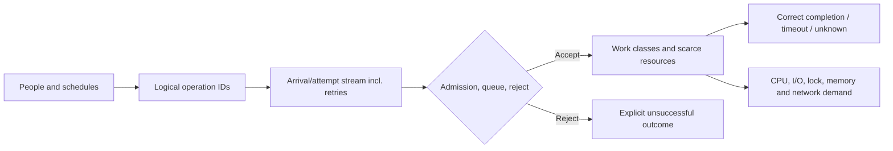

# Demand arithmetic and skew

**Owning question:** What does a demand estimate conceal about operation mix, bursts and hot keys?

This page belongs to [V01/C02 — Workload and demand models](README.md). Use the integrated walkthrough for the surrounding decision; the sections below own this narrower mechanism and its limits.

<!-- tycho-question-source:tycho.page.fdb4ef7f69154f8c8c433591f71494f9:3 -->
## 3. Original example: two identical account counts, different costs

Invent two standalone educational scenarios, both with **12,000 registered accounts**:

**Case A — reading lists:** in a fictional hour, 600 users read static public descriptions, mostly without writing. Suppose a synthetic schedule produces 3,000 read operations spread fairly evenly and 50 small writes. The derived mean is 3,050/3,600 ≈ **0.85 operations/s** for that hour. That does not predict p99 or the busiest ten seconds.

**Case B — short publication window:** suppose 1,800 attempts arrive in one 15-second window to claim access to the same small set of unique resources. The derived offered rate in that interval is **120 attempts/s**, but completed successful unique claims can be far lower if key contention and duplicate retries dominate. The two systems have the same number of accounts but incomparable peaks and synchronization costs.

These numbers are **fictional assumptions and elementary arithmetic**. They are not survey data and do not recommend any particular technology. The relevant question is which state/resource boundary must process the work, not whether one scenario earns the label “high traffic”.

**Text alternative:** user behavior generates logical intents and attempts; retries may multiply attempts. Admission separates rejected from accepted work, after which processing consumes different resources. Completion and resource cost must both be measured. The graph is a model, not a deployed architecture or manually curated knowledge graph.

<!-- /tycho-question-source -->
<!-- tycho-question-source:tycho.page.fdb4ef7f69154f8c8c433591f71494f9:4 -->
## 4. Simple demand arithmetic and its boundaries

At a steady compatible boundary, completed average throughput λ and average time W spent resident inside it relate to average occupancy L by **L = λW**. This does **not** say that adding concurrency increases useful throughput, or that one p99 value may replace W. If λ represents only successful completed operations while long-running/rejected work is excluded, the measured boundary may no longer satisfy the accounting assumptions. See the canonical [queueing page](../../v07/c01/queueing-littles-law.md) for the precise limitations.

For a hypothetical request mix, suppose:
- 70% small metadata reads at *assumed* mean CPU demand 2 ms;
- 20% object reads at 7 ms;
- 10% writes at 15 ms.

Expected CPU demand under that **illustrative** mix is 0.7×2 + 0.2×7 + 0.1×15 = **4.3 ms of CPU per operation**. At 100 completed operations/s, this would require about **430 ms CPU/s** if those demands are stable and perfectly accounted, before overhead or contention. It does *not* mean a quarter/half core is universally sufficient; I/O, locks, pauses, scheduler overhead, burst, hardware and other work can dominate.

A workload model should explicitly mark whether an operation's “service time” is **CPU time**, wall time, DB execution, queue wait or a distribution derived from measurements. Adding unrelated quantities into a single demand average invites incorrect capacity planning.

<!-- /tycho-question-source -->
<!-- tycho-question-source:tycho.page.fdb4ef7f69154f8c8c433591f71494f9:5 -->
## 5. Distribution and correlation matter

Suppose read latency is bimodal—many requests hit a cache, a small fraction miss and perform costly database work. An average hides the parent tail and the backend's miss-driven peak. Alternatively, all writes may target one popular resource and serialize despite spare average CPU capacity.

Record joint information when it changes the decision: operation type *by key skew*, request bytes *by tenant*, retries *by failure class*, cache misses *by dependency*, peak arrivals *by time window*. A single global request histogram is not a substitute for such conditional samples.

**Synthetic counterexample:** a load test chooses keys uniformly while real hypothetical users overwhelmingly request the newest published item. The system appears to scale with additional app replicas in the synthetic test, but the real hot key remains serialized in an authoritative datastore. The correct next step is a representative skewed-key experiment, not a stronger extrapolation from the uniform result.

The [Tycho sharding and hot-key explanation](../../v05/c05/shard-keys-hotspots-and-resharding.md) owns partitioning consequences. [Autoscaling lag](../../v07/c06/autoscaling-lag-and-capacity-limits.md) owns the controller startup delay that makes short bursts especially difficult.

<!-- /tycho-question-source -->

## Navigation, prerequisites and source scope

| Route | Destination |
|---|---|
| Parent and source ledger | [Chapter introduction and exact source rows](README.md#chapter-source-ledger) |
| Previous / prerequisite | [Read preceding context](arrivals-population.md) |
| Next | [Continue the reasoning](workload-contract.md) |
| Integrated question | [Original scenario and limits](workload-demand-and-arrival-models.md) |

The source material keeps its original published/inferred/synthetic/unverified distinctions. Chapter-wide citations are shared reference context, not proof that every cited source supports every sentence on this page. Freshly inspected text is identified explicitly; absent dates and unknowns are retained.
