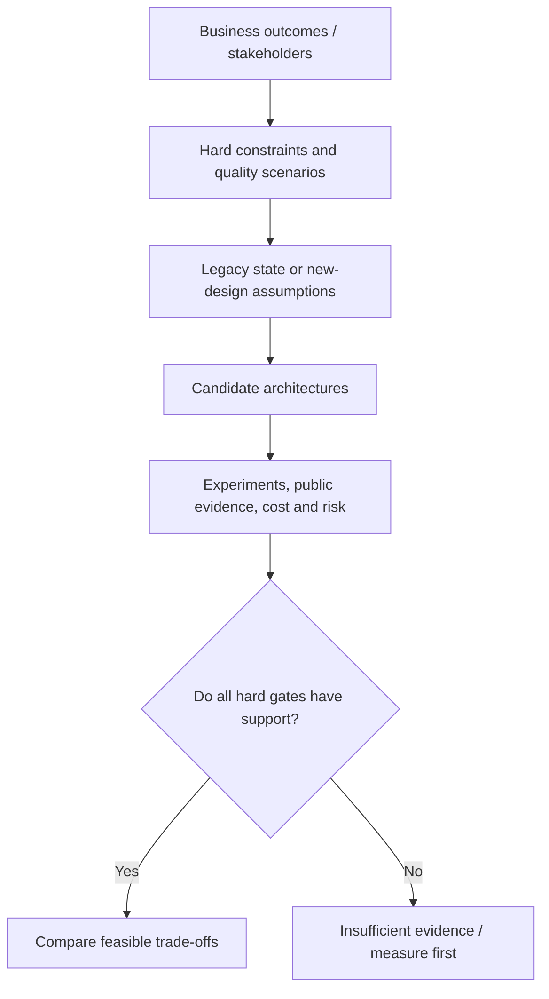
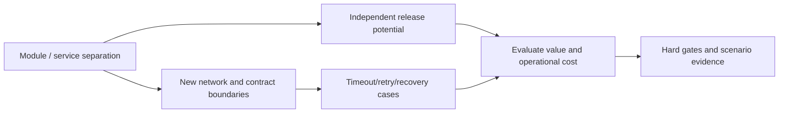
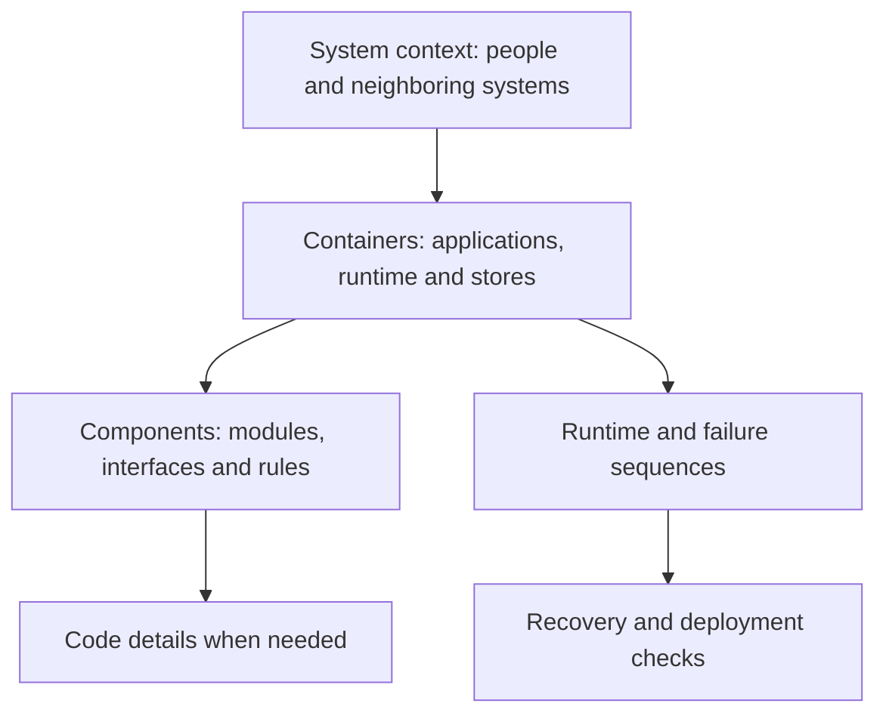

# Architecture drivers, quality scenarios and readable system views

> Tycho foundational technical page for [Issue #79](https://github.com/rouslanbaranov/tycho/issues/79), proposed V01/C01–C05. Public reference reading: **2026-10-18**. Original teaching examples only; no approved stakeholder objectives, load measurements, production system or independent expert review.

## Purpose and mission

Architectural styles are **candidate means**, not ends. Before recommending a monolith, a microservice boundary, a queue, a particular database or multiple regions, an architect must know what users need to accomplish, which outcomes are mandatory, what qualities must hold under defined conditions, and what evidence would demonstrate success.

This page connects measurable architecture drivers to technical views. It is complementary to the [reusable requirements/workload profile](../../../../authoring/models/requirements-workload-profile.md), the [module/service styles](../../../application/architecture-styles-and-module-boundaries.md) and the [evolution and extraction guide](../../../application/architecture-evolution-and-extraction.md).

## 1. Name the decision before selecting a style

A useful input to architecture analysis separates at least five aspects:

1. **Business outcome:** what a user or operator must accomplish, with observable success.
2. **Hard gate:** a mandatory security, integrity, legal, economic or operational condition that rejects a demonstrably unsuitable candidate.
3. **Quality scenario:** a specified stimulus and environment leading to an expected response measured against a defined threshold.
4. **Preference:** an advantage to compare *among* viable candidates, rather than an excuse to ignore a hard gate.
5. **Uncertainty:** a fact not established by sources, modeling or measurement, with an experiment or inspection task attached.

The public **arc42 Introduction and Goals** §1.1 distinguishes essential requirements/drivers from full requirements sources; §1.2 asks for the highest-priority **architecture quality goals**, concretized as scenarios rather than vague adjectives; §1.3 names stakeholders and expectations. The framework does not prescribe whether those goals require one process or many. [E01]

Text alternative: establish user outcomes, hard constraints, scenarios and existing evidence before listing architectures. Compare only options that meet demonstrable hard gates; missing decisive evidence sends the question back to measurement or source review. This is an original reasoning map.

## 2. Quality-attribute scenarios must be testable

A statement such as "the service must be scalable and highly available" is not a verification criterion. A useful scenario defines a **source/stimulus**, **environment**, **affected boundary**, **system response** and **quantitative measure**, including exclusions, observation window, ownership and whether the number is a requirement, estimate or observed fact.

The following examples are **invented** for a hypothetical workshop registration system; none is approved or achieved:

| Scenario | Stimulus/environment | Intended response and measure | Decision significance |
|---|---|---|---|
| Q-PERF | During 20-minute assumed peak, visitors browse at an **offered** 120 API requests/s with a specified route mix | Proposed browse SLO: at least 99% of *eligible* operations complete successfully in ≤500 ms, measured at edge over a stated window | A candidate must be load-tested under the same generator/mix |
| Q-INTEGRITY | Two visitors concurrently request the last remaining seat | No more than capacity-confirmed seats; duplicate request key must not create two logical registrations | An invariant hard gate, **not** a 99% SLO |
| Q-RECOVERY | One application instance stops while admitted requests exist | User outcomes remain defined; restore nominal service within **proposed** 10 minutes | Requires a failure-domain and recovery test, not only replica readiness |
| Q-CHANGE | Organizer requests a catalog-only business change | Candidate preference: release catalog behavior without unrelated registration data migration | Supports comparison of modularity/deployment alternatives, not a mandatory service split |
| Q-COST | Typical and peak demand over a budget horizon | Proposed total-cost ceiling with a list of included operational expenses | Reject a design above a real approved hard cost cap, not a toy estimate |

Do not mix a proposed reliability target with an achieved result. For service-level objectives, the public **Google Site Reliability Workbook**, Chapter 2, *Implementing SLOs*, explicitly distinguishes indicators/objectives from actual decision processes and demands agreement on SLO meaning and scope. It is about a user's experience, not a success check for every individual pod or container. [E02]

### A design can improve one quality and weaken another

A separation of registration into an independent service might reduce release coordination but increase network failure modes and make cross-domain consistency harder. A modular monolith might preserve a useful local transaction but force whole-artifact deployment. Both could satisfy the hard business invariant; **the burden is to test each proposal under declared conditions**.

Text alternative: separation may enable independent release but also introduces new communication boundaries, error modes and operating costs. Both effects must be assessed against stated user quality scenarios and invariants; no arrow means automatically better.

## 3. Different diagrams answer different questions

A single "architecture diagram" often combines people, components, build modules, Kubernetes pods and database internals into one uninterpretable picture. A reader needs a consistent abstraction level and clearly labelled relationships.

The official **C4 model** introduction distinguishes system context, container, component and code views; its purpose is to progressively show scope and ownership rather than force all levels into one drawing. C4 is **notation- and tooling-independent**; this book uses Mermaid to make these explanations editable and accessible, but a Mermaid flowchart should not be mislabelled a formally complete C4 diagram without respecting the described abstraction. [E03]

| View or question | What it must show | Example omission that misleads |
|---|---|---|
| System context | Actors, external systems and trust/business boundaries | Omitting an external billing/identity dependency while discussing availability |
| Container/deployment | Runtime components, executable ownership, storage and interactions | Conflating a logical module with an independently deployed process |
| Component/module | Internal responsibilities, published interfaces and dependency direction | Showing packages as independent services |
| Runtime/sequence | Request, message, transaction and timeout order | Hiding the ambiguous response after a committed side effect |
| State/data | Authoritative owner, schema/replication and consistency boundary | Drawing a broker queue as the source of truth without justification |
| Failure/recovery | Failure domain, degraded path, cutover, recovery and irreversible states | Showing a successful traffic rollback without data-format compatibility |

Text alternative: progressively zoom from external context to runtime containers, internal components and code. Sequence and recovery diagrams are complementary perspectives on behavior, not replacements for the structural view. This diagram is an original navigation aid; the canonical C4 abstractions come from the cited public model.

### Diagram evidence and accessibility rules

Every useful diagram in Tycho must indicate whether it shows a published mechanism, proposed design or entirely synthetic example; add enough nearby text to explain the path without Mermaid rendering. Cite exact authoritative source sections for real behavior claims. A neat drawing is not proof of feasibility, consistency, capacity or compliance.

Mermaid is a **representation**; a C4-style concept diagram is an **architecture view**. The source-to-claim model and future graphs/index metadata must point to canonical material, not create an alternative undocumented truth about the system.

## 4. Decision cases: same traffic, different constraints

Suppose two wholly fictional registration products each see *offered* 120 requests/s during a peak. That number alone does not select an application style.

- **System A** has a small cohesive team, a stable single local transaction for capacity allocation, infrequent deployment and tight operating budget. A modular monolith with enforced boundaries may be a viable candidate if performance and recovery tests meet its targets.
- **System B** has independent capabilities, different release schedules, separate ownership, tested APIs, mature telemetry and sufficient operational support. A bounded service split might be feasible if downstream state and cross-service failure behavior remain correct.
- **System C** has undocumented shared tables, incompatible clients, unreliable release rollback and no meaningful telemetry. **Insufficient evidence** is the appropriate outcome until its baseline and transition constraints are known.

None of these assertions is a real measured system. They demonstrate why equal arrival rates can coincide with different architectural constraints. Stable process boundaries and consistent transaction semantics often matter more for a decision than headline RPS.

## 5. Quality and evidence review checklist

Before marking an architecture comparison ready for decision support, establish:

- Who approved the user objectives, who owns each constraint and what environment/window it applies to.
- That every scenario specifies eligible inputs and a measurable success or correctness rule.
- That throughput, occupancy, p99, capacity and user counts are not used interchangeably.
- Which constraints are hard gates and which are negotiable preferences.
- A baseline or model with explicit uncertainty, expected failure domains and resource ownership.
- At least one realistically simpler option and the evidence that could reverse the preferred choice.
- Source origin, edition, exact section, review scope and no dependence on uninspected paid content.
- Valid diagrams: named boundaries, direction, assumptions, failure paths and text alternatives.
- A record of automated checks, manual technical review and actual experiments **as separate statuses**.

This creates a reusable method for evaluating architecture patterns, but the complete pattern applicability cards and legacy-specific modernization model are further work. **A method alone is not a populated knowledge base.**

## Engineering walkthrough — An apparently faster architecture that fails a hard invariant

**Original synthetic decision:** product leadership asks for a booking confirmation within 300 ms for 99% of accepted requests; operations can tolerate a clearly signaled temporary refusal during a dependency incident; the resource owner requires **no double-confirmed exclusive booking**. These are assumed requirements, not observed SLO achievement. Evaluate a read-cache-first design against direct authoritative transactions and a queued confirmation flow.

| Candidate | Hypothetical latency strength | Business and failure constraint | Verdict |
|---|---|---|---|
| Cache says seat free; asynchronously writes allocation | Very fast speculative response | Two concurrent clients may both receive success before serialization | **Reject** despite best headline latency |
| Authoritative transaction, bounded ingress | Confirmation after durable invariant check | Fail/reject when unavailable; exposes limited acceptance throughput | Conditionally feasible if measured latency passes |
| Durable queue returns pending immediately | Quick acknowledgement of receipt | Does not meet a requirement for *final* confirmation within 300 ms | Feasible only after renegotiating user semantics |

Availability, latency, correctness and operating cost cannot be compressed into one scalar without first defining whose outcome each measures. The stakeholder may prefer a quick *pending* receipt, but a pending receipt cannot be counted as a confirmed booking for the SLI. The decision record must identify the release cohort, sample exclusions, rejected requests and measurable restoration objective.

**Decision-reversal evidence:** measure genuine offered load, confirmed outcomes under hot-key contention, and behavior after an acknowledgment is lost. If the confirmation requirement changes to accepted-into-workflow, the queue becomes a legitimate candidate; if strict final confirmation is retained, it is not equivalent. No technology deployment or production measurement was performed.

**Verification status:** The preceding original example and its predicted outcomes are synthetic. No implementation experiment, benchmark or independent technical review was executed for this example.
## Sources, scope and known limitations

| Evidence | Public source and precise read scope | Supports / limits |
|---|---|---|
| E01 | [arc42, Section 1: Introduction and Goals](https://docs.arc42.org/section-1/), §§1.1 Requirements Overview, 1.2 Quality Goals and 1.3 Stakeholder, inspected 2026-10-18 | Prioritized architecture quality drivers and stakeholder/requirement framing, not a technology selection algorithm |
| E02 | [The Site Reliability Workbook, Chapter 2: Implementing SLOs](https://sre.google/workbook/implementing-slos/), sections *Why SREs Need SLOs* and *Getting Started*, inspected 2026-10-18 | Agreed user-oriented objectives and evidence-driven reliability decisions; no achieved SLO for these fictional cases |
| E03 | [C4 Model by Simon Brown, Introduction](https://c4model.com/introduction), inspected 2026-10-18 | Progressive context/container/component/code and supporting dynamic/deployment perspectives; not a fixed Mermaid syntax |
| E04 | [Lewis & Fowler, Microservices](https://martinfowler.com/articles/microservices.html), 2014, *Componentization via Services* and *Design for failure* | Costs and characteristics of service-based boundary decisions; descriptive, not a proof of optimality |

**Review state:** public-source-bounded explanation and author self-check, no independent human review, no real product requirements approval and no executed scenario. Full ISO quality models, comprehensive standards taxonomy and measurable product comparisons are not claimed researched.

**Explicit unanswerable example:** "Can we safely promise 99.99% availability with two containers and an existing database?" No answer without eligible good-event definition, dependency failure domains, data recovery path, traffic patterns, capacity under failure and demonstration that those mechanisms can meet the proposed objective.

<!-- tycho-edition-navigation -->

## Edition navigation and evidence scope

| Route | Destination |
|---|---|
| Parent chapter | [Question, conclusions and reading route](README.md) |
| Parent volume | [Volume synthesis](../README.md) |
| Book | [Authoritative contents](../../../README.md) |
| Source versions and access scope | [Registered sources](../../../../sources/README.md) and the exact page-local citation ledger above |

The original manuscript was accepted under #213 at the recorded baseline. Earlier draft/review labels describe historical authoring events. Source access, versions, unexecuted experiments and nonclaims retain their original scope; assembly does not assert a new source read or benchmark. The chapter landing adds editorial synthesis and navigation.
