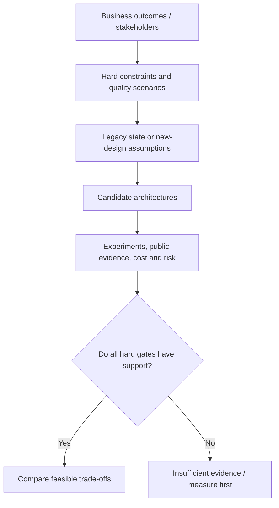
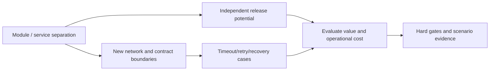

# Hard gates and measurable quality scenarios

**Owning question:** How is a quality preference converted into a testable acceptance condition?

This page belongs to [V01/C03 — Quality attributes and trade-offs](README.md). Use the integrated walkthrough for the surrounding decision; the sections below own this narrower mechanism and its limits.

<!-- tycho-question-source:tycho.page.06b70cb83d4f490ea9ef698a025e7684:1 -->
## 1. Name the decision before selecting a style

A useful input to architecture analysis separates at least five aspects:

1. **Business outcome:** what a user or operator must accomplish, with observable success.
2. **Hard gate:** a mandatory security, integrity, legal, economic or operational condition that rejects a demonstrably unsuitable candidate.
3. **Quality scenario:** a specified stimulus and environment leading to an expected response measured against a defined threshold.
4. **Preference:** an advantage to compare *among* viable candidates, rather than an excuse to ignore a hard gate.
5. **Uncertainty:** a fact not established by sources, modeling or measurement, with an experiment or inspection task attached.

The public **arc42 Introduction and Goals** §1.1 distinguishes essential requirements/drivers from full requirements sources; §1.2 asks for the highest-priority **architecture quality goals**, concretized as scenarios rather than vague adjectives; §1.3 names stakeholders and expectations. The framework does not prescribe whether those goals require one process or many. [E01]

Text alternative: establish user outcomes, hard constraints, scenarios and existing evidence before listing architectures. Compare only options that meet demonstrable hard gates; missing decisive evidence sends the question back to measurement or source review. This is an original reasoning map.

<!-- /tycho-question-source -->
<!-- tycho-question-source:tycho.page.06b70cb83d4f490ea9ef698a025e7684:2 -->
## 2. Quality-attribute scenarios must be testable

A statement such as "the service must be scalable and highly available" is not a verification criterion. A useful scenario defines a **source/stimulus**, **environment**, **affected boundary**, **system response** and **quantitative measure**, including exclusions, observation window, ownership and whether the number is a requirement, estimate or observed fact.

The following examples are **invented** for a hypothetical workshop registration system; none is approved or achieved:

| Scenario | Stimulus/environment | Intended response and measure | Decision significance |
|---|---|---|---|
| Q-PERF | During 20-minute assumed peak, visitors browse at an **offered** 120 API requests/s with a specified route mix | Proposed browse SLO: at least 99% of *eligible* operations complete successfully in ≤500 ms, measured at edge over a stated window | A candidate must be load-tested under the same generator/mix |
| Q-INTEGRITY | Two visitors concurrently request the last remaining seat | No more than capacity-confirmed seats; duplicate request key must not create two logical registrations | An invariant hard gate, **not** a 99% SLO |
| Q-RECOVERY | One application instance stops while admitted requests exist | User outcomes remain defined; restore nominal service within **proposed** 10 minutes | Requires a failure-domain and recovery test, not only replica readiness |
| Q-CHANGE | Organizer requests a catalog-only business change | Candidate preference: release catalog behavior without unrelated registration data migration | Supports comparison of modularity/deployment alternatives, not a mandatory service split |
| Q-COST | Typical and peak demand over a budget horizon | Proposed total-cost ceiling with a list of included operational expenses | Reject a design above a real approved hard cost cap, not a toy estimate |

Do not mix a proposed reliability target with an achieved result. For service-level objectives, the public **Google Site Reliability Workbook**, Chapter 2, *Implementing SLOs*, explicitly distinguishes indicators/objectives from actual decision processes and demands agreement on SLO meaning and scope. It is about a user's experience, not a success check for every individual pod or container. [E02]

### A design can improve one quality and weaken another

A separation of registration into an independent service might reduce release coordination but increase network failure modes and make cross-domain consistency harder. A modular monolith might preserve a useful local transaction but force whole-artifact deployment. Both could satisfy the hard business invariant; **the burden is to test each proposal under declared conditions**.

Text alternative: separation may enable independent release but also introduces new communication boundaries, error modes and operating costs. Both effects must be assessed against stated user quality scenarios and invariants; no arrow means automatically better.

<!-- /tycho-question-source -->

## Navigation, prerequisites and source scope

| Route | Destination |
|---|---|
| Parent and source ledger | [Chapter introduction and exact source rows](README.md#chapter-source-ledger) |
| Previous / prerequisite | [Read preceding context](quality-drivers-and-architecture-views.md) |
| Next | [Continue the reasoning](views-tradeoffs.md) |
| Integrated question | [Original scenario and limits](quality-drivers-and-architecture-views.md) |

The source material keeps its original published/inferred/synthetic/unverified distinctions. Chapter-wide citations are shared reference context, not proof that every cited source supports every sentence on this page. Freshly inspected text is identified explicitly; absent dates and unknowns are retained.
