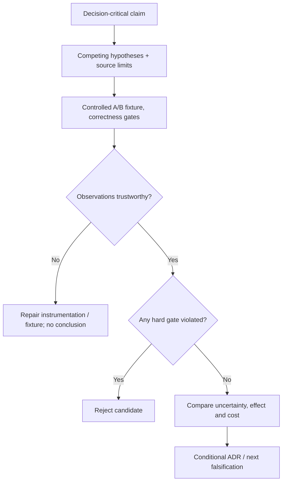

# Discriminating architecture experiments

**Owning question:** What observation would distinguish cache benefit from query repair?

This page belongs to [V01/C04 — Evidence, hypotheses and architecture experiments](README.md). Use the integrated walkthrough for the surrounding decision; the sections below own this narrower mechanism and its limits.

<!-- tycho-question-source:tycho.page.a2cd4465792a4740aa5150ad248fd420:3 -->
## 3. Define the experiment contract before the result

Write this in advance:

1. **Claim:** under scenario X, change Y improves user-visible metric Z without violating invariants.
2. **Boundary:** where the clock starts, what counts as a logical request, and which system/resources are included.
3. **Alternatives:** unchanged or smallest-safe baseline and a materially distinct candidate.
4. **Workload:** source/version of input trace, arrival schedule, key skew, old/new client mix and dataset.
5. **Hard gates:** permissions, correctness, durable state, compatibility and recovery.
6. **Expected signature:** which metric should change if the hypothesis is true and which independent metric would contradict it.
7. **Repetition and uncertainty:** trials, warm/cold state, random order, noise and acceptable range; disclose limitations.
8. **Abort and rollback:** conditions where proceeding could cause unsafe outcomes.
9. **Evidence record:** exact tool versions/configuration, raw observations, analysis scripts, failed checks and independent review status.

Pre-registering a decision criterion avoids adjusting the threshold until a preferred candidate wins. It does not make a weak benchmark scientifically valid; the fixture still needs representative, accurately observed demand and correctness.

<!-- /tycho-question-source -->
<!-- tycho-question-source:tycho.page.a2cd4465792a4740aa5150ad248fd420:4 -->
## 4. A worked fictional experiment: cache versus query repair

The trail directory considers two hypothetical changes:

- **Candidate A:** fix a measured missing index or query plan if H1 is supported.
- **Candidate B:** introduce a read-through cache with defined TTL/invalidation if read repetition and acceptable staleness are established.

Control the same dataset, actual offered query schedule, permissions, node/DB resource ceilings and cache warm/cold state. Report success, errors, p95/p99, DB work, cache hit/miss, stale results and cost, not only latency of completed requests.

A valid negative test changes the underlying trail closure and queries immediately after. If a cache serves unsafe outdated closure information while the contract requires current data, candidate B **fails a hard correctness gate** regardless of latency gains. This failure is expected to be observable even without a high-load test.

Text alternative: define the claim and rival explanations before running controlled experiments. Verify denominator and setup first, reject any correctness violation, then compare only candidates that pass. If evidence is inadequate, repair the experiment rather than select the preferred pattern.

<!-- /tycho-question-source -->

## Navigation, prerequisites and source scope

| Route | Destination |
|---|---|
| Parent and source ledger | [Chapter introduction and exact source rows](README.md#chapter-source-ledger) |
| Previous / prerequisite | [Read preceding context](evidence-hypotheses.md) |
| Next | [Continue the reasoning](negative-results.md) |
| Integrated question | [Original scenario and limits](architecture-evidence-hypotheses-and-experiments.md) |

The source material keeps its original published/inferred/synthetic/unverified distinctions. Chapter-wide citations are shared reference context, not proof that every cited source supports every sentence on this page. Freshly inspected text is identified explicitly; absent dates and unknowns are retained.
