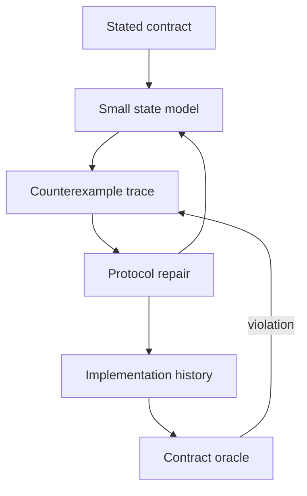

---
{
  "metadata_version": 1,
  "id": "tycho.page.ac84c140be153d3b1f5752ffbd38cb5b",
  "kind": "page",
  "parent_id": "tycho.chapter.ee2cd95003ab4018a9d49e2ff0b6b2f4",
  "canonical_path": "book/volumes/v01/c04/protocol-correctness.md",
  "title": "Distributed protocol verification",
  "topic_ids": [
    "application-architecture"
  ],
  "perspectives": [
    "architecture",
    "evaluation",
    "operations"
  ],
  "summary": "How can histories, invariants and executable models expose a distributed correctness defect?",
  "route_hints": {
    "questions": [
      "How can histories, invariants and executable models expose a distributed correctness defect?"
    ],
    "prerequisites": [],
    "related_ids": [
      "tycho.chapter.ee2cd95003ab4018a9d49e2ff0b6b2f4"
    ],
    "excludes": [
      "Original synthetic designs and proposed checks; no executed product experiment or independent acceptance."
    ],
    "keywords": [
      "distributed",
      "protocol",
      "verification",
      "histories",
      "invariants",
      "executable",
      "models",
      "expose",
      "correctness",
      "defect"
    ]
  },
  "evidence_scope": {
    "source_ids": [
      "src.jepsen-session-models",
      "src.fdb-simulation",
      "src.tla"
    ],
    "claim_ids": [],
    "status": "source-linked",
    "notes": "Selected public evidence and limits are in the page ledger and dated inspection record. Scenarios, workloads and architecture decisions are original synthetic reasoning, not production observations."
  },
  "content_review": {
    "status": "self-checked",
    "reviewed_at": "2026-10-20",
    "reviewer": "Codex author; integration execution and independent acceptance pending",
    "proof_uri": null
  },
  "authored_at": "2026-10-20",
  "updated_at": "2026-10-20",
  "source_inspection_date": "2026-10-20",
  "content_verified_at": null
}
---

# Distributed protocol verification

**Owning question:** How can histories, invariants and executable models expose a distributed correctness defect?

## Make a claim falsifiable before building a harness

“Survives retries” is too vague to test. State a safety property over observable operations, the failures under which it must hold, and the conditions needed for progress. Safety forbids a bad state; liveness requires eventual progress under stated fairness and recovery assumptions. A system can preserve safety by refusing every request, so both matter.

This original example studies a service that publishes a catalogue entry and an associated search event. The authoritative database stores entry state and an outbox record in one transaction. A worker delivers events to an external index. The scope excludes arbitrary corruption of the database's committed log; if that failure matters, it needs another model.

## A small state model

For one entry, use variables: entry state in {absent, visible, retired}; authoritative generation; durable outbox records; delivery attempts; index generation and visibility. The initial state is absent, generation zero, empty outbox and empty index. A publish or retire transaction advances generation and atomically records both entry state and the corresponding outbox event.

Delivery may duplicate, delay or reorder events. The index applies an event only if its generation exceeds the stored generation. Applying the same event again is a no-op. A retirement stores a durable visibility fence even when there is no searchable document.

The safety predicates are:

- Every committed authoritative transition has its corresponding durable outbox record.
- The stored index generation never decreases.
- An event older than an applied retirement cannot restore visibility.
- One operation identifier denotes at most one authoritative transition.

A progress property is conditional: once the database and worker remain available, valid queued events receive fair retries, and the index accepts requests, every committed generation eventually reaches the index or a later superseding generation does. Continuous failure or permanent rejection violates those premises; it is not evidence against that conditional property.

## A counterexample worth preserving

Consider a broken consumer that deletes both the searchable document and its generation on retirement.

| Step | Authoritative state | Delivery | Index result |
| --- | --- | --- | --- |
| 1 | Visible at generation 1 | Publish delayed | Empty |
| 2 | Retired at generation 2 | Retire applied | Empty, generation forgotten |
| 3 | Retired at generation 2 | Old publish arrives | Visible at generation 1 |

The defect appears with one entry and two events. Increasing machine count would not improve this argument. Retaining the generation-2 fence blocks step 3. Garbage-collecting that fence needs a separate bound on replay age or a durable authority check.

A second failure occurs when the database commit succeeds and its response is lost. Repeating the command without a durable idempotency identity can create two transitions. A client timeout alone cannot distinguish “did not commit” from “committed but response lost.”

## Three complementary verification layers

| Layer | Inputs and oracle | What it can miss |
| --- | --- | --- |
| Executable model exploration | Small state space, enabled transitions, safety and progress predicates | An implementation detail omitted from the model |
| Deterministic simulation | Real protocol logic inside controlled time, scheduling and fault interfaces | Unmodeled runtime, operating-system or hardware behavior |
| History checking | Recorded operations and results, checked against a declared consistency model | Internal state or effects never captured in the history |

A repeatable simulation seed is meaningful only if sources of nondeterminism are controlled and the same code, configuration and schedule interpretation remain available. Recording a seed in an ordinary concurrent test does not make it deterministic.

History capture needs invocation and completion boundaries, client/session identity, operation identity, returned version, and uncertain outcomes. Do not erase timed-out operations or classify them as definitely uncommitted. A checker must account for legal completions consistent with what was observed. A session property needs session boundaries; an invariant over an external side effect needs evidence of that effect as well.

## From counterexample to implementation review

Text alternative: turn a contract into a model, use counterexamples to repair the protocol, then check implementation histories against the contract. Feed observed violations back into the model. Passing one layer does not establish the others.

For each state transition, identify the implementation's durable write or atomic boundary. For each modeled crash, identify what survives restart. Review the correspondence explicitly: a proof about an atomic publish transition does not apply if code writes metadata and the outbox separately.

Preserve a minimized failing trace, environment assumptions and exact code revision. A regression should exercise the defect and its oracle, not merely assert that a helper returns the value it was written to return.

## Bounded plan and alternatives

A proposed first exploration bounds one entry, two clients, two event generations, duplicate delivery and a crash before or after each durable boundary. An implementation harness would then vary delivery order, response loss, worker restart and index reset. Acceptance requires no safety counterexample within the declared exploration bounds and eventual convergence once the recovery premises hold.

This page contains a specification sketch and hand-derived trace. No TLA+ specification, TLC run, simulation, implementation history or exhaustive state exploration was executed. Its concrete value is an inspectable contract and a reproducible defect hypothesis.

Use a hand-reviewed transition table for a small protocol when building a formal toolchain would add little. Add a model checker when interleavings or ownership states outgrow reliable manual enumeration. Add runtime fault tests when the risk sits in persistence, libraries or integration boundaries absent from the model.

## Evidence ledger

[Consistency models](https://jepsen.io/consistency/models) supports naming a history-level consistency contract rather than treating successful requests as sufficient evidence. [Simulation and Testing](https://github.com/apple/foundationdb/blob/f314e81f8ee1d2eeff4a35d4d658c47287f08e89/documentation/sphinx/source/testing.rst) was read at the pinned public revision, in its correctness and simulation sections; it describes deterministic simulation alongside other testing. No implementation code or simulator was inspected or executed. [The TLA+ Home Page](https://lamport.azurewebsites.net/tla/tla.html) introduces TLA+, model checking and proof tools; it does not certify this sketch. The model, traces and acceptance plan are original.
