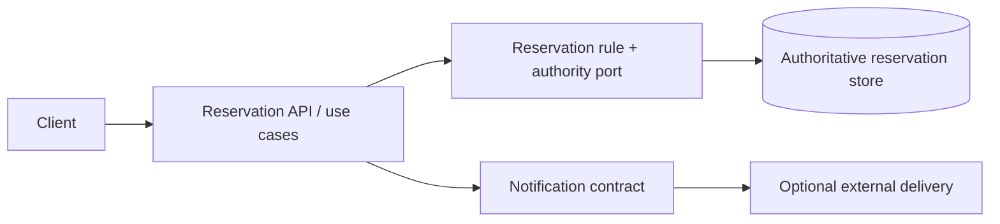
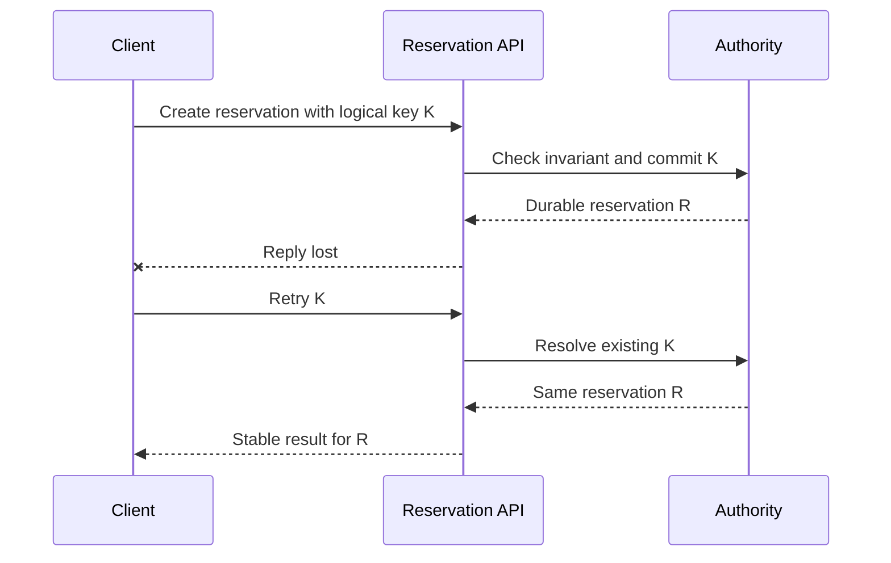

# Architecture descriptions, complementary views and decision records

> **Tycho manuscript V01/C05**, original explanatory content and fictional diagrams; public arc42 §3, §5–7 and §9 source sections reviewed 2026-10-19. No observed software system, real source scan, deployed infrastructure or independently approved ADR was consulted.

## Purpose and mission

An architecture description is not one diagram. A static module picture cannot show how a timeout becomes a duplicate external effect, and a sequence diagram cannot show which containers share a failure domain. Engineers should select **the minimum set of complementary views needed to answer explicit stakeholder questions**, with stable identities linking their elements and with decisions that record *why* the architecture has the stated shape.

[arc42 Building Block View §5](https://docs.arc42.org/section-5/) explains hierarchical decomposition of a system into building blocks and dependencies. [Runtime View §6](https://docs.arc42.org/section-6/) focuses on representative interactions and failures; [Deployment View §7](https://docs.arc42.org/section-7/) maps software to infrastructure. Those views answer different questions, not contradictory alternatives.

## 1. Start with concerns and a coherent vocabulary

Before drawing, define:
- **System boundary:** what the selected software system owns, which people and neighbors interact with it.
- **Responsibility:** what functional result or rule belongs to each logical component.
- **Runtime identity:** process, executor, container or deployed artifact; not interchangeable with a business capability.
- **Data authority:** source of truth for a business object; not interchangeable with a cache.
- **Dependency:** an interface, network connection, transaction, event or runtime deployment relationship with a named meaning.
- **Version:** repository/diagram/contract revision, because an architecture depiction changes over time.
- **Evidence state:** observed source/runtime fact versus hypothesis or proposed target.

A diagram label is an assertion. If only a desired topology is known, call the drawing **proposed**, and never silently present it as the running implementation.

## 2. The main views answer separate questions

| View | Reader's question | What it must contain | What it cannot prove |
|---|---|---|---|
| Context | Who uses and surrounds the system? | Actors, external partners, data/effect contracts, scope | Internal modules or runtime availability |
| Building blocks | Which responsibilities and dependency directions exist? | Modules, interfaces, owned state, black-box boundaries | Per-request causal order |
| Runtime | How does a user journey or fault unfold? | Messages, deadlines, state transitions, error branches | Physical placement and shared-failure zones |
| Deployment | Where do software artifacts execute? | Nodes, processes, zones, networks, quotas, storage | That the actual system passes a user SLO |
| Data/consistency | Who commits or derives each state? | Authority, schema, versions, read models, reconciliation | Availability of any specific deployment |
| Cross-cutting | How are authorization, monitoring and recovery applied? | Consistent policies and enforcement points | Operational effectiveness without testing |
| Decision record | Why this choice, given alternatives and constraints? | Context, criteria, chosen/rejected option, consequences, status | That a proposal was accepted merely by existing |

The [arc42 context/scope guidance](https://docs.arc42.org/section-3/) deliberately distinguishes business context and technical context. Do not place a framework class on a business context chart merely because an engineer knows its name.

## 3. Fictional architecture example: community tool reservations

Imagine a simple equipment booking application. An external client requests a timeslot. A reservation component enforces exclusivity and writes the authoritative record. A notification component later sends optional confirmation. This is an invented design, not observed production software.

### Static responsibility view

Text alternative: client invokes a reservation API; one reservation rule/authority owns the committed state. Notification is a separate optional interaction. The diagram shows logical responsibilities, not the number of JVM processes or separate machines.

### Runtime scenario: acknowledgment loss

Text alternative: after a valid commit, the client may not receive the acknowledgment. If the architecture promises idempotent logical commands, a later retry must resolve the same durable identity, rather than creating an additional booking. This is a **required design and test**, not evidence a specific system behaves that way.

### Deployment view: two possible configurations

The same logical modules could run in one modular executable, or as independently deployed services with a remote communication and consistency boundary. A placement diagram would specify **which deployable executes each box**, the zones/data dependencies and how the authoritative store is reached. This scenario does not contain those facts, so inventing a specific multi-zone production diagram would be misleading. Read [deployment/runtime placement](../../v08/c03/runtime-placement-and-control-plane.md) for alternatives, not presumed infrastructure.

## 4. Stable identities link views without making a knowledge graph mandatory

A component named ReservationAuthority in a static chart should be referable from runtime interactions and a deployment allocation, ideally through a stable ID and a versioned description. That can be a simple Markdown table or cross-reference:

| Stable ID | Responsibility | Runtime scenario role | Deployment mapping | Evidence state |
|---|---|---|---|---|
| A-01 | Client API and command validation | A | Unknown / design choice pending | Proposed |
| D-01 | Exclusive state authority | D | Same process or external store unknown | Proposed |
| N-01 | Optional notification | No critical-path guarantee | Unknown | Proposed |

This cross-view mapping is **ordinary documentation**. It does not require building a manually curated concept graph as Tycho infrastructure. Links should have clear semantics; a cross-reference to an architecture item is not proof of runtime presence.

## 5. One decision record, multiple views

**Original ADR-SYN-08 — preserve a single reservation authority.**

- **Status:** PROPOSED; not approved for a real system.
- **Context:** exclusivity and lost-response recovery matter. Load, deployment cadence and read/write skew are unknown.
- **Alternatives:** A single deployable with clear internal modules; a separately deployed reservation service; independently accepting data replicas.
- **Decision:** keep one explicit authority in the *conceptual* design. Defer runtime splitting until data ownership and quality scenarios support it.
- **Consequences:** simpler invariant reasoning; potential shared deployment and scale limits; a future extraction still needs safe authority transfer.
- **Evidence:** architecture sources explain representations, not workload feasibility; no benchmark exists.
- **Review trigger:** confirmed independent ownership, measured capacity/deployment constraint, or incompatible operational boundary.

[arc42 §9](https://docs.arc42.org/section-9/) supports contextual decision rationale, alternatives and consequences. A diagram illustrating ADR-SYN-08 cannot be substituted for the written rejection rationale, and documentation approval cannot be inferred from a merge.

## 6. Keep descriptions correct through change

A useful publication process rechecks:
1. Every actor/interface in context has a declared information or effect contract.
2. Every building block has a readable responsibility and dependency direction.
3. Runtime scenarios use actual building-block identities and include significant errors/cancellations.
4. Deployment allocations name software/runtime versions and failure-domain assumptions when known.
5. The data authority is consistent between static, runtime and migration models.
6. Contradictions are recorded rather than masked; proposed targets never become observed facts by a filename rename.
7. ADR statuses, rejected options and revisit triggers remain readable across revisions.
8. Source links, revisions and known unknowns survive documentation reshuffling.

For a changed interface, update the behavior and the rationale, not only a single arrow. A view can be accurate at one revision and stale at the next, so immutable evidence/version identity matters.

## 7. Public source ledger and limits

| Public arc42 section inspected | Narrowly supported subject | Not demonstrated |
|---|---|---|
| [§3 Context and Scope](https://docs.arc42.org/section-3/) | External business and technical context | Fictional partners' real contracts |
| [§5 Building Block View](https://docs.arc42.org/section-5/) | Static hierarchy, responsibilities and interface/dependency abstraction | Enforced module dependencies in code |
| [§6 Runtime View](https://docs.arc42.org/section-6/) | Representative user and failure scenarios | A trace or runtime experiment |
| [§7 Deployment View](https://docs.arc42.org/section-7/) | Software mapping to physical/runtime infrastructure | A running, validated deployment |
| [§9 Architecture Decisions](https://docs.arc42.org/section-9/) | Context, rationale, rejected alternatives and decision lifecycle | Approval of ADR-SYN-08 |

Every component, failure path, ID and table in the fictional case is original teaching material. No real system, diagram export, experiment, source code, stakeholder acceptance or independent editorial approval was examined. This chapter needs integration into final volume/page structure.

## Engineering walkthrough — Reconciling one failure across architectural views

**Original synthetic trace:** an equipment reservation commits in the database, but the HTTP response disappears. In the **context view**, Client, Booking System and External Payment are separate actors; in the **building-block view**, Booking API invokes Booking Domain and Persistence Adapter; in the **runtime view**, operation K42 is committed before transport acknowledgment; in the **deployment view**, two replicas share one authoritative booking store.

A misleading diagram might show the API and database in different containers and infer that a replay on the second replica is a fresh booking. Another might label the payment provider "inside" the application simply because the integration library is included in the build. Both inconsistencies turn diagram layout into an unsupported authority claim.

| Linked artifact | Must say | Contradiction the editor rejects |
|---|---|---|
| Context | Payment is external; business result belongs to Booking | Provider internals are part of Booking authority |
| Component | Persistence Adapter commits under Booking's invariant | Controller-local memory uniquely deduplicates across replicas |
| Sequence | Commit precedes lost response; retry resolves K42 | Timeout proves transaction rollback |
| Deployment | Two API replicas share a durable writer | Replica count implies independent writers or cross-region guarantee |
| ADR | Retain one authoritative writer pending evidence of extraction benefit | Diagram quietly replaces the approved state owner |

**Review gate:** assign stable identifiers to the same components/operations in every view and walk the timeout through them, including caller-visible UNKNOWN and recovery lookup. A context diagram is not an executable access policy, a deployment view is not measured failover behavior, and an ADR is not a running system. The example has no real deployed equivalents.

**Verification status:** The preceding original example and its predicted outcomes are synthetic. No implementation experiment, benchmark or independent technical review was executed for this example.
## Navigation

Proposed owner **V01/C05** in [the 69-chapter outline](../../../PROPOSED-STRUCTURE.md); current [application/foundations landing](../../../application/README.md). Read first [system boundaries](../c01/problem-framing-and-system-boundaries.md), then [quality drivers](../c03/quality-drivers-and-architecture-views.md), [modular boundaries](../../../application/architecture-styles-and-module-boundaries.md), [architectural alternatives and ADRs](../../v10/c04/architecture-alternatives-experiments-and-adrs.md).

<!-- tycho-edition-navigation -->

## Edition navigation and evidence scope

| Route | Destination |
|---|---|
| Parent chapter | [Question, conclusions and reading route](README.md) |
| Parent volume | [Volume synthesis](../README.md) |
| Book | [Authoritative contents](../../../README.md) |
| Source versions and access scope | [Registered sources](../../../../sources/README.md) and the exact page-local citation ledger above |

The original manuscript was accepted under #213 at the recorded baseline. Earlier draft/review labels describe historical authoring events. Source access, versions, unexecuted experiments and nonclaims retain their original scope; assembly does not assert a new source read or benchmark. The chapter landing adds editorial synthesis and navigation.
